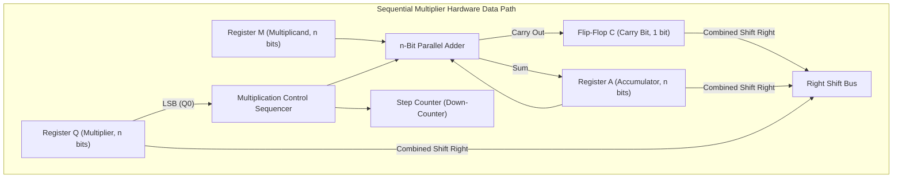

[DLCD Index](../README.md) / [Unit 4: Computer Arithmetic and Control Design](Introduction.md)

# L01 - Multiplication of Positive Numbers

In Unit 1 (Lecture 8), we designed purely combinational array multipliers using matrices of AND gates and adder rows. While combinational multipliers are fast, fabricating a 64-bit by 64-bit array requires over 4,000 AND gates and 63 cascaded adder stages—consuming massive silicon real estate and drawing substantial dynamic power.

In general-purpose processors, architects balance speed against chip area. Instead of building an enormous matrix of adders, an ALU can reuse a **single $n$-bit adder** across multiple clock cycles, shifting and adding partial products sequentially.

In this lecture, we examine the **sequential shift-and-add hardware data path**, walk through a step-by-step trace of unsigned integer multiplication, and evaluate the trade-offs between area and latency.

---

## The Principle of Sequential Multiplication

Recall how paper-and-pencil multiplication works for positive binary numbers:

```
          1 1 0 1   (Multiplicand M = 13)
      ×   1 0 1 1   (Multiplier   Q = 11)
      -----------
          1 1 0 1   <- Q0 = 1: Add M, shift
        1 1 0 1     <- Q1 = 1: Add M, shift
      0 0 0 0       <- Q2 = 0: Add 0, shift
+   1 1 0 1         <- Q3 = 1: Add M, shift
-----------------
  1 0 0 0 1 1 1 1   (Product P = 143)
```

Notice what happens at each stage:
1. We inspect the **least significant bit of the multiplier ($Q_0$)**.
2. If $Q_0 = 1$, we add the multiplicand $M$ to the running sum. If $Q_0 = 0$, we add zero.
3. We shift the running sum relative to the multiplicand to prepare for the next bit.

In hardware, instead of shifting the multiplicand left (which would require an ever-widening $2n$-bit adder), we do something much smarter: **we shift the running accumulator right**!

---

## The Sequential Shift-and-Add Data Path

A hardware sequential multiplier requires four primary registers and a single $n$-bit parallel adder:



Let's inspect the role of each component:
- **Register $M$ (Multiplicand)**: An $n$-bit register holding the multiplicand. It remains unchanged throughout the entire multiplication.
- **Register $Q$ (Multiplier)**: An $n$-bit shift register initialized with the multiplier. On each step, its least significant bit ($Q_0$) controls whether an addition occurs. As the multiplier bits are processed, Register $Q$ shifts right.
- **Register $A$ (Accumulator)**: An $n$-bit register initialized to **$0$**. It stores the upper $n$ bits of the accumulated partial product.
- **Flip-Flop $C$ (Carry)**: A 1-bit register that catches any carry-out generated by the $n$-bit adder during the operation $A + M$.
- **Step Counter**: Initialized to $n$ (the word bit-width). Decremented on each cycle; halts the algorithm when it reaches zero.

Notice a brilliant design economy: **Registers $A$ and $Q$ are chained together as a single $2n$-bit shift register ($A Q$)**. As the multiplier bits in $Q$ are consumed and shifted out to the right, the lower bits of the newly calculated product shift into the freed upper spaces of $Q$! 

When the counter reaches zero, the final $2n$-bit product is stored seamlessly across **$A$ (upper $n$ bits)** and **$Q$ (lower $n$ bits)**.

---

## The Shift-and-Add Algorithm

For two $n$-bit unsigned positive integers ($M$ and $Q$):

1. **Initialization**:
   - $A \leftarrow 0$
   - $C \leftarrow 0$
   - $\text{Counter} \leftarrow n$
2. **Loop ($n$ iterations)**:
   - **Inspect $Q_0$**:
     - If $Q_0 = 1$: Add multiplicand to accumulator:
       $$(C, A) \leftarrow A + M$$
     - If $Q_0 = 0$: Do not add (skip addition).
   - **Shift Right**:
     - Shift the combined $(C, A, Q)$ register pair one bit to the right:
       - The carry bit $C$ shifts into the MSB of $A$ ($A_{n-1} \leftarrow C$).
       - The LSB of $A$ ($A_0$) shifts into the MSB of $Q$ ($Q_{n-1} \leftarrow A_0$).
       - The LSB of $Q$ ($Q_0$) is discarded.
       - The carry flip-flop is cleared: $C \leftarrow 0$.
   - **Decrement Counter**:
     - $\text{Counter} \leftarrow \text{Counter} - 1$.
3. **Termination**:
   - When $\text{Counter} = 0$, stop.
   - The final product resides in the register pair **$A Q$**.

---

## Step-by-Step Worked Example

Let's trace the hardware step-by-step for a 4-bit multiplication ($n = 4$):
- **Multiplicand ($M$)**: $13_{10} = \mathbf{1101_2}$
- **Multiplier ($Q$)**: $11_{10} = \mathbf{1011_2}$
- **Expected Product ($P$)**: $13 \times 11 = 143_{10} = \mathbf{10001111_2}$

| Step / Cycle | Operation | $C$ | Accumulator ($A$) | Multiplier ($Q$) | Counter | Notes |
| :---: | :---: | :---: | :---: | :---: | :---: | :---: |
| **Initial** | Load inputs | 0 | `0000` | `1011` | 4 | $A=0, Q=11, M=1101$ |
| **Cycle 1** | $Q_0 = 1 \implies A \leftarrow A + M$ | 0 | `1101` | `1011` | 4 | Add $0000 + 1101 = 1101$ |
| | Shift Right $(C, A, Q)$ | 0 | **`0110`** | **`1101`** | **3** | $C \to A_3$, $A_0(1) \to Q_3$ |
| **Cycle 2** | $Q_0 = 1 \implies A \leftarrow A + M$ | 1 | `0011` | `1101` | 3 | Add $0110 + 1101 = 10011$ ($C=1$) |
| | Shift Right $(C, A, Q)$ | 0 | **`1001`** | **`1110`** | **2** | $C(1) \to A_3$, $A_0(1) \to Q_3$ |
| **Cycle 3** | $Q_0 = 0 \implies$ No Add | 0 | `1001` | `1110` | 2 | Skip addition |
| | Shift Right $(C, A, Q)$ | 0 | **`0100`** | **`1111`** | **1** | $C(0) \to A_3$, $A_0(1) \to Q_3$ |
| **Cycle 4** | $Q_0 = 1 \implies A \leftarrow A + M$ | 1 | `0001` | `1111` | 1 | Add $0100 + 1101 = 10001$ ($C=1$) |
| | Shift Right $(C, A, Q)$ | 0 | **`1000`** | **`1111`** | **0** | $C(1) \to A_3$, $A_0(1) \to Q_3$ |

### Verification:
The counter has reached 0. Let's inspect the combined register pair **$A Q$**:
- Register $A = \mathbf{1000_2}$
- Register $Q = \mathbf{1111_2}$
- Combined Product $A Q = \mathbf{10001111_2}$

Let's convert $10001111_2$ to decimal:
$$10001111_2 = 128 + 8 + 4 + 2 + 1 = \mathbf{143_{10}}$$

The hardware result matches the exact mathematical product!

---

## Combinational vs. Sequential Multipliers

| Metric | Combinational Array Multiplier | Sequential Shift-and-Add Multiplier |
| :---: | :---: | :---: |
| **Hardware Resources** | $n \times n$ AND gates, $(n-1)$ multi-bit adders | **Single $n$-bit adder**, three $n$-bit registers |
| **Silicon Area** | Enormous ($O(n^2)$) | **Minimal ($O(n)$)** |
| **Latency / Throughput** | Combinational propagation delay (1 clock cycle) | **$n$ discrete clock cycles** |
| **Clock Complexity** | Purely combinational | Requires clocking and control sequencer |
| **Typical Usage** | High-performance DSPs, graphics ALUs | Microcontrollers, embedded CPUs, compact ALUs |

---

## Key Takeaways

- Combinational array multipliers require extensive silicon area ($O(n^2)$), whereas **sequential multipliers** reuse a single $n$-bit parallel adder across $n$ clock cycles to conserve chip space ($O(n)$).
- The sequential data path consists of: Register $M$ (Multiplicand), Register $Q$ (Multiplier), Register $A$ (Accumulator), Carry flip-flop $C$, and a down-counter.
- Registers $A$ and $Q$ form a concatenated $2n$-bit shift register. As multiplier bits are shifted out of $Q$, completed product bits shift into $Q$ from $A$.
- In each cycle, the hardware tests $Q_0$: if $1$, it adds $M$ to $A$; if $0$, it skips addition. It then shifts $(C, A, Q)$ right by 1 bit and decrements the counter.
- When the counter reaches zero, the final product resides in **$A Q$**.

---

The algorithm we just executed works flawlessly for unsigned positive integers. But modern computers operate on signed numbers represented in 2's complement. If you attempt to feed negative 2's complement numbers into this unsigned shift-and-add hardware, the result will be completely wrong! In the next lecture, we analyze [**Signed Multiplication and Booth's Algorithm**](L02%20-%20Signed%20Multiplication%20and%20Booth's%20Algorithm.md), discovering how recoding bit patterns solves signed multiplication and speeds up execution.
