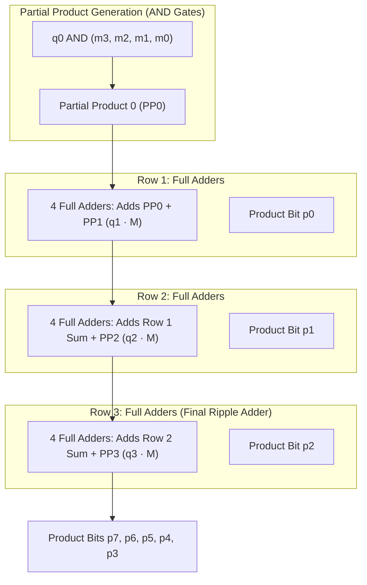
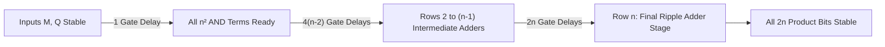

[DLCD Index](../README.md) / [Unit 4: Computer Arithmetic and Control Design](Introduction.md)

# L01 - Unsigned Multiplication and Array Multipliers

In previous units, we studied how digital hardware adds and subtracts numbers using combinational circuits like ripple-carry and carry-lookahead adders. But computer programs constantly perform multiplication: calculating array indexing offsets, scaling graphics vertices, and evaluating machine learning weights.

How does physical silicon multiply two binary numbers? 

At the most fundamental hardware level, multiplication is nothing more than repeated addition and shifting. In this lecture, we examine the combinational **Array Multiplier**, analyze how a matrix of AND gates and Full Adders computes products in a single combinational burst, derive its worst-case propagation delay formula, and identify why scaling pure arrays to 32 or 64 bits demands alternative architectures.

---

## The Principle of Binary Multiplication

Recall how paper-and-pencil multiplication works for positive binary numbers. Consider multiplying two 4-bit unsigned integers: Multiplicand $M = 13_{10} = (1101)_2$ and Multiplier $Q = 11_{10} = (1011)_2$:

```
              1  1  0  1    (Multiplicand M = 13, bits m3 m2 m1 m0)
          ×   1  0  1  1    (Multiplier   Q = 11, bits q3 q2 q1 q0)
          --------------
              1  1  0  1    <- Partial Product 0: M × q0 (q0 = 1)
           1  1  0  1       <- Partial Product 1: M × q1 (q1 = 1, shifted 1 bit left)
        0  0  0  0          <- Partial Product 2: M × q2 (q2 = 0, shifted 2 bits left)
+    1  1  0  1             <- Partial Product 3: M × q3 (q3 = 1, shifted 3 bits left)
------------------------
     1  0  0  0  1  1  1  1    (Product P = 143, 8 bits: p7..p0)
```

Notice several critical mathematical properties here:
1. **Generating Partial Product Bits**: Each partial product bit is the product of one multiplicand bit $m_j$ and one multiplier bit $q_i$. Since both are binary digits ($0$ or $1$), binary multiplication is identical to a logical **AND** operation:
   $$m_j \times q_i = m_j \cdot q_i$$
2. **Result Bit Width**: Multiplying two $n$-bit unsigned numbers yields a product that can span up to **$2n$ bits** in width. For $n = 4$, the maximum product is $(15)_{10} \times (15)_{10} = 225_{10} = (11100001)_2$, which fits in exactly $2 \times 4 = 8$ bits.
3. **Summation**: The final product is obtained by summing the shifted partial products row by row.

---

## Combinational Array Multiplier Architecture

An **Array Multiplier** realizes paper-and-pencil binary multiplication directly in combinational silicon without clock pulses or flip-flops. 

Every single bit of the partial products is computed simultaneously using a grid of 2-input AND gates, and the shifted sums are resolved using a two-dimensional array of Full Adders (FA):



### The $4 \times 4$ Multiplier Cell Mechanics

Let's examine how individual bits flow through the array:
- In row 0, four AND gates compute $m_3 q_0, m_2 q_0, m_1 q_0, m_0 q_0$.
- Bit $m_0 q_0$ requires no addition; it drops directly out as the least significant product bit:
  $$p_0 = m_0 \cdot q_0$$
- In row 1, four Full Adders add the terms $(m_3 q_0, m_2 q_0, m_1 q_0)$ to the terms $(m_3 q_1, m_2 q_1, m_1 q_1, m_0 q_1)$. The sum bit produced by the rightmost adder forms product bit $p_1$.
- The carry bits produced by each adder in a row ripple to the next adder in the same row or pass down to the row below.
- This process repeats across $n-1$ adder stages. The final row serves as a ripple-carry adder that produces the highest-order product bits ($p_{2n-1}..p_n$).

---

## Hardware Resource Requirements

For an $n \times n$ array multiplier multiplying two $n$-bit unsigned integers:

| Component | Count Formula | Count for $4 \times 4$ | Count for $8 \times 8$ | Count for $32 \times 32$ |
| :--- | :---: | :---: | :---: | :---: |
| **AND Gates** | $n^2$ | $16$ | $64$ | $1,024$ |
| **Full Adders (FA)** | $n(n - 1)$ | $12$ | $56$ | $992$ |
| **Output Bits** | $2n$ | $8$ bits | $16$ bits | $64$ bits |

Notice something here — as word length doubles, the hardware component count quadruples! An array multiplier exhibits **$O(n^2)$ hardware complexity**.

---

## Worst-Case Propagation Delay Analysis

How fast can an array multiplier produce a valid result? Because it contains no clock, we calculate the worst-case propagation delay from the moment inputs $M$ and $Q$ stabilize until the most significant product bit $p_{2n-1}$ settles.

### Gate Delay Assumptions
Following standard textbook conventions (Hamacher section 6.3):
- Each 2-input **AND gate** introduces **$1$ gate delay** ($\Delta$).
- Each **Full Adder (FA)** introduces **$2$ gate delays** ($2\Delta$: one for generating the intermediate XOR/NAND terms and one for the carry/sum outputs).



### Derivation of the Delay Formula

Let's trace the critical path step by step:
1. **Initial Partial Product Generation**:
   All $n^2$ partial product terms $m_j q_i$ are generated in parallel by AND gates:
   $$\text{Delay}_{\text{AND}} = 1 \text{ gate delay}$$
2. **Intermediate Full Adder Rows (Rows $2$ to $n-1$)**:
   There are $(n - 2)$ intermediate adder stages. In each intermediate stage, the critical path passes through two Full Adder blocks, each contributing $2$ gate delays:
   $$\text{Delay}_{\text{intermediate}} = 2 \times 2 \times (n - 2) = 4(n - 2) \text{ gate delays}$$
3. **Final Adder Stage (Row $n$)**:
   The final row behaves as an $n$-bit ripple-carry adder. A carry signal must ripple across all $n$ Full Adders in the row, with each adder contributing $2$ gate delays:
   $$\text{Delay}_{\text{final row}} = 2n \text{ gate delays}$$

Summing these individual delays gives the total worst-case propagation delay:

$$\text{Total Delay} = 1 + 4(n - 2) + 2n = 1 + 4n - 8 + 2n = 6n - 7$$

Notice that $6n - 7$ can be cleanly rewritten as:

$$\mathbf{\text{Worst-Case Delay} = 6(n - 1) - 1 \text{ gate delays}}$$

### Numerical Example ($4 \times 4$ Array)
For a $4 \times 4$ array multiplier ($n = 4$):
$$\text{Delay} = 6(4 - 1) - 1 = 6(3) - 1 = \mathbf{17\text{ gate delays}}$$

If each AND gate delay is $1\text{ ns}$ and each Full Adder delay is $2\text{ ns}$, the worst-case propagation delay is:
$$\text{Worst-Case Latency} = 1\text{ ns} + 4(4 - 2)(2\text{ ns}) + 2(4)(2\text{ ns}) = 1 + 8 + 16 = \mathbf{17\text{ ns}}$$

---

## Architectural Strengths and Limitations

### Advantages:
- **Purely Combinational**: Requires zero clock signals, state sequencers, or register storage. The product appears at the outputs after the propagation delay settles.
- **High Throughput when Pipelined**: Latches can easily be inserted between rows to turn the array into a fully pipelined multiplier capable of accepting new inputs every clock cycle.

### Limitations:
- **Massive Area Consumption**: Fabricating an array for 32-bit integers requires $1,024$ AND gates and $992$ Full Adders. For 64-bit integers, this skyrockets to $4,096$ AND gates and $4,032$ Full Adders.
- **Unsigned Only**: The pure array structure works strictly for unsigned positive numbers. It fails for 2's complement negative integers because partial product sign extension is not accommodated.
- **Linear Delay Growth**: The propagation delay grows linearly as $O(n)$, which becomes unacceptably sluggish for wide computer arithmetic words.

---

## Key Takeaways

- Binary multiplication of two $n$-bit integers produces a product of up to **$2n$ bits**.
- In an array multiplier, each partial product bit $m_j \cdot q_i$ is generated by a 2-input AND gate.
- An $n \times n$ combinational array multiplier requires **$n^2$ AND gates** and **$n(n - 1)$ Full Adders**.
- Assuming $1$ gate delay for AND gates and $2$ gate delays per Full Adder, the worst-case propagation delay is governed by the formula:
  $$\mathbf{\text{Delay} = 6(n - 1) - 1 \text{ gate delays}}$$
- For a $4 \times 4$ array, the worst-case latency is **$17$ gate delays**.
- While combinational arrays offer high speed for narrow widths, their $O(n^2)$ gate cost and inability to handle signed 2's complement integers make sequential and recoded multipliers necessary in general-purpose ALUs.

---

If dedicating over a thousand adders to a combinational array is too costly for a processor, how can an ALU multiply numbers using only a **single shared adder** across successive clock cycles? Furthermore, how can hardware cleanly handle **negative 2's complement numbers** without sign-conversion overhead? In the next lecture, we examine [**Sequential Multiplication, Booth's Algorithm, and Fast Multiplication**](L02%20-%20Sequential%20Multiplication,%20Booth's%20Algorithm,%20and%20Fast%20Multiplication.md).
