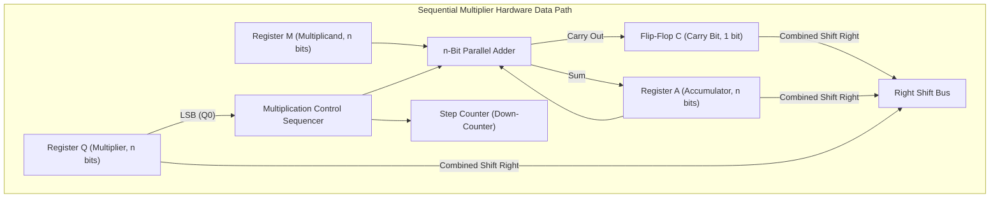
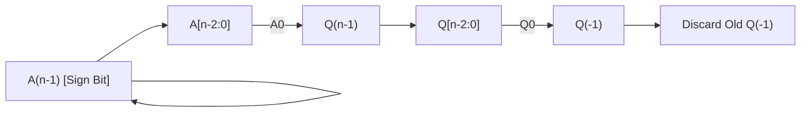
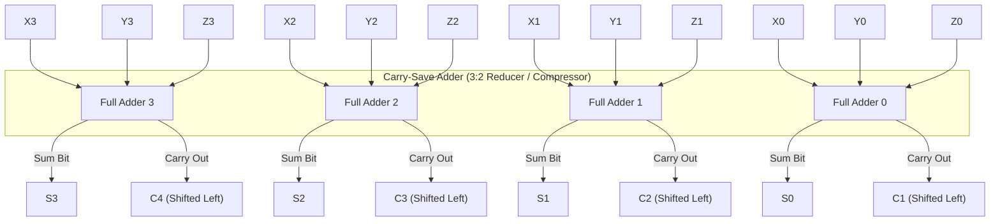
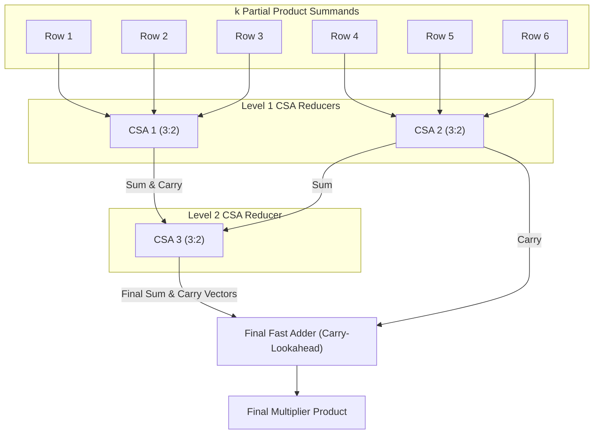

[DLCD Index](../README.md) / [Unit 4: Computer Arithmetic and Control Design](Introduction.md)

# L02 - Sequential Multiplication, Booth's Algorithm, and Fast Multiplication

In Lecture 1, we saw how combinational array multipliers multiply numbers in a single burst by spreading AND gates and Full Adders across a silicon grid. But as word size grows to 32 or 64 bits, dedicating thousands of adders to multiplication consumes excessive area and power. Moreover, standard array multipliers cannot handle signed 2's complement negative numbers.

How can a processor multiply numbers using only a **single shared adder** across successive clock cycles? How can hardware handle negative numbers directly without separate sign conversion? And when high throughput is paramount, how can we reduce partial products and bypass carry rippling?

In this lecture, we examine **Sequential Shift-and-Add Multiplication**, master **Booth's Algorithm** for signed 2's complement multiplication, and explore high-speed techniques including **Radix-4 Bit-Pair Recoding** and **Carry-Save Addition (Wallace Trees)**.

---

## Sequential Shift-and-Add Multiplication

Instead of building a separate adder for each row of the multiplication, sequential hardware reuses a **single $n$-bit parallel adder** across $n$ clock cycles.

Consider the paper-and-pencil multiplication of two 4-bit unsigned integers: Multiplicand $M = 13_{10} = (1101)_2$ and Multiplier $Q = 11_{10} = (1011)_2$:

```
          1 1 0 1   (Multiplicand M = 13)
      ×   1 0 1 1   (Multiplier   Q = 11)
      -----------
          1 1 0 1   <- Q0 = 1: Add M, shift
        1 1 0 1     <- Q1 = 1: Add M, shift
      0 0 0 0       <- Q2 = 0: Add 0, shift
+   1 1 0 1         <- Q3 = 1: Add M, shift
-----------------
  1 0 0 0 1 1 1 1   (Product P = 143)
```

In hardware, shifting the multiplicand to the left on each step would require an adder that grows wider with every cycle. Instead, hardware performs an equivalent operation: **it shifts the running sum (accumulator) to the right**!

---

### Hardware Datapath

The sequential shift-and-add data path requires three $n$-bit registers, a carry flip-flop, a step counter, and a single $n$-bit adder:



- **Register $M$ (Multiplicand)**: Stores the multiplicand throughout the calculation.
- **Register $A$ (Accumulator)**: Initialized to $0$. Holds the upper half of the partial product.
- **Register $Q$ (Multiplier)**: Initialized with the multiplier. On each step, its least significant bit ($Q_0$) determines whether $M$ is added to $A$.
- **Registers $A$ and $Q$ form a combined $2n$-bit shift register ($A, Q$)**: As multiplier bits in $Q$ are inspected and shifted right, the lower product bits shift out of $A$ and occupy the freed upper bit positions of $Q$.
- **Carry Flip-Flop $C$**: Catches the carry-out produced during $A + M$. During the right-shift, $C$ shifts into the MSB of $A$, and $C$ is cleared to $0$.

### The Shift-and-Add Algorithm
1. **Initialize**: $A \leftarrow 0$, $C \leftarrow 0$, $\text{Counter} \leftarrow n$.
2. **Loop ($n$ cycles)**:
   - Check $Q_0$:
     - If $Q_0 = 1$: $(C, A) \leftarrow A + M$.
     - If $Q_0 = 0$: Do not add.
   - **Shift Right**: Shift $(C, A, Q)$ right by 1 bit.
   - **Decrement**: $\text{Counter} \leftarrow \text{Counter} - 1$.
3. When $\text{Counter} = 0$, the $2n$-bit product is in $(A, Q)$.

While sequential shift-and-add is hardware-efficient ($O(n)$ gates instead of $O(n^2)$), it fails if either $M$ or $Q$ is negative in 2's complement representation.

---

## Signed Multiplication: Booth's Algorithm

If you attempt to feed negative 2's complement numbers into unsigned shift-and-add hardware, the computation fails because the sign bit has a negative weight ($-2^{n-1}$) and logical zero-fill right-shifting destroys the sign.

In 1951, Andrew Donald Booth introduced an algorithm that **multiplies signed 2's complement numbers directly, with zero pre-conversion**.

### The Mathematical Core: Runs of Ones

Booth's algorithm exploits a mathematical identity regarding strings of consecutive $1$s:

Consider multiplying by the multiplier $00111100_2$ ($60_{10}$):
- Conventional multiplication performs four additions ($2^5 + 2^4 + 2^3 + 2^2 = 32 + 16 + 8 + 4 = 60$).
- Notice that:
  $$60_{10} = 64 - 4 = \mathbf{2^6 - 2^2}$$

Instead of performing **four additions**, we can perform **only two operations**:
1. **Subtract $M$** at the beginning of the block of ones (at bit position 2, weight $2^2$).
2. **Add $M$** at the end of the block of ones (at bit position 6, weight $2^6$).
3. Do **nothing** for all bits in the middle!

```
Multiplier Bits:       0    0    1    1    1    1    0    0
Booth Operation:       0    0   +M    0    0   -M    0    0
                                ^               ^
                          End of 1s       Start of 1s
```

---

### Booth Recoding Rules

The hardware inspects two adjacent multiplier bits: the current bit **$Q_i$** and the previous bit **$Q_{i-1}$** (with an extra flip-flop $Q_{-1}$ initialized to `0`):

| $Q_i$ | $Q_{i-1}$ | Meaning / Transition | Hardware Action |
| :---: | :---: | :---: | :---: |
| **0** | **0** | Middle of a run of zeros | **Do nothing**, Arithmetic Shift Right (ASR) |
| **0** | **1** | **End of a run of ones** | **Add Multiplicand ($A \leftarrow A + M$)**, ASR |
| **1** | **0** | **Beginning of a run of ones** | **Subtract Multiplicand ($A \leftarrow A - M$)**, ASR |
| **1** | **1** | Middle of a run of ones | **Do nothing**, Arithmetic Shift Right (ASR) |

### The Arithmetic Shift Right (ASR)
In signed 2's complement arithmetic, the sign bit must be preserved during right shifts. In an **Arithmetic Shift Right (ASR)**, the sign bit ($A_{n-1}$) replicates itself into the new MSB while all other bits move right:



---

### Worked Trace: $(-5) \times (-4)$

Let Multiplicand $M = -5_{10} = (1011)_2$ and Multiplier $Q = -4_{10} = (1100)_2$.
We know $-M = -(-5) = +5 = (0101)_2$. Word size $n = 4$.

```
Initial:   A = 0000, Q = 1100, Q_-1 = 0, Count = 4

Cycle 1:   Inspect (Q0, Q_-1) = (0, 0) -> Middle of zeros: Do nothing.
           ASR (A, Q, Q_-1):
           A = 0000, Q = 0110, Q_-1 = 0, Count = 3

Cycle 2:   Inspect (Q0, Q_-1) = (0, 0) -> Middle of zeros: Do nothing.
           ASR (A, Q, Q_-1):
           A = 0000, Q = 0011, Q_-1 = 0, Count = 2

Cycle 3:   Inspect (Q0, Q_-1) = (1, 0) -> Start of ones: Subtract M (A <- A - M = A + 5).
           A = 0000 + 0101 = 0101
           ASR (A, Q, Q_-1):
           A = 0010, Q = 1001, Q_-1 = 1, Count = 1

Cycle 4:   Inspect (Q0, Q_-1) = (1, 1) -> Middle of ones: Do nothing.
           ASR (A, Q, Q_-1):
           A = 0001, Q = 0100, Q_-1 = 1, Count = 0
```

Algorithm terminates! The final 8-bit product in $(A, Q)$ is:
$$\mathbf{(A, Q) = (0001 \ 0100)_2 = 16 + 4 = +20_{10}}$$
$(-5) \times (-4) = +20$. The result is exact without any special pre- or post-processing!

### Best-Case vs. Worst-Case of Booth's Algorithm
- **Best Case**: The multiplier contains long blocks of consecutive 1s and 0s (e.g., $00011110$). Operations occur only at transitions, dramatically speeding execution.
- **Worst Case**: The multiplier contains alternating 1s and 0s (e.g., $01010101$). Every single bit marks a transition, requiring $n$ additions/subtractions—yielding zero speed benefit.

---

## Fast Multiplication: Radix-4 Bit-Pair Recoding

To guarantee speedups regardless of bit patterns, modern multipliers use **Bit-Pair Recoding (Radix-4 Booth Recoding)**.

Instead of scanning 1 bit per cycle, the multiplier scans **three bits at a time**: $(Q_{i+1}, Q_i, Q_{i-1})$. This recodes each pair of multiplier bits into a single digit from the set $\{-2, -1, 0, +1, +2\}$:

| $Q_{i+1}$ | $Q_i$ | $Q_{i-1}$ | Multiplier Digit | Partial Product Action |
| :---: | :---: | :---: | :---: | :--- |
| **0** | **0** | **0** | $0$ | Add $0$ |
| **0** | **0** | **1** | $+1$ | Add $+1 \times M$ |
| **0** | **1** | **0** | $+1$ | Add $+1 \times M$ |
| **0** | **1** | **1** | $+2$ | Add $+2 \times M$ (Shift $M$ left 1 bit, then add) |
| **1** | **0** | **0** | $-2$ | Subtract $2 \times M$ (Shift $M$ left 1 bit, then subtract) |
| **1** | **0** | **1** | $-1$ | Subtract $1 \times M$ (Add 2's complement of $M$) |
| **1** | **1** | **0** | $-1$ | Subtract $1 \times M$ |
| **1** | **1** | **1** | $0$ | Add $0$ |

Notice the decisive architectural payoff:
> **Bit-pair recoding halves the number of partial products from $n$ to $n/2$!**

A 32-bit multiplication that normally requires 32 summands now requires only **16 summands**. Generating $+2M$ or $-2M$ is trivial in hardware: a 1-bit hardwired left shift with conditional 2's complement inversion.

---

## Fast Multiplication: Carry-Save Addition and Wallace Trees

Even after halving summands with Radix-4 recoding, summing 16 or 32 rows using conventional adders causes horizontal carries to ripple repeatedly, degrading performance.

To bypass carry rippling, ALUs use **Carry-Save Addition (CSA)**.

### The Carry-Save Adder (3:2 Compressor)

A Carry-Save Adder accepts **three $n$-bit input numbers** and compresses them into **two $n$-bit numbers** (a Sum vector and a Carry vector) with **zero horizontal carry propagation**:



Because each Full Adder operates strictly in parallel without waiting for horizontal carries:
$$\mathbf{t_{\text{CSA}} = t_{\text{Full Adder}} \approx \text{Constant (independent of word width } n\text{)}}$$

A CSA compresses three rows into two rows in just **$2$ gate delays**, regardless of word width!

---

### The Wallace Tree Reduction Network

By cascading CSA 3:2 reducers into a multi-tiered tree (a **Wallace Tree**), hardware reduces an arbitrary number of partial product rows $k$ down to two final vectors in **logarithmic time**:



### Wallace Tree Reduction Levels
The number of CSA levels required to reduce $k$ summands down to 2 vectors scales as:
$$\text{Levels} \approx 1.7 \log_2 k - 1.7$$

| Number of Summands ($k$) | Reduction Sequence | CSA Levels Required |
| :---: | :---: | :---: |
| **4** | $4 \to 3 \to 2$ | **2 levels** |
| **8** | $8 \to 6 \to 4 \to 3 \to 2$ | **4 levels** |
| **16** | $16 \to 11 \to 8 \to 6 \to 4 \to 3 \to 2$ | **6 levels** |
| **32** | $32 \to 22 \to 15 \to 10 \to 7 \to 5 \to 4 \to 3 \to 2$ | **8 levels** |

Once the Wallace Tree compresses the summands into **two final vectors** (one Sum vector and one Carry vector), a single high-speed Carry-Lookahead Adder (CLA) resolves the final product.

---

## Key Takeaways

- **Sequential Shift-and-Add Multiplication** reuses a single $n$-bit parallel adder across $n$ clock cycles, shifting the combined $(C, A, Q)$ register right on each step to compute products with minimal hardware.
- **Booth's Algorithm** directly multiplies positive and negative 2's complement numbers without sign pre-conversion by exploiting the mathematical identity for runs of ones: $2^k + \dots + 2^m = 2^{k+1} - 2^m$.
- Booth's hardware inspects bit pairs $(Q_i, Q_{i-1})$: $01 \to \text{Add } M$, $10 \to \text{Subtract } M$, and uses an **Arithmetic Shift Right (ASR)** to preserve sign bits.
- **Bit-Pair Recoding (Radix-4)** examines three bits at a time $(Q_{i+1}, Q_i, Q_{i-1})$, producing multiplier digits from $\{-2, -1, 0, +1, +2\}$ and **halving the number of partial products** ($n \to n/2$).
- **Carry-Save Addition (CSA)** acts as a **3:2 compressor**, converting 3 operand rows into 2 vectors in constant time ($t_{\text{FA}} \approx 2\Delta$) by eliminating horizontal carry propagation.
- **Wallace Trees** arrange CSA 3:2 reducers hierarchically, compressing $k$ summands into 2 vectors in $O(\log k)$ time before a final carry-lookahead adder generates the product.

---

Multiplication is the process of repeated addition and shifting. Its mathematical inverse is integer division: repeated subtraction and shifting. How does an ALU determine quotient bits, how do we handle trial subtractions that produce negative remainders, and how does the non-restoring algorithm eliminate unnecessary additions? In the next lecture, we examine [**Integer Division - Restoring and Non-Restoring Algorithms**](L03%20-%20Integer%20Division%20-%20Restoring%20and%20Non-Restoring%20Algorithms.md).
