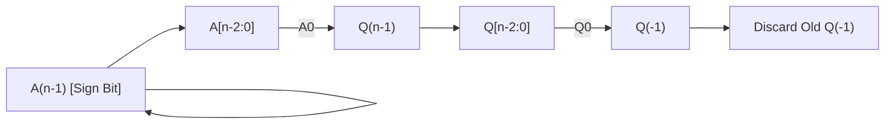

[DLCD Index](../README.md) / [Unit 4: Computer Arithmetic and Control Design](Introduction.md)

# L02 - Signed Multiplication and Booth's Algorithm

In Lecture 1, we implemented the sequential shift-and-add algorithm for positive unsigned integers. But modern microprocessors rarely work exclusively with positive numbers; they manipulate signed numbers represented in **2's complement**.

If you attempt to feed signed negative numbers into an unsigned multiplier, the calculation fails catastrophically:
- In 2's complement, the Most Significant Bit has a negative weight ($-2^{n-1}$).
- Unsigned right-shifts insert zeros into the MSB, corrupting negative numbers whose sign bits must be preserved through **sign extension**.
- If the multiplier is negative, the final operation must be a subtraction, not an addition.

One clumsy workaround is to check the signs of both operands, negate any negative numbers to positive, multiply them with unsigned hardware, and negate the final product if the signs differed. But sign-conversion logic adds latency and extra hardware.

In 1951, Andrew Donald Booth invented an ingenious mathematical algorithm that **multiplies positive and negative 2's complement numbers directly, with zero pre-conversion**.

In this lecture, we explore the mathematical brilliance of **Booth's Algorithm**, trace its hardware execution, and analyze **Radix-4 Bit-Pair Recoding** to cut multiplication time in half.

---

## The Mathematical Foundation of Booth's Algorithm

Booth's algorithm is built upon a profound observation about strings of consecutive ones in binary numbers:

Consider multiplying a number by the binary multiplier **$00111100_2$**:
- In standard multiplication, this requires **four separate additions** of the multiplicand shifted to positions 2, 3, 4, and 5:
  $$\text{Value} = 2^5 + 2^4 + 2^3 + 2^2 = 32 + 16 + 8 + 4 = \mathbf{60_{10}}$$
- But notice an algebraic identity:
  $$60_{10} = 64 - 4 = \mathbf{2^6 - 2^2}$$

Instead of performing **four additions**, we can achieve the exact same mathematical result with **only two operations**:
1. **Subtract** the multiplicand at the start of the block of ones (weight $2^2$).
2. **Add** the multiplicand at the end of the block of ones (weight $2^6$).
3. Do **nothing** for all the bits in the middle!

```
Multiplier Bits:       0    0    1    1    1    1    0    0
Booth Operation:       0    0   +M    0    0   -M    0    0
                                ^               ^
                          End of 1s       Start of 1s
```

Booth's algorithm detects transitions between blocks of zeros and blocks of ones, replacing runs of additions with a single subtraction and a single addition.

---

## Booth's Recoding Rules

To detect where a block of ones begins and ends, the hardware inspects **two adjacent multiplier bits simultaneously**:
- The current multiplier bit: **$Q_i$**
- The previously examined multiplier bit to its right: **$Q_{i-1}$**

*(At the very start of the algorithm, an extra flip-flop called $Q_{-1}$ is initialized to **`0`**).*

| $Q_i$ | $Q_{i-1}$ | Meaning / Transition | Hardware Operation |
| :---: | :---: | :---: | :---: |
| **0** | **0** | Middle of a run of zeros | **Do nothing (No add/sub)**, shift right |
| **0** | **1** | **End of a run of ones** | **Add Multiplicand ($A \leftarrow A + M$)**, shift right |
| **1** | **0** | **Beginning of a run of ones** | **Subtract Multiplicand ($A \leftarrow A - M$)**, shift right |
| **1** | **1** | Middle of a run of ones | **Do nothing (No add/sub)**, shift right |

---

## The Arithmetic Shift Right (ASR)

In unsigned multiplication, we performed a logical right shift, inserting a `0` into the MSB. 

In signed 2's complement multiplication, we **must preserve the sign of the accumulator**!
Therefore, Booth's algorithm strictly uses an **Arithmetic Shift Right (ASR)**:

> **In an Arithmetic Shift Right, the Most Significant Bit ($A_{n-1}$) is copied into itself, preserving the sign, while all other bits move one position to the right:**
> $$A_{n-1} \leftarrow A_{n-1}$$
> $$A_{n-2} \leftarrow A_{n-1}$$
> $$Q_{n-1} \leftarrow A_0$$
> $$Q_{-1} \leftarrow Q_0$$



---

## Step-by-Step Worked Example: Negative × Negative

Let's trace Booth's algorithm on signed 4-bit numbers:
- **Multiplicand ($M$)**: $-5_{10} = \mathbf{1011_2}$
- **Multiplier ($Q$)**: $-7_{10} = \mathbf{1001_2}$
- **Two's Complement of $M$ ($-M$)**: $+5_{10} = \mathbf{0101_2}$
- **Expected Product ($P$)**: $(-5) \times (-7) = \mathbf{+35_{10}} = \mathbf{00100011_2}$

Let's initialize the registers:
- Accumulator $A = \mathbf{0000}$
- Multiplier $Q = \mathbf{1001}$
- Extra bit $Q_{-1} = \mathbf{0}$
- Counter $= 4$

---

### The Execution Trace:

| Cycle | Tested Bits ($Q_0 Q_{-1}$) | Operation Performed | Accumulator ($A$) | Multiplier ($Q$) | $Q_{-1}$ | Counter |
| :---: | :---: | :---: | :---: | :---: | :---: | :---: |
| **Start** | Initial state | Load $A, Q, M$ | `0000` | `1001` | `0` | 4 |
| **Cycle 1** | **$1 0$** | **Beginning of 1s: $A \leftarrow A - M$** ($A + (-M)$) | `0101` | `1001` | `0` | 4 |
| | | Add: $0000 + 0101 = 0101$ | | | | |
| | | **Arithmetic Shift Right (ASR)** | **`0010`** | **`1100`** | **`1`** | **3** |
| **Cycle 2** | **$0 1$** | **End of 1s: $A \leftarrow A + M$** | `1101` | `1100` | `1` | 3 |
| | | Add: $0010 + 1011 = 1101$ | | | | |
| | | **Arithmetic Shift Right (ASR)** | **`1110`** | **`0110`** | **`0`** | **2** |
| **Cycle 3** | **$0 0$** | **Run of zeros: No addition** | `1110` | `0110` | `0` | 2 |
| | | **Arithmetic Shift Right (ASR)** | **`1111`** | **`0011`** | **`0`** | **1** |
| **Cycle 4** | **$1 0$** | **Beginning of 1s: $A \leftarrow A - M$** ($A + (-M)$) | `0100` | `0011` | `0` | 1 |
| | | Add: $1111 + 0101 = 10100 \to 0100$ | | | | |
| | | **Arithmetic Shift Right (ASR)** | **`0010`** | **`0011`** | **`1`** | **0** |

---

### Verifying the Result:
The counter has reached 0. Let's inspect the final contents of $A Q$:
- Register $A = \mathbf{0010_2}$
- Register $Q = \mathbf{0011_2}$
- Combined Product $A Q = \mathbf{00100011_2}$

Let's convert $00100011_2$ to decimal:
$$00100011_2 = 32 + 2 + 1 = \mathbf{+35_{10}}$$

The product is **$+35$**, precisely correct! 
Notice that we multiplied two negative numbers directly in 2's complement hardware without a single pre-conversion step.

---

## Fast Multiplication: Radix-4 Bit-Pair Recoding

Standard Booth's algorithm is elegant, but it still requires $n$ clock cycles for an $n$-bit multiplier because it shifts only **1 bit per cycle**.

Can we speed this up?
In modern ALUs, Booth's algorithm is extended to **Radix-4 (Bit-Pair Recoding)**. 

Instead of examining 1 bit and shifting 1 position, **Bit-Pair Recoding examines 3 bits at a time ($Q_{i+1}, Q_i, Q_{i-1}$) with a 1-bit overlap and shifts 2 bits per cycle!**

This cuts the number of multiplication cycles and partial products directly in half:
$$\mathbf{\text{Number of Cycles} = \frac{n}{2}}$$

---

### The Radix-4 Recoding Table

By evaluating the algebraic weights of the triplet $(Q_{i+1}, Q_i, Q_{i-1})$:
$$\text{Recoded Factor} = -2 \cdot Q_{i+1} + Q_i + Q_{i-1}$$

| $Q_{i+1}$ | $Q_i$ | $Q_{i-1}$ | Recoded Multiplier Action | Hardware Implementation |
| :---: | :---: | :---: | :---: | :---: |
| 0 | 0 | 0 | **$0 \times M$** | Add 0 |
| 0 | 0 | 1 | **$+1 \times M$** | Add $M$ |
| 0 | 1 | 0 | **$+1 \times M$** | Add $M$ |
| 0 | 1 | 1 | **$+2 \times M$** | Shift $M$ left by 1 bit, then Add |
| 1 | 0 | 0 | **$-2 \times M$** | Shift $-M$ left by 1 bit, then Add |
| 1 | 0 | 1 | **$-1 \times M$** | Subtract $M$ (Add $-M$) |
| 1 | 1 | 0 | **$-1 \times M$** | Subtract $M$ (Add $-M$) |
| 1 | 1 | 1 | **$0 \times M$** | Add 0 |

Notice how clean the hardware operations are:
- Generating $+1M$ or $-1M$ is standard.
- Generating $+2M$ or $-2M$ does **not** require an extra multiplier; it is achieved simply by **shifting $M$ or $-M$ one position to the left**!

---

### Worked Example: Radix-4 Recoding

Suppose we want to multiply by the signed 6-bit multiplier:
$$Q = 110110_2 \quad (-10_{10})$$

Let's append $Q_{-1} = 0$ to the right:
$$Q = 1 \quad 1 \quad 0 \quad 1 \quad 1 \quad 0 \quad [\mathbf{0}]$$

Now group into overlapping 3-bit pairs:
- **Pair 0** (bits 1, 0, -1): $(1, 0, 0) \implies \mathbf{-2 \times M}$
- **Pair 1** (bits 3, 2, 1): $(0, 1, 1) \implies \mathbf{+2 \times M}$
- **Pair 2** (bits 5, 4, 3): $(1, 1, 0) \implies \mathbf{-1 \times M}$

Instead of performing 6 iterations of shifting and adding, the entire 6-bit signed multiplication completes in **only 3 addition-shift cycles**:
$$\text{Product} = (-2M \times 4^0) + (+2M \times 4^1) + (-1M \times 4^2)$$

This 50% reduction in partial products makes Radix-4 Booth recoding the universal standard in commercial high-performance processor ALUs.

---

## Key Takeaways

- Unsigned multiplication fails on signed 2's complement numbers because MSBs have negative weights ($-2^{n-1}$) and right-shifts require **sign extension**.
- **Booth's Algorithm** exploits the string-of-ones property: runs of consecutive ones are replaced by a subtraction at the beginning ($-M$) and an addition at the end ($+M$).
- Booth's hardware inspects two adjacent bits ($Q_i Q_{i-1}$):
  - $00 \implies$ No operation
  - $01 \implies$ Add $M$
  - $10 \implies$ Subtract $M$ (Add $-M$)
  - $11 \implies$ No operation
- State updates strictly use **Arithmetic Shift Right (ASR)** to preserve the sign of the accumulator.
- **Radix-4 Bit-Pair Recoding** inspects 3 bits with 1-bit overlap and shifts 2 bits per cycle, reducing the number of partial products and cycles by **50% ($n/2$)**.

---

Even with Radix-4 recoding, multi-operand addition still requires carries to ripple through adder stages. When multiplying wide 64-bit numbers, carry propagation becomes the ultimate speed bottleneck. In the next lecture, we examine [**Fast Multiplication and Carry-Save Addition**](L03%20-%20Fast%20Multiplication%20and%20Carry-Save%20Addition.md), investigating Carry-Save Adders (CSA) and Wallace Tree reduction networks.
