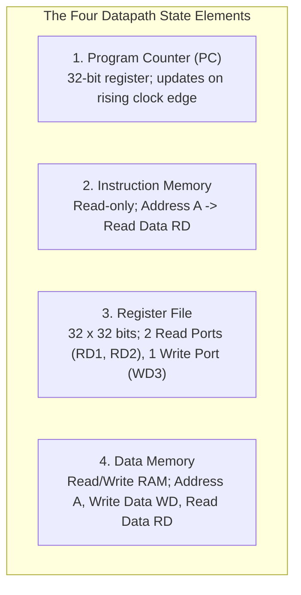
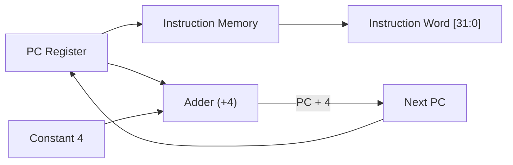
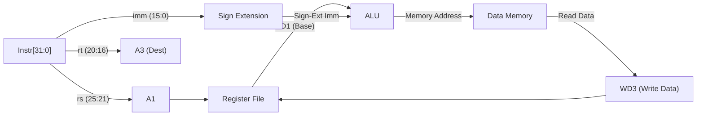
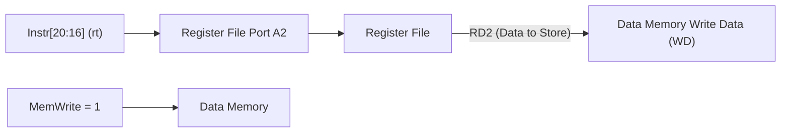
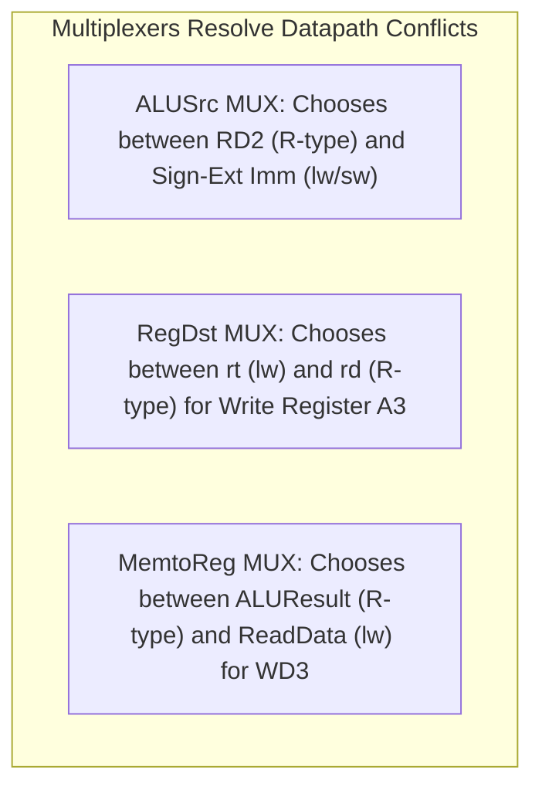
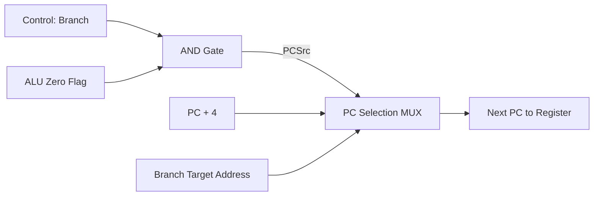
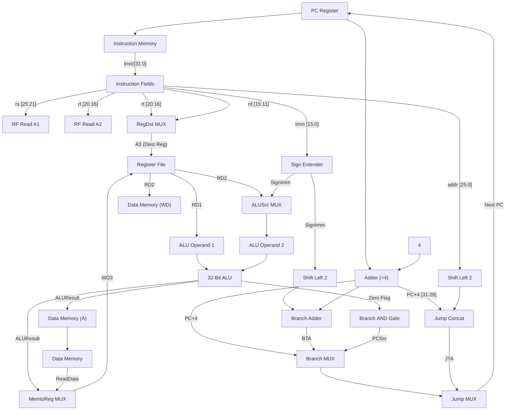

[DLCD Index](../README.md) / [Unit 4: Microarchitecture - Single-Cycle, Multi-Cycle, and Pipelined Processors](Introduction.md)

# L02 - Single-Cycle MIPS Datapath Design

In the previous lecture, we established that a processor consists of two collaborating subsystems: the **Datapath** (the muscle that manipulates words of data) and the **Control Unit** (the brain that asserts control signals). In this lecture, we roll up our sleeves and build the complete hardware datapath for a **Single-Cycle MIPS Processor**.

In a single-cycle processor, every instruction executes from start to finish within **one single clock cycle**. Rather than presenting a bewildering completed schematic all at once, we will engineer the datapath incrementally—beginning with basic instruction fetch, adding memory loads and stores, incorporating R-type arithmetic, and finally wiring branch and jump control flow into a unified, elegant circuit.

---

## The Four Fundamental State Elements

Every processor datapath is anchored by clocked storage elements that maintain the system's state. Our single-cycle MIPS datapath requires four primary state components:

Let's examine how each block operates:
1. **The Program Counter (PC)**: A standard 32-bit clocked register. Its input ($\text{PC}'$) receives the address of the next instruction, which is latched onto its output ($\text{PC}$) on every rising clock edge.
2. **Instruction Memory**: A memory array holding the compiled machine code. It takes a 32-bit address $A$ from the PC and combinationally outputs the 32-bit instruction word $\text{Instr}$. (In a single-cycle machine, instruction memory is read-only).
3. **The Register File**: A multi-ported 32-word $\times$ 32-bit storage array containing registers `$0` through `$31$:
   - Two 5-bit read address inputs ($A_1, A_2$) combinationally output two 32-bit words ($\text{RD}_1, \text{RD}_2$).
   - One 5-bit write address input ($A_3$) and 32-bit write data input ($\text{WD}_3$).
   - When Write Enable $\text{WE}_3 = 1$, data on $\text{WD}_3$ is written into register $A_3$ on the rising clock edge.
4. **Data Memory**: A memory array holding program data variables. Takes a 32-bit address $A$ and 32-bit write data $\text{WD}$. When $\text{WE} = 1$, it writes data on the clock edge; when $\text{WE} = 0$, it combinationally outputs the word at address $A$ on $\text{RD}$.

---

## Step 1: Instruction Fetch Hardware

The journey of every instruction begins with the **Fetch** stage. The processor must read the current instruction from memory and prepare the Program Counter for the next instruction.

1. The current address in the PC feeds into the Instruction Memory address port $A$.
2. The Instruction Memory outputs the 32-bit machine instruction word $\text{Instr}$.
3. Simultaneously, a dedicated 32-bit hardware adder computes $\text{PC} + 4$.
4. By default, $\text{PC} + 4$ is routed back to the PC register input, so that on the next clock edge, the processor will fetch the next sequential instruction.

---

## Step 2: Datapath for Load Word (`lw`)

Now let's add the hardware needed to execute a memory load instruction:

$$\text{lw } \$rt, \quad \text{imm}(\$rs)$$

Recall what `lw` must do:
1. Read the base address from register `$rs$.
2. Sign-extend the 16-bit immediate offset $\text{Instr}[15:0]$ to 32 bits.
3. Add the base address to the sign-extended offset to form the effective memory address.
4. Read Data Memory at that address.
5. Write the loaded data into destination register `$rt$.

Notice the hardware additions:
- We connect bits 25:21 ($rs$) to read address $A_1$. The base address emerges on $\text{RD}_1$.
- We connect bits 15:0 to a **Sign Extension Unit**, which replicates bit 15 across the upper 16 bits.
- An **ALU** adds the base address ($\text{RD}_1$) and the sign-extended immediate to compute the effective address.
- The ALU output drives the Data Memory address input $A$.
- The data read from memory ($\text{RD}$) is routed directly to the Register File write data port $\text{WD}_3$.
- Bits 20:16 ($rt$) are wired to write register input $A_3$, and Register Write Enable ($\text{RegWrite}$) is set to $1$.

---

## Step 3: Integrating Store Word (`sw`)

Now let's incorporate the store instruction:

$$\text{sw } \$rt, \quad \text{imm}(\$rs)$$

Notice something wonderful: `sw` calculates its memory address **identically** to `lw`! It uses the exact same base register $rs$, the exact same sign-extended immediate, and the exact same ALU addition.

The only difference is what happens at Data Memory:
- `lw` reads data from memory and writes it to the register file.
- `sw` reads data from register `$rt` and writes it **into** memory!

To support `sw`:
- We connect bits 20:16 ($rt$) to read address port $A_2$ of the register file.
- The output $\text{RD}_2$ (holding the value of register `$rt`) connects directly to the **Write Data ($\text{WD}$)** input of Data Memory.
- For `sw`, we assert $\text{MemWrite} = 1$ and de-assert $\text{RegWrite} = 0$.

---

## Step 4: Integrating R-Type Computational Instructions

Now let's add support for R-type instructions (`add`, `sub`, `and`, `or`, `slt`):

$$\mathbf{\text{op}} \quad \$rd, \quad \$rs, \quad \$rt$$

In R-type instructions:
1. Operand 1 comes from register `$rs$ ($\text{RD}_1$).
2. Operand 2 comes from register `$rt$ ($\text{RD}_2$).
3. The ALU performs the operation specified by the 6-bit function code $\text{Instr}[5:0]$.
4. The ALU result is written back into destination register **`$rd$` ($\text{Instr}[15:11]$)**, NOT `$rt$`!

Look at the conflicts that arise between R-type instructions and memory instructions:
- **Conflict 1 (ALU Second Operand)**: For R-type, the second ALU input must be register $\text{RD}_2$. But for `lw`/`sw`, it must be the sign-extended immediate!
- **Conflict 2 (Destination Register Address)**: For R-type, the destination register is $\text{Instr}[15:11]$ ($rd$). But for `lw`, the destination register is $\text{Instr}[20:16]$ ($rt$)!
- **Conflict 3 (Register Write Data)**: For R-type, the data written to the register file is the ALU result. But for `lw`, it is the data read from memory!

How do digital designers resolve conflicts where different instructions need different data sources on the same wire?
**We insert Multiplexers!**

By adding these three multiplexers, our datapath now seamlessly executes all R-type instructions, `lw`, and `sw`!

---

## Step 5: Integrating Conditional Branch (`beq`)

Now we must support conditional decision making:

$$\text{beq } \$rs, \quad \$rt, \quad \text{imm}$$

If register `$rs` equals register `$rt`, the processor must branch to:

$$\text{Branch Target Address (BTA)} = (\text{PC} + 4) + (\text{Sign-Extend}(\text{imm}) \ll 2)$$

To implement this:
1. **Equality Check**: We route $\text{RD}_1$ and $\text{RD}_2$ into the ALU and command the ALU to perform subtraction ($rs - rt$). If the two registers are identical, the difference is zero, and the ALU asserts its built-in **`Zero` flag output** ($\text{Zero} = 1$).
2. **Branch Target Calculation**:
   - Take the 16-bit immediate $\text{Instr}[15:0]$ and pass it through the Sign Extension unit.
   - Shift the 32-bit sign-extended value left by 2 bits (a simple hardwired wire shift, appending `00` to the right).
   - Add this shifted offset to $\text{PC} + 4$ using an independent, dedicated 32-bit adder.
3. **PC Selection Logic**:
   - We must branch only if **both** the instruction is a branch ($\text{Branch} = 1$) **and** the registers are equal ($\text{Zero} = 1$).
   - We combine these signals with an AND gate: $\text{PCSrc} = \text{Branch} \ \& \ \text{Zero}$.
   - We insert a 2:1 multiplexer before the PC register:
     - If $\text{PCSrc} = 0$: The multiplexer selects $\text{PC} + 4$ (sequential execution).
     - If $\text{PCSrc} = 1$: The multiplexer selects the Branch Target Address.

---

## Step 6: Integrating Unconditional Jump (`j`)

Finally, we must implement unconditional jumps:

$$\text{j } \text{target}$$

Recall from L07 that the 32-bit jump target address (JTA) is constructed via pseudo-direct addressing:

$$\text{JTA} = (\text{PC} + 4)_{31:28} \;\parallel\; (\text{Instr}[25:0] \ll 2)$$

Hardware required:
1. Shift the 26-bit jump field $\text{Instr}[25:0]$ left by 2 bits to produce a 28-bit value.
2. Concatenate the upper 4 bits of the sequential PC ($(\text{PC} + 4)_{31:28}$) to the front, forming a complete 32-bit jump address.
3. Place an additional 2:1 multiplexer at the very front of the PC input, controlled by a new signal called **`Jump`**:
   - If $\text{Jump} = 0$: It passes the output of the branch multiplexer (either $\text{PC} + 4$ or BTA).
   - If $\text{Jump} = 1$: It overrides the PC with the Jump Target Address.

---

## The Complete Unified Single-Cycle Datapath

Bringing all these modular circuits together produces the complete, unified **Single-Cycle MIPS Datapath**:

### Trace of Control Signals Across Instructions

| Instruction | `RegDst` | `ALUSrc` | `MemtoReg` | `RegWrite` | `MemWrite` | `Branch` | `ALUOp` | `Jump` |
|:---|:---:|:---:|:---:|:---:|:---:|:---:|:---:|:---:|
| **R-Type** (`add`, `sub`) | **1** (`rd`) | **0** (`RD2`) | **0** (ALU) | **1** | **0** | **0** | `10` | **0** |
| **`lw`** | **0** (`rt`) | **1** (Imm) | **1** (Mem) | **1** | **0** | **0** | `00` (Add) | **0** |
| **`sw`** | **X** | **1** (Imm) | **X** | **0** | **1** | **0** | `00` (Add) | **0** |
| **`beq`** | **X** | **0** (`RD2`) | **X** | **0** | **0** | **1** | `01` (Sub) | **0** |
| **`j`** | **X** | **X** | **X** | **0** | **0** | **0** | `XX` | **1** |

*(Note: `X` denotes a Don't Care condition where the signal value has no effect because a write enable is de-asserted).*

---

## Key Takeaways

- The Single-Cycle MIPS Datapath executes every instruction in one clock cycle, updating the architectural state on each rising clock edge.
- Four state elements anchor the datapath: Program Counter (PC), Instruction Memory, Register File, and Data Memory.
- Datapath conflicts are resolved by multiplexers:
  - `RegDst`: Selects destination register between `$rt` (`lw`) and `$rd` (R-type).
  - `ALUSrc`: Selects second ALU operand between register `$rt` (R-type, `beq`) and sign-extended immediate (`lw`, `sw`).
  - `MemtoReg`: Selects writeback data between ALUResult (R-type) and memory ReadData (`lw`).
  - `PCSrc`: Selects next PC between sequential $\text{PC} + 4$ and branch target address ($\text{Branch} \ \& \ \text{Zero}$).
  - `Jump`: Selects between sequential/branch PC and pseudo-direct jump target.
- Dedicated adders compute $\text{PC} + 4$ and Branch Target Addresses in parallel with the main ALU.

---

The datapath muscle is fully assembled, but who controls the multiplexers and write-enable lines? In the next lecture, [L03 - Single-Cycle MIPS Control Unit Design](L03%20-%20Single-Cycle%20MIPS%20Control%20Unit%20Design.md), we build the Control Unit: the Main Decoder, the ALU Decoder, and analyze the critical-path timing of the entire processor.
