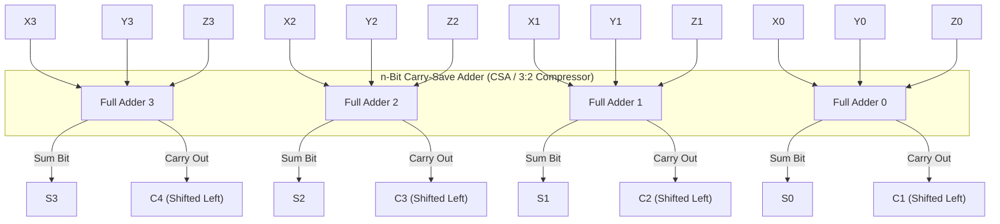
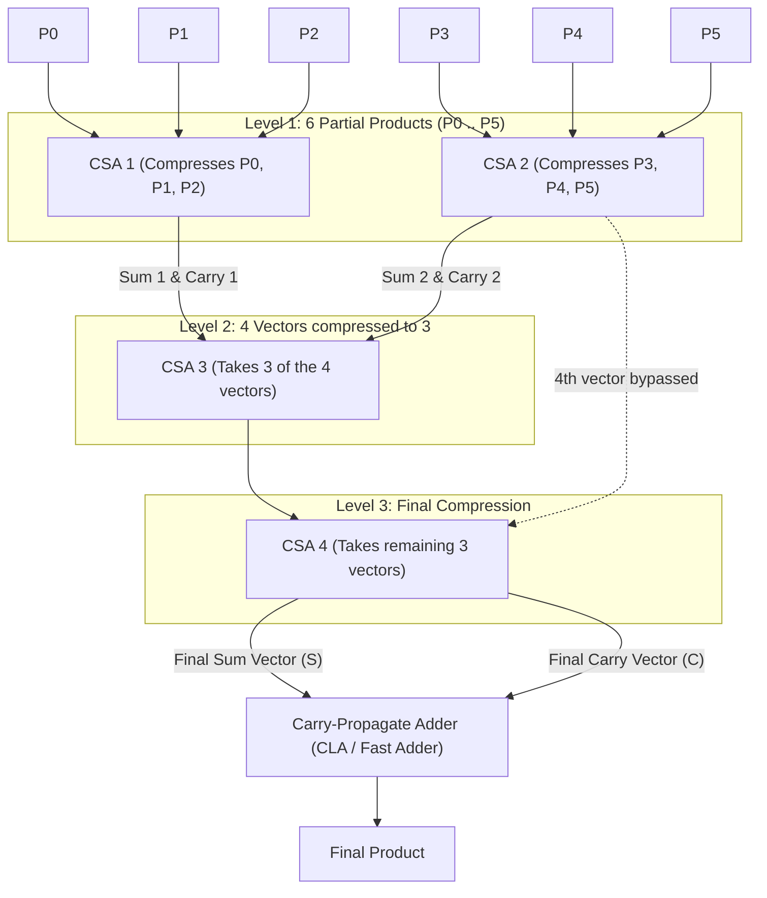
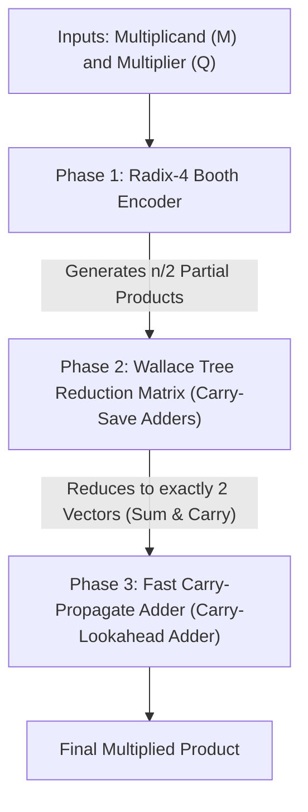

[DLCD Index](../README.md) / [Unit 4: Computer Arithmetic and Control Design](Introduction.md)

# L03 - Fast Multiplication and Carry-Save Addition

In the previous two lectures, we explored sequential multipliers and Booth's recoding. In all these designs, multiplication ultimately reduces to a single arithmetic challenge: **summing a large stack of shifted partial product rows**.

When multiplying two 64-bit numbers, hardware generates up to 64 partial products (or 32 rows with Radix-4 Booth recoding). If you add these rows using conventional adders, each addition forces carry bits to ripple from LSB to MSB. Accumulating 32 or 64 rows sequentially creates an intolerable propagation delay that would throttle processor clock rates.

To achieve maximum throughput, high-speed graphics chips and modern CPU ALUs use **Carry-Save Addition (CSA)** and **Wallace Tree reduction networks**.

In this lecture, we examine how carry-save adders eliminate horizontal carry propagation, trace how Wallace Trees compress partial products in $O(\log n)$ time, and analyze the complete fast multiplier data path.

---

## The Carry Propagation Bottleneck

Why is adding multiple binary numbers so slow in conventional hardware?

Consider adding four 4-bit numbers ($W, X, Y, Z$) using standard **Carry-Propagate Adders (CPA)**:
1. Adder 1 adds $W + X$. Carries must ripple from bit 0 to bit 3 before the sum is valid.
2. Adder 2 adds $(W + X) + Y$. Carries must ripple all the way across again.
3. Adder 3 adds $[(W + X) + Y] + Z$. Carries ripple a third time.

If an $n$-bit adder has a ripple delay of $n \cdot t_{\text{gate}}$, summing $k$ operands requires:
$$\mathbf{\text{Total Latency} = (k - 1) \times n \times t_{\text{gate}}}$$

Notice the fundamental design flaw: **we are spending time resolving horizontal carries after every single addition, even though we only care about the final carry at the very end of the problem!**

Can we defer horizontal carry propagation until the absolute final step?

---

## Carry-Save Addition (CSA)

The core breakthrough of fast multiplication is **Carry-Save Addition (CSA)**:

> **A Carry-Save Adder takes THREE $n$-bit input numbers and compresses them into TWO $n$-bit numbers (a Sum vector and a Carry vector), with ZERO horizontal carry propagation!**

Because a CSA converts 3 numbers into 2 numbers, it is formally known as a **3:2 Compressor**.

---

### Internal Circuit Architecture

A Carry-Save Adder is constructed from an array of $n$ standard Full Adders. But look at how the wires are connected:

Look at the wiring carefully:
- **No horizontal connections exist!** Full Adder 0 does **not** send its carry output to Full Adder 1.
- Each Full Adder $i$ operates completely in parallel and independently:
  $$S_i = X_i \oplus Y_i \oplus Z_i$$
  $$C_{i+1} = X_i Y_i + Y_i Z_i + X_i Z_i$$
- The Sum bits form a **Sum Vector ($S$)**: $S = (S_{n-1}, \dots, S_1, S_0)$.
- The Carry bits form a **Carry Vector ($C$)**: shifted one position to the left (weight $2^{i+1}$).

### The Crucial Consequence: Constant Time Latency
Because there is no horizontal carry propagation:
$$\mathbf{t_{\text{CSA}} = t_{\text{Full Adder}} \approx \text{Constant (independent of word width } n\text{)}}$$

Whether your numbers are 4 bits wide or 1,024 bits wide, a Carry-Save Adder compresses three inputs into two inputs in the **exact same duration as a single 1-bit full adder** ($\approx 2\text{ gate delays}$)!

---

## The Wallace Tree Multiplier Architecture

In 1964, Australian computer scientist Christopher Wallace asked a profound question:
> *If a Carry-Save Adder compresses 3 numbers into 2 numbers in constant time, what is the fastest topological arrangement to compress a stack of $k$ partial products down to 2?*

Instead of cascading CSAs linearly in a chain, Wallace organized them into a **hierarchical tree**.

A **Wallace Tree** groups partial products into triplets at each level, compresses each triplet in parallel, and feeds the resulting Sum and Carry vectors into the next level of the tree.

---

## Logarithmic Reduction Mechanics

At each level of a Wallace Tree, every 3 vectors are reduced to 2 vectors. The number of rows decreases by a factor of roughly $2/3$:

| Level | Operands Remaining | Compression Ratio |
| :---: | :---: | :---: |
| **0 (Inputs)** | $k$ partial products | Initial |
| **Level 1** | $\approx \frac{2}{3} k$ | First stage parallel compression |
| **Level 2** | $\approx \frac{4}{9} k$ | Second stage |
| **...** | $\dots$ | $\dots$ |
| **Final Level** | **Exactly 2 vectors** | Ready for final carry-propagate addition |

Because the reduction is geometric, the number of tree levels required to reduce $k$ operands down to 2 is **logarithmic**:

$$\mathbf{\text{Number of Tree Levels} = O(\log_{1.5} k)}$$

Look at the staggering speedup for large word sizes:
- To add **16 partial products**:
  - Linear addition: 15 serial adder stages.
  - Wallace Tree: **Only 6 levels** of carry-save adders!
- To add **64 partial products** (64-bit multiplier):
  - Linear addition: 63 serial adder stages.
  - Wallace Tree: **Only 10 levels**!

---

## The Complete Fast Multiplier Architecture

A modern high-speed processor multiplier operates in **three distinct phases**:

1. **Phase 1: Partial Product Generation (Radix-4 Booth Encoding)**:
   The multiplier is recoded using Radix-4 bit-pairs, cutting the number of partial products from $n$ down to $n/2$.
2. **Phase 2: Partial Product Reduction (Wallace Tree)**:
   The $n/2$ partial product rows are fed into a multi-level Wallace Tree network of Carry-Save Adders. The matrix compresses the entire stack down to **exactly two numbers**: a final Sum vector and a final Carry vector, operating in $O(\log n)$ gate delays.
3. **Phase 3: Final Carry-Propagate Addition**:
   The two remaining vectors are summed using a high-speed parallel adder (such as a **Carry-Lookahead Adder (CLA)** or Kogge-Stone Adder). This is the **only step in the entire multiplier where carries ripple horizontally**!

---

## Multiplier Architectures Comparison

| Architecture | Latency (Delay) | Hardware Area Cost | Power Consumption | Typical Application |
| :---: | :---: | :---: | :---: | :---: |
| **Sequential Shift-and-Add** | $O(n)$ clock cycles (Slowest) | $O(n)$ (Minimal) | Very Low | Low-cost microcontrollers, IoT devices |
| **Array Multiplier** | $O(n)$ gate delays | $O(n^2)$ (Large) | High | Legacy digital filters |
| **Booth Radix-4 Sequential** | $O(n/2)$ clock cycles | $O(n)$ | Moderate | Embedded DSPs |
| **Wallace Tree Multiplier** | **$O(\log n)$ gate delays (Fastest)** | $O(n^2)$ irregular layout | Very High | Modern CPU ALUs, GPUs, Neural Network NPUs |

---

## Key Takeaways

- In multi-operand addition, resolving carries after every addition creates an $O(k \cdot n)$ delay bottleneck.
- A **Carry-Save Adder (CSA / 3:2 Compressor)** takes three inputs and produces a Sum vector and a Carry vector (shifted left) in **constant time ($O(1)$)**, completely eliminating horizontal carry propagation.
- A **Wallace Tree** arranges Carry-Save Adders in a parallel hierarchical network, compressing $k$ partial products down to 2 in **logarithmic time ($O(\log_{1.5} k)$)**.
- High-performance multipliers combine **Radix-4 Booth encoding** (halving the partial products), a **Wallace Tree** (reducing partial products to two vectors in logarithmic time), and a single high-speed **Carry-Lookahead Adder** to generate the final product.

---

We have now conquered both positive and signed multiplication, scaling from basic shift-and-add registers to gigahertz Wallace Trees. But multiplication is only half of the arithmetic equation. The inverse operation—division—presents entirely different hardware challenges. In the next lecture, we examine [**Integer Division**](L04%20-%20Integer%20Division.md), analyzing restoring and non-restoring division algorithms.
