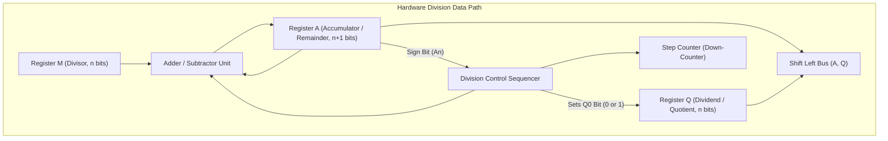

[DLCD Index](../README.md) / [Unit 4: Computer Arithmetic and Control Design](Introduction.md)

# L03 - Integer Division - Restoring and Non-Restoring Algorithms

In the preceding two lectures, we mastered binary multiplication across combinational arrays, sequential data paths, Booth recoding, and Wallace Trees. Now we turn to its arithmetic inverse: **Integer Division**.

Division is fundamentally more difficult to implement in silicon than multiplication. When multiplying, each partial product is calculated independently from the multiplier bits. In division, however, the choice of the next quotient bit depends on the running subtraction result—creating a trial-and-error sequential feedback loop.

In this lecture, we examine the **hardware division data path**, analyze the **Restoring Division algorithm**, discover the mathematical insight behind **Non-Restoring Division**, and trace both algorithms on hardware registers.

---

## The Principle of Binary Division

Integer division evaluates the fundamental algebraic equation:

$$\mathbf{\text{Dividend } (D) = \text{Divisor } (M) \times \text{Quotient } (Q) + \text{Remainder } (R)}$$

where the remainder must satisfy:
$$\mathbf{0 \le R < M}$$

Let's examine paper-and-pencil binary long division for $11_{10} \div 3_{10}$ ($1011_2 \div 0011_2$):

```
             0 0 1 1   <- Quotient Q = 3
       -------------
0 0 1 1 ) 1 0 1 1      <- Dividend D = 11
        - 0 0 1 1      <- Divisor M = 3
        ---------
          0 0 1 0      <- Remainder R = 2
```

In decimal long division, you guess how many times the divisor fits into the partial dividend ($0$ through $9$).
In binary division, life is simpler: a digit is either **`1`** (the divisor fits) or **`0`** (the divisor does not fit).

However, silicon cannot "look ahead" to see if a divisor fits. The hardware must physically perform a trial subtraction ($A - M$) and check the sign bit of the result:
- If the result is **positive** ($A \ge 0$): the divisor fit! The quotient bit is `1`.
- If the result is **negative** ($A < 0$): the divisor did not fit! The quotient bit is `0`.

---

## The Hardware Division Data Path

A sequential hardware divider uses three registers, an $(n+1)$-bit parallel adder/subtractor, and a down-counter:



Let's inspect the registers:
- **Register $M$ (Divisor)**: Holds the $n$-bit divisor throughout the operation.
- **Register $Q$ (Dividend / Quotient)**: Initialized with the $n$-bit dividend. As the dividend bits are shifted left out of $Q$ into $A$, newly calculated quotient bits are shifted in at the LSB ($Q_0$).
- **Register $A$ (Accumulator / Partial Remainder)**: Initialized to **$0$**. It is made **$n+1$ bits wide** so that its most significant bit ($A_n$) acts as an unambiguous sign bit.
- **Adder/Subtractor**: Computes $A - M$ (or $A + M$).

Registers $A$ and $Q$ form a combined $(2n+1)$-bit shift register $(A, Q)$ that shifts **left** on every cycle.

---

## The Restoring Division Algorithm

In **Restoring Division**, the hardware tests whether the divisor fits by optimistically subtracting $M$. If the subtraction yields a negative result, the hardware must **restore the original value** by adding $M$ back.

### The Algorithm:
1. **Initialize**: $A \leftarrow 0$, $M \leftarrow \text{Divisor}$, $Q \leftarrow \text{Dividend}$, $\text{Counter} \leftarrow n$.
2. **Loop ($n$ times)**:
   - **Shift Left**: Shift $(A, Q)$ left by 1 bit. (The MSB of $Q$ enters the LSB of $A$; a placeholder $0$ enters $Q_0$).
   - **Subtract**: Subtract divisor from accumulator:
     $$A \leftarrow A - M$$
   - **Check Sign of $A$ ($A_n$)**:
     - **If $A \ge 0$ ($A_n = 0$)**: The subtraction succeeded! Set quotient bit $Q_0 \leftarrow 1$.
     - **If $A < 0$ ($A_n = 1$)**: The subtraction failed! Set quotient bit $Q_0 \leftarrow 0$, and **restore** the previous value of $A$:
       $$A \leftarrow A + M$$
   - **Decrement**: $\text{Counter} \leftarrow \text{Counter} - 1$.
3. **Termination**: When $\text{Counter} = 0$, the exact **Quotient** is in $Q$ and the **Remainder** is in $A$.

---

### Worked Trace: Restoring Division ($11 \div 3$)

Let Dividend $D = 11_{10} = (1011)_2$ and Divisor $M = 3_{10} = (00011)_2$ (5-bit format).
$2$'s complement of $M$: $-M = 11101_2$. Step count $n = 4$.

| Cycle | Step / Operation | Action Detail | Register A ($5$ bits) | Register Q ($4$ bits) | Count |
| :---: | :--- | :--- | :---: | :---: | :---: |
| **Start** | Initialization | $A = 0, Q = D, M = 3$ | `00000` | `1011` | 4 |
| **Cycle 1** | Shift Left $(A, Q)$ | Shift left 1 bit | `00001` | `011_` | 4 |
| | Subtract $M$ | $A \leftarrow A - M$ ($00001 + 11101$) | `11110` | `011_` | 4 |
| | Check Sign ($A < 0$) | Set $Q_0 = 0$, **Restore $A \leftarrow A + M$** | **`00001`** | **`0110`** | **3** |
| **Cycle 2** | Shift Left $(A, Q)$ | Shift left 1 bit | `00010` | `110_` | 3 |
| | Subtract $M$ | $A \leftarrow A - M$ ($00010 + 11101$) | `11111` | `110_` | 3 |
| | Check Sign ($A < 0$) | Set $Q_0 = 0$, **Restore $A \leftarrow A + M$** | **`00010`** | **`1100`** | **2** |
| **Cycle 3** | Shift Left $(A, Q)$ | Shift left 1 bit | `00101` | `100_` | 2 |
| | Subtract $M$ | $A \leftarrow A - M$ ($00101 + 11101$) | `00010` | `100_` | 2 |
| | Check Sign ($A \ge 0$) | Positive! Set $Q_0 = 1$ (No restore) | **`00010`** | **`1001`** | **1** |
| **Cycle 4** | Shift Left $(A, Q)$ | Shift left 1 bit | `00101` | `001_` | 1 |
| | Subtract $M$ | $A \leftarrow A - M$ ($00101 + 11101$) | `00010` | `001_` | 1 |
| | Check Sign ($A \ge 0$) | Positive! Set $Q_0 = 1$ (No restore) | **`00010`** | **`0011`** | **0** |

Counter reaches 0!
- **Quotient ($Q$)**: $\mathbf{0011_2 = 3_{10}}$
- **Remainder ($A$)**: $\mathbf{00010_2 = 2_{10}}$
$11 = 3 \times 3 + 2$. The arithmetic is exact!

Notice the performance flaw of Restoring Division: whenever a subtraction fails, the hardware wastes an entire addition cycle undoing it!

---

## Non-Restoring Division

Can we eliminate the wasted restoration step when a trial subtraction fails?

Let's look at the mathematics:
1. In cycle $i$, we subtract $M$:
   $$A_{\text{new}} = A - M$$
2. Suppose $A_{\text{new}} < 0$. In Restoring Division, we restore by adding $M$:
   $$A_{\text{restored}} = A_{\text{new}} + M = A$$
3. In the next cycle ($i+1$), we shift left (which multiplies $A$ by $2$) and subtract $M$:
   $$A_{i+1} = 2 \times A_{\text{restored}} - M = 2(A_{\text{new}} + M) - M$$
   $$A_{i+1} = 2A_{\text{new}} + 2M - M = \mathbf{2A_{\text{new}} + M}$$

Notice something here:
> **Instead of adding $M$ to restore $A$ and then shifting and subtracting $M$, we can simply shift $A$ immediately and ADD $M$ in the next cycle!**

This algebraic equivalence completely eliminates the restoration step!

---

### The Non-Restoring Division Algorithm

1. **Initialize**: $A \leftarrow 0$, $M \leftarrow \text{Divisor}$, $Q \leftarrow \text{Dividend}$, $\text{Counter} \leftarrow n$.
2. **Loop ($n$ times)**:
   - **Step 1 (Conditional Operation based on previous sign of $A$)**:
     - **If $A \ge 0$**: Shift $(A, Q)$ left by 1 bit, then **Subtract $M$**:
       $$A \leftarrow 2A - M$$
     - **If $A < 0$**: Shift $(A, Q)$ left by 1 bit, then **Add $M$**:
       $$A \leftarrow 2A + M$$
   - **Step 2 (Determine Quotient bit based on new sign of $A$)**:
     - **If new $A \ge 0$**: Set $Q_0 \leftarrow 1$.
     - **If new $A < 0$**: Set $Q_0 \leftarrow 0$.
   - **Decrement**: $\text{Counter} \leftarrow \text{Counter} - 1$.
3. **Final Remainder Correction**:
   After $n$ iterations, inspect the final sign of $A$:
   - If $A \ge 0$: the remainder is valid.
   - If $A < 0$: the remainder is negative and must be corrected by adding $M$:
     $$A \leftarrow A + M$$

---

### Worked Trace: Non-Restoring Division ($11 \div 3$)

Let Dividend $D = 11_{10} = (1011)_2$ and Divisor $M = 3_{10} = (00011)_2$, $-M = 11101_2$. Step count $n = 4$.

| Cycle | Step / Operation | Action Detail | Register A ($5$ bits) | Register Q ($4$ bits) | Count |
| :---: | :--- | :--- | :---: | :---: | :---: |
| **Start** | Initialization | $A = 0, Q = D, M = 3$ | `00000` | `1011` | 4 |
| **Cycle 1** | Shift Left $(A, Q)$ | Shift | `00001` | `011_` | 4 |
| | $A$ was $\ge 0 \implies \mathbf{\text{SUB } M}$ | $A \leftarrow A - M$ ($00001 + 11101$) | `11110` | `011_` | 4 |
| | New $A < 0 \implies \mathbf{Q_0 = 0}$ | No restoration! | **`11110`** | **`0110`** | **3** |
| **Cycle 2** | Shift Left $(A, Q)$ | Shift | `11100` | `110_` | 3 |
| | $A$ was $< 0 \implies \mathbf{\text{ADD } M}$ | $A \leftarrow A + M$ ($11100 + 00011$) | `11111` | `110_` | 3 |
| | New $A < 0 \implies \mathbf{Q_0 = 0}$ | No restoration! | **`11111`** | **`1100`** | **2** |
| **Cycle 3** | Shift Left $(A, Q)$ | Shift | `11111` | `100_` | 2 |
| | $A$ was $< 0 \implies \mathbf{\text{ADD } M}$ | $A \leftarrow A + M$ ($11111 + 00011$) | `00010` | `100_` | 2 |
| | New $A \ge 0 \implies \mathbf{Q_0 = 1}$ | Sign is positive | **`00010`** | **`1001`** | **1** |
| **Cycle 4** | Shift Left $(A, Q)$ | Shift | `00101` | `001_` | 1 |
| | $A$ was $\ge 0 \implies \mathbf{\text{SUB } M}$ | $A \leftarrow A - M$ ($00101 + 11101$) | `00010` | `001_` | 1 |
| | New $A \ge 0 \implies \mathbf{Q_0 = 1}$ | Sign is positive | **`00010`** | **`0011`** | **0** |

### Final Correction Check:
The counter is 0. Is $A < 0$? No ($A = 00010 \ge 0$). No final correction needed!
- **Quotient ($Q$)**: $\mathbf{0011_2 = 3_{10}}$
- **Remainder ($A$)**: $\mathbf{00010_2 = 2_{10}}$

Look at the elegance of Non-Restoring division: **every single clock cycle executes exactly one operation**. Zero wasted restoration steps!

---

## Comparison: Restoring vs. Non-Restoring Division

| Feature | Restoring Division | Non-Restoring Division |
| :---: | :---: | :---: |
| **Operations per Cycle** | 1 operation if $A \ge 0$; **2 operations if $A < 0$** (Subtract + Add) | **Strictly 1 operation per cycle** (Always) |
| **Execution Time** | Variable and slow ($n$ to $2n$ additions) | **Fixed and deterministic ($n$ operations)** |
| **Cycle Control** | Irregular clocking or multi-step cycles | Uniform, high-speed synchronous clocking |
| **Final Step** | None (Remainder is always positive) | One conditional addition if final $A < 0$ |
| **Hardware Standard** | Educational only | **Standard in modern ALUs** |

---

## Key Takeaways

- Integer division satisfies: $\mathbf{\text{Dividend} = \text{Divisor} \times \text{Quotient} + \text{Remainder}}$, where $0 \le R < M$.
- Hardware division uses an $(n+1)$-bit Accumulator ($A$), an $n$-bit Quotient register ($Q$), an $n$-bit Divisor register ($M$), and a down-counter.
- **Restoring Division** subtracts $M$: if the sign bit turns negative, it sets $Q_0 = 0$ and adds $M$ back to restore the accumulator, wasting time.
- **Non-Restoring Division** eliminates restoration by adding $M$ in the next cycle if $A$ was negative, and subtracting $M$ if $A$ was positive ($2(A-M)+M = 2A-M$).
- Non-Restoring division requires strictly **one addition or subtraction per cycle**, making it significantly faster and standard in modern CPU ALUs.

---

Up to this point, all our arithmetic has operated on whole integers. But engineering, physics, scientific simulation, and 3D graphics require real numbers with fractional decimal points ($3.14159$, $6.022 \times 10^{23}$, $1.6 \times 10^{-19}$). In the next lecture, we master [**Floating-Point Numbers and IEEE 754 Standard**](L04%20-%20Floating-Point%20Numbers%20and%20IEEE%20754%20Standard.md), exploring single and double precision formats, biased exponents, and floating-point arithmetic.
