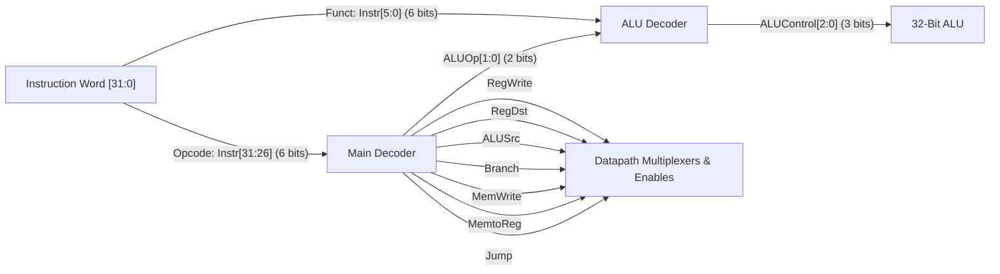
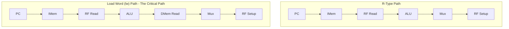

[DLCD Index](../README.md) / [Unit 4: Microarchitecture - Single-Cycle, Multi-Cycle, and Pipelined Processors](Introduction.md)

# L03 - Single-Cycle MIPS Control Unit Design

In the previous lecture, we assembled the physical datapath for our single-cycle MIPS processor. We placed multiplexers, adders, and memories on the silicon canvas. But a datapath without a control unit is like an orchestra without a conductor: the instruments are present, but nobody is telling the multiplexers which inputs to select or commanding the register file when to write.

The **Control Unit** is the brain of the processor. It inspects the 32-bit instruction word, decodes the opcode and function fields, and generates the binary control signals that configure the datapath on every clock cycle.

In this lecture, we examine the modular decomposition of the control unit into the **Main Decoder** and **ALU Decoder**, construct complete truth tables for all supported instructions, and perform a rigorous **critical-path timing analysis** to reveal why single-cycle execution is fundamentally inefficient.

---

## Control Unit Decomposition: Main Decoder and ALU Decoder

To keep the control logic simple and modular, the control unit is partitioned into two distinct combinational decoding blocks:

1. **The Main Decoder**: Reads the 6-bit opcode ($\text{Instr}[31:26]$). It produces all datapath multiplexer selects and memory/register write enables, as well as a 2-bit intermediate signal called **`ALUOp[1:0]`**.
2. **The ALU Decoder**: Takes the 2-bit `ALUOp[1:0]` from the Main Decoder and the 6-bit function code ($\text{Instr}[5:0]$) from the instruction. It outputs the 3-bit **`ALUControl[2:0]`** that dictates the exact ALU operation.

Why use two decoders instead of one giant truth table?
Because all R-type instructions (`add`, `sub`, `and`, `or`, `slt`) share the exact same opcode (`000000`). By handling R-type specifics inside the smaller ALU decoder, the Main Decoder treats all R-type instructions identically, drastically reducing silicon gate complexity!

---

## The ALU Decoder: Truth Table and Operation

The ALU decoder translates the 2-bit `ALUOp` signal and the 6-bit `funct` field into the 3-bit `ALUControl[2:0]` required by our ALU:

- `ALUOp = 00`: Force addition (used by `lw`, `sw`, and `addi` to compute base + offset).
- `ALUOp = 01`: Force subtraction (used by `beq` to compare operands and assert the `Zero` flag).
- `ALUOp = 10`: R-type instruction. Inspect the `funct` field to determine the operation.

| `ALUOp[1:0]` | `funct` (Binary) | Target Operation | `ALUControl[2:0]` | Description |
|:---:|:---:|:---:|:---:|:---|
| **`00`** | `XXXXXX` | **Add** | **`010`** | Addition for memory address or `addi` |
| **`X1`** | `XXXXXX` | **Subtract** | **`110`** | Subtraction for `beq` equality test |
| **`1X`** | `100000` | **`add`** | **`010`** | Addition |
| **`1X`** | `100010` | **`sub`** | **`110`** | Subtraction |
| **`1X`** | `100100` | **`and`** | **`000`** | Bitwise AND |
| **`1X`** | `100101` | **`or`** | **`001`** | Bitwise OR |
| **`1X`** | `101010` | **`slt`** | **`111`** | Set Less Than (relational compare) |

Notice the logic minimization opportunities:
- Because `ALUOp` is never `11`, we can use Don't Cares (`X1` and `1X`) instead of strictly matching `01` and `10`.
- For all five R-type instructions, the first two bits of `funct` are always `10`. The decoder can completely ignore `funct[5:4]`, inspecting only the lower 4 bits!

---

## The Main Decoder: Complete Truth Table

The Main Decoder inspects the 6-bit opcode ($\text{Instr}[31:26]$) and generates seven datapath control signals plus the 2-bit `ALUOp`:

| Instruction | Opcode (`Op[5:0]`) | `RegWrite` | `RegDst` | `ALUSrc` | `Branch` | `MemWrite` | `MemtoReg` | `ALUOp[1:0]` | `Jump` |
|:---|:---:|:---:|:---:|:---:|:---:|:---:|:---:|:---:|:---:|
| **R-Type** | `000000` | **1** | **1** (`rd`) | **0** (`RD2`) | **0** | **0** | **0** (ALU) | **`10`** | **0** |
| **`lw`** | `100011` | **1** | **0** (`rt`) | **1** (Imm) | **0** | **0** | **1** (Mem) | **`00`** | **0** |
| **`sw`** | `101011` | **0** | **X** | **1** (Imm) | **0** | **1** | **X** | **`00`** | **0** |
| **`beq`** | `000100` | **0** | **X** | **0** (`RD2`) | **1** | **0** | **X** | **`01`** | **0** |
| **`addi`** | `001000` | **1** | **0** (`rt`) | **1** (Imm) | **0** | **0** | **0** (ALU) | **`00`** | **0** |
| **`j`** | `000010` | **0** | **X** | **X** | **0** | **0** | **X** | **`XX`** | **1** |

### Understanding the Don't Cares ($X$)
Notice why certain signals are marked as Don't Cares ($X$):
- In `sw` and `beq`, `RegWrite = 0`. Because the register file will not write anything on the clock edge, it does not matter what register address is selected by `RegDst` or what data is presented by `MemtoReg`.
- In `j`, the instruction simply jumps to a target address. No registers or data memories are read or written, so nearly all internal datapath controls are Don't Cares.

---

## Critical-Path Timing Analysis: The Speed Limit of Single-Cycle

In a synchronous single-cycle processor, every instruction must complete its entire journey within **one clock cycle**. Therefore, the clock period $T_c$ must be stretched long enough to accommodate the **slowest possible instruction** through the datapath.

Which instruction is the slowest? Let's trace the physical delays of each instruction type:

Notice that:
- **R-type** accesses Instruction Memory, reads the Register File, evaluates the ALU, and writes back to the Register File.
- **`sw`** accesses Instruction Memory, reads the Register File, evaluates the ALU, and writes to Data Memory.
- **`beq`** accesses Instruction Memory, reads the Register File, evaluates the ALU, and branches.
- **`lw` (Load Word)** does **everything**: it fetches from Instruction Memory, reads the base register, evaluates the ALU, reads from Data Memory, passes through the writeback multiplexer, and settles into the Register File setup window!

Therefore, the **`lw` instruction establishes the critical path of the single-cycle processor**:

$$T_c = t_{\text{pcq\_PC}} + t_{\text{mem}} + \max(t_{\text{RFread}}, t_{\text{ext}} + t_{\text{mux}}) + t_{\text{ALU}} + t_{\text{mem}} + t_{\text{mux}} + t_{\text{RFsetup}}$$

Because reading the register file ($t_{\text{RFread}}$) takes longer than sign-extending and muxing, this simplifies to:

$$T_c = t_{\text{pcq\_PC}} + 2 t_{\text{mem}} + t_{\text{RFread}} + t_{\text{ALU}} + t_{\text{mux}} + t_{\text{RFsetup}}$$

---

## Numerical Performance Calculation (Textbook Example)

Let's plug in realistic silicon delays from Harris & Harris:

| Circuit Element | Parameter Symbol | Physical Delay |
|:---|:---:|:---:|
| **PC Register Clock-to-Q** | $t_{\text{pcq\_PC}}$ | $30\text{ ps}$ |
| **Instruction / Data Memory Read** | $t_{\text{mem}}$ | **$250\text{ ps}$** |
| **Register File Read** | $t_{\text{RFread}}$ | **$150\text{ ps}$** |
| **ALU Delay** | $t_{\text{ALU}}$ | **$200\text{ ps}$** |
| **Multiplexer Delay** | $t_{\text{mux}}$ | $25\text{ ps}$ |
| **Register File Setup Time** | $t_{\text{RFsetup}}$ | $20\text{ ps}$ |

### Calculating Minimum Clock Period ($T_c$)
$$T_c = 30\text{ ps} + 2(250\text{ ps}) + 150\text{ ps} + 200\text{ ps} + 25\text{ ps} + 20\text{ ps}$$

$$T_c = 30 + 500 + 150 + 200 + 25 + 20 = \mathbf{925\text{ ps}}$$

The maximum clock frequency of the processor is:

$$f_{\max} = \frac{1}{T_c} = \frac{1}{925 \times 10^{-12}\text{ s}} \approx \mathbf{1.081\text{ GHz}}$$

### Total Execution Time for a Real Program
Suppose a benchmark program executes $100\text{ billion instructions}$ ($I = 100 \times 10^9$).
Since single-cycle processors have $\text{CPI} = 1$:

$$\text{Execution Time} = I \times \text{CPI} \times T_c = (100 \times 10^9) \times 1 \times (925 \times 10^{-12}\text{ s}) = \mathbf{92.5\text{ seconds}}$$

---

## The Fatal Flaw of the Single-Cycle Processor

Now consider the profound architectural inefficiency of this design:
- A simple conditional branch (`beq`) or register addition (`add`) requires only $\approx 400\text{ ps}$ to complete.
- But because the clock period is rigidly fixed to $925\text{ ps}$ to accommodate the rare `lw` instruction, the hardware sits completely **idle and wasted for over 500 ps** during every branch, jump, and add!
- Furthermore, because every hardware resource can only be used once per clock cycle, the design requires **two separate memories** (Instruction Memory and Data Memory) and **three separate adders** (PC adder, Branch adder, and ALU), consuming excessive silicon area.

We have a glaring problem: how can we allow fast instructions to complete in less time, while reusing hardware to save silicon area?

---

## Key Takeaways

- The Control Unit is factored into a Main Decoder (decoding the 6-bit opcode) and an ALU Decoder (combining `ALUOp` and the 6-bit `funct` field).
- `ALUOp = 00` forces addition (`lw`, `sw`, `addi`); `ALUOp = 01` forces subtraction (`beq`); `ALUOp = 10` consults the `funct` field for R-type instructions.
- The Main Decoder generates seven datapath control signals (`RegWrite`, `RegDst`, `ALUSrc`, `Branch`, `MemWrite`, `MemtoReg`, `Jump`).
- The critical path of the single-cycle processor is dictated by the **`lw` (Load Word)** instruction, requiring $T_c = t_{\text{pcq\_PC}} + 2t_{\text{mem}} + t_{\text{RFread}} + t_{\text{ALU}} + t_{\text{mux}} + t_{\text{RFsetup}} = 925\text{ ps}$.
- Single-cycle design is fundamentally inefficient because the clock period must be stretched to accommodate the worst-case instruction, forcing faster instructions to waste over half of every clock cycle in idle delay.

---

How do we break free from this single-cycle bottleneck? By breaking instructions into multiple shorter clock cycles and reusing a single ALU and memory! In the next lecture, [L04 - Multi-Cycle MIPS Datapath Design](L04%20-%20Multi-Cycle%20MIPS%20Datapath%20Design.md), we build the Multi-Cycle MIPS processor datapath.
