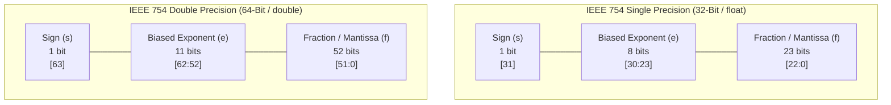

[DLCD Index](../README.md) / [Unit 4: Computer Arithmetic and Control Design](Introduction.md)

# L04 - Floating-Point Numbers and IEEE 754 Standard

In the previous three lectures, all our arithmetic circuits operated on integers: whole numbers with no decimal points. But the real physical universe does not operate solely in integers.

When a computer simulates a rocket trajectory, renders 3D lighting, or trains a machine learning neural network, it must calculate with real numbers spanning enormous extremes:
- The mass of an electron: $9.109 \times 10^{-31}\text{ kg}$
- The speed of light: $2.998 \times 10^8\text{ m/s}$
- The mass of the Sun: $1.989 \times 10^{30}\text{ kg}$

If you attempted to store these numbers using a fixed binary point (e.g., 16 bits for the integer and 16 bits for the fraction), you could never represent both the electron and the Sun in the same computer.

To capture vast dynamic ranges with high precision, computers use **Floating-Point Representation**. In 1985, UC Berkeley mathematician William Kahan led the creation of the universal standard that governs floating-point hardware on all modern processors: **IEEE Standard 754**.

In this lecture, we examine the **IEEE 754 Single and Double Precision formats**, analyze **biased exponents** and the **hidden leading bit**, decode **special values ($\pm \infty$, NaN, Denormals)**, and examine floating-point arithmetic rules.

---

## The Concept of Floating-Point (Scientific Notation)

In decimal scientific notation, real numbers are written as:
$$\pm M \times 10^E$$
where $M$ is the **Mantissa (Significand)** and $E$ is the integer **Exponent**. The decimal point is not fixed; it "floats" dynamically based on the value of $E$.

In binary digital systems, floating-point numbers follow the exact same mathematical model in base 2:

$$\mathbf{V = (-1)^s \times \text{Mantissa} \times 2^E}$$

where:
- **$s$ (Sign Bit)**: Determines polarity: $s = 0$ for positive ($+$), $s = 1$ for negative ($-$).
- **$\text{Mantissa}$**: The fractional precision bits.
- **$E$ (Exponent)**: The power of 2 that scales the number.

---

## Fixed-Point vs. Floating-Point Systems

Before exploring IEEE 754, notice why fixed-point representation falls short:
- In a signed **Fixed-Point** system with $m$ integer bits and $f$ fraction bits, the binary radix point is permanently anchored. For example, with $4$ integer bits and $4$ fraction bits:
  $$6.75_{10} = (0110.1100)_2$$
  where the integer part is $0110_2 = 6_{10}$ and the fraction part is $0.1100_2 = 0.5 + 0.25 = 0.75_{10}$.
- **The Bottleneck**: Fixed-point representation has a rigid, narrow dynamic range. It cannot represent very tiny numbers ($10^{-30}$) or immense numbers ($10^{30}$) without allocating hundreds of bits.

Floating-point solves this by dynamically shifting the binary point and using an explicit exponent field.

---

## The IEEE 754 Formats: Single and Double Precision

IEEE 754 standardizes two primary floating-point word widths:



### Architectural Parameters:

| Parameter | Single Precision (32-Bit) | Double Precision (64-Bit) |
| :---: | :---: | :---: |
| **Total Bit Width** | 32 bits (`float` in C) | 64 bits (`double` in C) |
| **Sign Bit ($s$)** | 1 bit (bit 31) | 1 bit (bit 63) |
| **Exponent Bits ($e$)** | 8 bits (bits 30..23) | 11 bits (bits 62..52) |
| **Fraction Bits ($f$)** | 23 bits (bits 22..0) | 52 bits (bits 51..0) |
| **Exponent Bias** | **$127$** ($2^{8-1} - 1$) | **$1023$** ($2^{11-1} - 1$) |
| **Effective Mantissa Precision** | **24 bits** ($\approx 7$ decimal digits) | **53 bits** ($\approx 16$ decimal digits) |
| **Dynamic Range** | $\approx 1.2 \times 10^{-38} \text{ to } 3.4 \times 10^{38}$ | $\approx 2.2 \times 10^{-308} \text{ to } 1.8 \times 10^{308}$ |

---

## The Three Components of IEEE 754

---

### 1. The Sign Bit ($s$)
A single bit representing polarity:
$$(-1)^s \implies s = 0 \text{ is Positive}, \quad s = 1 \text{ is Negative}$$
Notice that 2's complement is **not** used for the mantissa. Floating-point numbers use an explicit sign-magnitude format because negating a number simply requires inverting the sign bit ($s \leftarrow \overline{s}$).

---

### 2. The Biased Exponent ($e$)

Why does IEEE 754 store the exponent as a **Biased (Excess-$K$)** number rather than standard 2's complement?

In 2's complement, negative exponents would start with `1` (e.g., $-1 = 11111111_2$) and positive exponents with `0` (e.g., $+1 = 00000001_2$). If you compared two floating-point numbers using standard unsigned integer magnitude comparators, $-1$ would appear larger than $+1$!

By adding a constant **Bias** to the true signed exponent ($E$):
$$\mathbf{e = E + \text{Bias}}$$
$$\mathbf{E = e - \text{Bias}}$$
- For 32-bit Single Precision: $\text{Bias} = 127$.
- For 64-bit Double Precision: $\text{Bias} = 1023$.

All valid exponents become non-negative unsigned numbers ($1$ to $254$). As a result, **hardware can compare two floating-point numbers using simple, high-speed integer comparators**!

---

### 3. The Normalized Mantissa and the Hidden Leading Bit

In scientific notation, a number is **Normalized** when the digit before the radix point is non-zero. In decimal, $0.0034$ is normalized as $3.4 \times 10^{-3}$.

In binary, there is only one non-zero digit: **`1`**!
Therefore, every normalized binary floating-point number must begin with:
$$\mathbf{1.f_1 f_2 f_3 \dots f_m}$$

Notice a clever design optimization:
> **Because the leading bit before the binary point is ALWAYS `1`, there is no need to store it in memory!**

Hardware makes the leading bit **implicit and hidden**:
- The 23 bits stored in the memory word represent only the fractional bits ($f$) after the binary point.
- During ALU arithmetic, hardware automatically prepends the implicit leading `1.` before the calculation!
- Thus, 23 stored bits deliver **24 bits of mathematical precision**!

$$\mathbf{V = (-1)^s \times (1.f) \times 2^{e - 127}}$$

---

## Special Cases and Reserved Encodings

IEEE 754 reserves the extreme exponent values ($e = 0$ and $e = 255$ in single precision) to represent mathematical edge cases:

| Sign ($s$) | Exponent ($e$) | Fraction ($f$) | Mathematical Value | Description |
| :---: | :---: | :---: | :---: | :--- |
| $0$ or $1$ | `00000000` ($0$) | $= 0$ | $\mathbf{\pm 0}$ | Positive / Negative Zero |
| $0$ or $1$ | `00000000` ($0$) | $\neq 0$ | $\mathbf{(-1)^s \times (0.f) \times 2^{-126}}$ | **Denormalized (Subnormal) Numbers** |
| $0$ | `11111111` ($255$) | $= 0$ | $\mathbf{+\infty}$ | Positive Infinity (Divide by zero, Overflow) |
| $1$ | `11111111` ($255$) | $= 0$ | $\mathbf{-\infty}$ | Negative Infinity |
| $0$ or $1$ | `11111111` ($255$) | $\neq 0$ | $\mathbf{\text{NaN}}$ | **Not a Number** ($0/0$, $\sqrt{-1}$, $\infty - \infty$) |

### Denormalized (Subnormal) Numbers: Gradual Underflow
When numbers become smaller than the minimum normalized value ($2^{-126}$), setting the exponent to $0$ turns off the hidden leading bit ($0.f$). This allows values to shrink smoothly toward zero (**gradual underflow**) rather than abruptly crashing to zero.

---

## Step-by-Step Conversion Example: Decimal to IEEE 754

Let's convert the decimal number **$-21.625_{10}$** into 32-bit Single Precision IEEE 754:

### Step 1: Determine the Sign Bit
The number is negative, so **$s = 1$**.

### Step 2: Convert to Binary
- Integer part ($21_{10}$):
  $$21_{10} = 16 + 4 + 1 = \mathbf{10101_2}$$
- Fractional part ($0.625_{10}$):
  $$0.625 \times 2 = 1.25 \implies 1$$
  $$0.25 \times 2 = 0.50 \implies 0$$
  $$0.50 \times 2 = 1.00 \implies 1$$
  $$0.625_{10} = \mathbf{0.101_2}$$
- Combined:
  $$21.625_{10} = \mathbf{10101.101_2}$$

### Step 3: Normalize
Shift the binary point 4 positions left to leave exactly one non-zero bit before the point:
$$10101.101_2 = \mathbf{1.0101101_2 \times 2^4}$$
- The true exponent is **$E = 4$**.
- The significand is $1.0101101_2$.

### Step 4: Calculate the Biased Exponent
$$e = E + 127 = 4 + 127 = 131_{10}$$
Convert $131$ to 8-bit binary:
$$131_{10} = 128 + 2 + 1 = \mathbf{10000011_2}$$

### Step 5: Form the 23-Bit Fraction Field
Drop the implicit leading `1.` and take `0101101`. Pad with trailing zeros to 23 bits:
$$f = \mathbf{01011010000000000000000_2}$$

### Step 6: Assemble the 32-Bit Word
```
Field:      s       Exponent (e)                 Fraction (f)
Bits:      [31]       [30:23]                       [22:0]
Binary:     1        10000011        0101 1010 0000 0000 0000 000
```
Hexadecimal grouping:
$$\underbrace{1100}_{\text{C}} \; \underbrace{0001}_{1} \; \underbrace{1010}_{\text{A}} \; \underbrace{1101}_{\text{D}} \; \underbrace{0000}_{0} \; \underbrace{0000}_{0} \; \underbrace{0000}_{0} \; \underbrace{0000}_{0}$$

$$\mathbf{-21.625_{10} = 0\text{xC1AD0000}}$$

---

## Floating-Point Arithmetic Rules

Arithmetic on floating-point numbers follows a multi-step sequence:

### Addition and Subtraction ($X \pm Y$)
1. **Zero Check**: If one operand is zero, return the other operand.
2. **Align Mantissas**: Compare exponents $e_1$ and $e_2$. Shift the mantissa of the number with the **smaller exponent to the right** by $|e_1 - e_2|$ bits until exponents match.
3. **Add/Subtract Mantissas**: Compute sum or difference on the aligned mantissas.
4. **Normalize**: If addition overflowed ($> 2.0$), shift right by 1 bit and increment exponent; if subtraction cancelled ($< 1.0$), shift left and decrement exponent.
5. **Round & Check Exceptions**: Round according to IEEE rounding modes, checking for overflow or underflow.

### Multiplication ($X \times Y$)
1. **Sign**: $s_{\text{result}} = s_1 \oplus s_2$.
2. **Add Exponents**: $e_{\text{result}} = (e_1 + e_2) - \text{Bias}$ (subtract the extra bias).
3. **Multiply Mantissas**: Multiply the 24-bit significands ($1.f_1 \times 1.f_2$).
4. **Normalize and Round**: Shift mantissa if product is $\ge 2.0$ and round to 23 bits.

---

## Key Takeaways

- Fixed-point numbers have rigid binary points and limited dynamic range; **Floating-Point** represents real numbers using binary scientific notation: $\mathbf{V = (-1)^s \times (1.f) \times 2^{e - \text{Bias}}}$.
- **IEEE 754 Single Precision (32-bit)**: 1 sign bit, 8 exponent bits (Bias = 127), 23 fraction bits.
- **IEEE 754 Double Precision (64-bit)**: 1 sign bit, 11 exponent bits (Bias = 1023), 52 fraction bits.
- Exponents are **Biased** (stored as unsigned positive integers) to allow standard unsigned hardware comparators to compare floating-point numbers.
- In normalized numbers, the **leading bit `1` is implicit and hidden**, yielding 24 bits of precision from a 23-bit fraction field.
- IEEE 754 reserves special exponent states for **Zero ($e=0, f=0$)**, **Denormalized numbers ($e=0, f\neq 0$)**, **Infinity ($e=255, f=0$)**, and **NaN ($e=255, f\neq 0$)**.

---

With integer addition, subtraction, fast multiplication, division, and floating-point representations fully mastered, our arithmetic journey is complete. Now we step back into the CPU architecture to see how the Control Unit coordinates these ALU units. In the next lecture, we examine [**Fundamental Processing Concepts and Single-Bus Datapath**](L05%20-%20Fundamental%20Processing%20Concepts%20and%20Single-Bus%20Datapath.md), analyzing the internal processor bus, register gating, and memory interfacing.
