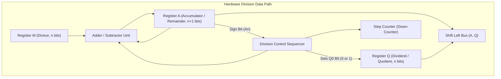

[DLCD Index](../README.md) / [Unit 4: Computer Arithmetic and Control Design](Introduction.md)

# L04 - Integer Division

In the preceding three lectures, we mastered binary multiplication across combinational arrays, sequential data paths, Booth recoding, and Wallace Trees. Now we turn to its arithmetic inverse: **Integer Division**.

Division is fundamentally more difficult to implement in silicon than multiplication. When multiplying, each partial product is calculated independently from the multiplier bits. In division, however, the choice of the next quotient bit depends on the running subtraction result—creating a trial-and-error sequential feedback loop.

In this lecture, we examine the **hardware division data path**, analyze the **Restoring Division algorithm**, discover the mathematical insight behind **Non-Restoring Division**, and trace both algorithms on hardware registers.

---

## The Principle of Binary Division

Integer division evaluates the fundamental algebraic equation:

$$\mathbf{\text{Dividend } (D) = \text{Divisor } (M) \times \text{Quotient } (Q) + \text{Remainder } (R)}$$

where the remainder must satisfy:
$$\mathbf{0 \le R < M}$$

Let's examine paper-and-pencil binary long division for $11_{10} \div 3_{10}$ ($1011_2 \div 0011_2$):

```
             0 0 1 1   <- Quotient Q = 3
       -------------
0 0 1 1 ) 1 0 1 1      <- Dividend D = 11
        - 0 0 1 1      <- Divisor M = 3
        ---------
          0 0 1 0      <- Remainder R = 2
```

In decimal long division, you guess how many times the divisor fits into the partial dividend ($0$ through $9$).
In binary division, life is simpler: a digit is either **`1`** (the divisor fits) or **`0`** (the divisor does not fit).

However, silicon cannot "look ahead" to see if a divisor fits. The hardware must physically perform a subtraction ($A - M$) and check the sign bit of the result:
- If the result is **positive** ($A \ge 0$): the divisor fit! The quotient bit is `1`.
- If the result is **negative** ($A < 0$): the divisor did not fit! The quotient bit is `0`.

---

## The Hardware Division Data Path

A sequential hardware divider uses three registers, an $(n+1)$-bit parallel adder/subtractor, and a down-counter:



Let's inspect the registers:
- **Register $M$ (Divisor)**: Holds the $n$-bit divisor throughout the operation.
- **Register $Q$ (Dividend / Quotient)**: Initialized with the $n$-bit dividend. As the dividend bits are shifted left out of $Q$ into $A$, newly calculated quotient bits are shifted in at the LSB ($Q_0$).
- **Register $A$ (Accumulator / Partial Remainder)**: Initialized to **$0$**. It is made **$n+1$ bits wide** so that its most significant bit ($A_n$) acts as an unambiguous sign bit.
- **Adder/Subtractor**: Computes $A - M$ (or $A + M$).

Registers $A$ and $Q$ form a combined $(2n+1)$-bit shift register $(A, Q)$ that shifts **left** on every cycle.

---

## The Restoring Division Algorithm

In **Restoring Division**, the hardware tests whether the divisor fits by optimistically subtracting $M$. If the subtraction yields a negative result, the hardware must **restore the original value** by adding $M$ back.

### The Algorithm:
1. **Initialize**: $A \leftarrow 0$, $M \leftarrow \text{Divisor}$, $Q \leftarrow \text{Dividend}$, $\text{Counter} \leftarrow n$.
2. **Loop ($n$ times)**:
   - **Shift Left**: Shift $(A, Q)$ left by 1 bit. (The MSB of $Q$ enters the LSB of $A$; a placeholder $0$ enters $Q_0$).
   - **Subtract**: Subtract divisor from accumulator:
     $$A \leftarrow A - M$$
   - **Test Sign of $A$ ($A_n$)**:
     - **If $A \ge 0$ (Sign bit $A_n = 0$)**: The divisor fits!
       $$\mathbf{Q_0 \leftarrow 1}$$
       (No restoration needed).
     - **If $A < 0$ (Sign bit $A_n = 1$)**: The divisor did NOT fit!
       $$\mathbf{Q_0 \leftarrow 0}$$
       $$\mathbf{A \leftarrow A + M \quad \text{(Restoration Step)}}$$
       (Add $M$ back to restore the previous partial remainder).
   - **Decrement Counter**: $\text{Counter} \leftarrow \text{Counter} - 1$.
3. **Termination**: When $\text{Counter} = 0$, the **Quotient is in $Q$** and the **Remainder is in $A$**.

---

### Restoring Division Worked Example: $11 \div 3$

Let's divide $D = 11_{10} = 1011_2$ by $M = 3_{10} = 0011_2$ ($n = 4$):
- Divisor $M = \mathbf{00011_2}$ (5 bits with sign)
- Two's complement $-M = \mathbf{11101_2}$
- Initial: $A = \mathbf{00000}$, $Q = \mathbf{1011}$, $\text{Counter} = 4$.

| Cycle | Step / Operation | Accumulator ($A$) | Quotient ($Q$) | Counter | Notes |
| :---: | :---: | :---: | :---: | :---: | :---: |
| **Start** | Initialize | `00000` | `1011` | 4 | Initial state |
| **Cycle 1** | Shift Left $(A, Q)$ | `00001` | `011_` | 4 | Shift left 1 bit |
| | Subtract: $A \leftarrow A - M$ | `11110` | `011_` | 4 | $00001 + 11101 = 11110$ ($A < 0$) |
| | $A < 0 \implies Q_0 \leftarrow 0$, Restore | **`00001`** | **`0110`** | **3** | Restore: $11110 + 00011 = 00001$ |
| **Cycle 2** | Shift Left $(A, Q)$ | `00010` | `110_` | 3 | Shift left 1 bit |
| | Subtract: $A \leftarrow A - M$ | `11111` | `110_` | 3 | $00010 + 11101 = 11111$ ($A < 0$) |
| | $A < 0 \implies Q_0 \leftarrow 0$, Restore | **`00010`** | **`1100`** | **2** | Restore: $11111 + 00011 = 00010$ |
| **Cycle 3** | Shift Left $(A, Q)$ | `00101` | `100_` | 2 | Shift left 1 bit |
| | Subtract: $A \leftarrow A - M$ | `00010` | `100_` | 2 | $00101 + 11101 = 00010$ ($A \ge 0$) |
| | $A \ge 0 \implies Q_0 \leftarrow 1$ | **`00010`** | **`1001`** | **1** | Successful! No restoration needed. |
| **Cycle 4** | Shift Left $(A, Q)$ | `00101` | `001_` | 1 | Shift left 1 bit |
| | Subtract: $A \leftarrow A - M$ | `00010` | `001_` | 1 | $00101 + 11101 = 00010$ ($A \ge 0$) |
| | $A \ge 0 \implies Q_0 \leftarrow 1$ | **`00010`** | **`0011`** | **0** | Successful! No restoration needed. |

### Final Result:
- **Quotient ($Q$)**: $\mathbf{0011_2 = 3_{10}}$
- **Remainder ($A$)**: $\mathbf{00010_2 = 2_{10}}$
- Verification: $11 = 3 \times 3 + 2$. Correct!

### The Flaw of Restoring Division:
Whenever $A < 0$, the hardware must execute **two arithmetic operations in a single cycle** (subtract $M$, then add $M$). This doubles the cycle time or wastes extra clock ticks.

---

## The Non-Restoring Division Algorithm

Can we eliminate the restoration addition completely?

Look at the mathematics of what Restoring Division does when $A < 0$:
1. It subtracts $M$: $(A - M)$.
2. It restores $M$: $(A - M + M) = A$.
3. In the next cycle, it shifts left by 1 bit (which multiplies by 2): $2A$.
4. Then it subtracts $M$: **$2A - M$**.

Now look at what happens if we **do NOT restore $M$**:
1. We leave the negative result alone: $(A - M)$.
2. In the next cycle, we shift it left: $2(A - M) = 2A - 2M$.
3. Now, instead of subtracting, suppose we **ADD $M$**:
   $$2A - 2M + M = \mathbf{2A - M}$$

Notice something incredible: **$2(A - M) + M$ is algebraically identical to $2A - M$**!

By simply choosing to **ADD $M$** in the next cycle whenever $A$ is negative, we achieve the exact same mathematical result without ever restoring the accumulator!

---

### Non-Restoring Division Rules

In every cycle, we execute **exactly one arithmetic operation**:

1. **Shift Left**: Shift $(A, Q)$ left by 1 bit.
2. **Arithmetic Operation**:
   - If $A$ was **positive** ($A \ge 0$): **Subtract $M$** ($A \leftarrow A - M$).
   - If $A$ was **negative** ($A < 0$): **Add $M$** ($A \leftarrow A + M$).
3. **Determine Quotient Bit $Q_0$**:
   - If the new $A$ is **positive** ($A_n = 0$): $\mathbf{Q_0 \leftarrow 1}$.
   - If the new $A$ is **negative** ($A_n = 1$): $\mathbf{Q_0 \leftarrow 0}$.
4. **Decrement Counter**. Repeat $n$ times.
5. **Final Correction (Post-Processing)**:
   If at the end of all $n$ cycles the remainder $A$ is negative, restore it once with an addition:
   $$\text{If } A < 0 \implies A \leftarrow A + M$$

---

### Non-Restoring Division Worked Example: $11 \div 3$

Let's divide $11$ by $3$ using Non-Restoring Division:
- $M = \mathbf{00011_2}$, $-M = \mathbf{11101_2}$.
- Initial: $A = \mathbf{00000}$, $Q = \mathbf{1011}$, $\text{Counter} = 4$.

| Cycle | Condition of $A$ | Operation Performed | Accumulator ($A$) | Quotient ($Q$) | Counter |
| :---: | :---: | :---: | :---: | :---: | :---: |
| **Start** | $A \ge 0$ | Initialize | `00000` | `1011` | 4 |
| **Cycle 1** | Shift Left $(A, Q)$ | Shift | `00001` | `011_` | 4 |
| | $A$ was $\ge 0 \implies \text{Subtract } M$ | $A \leftarrow A - M$ | `11110` | `011_` | 4 |
| | New $A < 0 \implies \mathbf{Q_0 = 0}$ | No restoration! | **`11110`** | **`0110`** | **3** |
| **Cycle 2** | Shift Left $(A, Q)$ | Shift | `11100` | `110_` | 3 |
| | $A$ was $< 0 \implies \mathbf{\text{ADD } M}$ | $A \leftarrow A + M$ ($11100 + 00011$) | `11111` | `110_` | 3 |
| | New $A < 0 \implies \mathbf{Q_0 = 0}$ | No restoration! | **`11111`** | **`1100`** | **2** |
| **Cycle 3** | Shift Left $(A, Q)$ | Shift | `11111` | `100_` | 2 |
| | $A$ was $< 0 \implies \mathbf{\text{ADD } M}$ | $A \leftarrow A + M$ ($11111 + 00011$) | `00010` | `100_` | 2 |
| | New $A \ge 0 \implies \mathbf{Q_0 = 1}$ | Sign is positive | **`00010`** | **`1001`** | **1** |
| **Cycle 4** | Shift Left $(A, Q)$ | Shift | `00101` | `001_` | 1 |
| | $A$ was $\ge 0 \implies \mathbf{\text{SUB } M}$ | $A \leftarrow A - M$ ($00101 + 11101$) | `00010` | `001_` | 1 |
| | New $A \ge 0 \implies \mathbf{Q_0 = 1}$ | Sign is positive | **`00010`** | **`0011`** | **0** |

### Final Correction Check:
The counter is 0. Is $A < 0$? No ($A = 00010 \ge 0$). No final correction needed!
- **Quotient ($Q$)**: $\mathbf{0011_2 = 3_{10}}$
- **Remainder ($A$)**: $\mathbf{00010_2 = 2_{10}}$

Look at the elegance of Non-Restoring division: **every single clock cycle executes exactly one operation**. Zero wasted restoration steps!

---

## Comparison: Restoring vs. Non-Restoring Division

| Feature | Restoring Division | Non-Restoring Division |
| :---: | :---: | :---: |
| **Operations per Cycle** | 1 operation if $A \ge 0$; **2 operations if $A < 0$** (Subtract + Add) | **Strictly 1 operation per cycle** (Always) |
| **Execution Time** | Variable and slow ($n$ to $2n$ additions) | **Fixed and deterministic ($n$ operations)** |
| **Cycle Control** | Irregular clocking or multi-step cycles | Uniform, high-speed synchronous clocking |
| **Final Step** | None (Remainder is always positive) | One conditional addition if final $A < 0$ |
| **Hardware Standard** | Educational only | **Standard in modern ALUs** |

---

## Key Takeaways

- Integer division satisfies: $\mathbf{\text{Dividend} = \text{Divisor} \times \text{Quotient} + \text{Remainder}}$, where $0 \le R < M$.
- Hardware division uses an $(n+1)$-bit Accumulator ($A$), an $n$-bit Quotient register ($Q$), an $n$-bit Divisor register ($M$), and a down-counter.
- **Restoring Division** subtracts $M$: if the sign bit turns negative, it sets $Q_0 = 0$ and adds $M$ back to restore the accumulator, wasting time.
- **Non-Restoring Division** eliminates restoration by adding $M$ in the next cycle if $A$ was negative, and subtracting $M$ if $A$ was positive ($2(A-M)+M = 2A-M$).
- Non-Restoring division requires strictly **one addition or subtraction per cycle**, making it significantly faster and standard in modern CPU ALUs.

---

Up to this point, all our arithmetic has operated on whole integers. But engineering, physics, scientific simulation, and 3D graphics require real numbers with fractional decimal points ($3.14159$, $6.022 \times 10^{23}$, $1.6 \times 10^{-19}$). In the next lecture, we master [**Floating-Point Numbers and IEEE 754 Standard**](L05%20-%20Floating-Point%20Numbers%20and%20IEEE%20754%20Standard.md), exploring single and double precision formats, biased exponents, and floating-point arithmetic.
