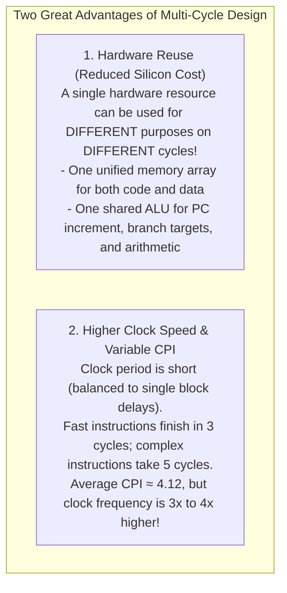
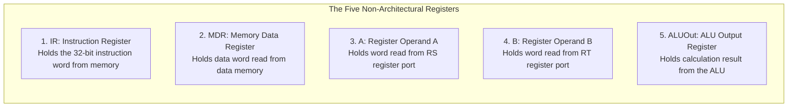
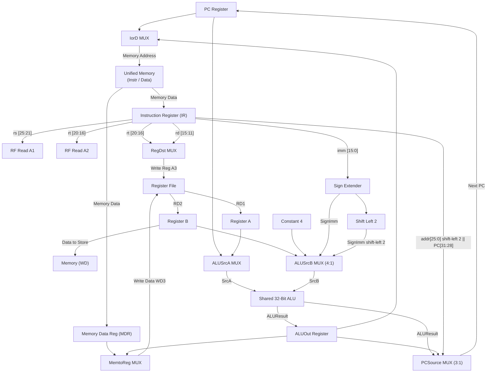

[DLCD Index](../README.md) / [Unit 4: Microarchitecture - Single-Cycle, Multi-Cycle, and Pipelined Processors](Introduction.md)

# L04 - Multi-Cycle MIPS Datapath Design

In the previous lecture, we discovered the fatal limitation of the single-cycle processor: its clock period is chained to the slowest instruction (`lw`), wasting over half of every clock cycle on fast instructions while redundantly duplicating expensive silicon hardware (requiring two memories and three adders).

How can we design a processor that lets faster instructions finish earlier, runs at a much higher clock frequency, and drastically slashes chip area?

The solution is the **Multi-Cycle Microarchitecture**.

In this lecture, we examine the architectural philosophy of multi-cycle design: breaking instruction execution into a sequence of short, balanced clock cycles, consolidating memories and ALUs through **hardware reuse**, and introducing **non-architectural internal registers** (`IR`, `MDR`, `A`, `B`, `ALUOut`) to build a unified multi-cycle MIPS datapath.

---

## The Multi-Cycle Philosophy: Hardware Reuse and Balanced Cycles

The single-cycle processor obeyed a strict rule: every instruction completes in exactly one clock cycle. Because a hardware component can only be used once per clock cycle, the single-cycle datapath was forced to duplicate components:
- It needed **two separate memories** (Instruction Memory and Data Memory).
- It needed **three separate arithmetic units** (a PC adder, a Branch adder, and the main ALU).

The multi-cycle processor relaxes this constraint: **an instruction executes across multiple, shorter clock cycles** (typically 3 to 5 cycles depending on the instruction).

This introduces two transformative advantages:

---

## Non-Architectural Registers: Bridging the Clock Cycles

In a single-cycle datapath, a signal launched from the PC travels continuously through the register file, ALU, and memory, arriving at the destination register setup window within the same clock period.

In a multi-cycle datapath, however, a clock edge occurs at the end of every stage! Any intermediate calculation produced in Cycle 1 will be wiped out when new inputs arrive in Cycle 2.
Therefore, the processor must introduce **internal temporary registers** to capture and hold intermediate results across cycle boundaries.

Because these registers are internal hardware scaffolding and are completely invisible to the programmer, they are called **Non-Architectural Registers**:

Let's examine why each register is essential:
1. **Instruction Register (`IR`)**: Latches the fetched instruction word from memory during Cycle 1. Because memory is shared and will be reused to read data in Cycle 4, `IR` holds the opcode, register numbers, and immediate constant stable for the remaining cycles of the instruction. It has an explicit write-enable line, **`IRWrite`**.
2. **Memory Data Register (`MDR`)**: Latches the data word read from memory during a `lw` instruction, holding it stable until it can be written into the register file in the next cycle.
3. **Registers `A` and `B`**: Latch the two operands read from the Register File ($\text{RD}_1, \text{RD}_2$), providing stable inputs to the ALU.
4. **`ALUOut` Register**: Latches the output of the ALU, holding effective memory addresses or arithmetic sums stable across clock boundaries.

---

## Consolidating Datapath Resources: The Shared Units

### 1. The Unified Memory System
Instead of maintaining separate instruction and data caches, the multi-cycle processor uses a **single unified memory array**:
- During **Cycle 1 (Fetch)**: The memory is read to fetch the instruction word at address $\text{PC}$.
- During **Cycle 4 (Memory Access)**: The same memory is read or written to access data at address `ALUOut`.

To switch the memory address between these two sources, we insert a 2:1 multiplexer controlled by **`IorD` (Instruction or Data)**:
- $\text{IorD} = 0$: Memory address is driven by the Program Counter ($\text{PC}$).
- $\text{IorD} = 1$: Memory address is driven by the internal register `ALUOut`.

### 2. The Single Shared ALU
Instead of three separate adders, the multi-cycle processor uses **one single ALU** for all additions and subtractions across the lifecycle of an instruction:
- In **Cycle 1**: The ALU adds $\text{PC} + 4$ to advance the Program Counter.
- In **Cycle 2**: The ALU adds $\text{PC} + (\text{Sign-Extend}(\text{imm}) \ll 2)$ to precompute the branch target address in case the instruction is a branch.
- In **Cycle 3**: The ALU performs the primary operation: adding base + offset for `lw`/`sw`, or computing the R-type operation, or subtracting $rs - rt$ for `beq`.

To feed different operands into the single ALU across different cycles, we place multiplexers at both ALU inputs:
- **`ALUSrcA` Multiplexer (2:1)**:
  - `0`: Selects the Program Counter ($\text{PC}$) for $\text{PC}+4$ or branch target calculations.
  - `1`: Selects internal register `A` (source register $rs$) for arithmetic and memory address calculations.
- **`ALUSrcB` Multiplexer (4:1)**:
  - `00`: Selects internal register `B` (source register $rt$) for R-type execution and `beq` comparison.
  - `01`: Selects constant **`4`** to increment $\text{PC} \leftarrow \text{PC} + 4$.
  - `10`: Selects the 32-bit sign-extended immediate ($\text{SignImm}$) for memory address computation.
  - `11`: Selects the sign-extended immediate shifted left by 2 ($\text{SignImm} \ll 2$) for branch target calculation.

---

## Assembling the Complete Multi-Cycle Datapath

Let's trace how the data flows through the unified multi-cycle datapath:

---

## Step-by-Step Execution Trace: Load Word (`lw`)

To appreciate how data flows across the multi-cycle datapath in physical time, let's trace a `lw` instruction across its **5 distinct clock cycles**:

### Cycle 1: Instruction Fetch
- $\text{IorD} = 0$: Memory address is driven by $\text{PC}$. Memory reads the instruction word.
- $\text{IRWrite} = 1$: The fetched instruction is clocked into the Instruction Register (`IR`).
- Concurrently, the ALU increments the PC: $\text{ALUSrcA} = 0$ ($\text{PC}$), $\text{ALUSrcB} = 01$ ($4$), $\text{ALUControl} = 010$ (Add).
- The incremented address ($\text{PC}+4$) is written directly back to the PC register ($\text{PCSource} = 00, \text{PCWrite} = 1$).

### Cycle 2: Instruction Decode and Register Read
- The instruction word is now frozen safely inside `IR`.
- Bits 25:21 ($rs$) and 20:16 ($rt$) address the Register File. The read data is clocked into internal registers `A` and `B`.
- The Sign Extender expands $\text{Instr}[15:0]$ into 32 bits.
- Opportunistically, the ALU precomputes the branch target address in case the instruction is a branch: $\text{ALUSrcA} = 0$ ($\text{PC}$), $\text{ALUSrcB} = 11$ ($\text{SignImm} \ll 2$). The result is stored in `ALUOut`. (If the instruction is not a branch, this result is simply ignored).

### Cycle 3: Memory Address Calculation
- The processor now knows this is a `lw` instruction.
- The ALU adds the base address to the offset: $\text{ALUSrcA} = 1$ (Register `A`), $\text{ALUSrcB} = 10$ ($\text{SignImm}$), $\text{ALUControl} = 010$ (Add).
- The resulting effective memory address is latched into **`ALUOut`** on the clock edge.

### Cycle 4: Memory Read
- $\text{IorD} = 1$: Memory address is driven by `ALUOut`.
- $\text{MemWrite} = 0$: Memory reads the data word at address `ALUOut`.
- At the end of the cycle, the loaded data word is latched into the Memory Data Register (**`MDR`**).

### Cycle 5: Register Writeback
- $\text{RegDst} = 0$: Selects bits 20:16 ($rt$) as the destination register address.
- $\text{MemtoReg} = 1$: Selects the data in `MDR` as the writeback data.
- $\text{RegWrite} = 1$: On the rising clock edge, the loaded data is written into register `$rt`. The instruction is complete!

---

## Hardware Comparison: Single-Cycle vs. Multi-Cycle Datapath

Let's contrast the hardware components required by both microarchitectures:

| Component | Single-Cycle Datapath | Multi-Cycle Datapath | Architectural Benefit of Multi-Cycle |
|:---|:---:|:---:|:---|
| **Memory Arrays** | **2** (Separate I-Mem & D-Mem) | **1 Unified Memory** | Cuts major silicon area; realistic shared RAM |
| **Arithmetic Units** | **3** (PC Adder, Branch Adder, ALU) | **1 Shared ALU** | Eliminates 2 large 32-bit carry-propagate adders |
| **Internal Registers** | **0** (Pure combinational paths) | **5** (`IR`, `MDR`, `A`, `B`, `ALUOut`) | Holds intermediate states across cycles |
| **Multiplexers** | 4 simple 2:1 multiplexers | 6 multiplexers (including 4:1 and 3:1) | Steers shared hardware between operational phases |
| **Clock Cycle Time** | Long ($\approx 925\text{ ps}$, chained blocks) | **Short ($\approx 250\text{ ps}$, single block)** | Clock frequency is nearly $4\times$ higher |

---

## Key Takeaways

- The Multi-Cycle MIPS Datapath breaks instruction execution into multiple shorter clock cycles, allowing faster instructions to complete earlier and enabling massive hardware reuse.
- A single unified memory array replaces separate instruction and data memories; a single ALU replaces three separate adders.
- Five non-architectural registers (`IR`, `MDR`, `A`, `B`, `ALUOut`) store intermediate calculations between clock cycles, invisible to the programmer.
- The `IorD` multiplexer switches the memory address between instruction fetch ($\text{PC}$) and data access (`ALUOut`).
- The `ALUSrcA` and `ALUSrcB` multiplexers allow the shared ALU to perform $\text{PC}+4$ in Cycle 1, branch target calculation in Cycle 2, and arithmetic or memory address computation in Cycle 3.
- Instructions have variable cycle counts: `lw` requires 5 cycles, R-type and `sw` require 4 cycles, and `beq` and `j` require 3 cycles.

---

The multi-cycle datapath has been successfully assembled with all its internal registers and multiplexers. But how does the processor transition from Cycle 1 to Cycle 2, and branch into different execution paths for different instructions? In the next lecture, [L05 - Multi-Cycle MIPS Control Unit and State Machine](L05%20-%20Multi-Cycle%20MIPS%20Control%20Unit%20and%20State%20Machine.md), we design the multi-cycle Finite State Machine and perform full CPI performance analysis.
