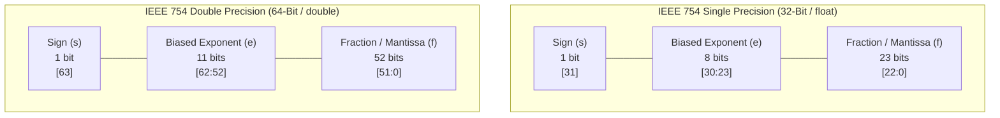
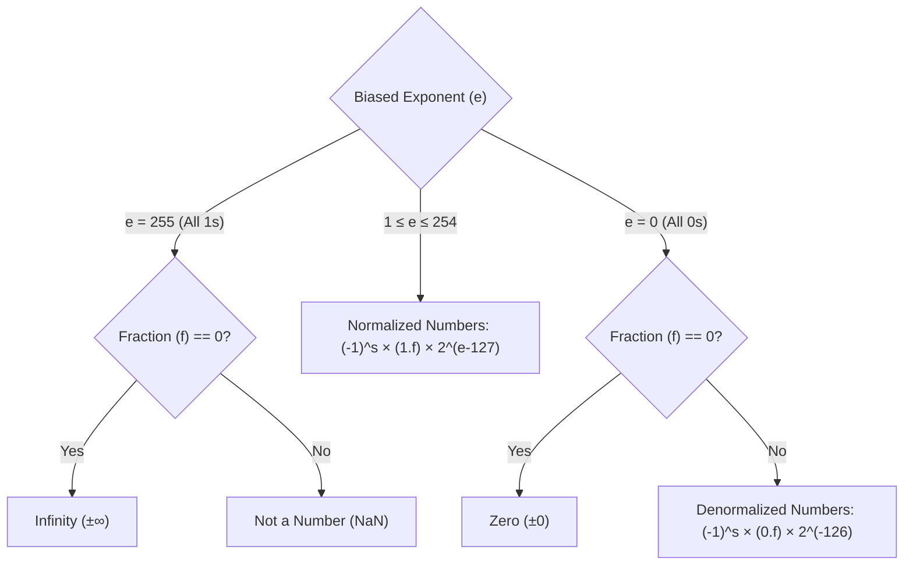

[DLCD Index](../README.md) / [Unit 4: Computer Arithmetic and Control Design](Introduction.md)

# L05 - Floating-Point Numbers and IEEE 754 Standard

In the previous four lectures, all our arithmetic circuits operated on integers: whole numbers with no decimal points. But the real physical universe does not operate solely in integers.

When a computer simulates a rocket trajectory, renders 3D lighting, or trains a machine learning neural network, it must calculate with real numbers spanning enormous extremes:
- The mass of an electron: $9.109 \times 10^{-31}\text{ kg}$
- The speed of light: $2.998 \times 10^8\text{ m/s}$
- The mass of the Sun: $1.989 \times 10^{30}\text{ kg}$

If you attempted to store these numbers using a fixed binary point (e.g., 16 bits for the integer and 16 bits for the fraction), you could never represent both the electron and the Sun in the same computer.

To capture vast dynamic ranges with high precision, computers use **Floating-Point Representation**. In 1985, UC Berkeley mathematician William Kahan led the creation of the universal standard that governs floating-point hardware on all modern processors: **IEEE Standard 754**.

In this lecture, we examine the **IEEE 754 Single and Double Precision formats**, analyze **biased exponents** and the **hidden leading bit**, decode **special values ($\pm \infty$, NaN, Denormals)**, and trace floating-point addition and multiplication.

---

## The Concept of Floating-Point (Scientific Notation)

In decimal scientific notation, real numbers are written as:
$$\pm M \times 10^E$$
where $M$ is the **Mantissa (Significand)** and $E$ is the integer **Exponent**. The decimal point is not fixed; it "floats" dynamically based on the value of $E$.

In binary digital systems, floating-point numbers follow the exact same mathematical model in base 2:

$$\mathbf{V = (-1)^s \times \text{Mantissa} \times 2^E}$$

where:
- **$s$ (Sign Bit)**: Determines polarity: $s = 0$ for positive ($+$), $s = 1$ for negative ($-$).
- **$\text{Mantissa}$**: The fractional precision bits.
- **$E$ (Exponent)**: The power of 2 that scales the number.

---

## The IEEE 754 Formats: Single and Double Precision

IEEE 754 standardizes two primary floating-point word widths:



### Architectural Parameters:

| Parameter | Single Precision (32-Bit) | Double Precision (64-Bit) |
| :---: | :---: | :---: |
| **Total Bit Width** | 32 bits (`float` in C) | 64 bits (`double` in C) |
| **Sign Bit ($s$)** | 1 bit (bit 31) | 1 bit (bit 63) |
| **Exponent Bits ($e$)** | 8 bits (bits 30..23) | 11 bits (bits 62..52) |
| **Fraction Bits ($f$)** | 23 bits (bits 22..0) | 52 bits (bits 51..0) |
| **Exponent Bias** | **$127$** ($2^{8-1} - 1$) | **$1023$** ($2^{11-1} - 1$) |
| **Effective Mantissa Precision** | **24 bits** ($\approx 7$ decimal digits) | **53 bits** ($\approx 16$ decimal digits) |
| **Dynamic Range** | $\approx 1.2 \times 10^{-38} \text{ to } 3.4 \times 10^{38}$ | $\approx 2.2 \times 10^{-308} \text{ to } 1.8 \times 10^{308}$ |

---

## The Three Components of IEEE 754

Let's dissect the engineering ingenuity behind each of the three fields:

---

### 1. The Sign Bit ($s$)
A single bit representing polarity:
$$(-1)^s \implies s = 0 \text{ is Positive}, \quad s = 1 \text{ is Negative}$$
Notice that 2's complement is **not** used for the mantissa. Floating-point numbers use an explicit sign-magnitude format because negating a number simply requires inverting the sign bit ($s \leftarrow \overline{s}$).

---

### 2. The Biased Exponent ($e$)

Why does IEEE 754 store the exponent as a **Biased (Excess-$K$)** number rather than standard 2's complement?

Suppose we used 2's complement: a positive exponent $+1$ ($00000001_2$) would appear larger than a negative exponent $-1$ ($11111111_2$) only if the hardware treated it as signed.

By adding a fixed constant **Bias ($127$ for single precision)** to the true exponent $E$:
$$\mathbf{e = E + \text{Bias} = E + 127}$$

Look at the transformation:
- True exponent $E = -126 \implies e = -126 + 127 = \mathbf{1_2} = 00000001_2$
- True exponent $E = 0 \implies e = 0 + 127 = \mathbf{127_2} = 01111111_2$
- True exponent $E = +127 \implies e = 127 + 127 = \mathbf{254_2} = 11111110_2$

Every single exponent is mapped to an **unsigned, strictly positive integer**!
**The Supreme Hardware Advantage**: A processor can compare two floating-point numbers using standard, high-speed **unsigned integer magnitude comparators** without unpacking the exponent and mantissa!

---

### 3. Normalized Mantissa & The Hidden Leading Bit

In binary scientific notation, any non-zero real number can be **normalized** so that there is exactly one non-zero binary digit to the left of the binary point:
$$V = 1.f_1 f_2 f_3 f_4 \dots_2 \times 2^E$$

Now ask yourself a simple question: In the binary numbering system, what can that non-zero digit to the left of the point possibly be?
It can **only be `1`**! (Because binary digits are only 0 or 1).

William Kahan realized: *If that leading digit is ALWAYS 1, why waste a precious bit of silicon memory storing it?*

> **The Hidden Leading Bit (Implicit 1)**:
> In normalized IEEE 754 numbers, the leading bit **`1` is implicit and NOT stored in memory**.
> The 23-bit fraction field ($f$) stores only the bits **after the binary point**:
> $$\mathbf{\text{True Mantissa} = 1.f = 1 + \sum_{i=1}^{23} f_i \cdot 2^{-i}}$$

This free architectural trick grants **24 bits of mathematical precision** out of a 23-bit physical storage field!

---

## Special Values in IEEE 754

How does IEEE 754 handle mathematical edge cases like division by zero ($1.0 / 0.0$), invalid operations ($\sqrt{-1}$), and true zero?

IEEE 754 reserves the extreme exponent values (**$e = 0$** and **$e = 255$**) to represent five special categories:



### The 5 IEEE 754 Numerical Classes:

| Exponent ($e$) | Fraction ($f$) | Mathematical Value Represented | Description / Behavior |
| :---: | :---: | :---: | :---: |
| **$0$** | **$= 0$** | **$\mathbf{\pm 0}$ (Zero)** | True zero. Both $+0$ and $-0$ exist ($s=0$ and $s=1$). |
| **$0$** | **$\neq 0$** | **$\mathbf{(-1)^s \times (0.f) \times 2^{-126}}$** | **Denormalized (Subnormal)**: Hidden bit becomes **0**! |
| **$1 \dots 254$** | Any | **$\mathbf{(-1)^s \times (1.f) \times 2^{e - 127}}$** | **Normalized**: Standard numbers with implicit leading 1. |
| **$255$** | **$= 0$** | **$\mathbf{\pm \infty}$ (Infinity)** | Overflow or division by zero ($1.0 / 0.0$). |
| **$255$** | **$\neq 0$** | **$\mathbf{\text{NaN}}$ (Not a Number)** | Invalid operations ($\sqrt{-1}$, $0.0/0.0$, $\infty - \infty$). |

### What are Denormalized Numbers?
When a calculation produces a number smaller than the smallest normalized number ($1.0 \times 2^{-126} \approx 1.18 \times 10^{-38}$), early computers suddenly flushed the result to zero (an abrupt underflow crash).

IEEE 754 solves this with **Denormalized Numbers**: when $e = 0$, the hidden bit switches from `1` to **`0`** ($0.f$). This allows numbers to shrink smoothly down to $2^{-149}$, a property known as **Gradual Underflow**.

---

## Step-by-Step Conversion Walkthrough

Let's convert a decimal real number into its exact IEEE 754 32-bit single-precision hexadecimal representation:

$$\mathbf{\text{Target Value} = -21.625_{10}}$$

### Step 1: Determine the Sign Bit
The number is negative $\implies \mathbf{s = 1}$.

### Step 2: Convert to Binary
- Convert integer part ($21$):
  $$21_{10} = 16 + 4 + 1 = \mathbf{10101_2}$$
- Convert fractional part ($0.625$):
  $$0.625 \times 2 = 1.25 \implies 1$$
  $$0.25 \times 2 = 0.50 \implies 0$$
  $$0.50 \times 2 = 1.00 \implies 1$$
  $$0.625_{10} = \mathbf{0.101_2}$$
- Combine:
  $$21.625_{10} = \mathbf{10101.101_2}$$

### Step 3: Normalize to Scientific Notation
Shift the binary point 4 places to the left so that only a single `1` remains before the point:
$$10101.101_2 = \mathbf{1.0101101_2 \times 2^4}$$
- The true exponent is **$E = 4$**.
- The mantissa with implicit 1 is $1.0101101_2$.

### Step 4: Calculate the Biased Exponent ($e$)
$$e = E + 127 = 4 + 127 = 131_{10}$$
Convert $131$ to 8-bit unsigned binary:
$$131 = 128 + 2 + 1 = \mathbf{10000011_2}$$

### Step 5: Form the 23-Bit Fraction Field ($f$)
Drop the hidden leading `1` and take the remaining fractional bits: `0101101`.
Pad with trailing zeros to reach exactly 23 bits:
$$f = \mathbf{01011010000000000000000_2}$$

### Step 6: Assemble the Complete 32-Bit Word
```
Field:      s       Exponent (e)                 Fraction (f)
Bits:      [31]       [30:23]                       [22:0]
Binary:     1        10000011        0101 1010 0000 0000 0000 000
```

Group into 4-bit nibbles and convert to hexadecimal:
$$\underbrace{1100}_{\text{C}} \; \underbrace{0001}_{1} \; \underbrace{1010}_{\text{A}} \; \underbrace{1101}_{\text{D}} \; \underbrace{0000}_{0} \; \underbrace{0000}_{0} \; \underbrace{0000}_{0} \; \underbrace{0000}_{0}$$

$$\mathbf{-21.625_{10} = 0\text{xC1AD0000}}$$

---

## Floating-Point Arithmetic Operations

Arithmetic on floating-point numbers is substantially more involved than integer operations:

### Floating-Point Addition and Subtraction ($X + Y$)
1. **Zero Check**: If one operand is zero, return the other operand.
2. **Align Mantissas**: Compare exponents $e_1$ and $e_2$. Shift the mantissa of the **smaller number to the right** by $|e_1 - e_2|$ bits until the exponents match!
3. **Add/Subtract Mantissas**: Perform addition or subtraction on the aligned mantissas.
4. **Normalize Result**: If the result overflowed ($> 2.0$), shift right and increment exponent; if the result cancelled out ($< 1.0$), shift left and decrement exponent.
5. **Round**: Round the result according to IEEE rounding modes (e.g., Round to Nearest Even).
6. **Exception Check**: Check for overflow ($e > 254 \to \infty$) or underflow ($e < 1 \to \text{Denormal}$).

### Floating-Point Multiplication ($X \times Y$)
1. **Sign Calculation**: $s_{\text{result}} = s_1 \oplus s_2$.
2. **Add Exponents**: $e_{\text{result}} = (e_1 + e_2) - 127$ (subtract the duplicate bias!).
3. **Multiply Mantissas**: Multiply the 24-bit significands ($1.f_1 \times 1.f_2$) using a Wallace Tree integer multiplier.
4. **Normalize and Round**: Shift mantissa if needed and round to 23 bits.

---

## Key Takeaways

- Fixed-point arithmetic suffers from severe dynamic range constraints; **Floating-Point** represents numbers in binary scientific notation: $\mathbf{V = (-1)^s \times (1.f) \times 2^{e - \text{Bias}}}$.
- **IEEE 754 Single Precision (32-bit)**: 1 sign bit, 8 exponent bits (Bias = 127), 23 fraction bits.
- **IEEE 754 Double Precision (64-bit)**: 1 sign bit, 11 exponent bits (Bias = 1023), 52 fraction bits.
- Exponents are **Biased** (stored as unsigned positive integers) to allow standard unsigned hardware comparators to compare floating-point numbers.
- In normalized numbers, the **leading bit `1` is implicit and hidden**, yielding 24 bits of precision from a 23-bit fraction field.
- IEEE 754 reserves special exponent states for **Zero ($e=0, f=0$)**, **Denormalized numbers ($e=0, f\neq 0$)**, **Infinity ($e=255, f=0$)**, and **NaN ($e=255, f\neq 0$)**.

---

With integer addition, subtraction, fast multiplication, division, and floating-point representations fully mastered, our arithmetic journey is complete. Now we step back into the CPU architecture to see how the Control Unit coordinates these ALU units. In the next lecture, we examine [**Fundamental Processing Concepts**](L06%20-%20Fundamental%20Processing%20Concepts.md), analyzing the internal processor bus, register gating, and memory interfacing.
