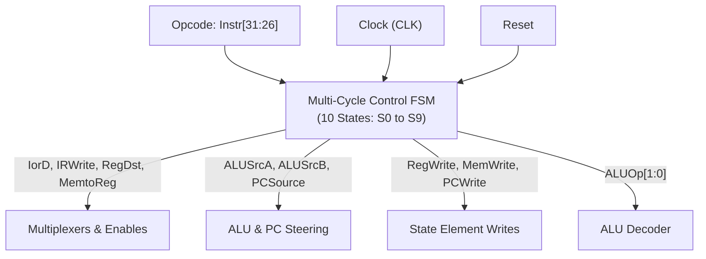
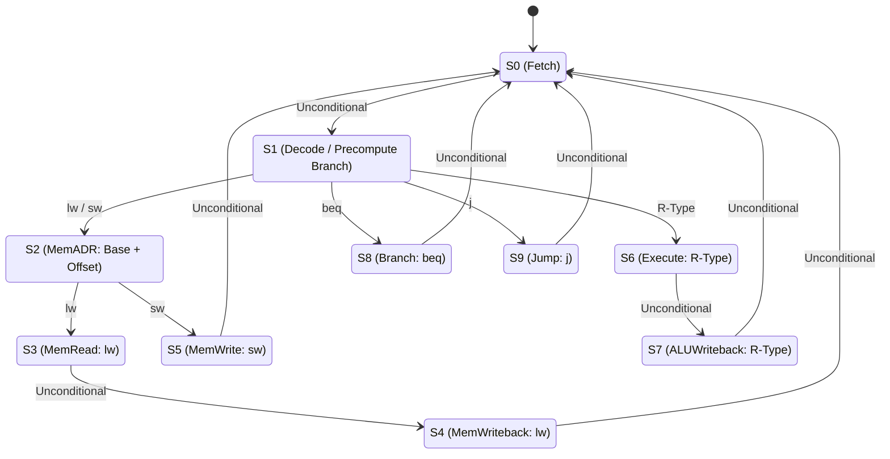

[DLCD Index](../README.md) / [Unit 4: Microarchitecture - Single-Cycle, Multi-Cycle, and Pipelined Processors](Introduction.md)

# L05 - Multi-Cycle MIPS Control Unit and State Machine

In the previous lecture, we built the multi-cycle datapath and saw how temporary registers (`IR`, `MDR`, `A`, `B`, `ALUOut`) allow a single memory and a single ALU to be reused across multiple clock cycles. But unlike the single-cycle processor where control signals remain constant for the entire duration of an instruction, a multi-cycle datapath requires control signals that **change dynamically from cycle to cycle**.

To orchestrate this sequential progression, the multi-cycle control unit cannot be a simple combinational decoder—**it must be a synchronous Finite State Machine (FSM)**.

In this lecture, we design the multi-cycle control FSM, trace the state transitions for every instruction category, calculate the average Cycles Per Instruction (CPI) using industry benchmarks, and analyze the fascinating **"Multi-Cycle Paradox"** where a processor with a $3\times$ faster clock can actually execute code slower than a single-cycle machine.

---

## The Control Unit as a Finite State Machine

In the multi-cycle processor, instruction execution is divided into five logical phases: **Fetch, Decode, Execute, Memory Access, and Writeback**.

Because the processor must remember which phase it is currently executing and branch into different states based on the instruction opcode, the control unit is synthesized as a **Moore Finite State Machine**:

The FSM takes the 6-bit opcode ($\text{Instr}[31:26]$) as its primary input. It outputs nineteen control lines to the datapath, including the 2-bit `ALUOp` feeding the standard ALU decoder.

---

## The Complete Multi-Cycle State Transition Diagram

The control FSM contains **10 distinct states** ($S_0$ through $S_9$), organized into a hub-and-spoke topology:

---

## Step-by-Step State Analysis

Let us examine the exact control signals asserted inside each of the 10 states:

### Phase 1: Instruction Fetch (State $S_0$)
- **Action**: Read the instruction word from memory at address $\text{PC}$, store it in `IR`, and increment the Program Counter: $\text{PC} \leftarrow \text{PC} + 4$.
- **Control Signals**:
  - $\text{IorD} = 0$ (Memory address from $\text{PC}$)
  - $\text{IRWrite} = 1$ (Latch fetched word into `IR`)
  - $\text{ALUSrcA} = 0$ (ALU operand 1 is $\text{PC}$)
  - $\text{ALUSrcB} = 01$ (ALU operand 2 is constant $4$)
  - $\text{ALUControl} = 010$ (Force addition)
  - $\text{PCSource} = 00$ (Select ALU result)
  - $\text{PCWrite} = 1$ (Update PC register)
- **Transition**: Every instruction visits State 0, then transitions unconditionally to State 1.

### Phase 2: Instruction Decode & Register Read (State $S_1$)
- **Action**: Read registers `$rs$` and `$rt$` into temporary registers `A` and `B`. Concurrently, precompute the branch target address in case the instruction is a branch: $\text{ALUOut} \leftarrow \text{PC} + (\text{SignImm} \ll 2)$.
- **Control Signals**:
  - $\text{ALUSrcA} = 0$ (ALU operand 1 is $\text{PC}$)
  - $\text{ALUSrcB} = 11$ (ALU operand 2 is $\text{SignImm} \ll 2$)
  - $\text{ALUControl} = 010$ (Force addition)
- **Transition**: The FSM inspects the opcode field $\text{Instr}[31:26]$ and branches into one of four distinct functional paths:
  - If `lw` or `sw` $\implies$ State 2.
  - If R-Type $\implies$ State 6.
  - If `beq` $\implies$ State 8.
  - If `j` $\implies$ State 9.

### Phase 3: The Memory Access Path (States $S_2, S_3, S_4, S_5$)
- **State $S_2$ (Memory Address Computation - `MemADR`)**:
  - Computes $\text{ALUOut} \leftarrow A + \text{SignImm}$.
  - Controls: $\text{ALUSrcA} = 1$ (Reg `A`), $\text{ALUSrcB} = 10$ ($\text{SignImm}$), $\text{ALUControl} = 010$ (Add).
  - Branch: If `lw` $\implies$ State 3; if `sw` $\implies$ State 5.
- **State $S_3$ (Memory Read - `MemRead`)**:
  - Reads Data Memory at address `ALUOut`.
  - Controls: $\text{IorD} = 1$. Latch data into `MDR` at cycle end. Transitions to State 4.
- **State $S_4$ (Memory Writeback - `MemWriteback`)**:
  - Writes data from `MDR` into destination register `$rt$.
  - Controls: $\text{RegDst} = 0$ (`$rt$`), $\text{MemtoReg} = 1$ (`MDR`), $\text{RegWrite} = 1$.
  - Instruction complete! Transitions back to State 0.
- **State $S_5$ (Memory Write - `MemWrite`)**:
  - Writes contents of register `B` into Data Memory at address `ALUOut`.
  - Controls: $\text{IorD} = 1$, $\text{MemWrite} = 1$.
  - Instruction complete! Transitions back to State 0.

### Phase 4: The R-Type Execution Path (States $S_6, S_7$)
- **State $S_6$ (Execution)**:
  - Computes $\text{ALUOut} \leftarrow A \text{ op } B$.
  - Controls: $\text{ALUSrcA} = 1$ (Reg `A`), $\text{ALUSrcB} = 00$ (Reg `B`), $\text{ALUOp} = 10$ (Consult `funct`).
  - Transitions to State 7.
- **State $S_7$ (ALU Writeback)**:
  - Writes `ALUOut` into destination register `$rd$.
  - Controls: $\text{RegDst} = 1$ (`$rd$`), $\text{MemtoReg} = 0$ (`ALUOut`), $\text{RegWrite} = 1$.
  - Instruction complete! Transitions back to State 0.

### Phase 5: The Branch and Jump Paths (States $S_8, S_9$)
- **State $S_8$ (Branch Completion - `beq`)**:
  - Compares registers: $A - B$. If $\text{Zero} = 1$, updates $\text{PC} \leftarrow \text{ALUOut}$ (the branch target precomputed in State 1!).
  - Controls: $\text{ALUSrcA} = 1$, $\text{ALUSrcB} = 00$, $\text{ALUControl} = 110$ (Subtract), $\text{PCSource} = 01$ (`ALUOut`), $\text{Branch} = 1$ ($\text{PCWriteCond}$).
  - Instruction complete! Transitions back to State 0.
- **State $S_9$ (Jump Completion - `j`)**:
  - Updates $\text{PC} \leftarrow \text{JTA}$.
  - Controls: $\text{PCSource} = 10$, $\text{PCWrite} = 1$.
  - Instruction complete! Transitions back to State 0.

---

## Instruction Cycle Breakdown and Average CPI

Because each instruction steps through its own path in the FSM, instructions have **variable cycle counts**:

| Instruction Category | State Progression | Total Clock Cycles |
|:---|:---|:---:|
| **Conditional Branch (`beq`)** | $S_0 \to S_1 \to S_8$ | **3 cycles** |
| **Unconditional Jump (`j`)** | $S_0 \to S_1 \to S_9$ | **3 cycles** |
| **Store Word (`sw`)** | $S_0 \to S_1 \to S_2 \to S_5$ | **4 cycles** |
| **R-Type (`add`, `sub`, etc.)** | $S_0 \to S_1 \to S_6 \to S_7$ | **4 cycles** |
| **Add Immediate (`addi`)** | $S_0 \to S_1 \to S_2 \to S_7$ | **4 cycles** |
| **Load Word (`lw`)** | $S_0 \to S_1 \to S_2 \to S_3 \to S_4$ | **5 cycles** |

### Calculating Average CPI on Benchmark Workloads
To compute the overall system CPI, we evaluate the instruction mix. In the standard **SPECINT2000 benchmark suite**, real-world software exhibits the following instruction distribution:
- **Loads (`lw`)**: 25%
- **Stores (`sw`)**: 10%
- **R-Type Arithmetic**: 52%
- **Conditional Branches (`beq`)**: 11%
- **Unconditional Jumps (`j`)**: 2%

We calculate the weighted average Cycles Per Instruction:

$$\text{Average CPI} = \sum (\text{Frequency}_i \times \text{Cycles}_i)$$

$$\text{Average CPI} = (0.11 + 0.02) \times 3 + (0.52 + 0.10) \times 4 + (0.25) \times 5$$

$$\text{Average CPI} = (0.13 \times 3) + (0.62 \times 4) + (0.25 \times 5)$$

$$\text{Average CPI} = 0.39 + 2.48 + 1.25 = \mathbf{4.12}$$

On average, our multi-cycle processor requires **4.12 clock cycles per instruction**.

---

## Performance Analysis: The Multi-Cycle Paradox

Now let us evaluate the multi-cycle clock period and calculate its real execution time.

### Multicycle Clock Period ($T_c$)
In the multi-cycle datapath, each stage consists of at most one major component (either a memory read, an ALU operation, or a register file read) plus multiplexing and register setup:

$$T_c = t_{\text{pcq}} + t_{\text{mux}} + \max(t_{\text{ALU}} + t_{\text{mux}}, t_{\text{mem}}) + t_{\text{setup}}$$

Using the exact same CMOS silicon parameters as L03:
- $t_{\text{pcq}} = 30\text{ ps}$
- $t_{\text{mux}} = 25\text{ ps}$
- $t_{\text{mem}} = 250\text{ ps}$
- $t_{\text{ALU}} = 200\text{ ps}$
- $t_{\text{setup}} = 20\text{ ps}$

Since $t_{\text{mem}} = 250\text{ ps} > t_{\text{ALU}} + t_{\text{mux}} = 225\text{ ps}$:

$$T_c = 30\text{ ps} + 25\text{ ps} + 250\text{ ps} + 20\text{ ps} = \mathbf{325\text{ ps}}$$

Notice the clock speed: the multi-cycle processor runs at $f = \frac{1}{325\text{ ps}} \approx \mathbf{3.08\text{ GHz}}$—nearly **three times faster** than the single-cycle processor ($1.08\text{ GHz}$)!

### The Shocking Execution Time Comparison
Now let us compute the total wall-clock time required to execute the same 100 billion instructions ($I = 100 \times 10^9$):

$$\text{Execution Time}_{\text{multicycle}} = I \times \text{CPI} \times T_c$$

$$\text{Execution Time}_{\text{multicycle}} = (100 \times 10^9) \times 4.12 \times (325 \times 10^{-12}\text{ s}) = \mathbf{133.9\text{ seconds}}$$

Recall our single-cycle execution time from L03:
$$\text{Execution Time}_{\text{single-cycle}} = \mathbf{92.5\text{ seconds}}$$

**The Multi-Cycle processor is slower than the single-cycle processor!** It takes $133.9\text{ seconds}$ versus $92.5\text{ seconds}$, despite having a 3 GHz clock!

### Why is Multi-Cycle Slower? (The Two Hidden Taxes)
How can a machine with a 3 GHz clock lose to a 1 GHz machine?
There are two fundamental structural reasons:

1. **Unequal Stage Delays**:
   Not all functional stages take the same time. The memory read takes $250\text{ ps}$, but the register file read takes only $150\text{ ps}$. Because synchronous design forces every cycle to be identical ($325\text{ ps}$), shorter stages waste $100\text{ ps}$ of dead time every single cycle.
2. **Sequencing Overhead (The Register Tax)**:
   At the end of **every single cycle**, data must be latched into a register. We must pay the physical tax of clock-to-Q and setup time:
   $$\text{Sequencing Overhead} = t_{\text{pcq}} + t_{\text{setup}} = 30\text{ ps} + 20\text{ ps} = \mathbf{50\text{ ps}}$$
   In single-cycle execution, we paid this 50 ps tax **only once per instruction**.
   In multi-cycle execution, for a 5-cycle `lw` instruction, we pay that 50 ps tax **five separate times ($250\text{ ps}$ of pure register overhead!)**.

The multi-cycle design successfully slashes silicon area, but the accumulated sequencing overhead causes it to lose in raw performance.

To achieve the best of both worlds—the short clock period of multi-cycle execution AND the $\text{CPI} \approx 1$ throughput of single-cycle execution—we must combine them.

That ultimate architecture is **Pipelining**.

---

## Key Takeaways

- The Multi-Cycle Control Unit is a 10-state synchronous Finite State Machine (Moore model) driven by the 6-bit opcode.
- State 0 (Fetch) and State 1 (Decode) are shared across all instructions.
- Variable cycle counts: `beq` and `j` require 3 cycles; R-type, `sw`, and `addi` require 4 cycles; `lw` requires 5 cycles.
- On the SPECINT2000 benchmark, the weighted average CPI is $4.12$.
- The multi-cycle clock period is short ($325\text{ ps}$ vs $925\text{ ps}$), enabling 3 GHz clock speeds.
- Despite the faster clock, multi-cycle total runtime ($133.9\text{ s}$) is slower than single-cycle ($92.5\text{ s}$) due to uneven stage quantization and paying the 50 ps register sequencing overhead on every clock cycle.

---

How do we achieve a 3 GHz clock while keeping CPI equal to 1? In the final lecture of the course, [L06 - Pipelined MIPS Processor Architecture and Hazards](L06%20-%20Pipelined%20MIPS%20Processor%20Architecture%20and%20Hazards.md), we build the 5-stage Pipelined MIPS processor and master structural, data, and control hazard resolution!
