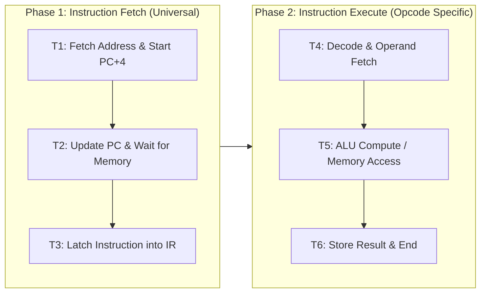

[DLCD Index](../README.md) / [Unit 4: Computer Arithmetic and Control Design](Introduction.md)

# L06 - Execution of a Complete Instruction and Branching

In Lecture 5, we analyzed the individual building blocks of the processor data path: register gating, temporary buffers $Y$ and $Z$, and memory handshakes.

Now we assemble these micro-operations into complete, cohesive machine instructions. What microscopic electronic signals are triggered on clock tick 1? What happens on clock tick 2? And how does the Control Unit dynamically branch the Program Counter when an `if` condition evaluates to true?

In this lecture, we dissect the **universal instruction fetch sequence**, trace the complete clock-cycle execution of an **ALU instruction (`Add (R3), R1`)**, a **memory load (`Move (R1), R2`)**, and a **conditional branch (`Branch_if_zero`)**, and construct the **Control Signal Activation Table**.

---

## The Dual-Phase Instruction Architecture

In a single-bus processor, the execution of every machine instruction is strictly divided into two consecutive phases:

1. **The Instruction Fetch Phase (Steps $T_1, T_2, T_3$)**:
   This three-step sequence is **100% identical for every single instruction in the CPU's instruction set**. The processor does not know what instruction it is about to execute until the end of step $T_3$.
2. **The Instruction Execution Phase (Steps $T_4, T_5, \dots$)**:
   The Control Unit decodes the opcode in the Instruction Register (IR) and branches into an instruction-specific sequence of micro-operations.

---

## The Universal Instruction Fetch Sequence

Let's trace steps $T_1$ through $T_3$ in detail:

$$\mathbf{T_1: \quad \text{PC}_{\text{out}}, \; \text{MAR}_{\text{in}}, \; \text{READ}, \; \text{Select4}, \; \text{Add}, \; Z_{\text{in}}}$$
$$\mathbf{T_2: \quad Z_{\text{out}}, \; \text{PC}_{\text{in}}, \; Y_{\text{in}}, \; \text{WMFC}}$$
$$\mathbf{T_3: \quad \text{MDR}_{\text{out}}, \; \text{IR}_{\text{in}}}$$

Look at the architectural elegance packed into these three clock cycles:

### Step $T_1$:
1. The **PC** drives the internal bus ($\text{PC}_{\text{out}}$).
2. The **MAR** latches the address ($\text{MAR}_{\text{in}}$), and the Control Unit issues an external **READ** command to primary memory.
3. *Simultaneously*, why waste the ALU while waiting for memory? 
   The ALU multiplexer is commanded to select constant 4 ($\text{Select4}$) on one input, while the current PC on the bus feeds the second input. The ALU adds them ($\text{Add}$), computing $\text{PC} + 4$.
4. The sum ($\text{PC} + 4$) is latched into temporary **Register $Z$** ($Z_{\text{in}}$).

### Step $T_2$:
1. Register $Z$ drives the updated address onto the bus ($Z_{\text{out}}$).
2. The **PC** latches this new value ($\text{PC}_{\text{in}}$), completing the update $\text{PC} \leftarrow \text{PC} + 4$.
3. *Simultaneously*, **Register $Y$** also latches this value ($Y_{\text{in}}$) so that $\text{PC} + 4$ is immediately available as a base if the instruction turns out to be a branch!
4. The CPU asserts **$\text{WMFC}$** (Wait for Memory Function Completed), stalling until memory places the instruction word into the MDR.

### Step $T_3$:
1. The memory controller has asserted MFC, latching the instruction into the MDR.
2. The **MDR** drives the instruction onto the internal bus ($\text{MDR}_{\text{out}}$).
3. The **Instruction Register (IR)** latches the word ($\text{IR}_{\text{in}}$).

At the end of step $T_3$, the instruction is inside the CPU. The control unit decodes the opcode and triggers step $T_4$.

---

## Case Study 1: ALU Instruction with Memory Operand: `Add (R3), R1`

Let's trace a complex instruction:
$$\mathbf{\text{Add } (R_3), R_1}$$
- **Meaning**: Fetch the operand from memory whose address is stored in register $R_3$, add it to the contents of register $R_1$, and store the final sum back into register $R_1$:
  $$R_1 \leftarrow R_1 + \text{Memory}[R_3]$$

### The Micro-Step Control Sequence:

| Step | Active Control Signals | Hardware Operations Executed |
| :---: | :---: | :---: |
| **$T_1$** | $\text{PC}_{\text{out}}, \text{MAR}_{\text{in}}, \text{READ}, \text{Select4}, \text{Add}, Z_{\text{in}}$ | Fetch instruction address; compute $\text{PC}+4$ |
| **$T_2$** | $Z_{\text{out}}, \text{PC}_{\text{in}}, Y_{\text{in}}, \text{WMFC}$ | Update $\text{PC} \leftarrow \text{PC}+4$; wait for instruction memory read |
| **$T_3$** | $\text{MDR}_{\text{out}}, \text{IR}_{\text{in}}$ | Latch instruction into IR; Control Unit decodes `Add (R3), R1` |
| **$T_4$** | $R_{3\text{out}}, \text{MAR}_{\text{in}}, \text{READ}$ | Load operand address from $R_3$ into MAR; issue Memory Read |
| **$T_5$** | $R_{1\text{out}}, Y_{\text{in}}, \text{WMFC}$ | Load first operand ($R_1$) into $Y$; wait for memory data to arrive |
| **$T_6$** | $\text{MDR}_{\text{out}}, \text{Add}, Z_{\text{in}}$ | MDR drives memory operand to bus; ALU adds $(Y + \text{MDR})$; latch into $Z$ |
| **$T_7$** | $Z_{\text{out}}, R_{1\text{in}}, \text{End}$ | Transfer sum from $Z$ to $R_1$; assert $\text{End}$ to reset step counter |

Notice the overlapping efficiency in step $T_5$: while the CPU is stalled waiting for external memory to read address $[R_3]$ ($\text{WMFC}$), it uses the idle internal bus to move $R_1$ into Register $Y$!

---

## Case Study 2: Memory Load Instruction: `Move (R1), R2`

Now let's trace a memory load instruction:
$$\mathbf{\text{Move } (R_1), R_2}$$
- **Meaning**: Read the data word from memory address $[R_1]$ and copy it into destination register $R_2$:
  $$R_2 \leftarrow \text{Memory}[R_1]$$

### The Micro-Step Control Sequence:

| Step | Active Control Signals | Hardware Operations Executed |
| :---: | :---: | :---: |
| **$T_1$** | $\text{PC}_{\text{out}}, \text{MAR}_{\text{in}}, \text{READ}, \text{Select4}, \text{Add}, Z_{\text{in}}$ | Fetch instruction address; compute $\text{PC}+4$ |
| **$T_2$** | $Z_{\text{out}}, \text{PC}_{\text{in}}, Y_{\text{in}}, \text{WMFC}$ | Update $\text{PC} \leftarrow \text{PC}+4$; wait for memory |
| **$T_3$** | $\text{MDR}_{\text{out}}, \text{IR}_{\text{in}}$ | Latch instruction into IR; decode opcode |
| **$T_4$** | $R_{1\text{out}}, \text{MAR}_{\text{in}}, \text{READ}$ | Transfer source address from $R_1$ into MAR; issue Memory Read |
| **$T_5$** | $\text{WMFC}$ | Wait for memory controller to place data in MDR |
| **$T_6$** | $\text{MDR}_{\text{out}}, R_{2\text{in}}, \text{End}$ | Transfer data from MDR over internal bus into $R_2$; reset counter |

The memory load completes in **6 clock steps**.

---

## Case Study 3: Conditional Branch Instruction: `Branch_if_zero LOC`

Now let's analyze how the processor evaluates decisions:
$$\mathbf{\text{Branch\_if\_zero } \text{LOC}}$$
- **Meaning**: Test the Zero condition flag ($Z$). If $Z = 1$ (the previous arithmetic result was 0), branch to target address $\text{LOC}$; if $Z = 0$, do not branch and continue in straight-line sequence.
- Target address $\text{LOC}$ is encoded in the instruction as a signed **PC-Relative offset**:
  $$\text{Target} = (\text{PC} + 4) + \text{Offset}$$

Recall from step $T_2$ that **Register $Y$ already holds $(\text{PC} + 4)$**!

### The Micro-Step Control Sequence:

| Step | Active Control Signals | Hardware Operations Executed |
| :---: | :---: | :---: |
| **$T_1$** | $\text{PC}_{\text{out}}, \text{MAR}_{\text{in}}, \text{READ}, \text{Select4}, \text{Add}, Z_{\text{in}}$ | Fetch instruction address; compute $\text{PC}+4$ |
| **$T_2$** | $Z_{\text{out}}, \text{PC}_{\text{in}}, Y_{\text{in}}, \text{WMFC}$ | Update $\text{PC}$; latch $(\text{PC}+4)$ into Register $Y$ |
| **$T_3$** | $\text{MDR}_{\text{out}}, \text{IR}_{\text{in}}$ | Latch branch instruction into IR; decode opcode |
| **$T_4$** | $\text{Offset-field-of-IR}_{\text{out}}, \text{Add}, Z_{\text{in}}$ | Extract offset from IR; ALU computes $Y + \text{Offset}$; latch into $Z$ |
| **$T_5$** | If $Z = 0 \implies \mathbf{\text{End}}$ If $Z = 1 \implies \mathbf{Z_{\text{out}}, \text{PC}_{\text{in}}, \text{End}}$ | If condition false: reset counter (PC already has $\text{PC}+4$!). If condition true: load target from $Z$ into PC! |

Look at the beauty of this logic:
- If the branch is **Not Taken ($Z = 0$)**: The instruction terminates immediately at step $T_5$ with $\text{End}$. The PC already holds $\text{PC} + 4$ from step $T_2$, so the processor seamlessly advances to the next sequential instruction!
- If the branch is **Taken ($Z = 1$)**: The target address computed in Register $Z$ is transferred into the PC ($Z_{\text{out}}, \text{PC}_{\text{in}}$), diverting execution to the branch destination!

---

## The Control Signal Activation Table

When you aggregate the control steps across all instructions supported by the CPU, you construct the **Control Signal Activation Table**. 

This table defines the master blueprint of the computer. Each row corresponds to a timing step ($T_k$), and each column corresponds to a specific physical control wire:

| Timing Step | $\text{PC}_{\text{out}}$ | $\text{MAR}_{\text{in}}$ | $\text{READ}$ | $Z_{\text{in}}$ | $Z_{\text{out}}$ | $\text{PC}_{\text{in}}$ | $Y_{\text{in}}$ | $\text{MDR}_{\text{out}}$ | $\text{IR}_{\text{in}}$ | $R_{3\text{out}}$ | $R_{1\text{in}}$ | $\text{End}$ |
| :---: | :---: | :---: | :---: | :---: | :---: | :---: | :---: | :---: | :---: | :---: | :---: | :---: | :---: |
| **$T_1$ (All)** | **1** | **1** | **1** | **1** | 0 | 0 | 0 | 0 | 0 | 0 | 0 | 0 |
| **$T_2$ (All)** | 0 | 0 | 0 | 0 | **1** | **1** | **1** | 0 | 0 | 0 | 0 | 0 |
| **$T_3$ (All)** | 0 | 0 | 0 | 0 | 0 | 0 | 0 | **1** | **1** | 0 | 0 | 0 |
| **$T_4$ (Add)** | 0 | **1** | **1** | 0 | 0 | 0 | 0 | 0 | 0 | **1** | 0 | 0 |
| **$T_5$ (Add)** | 0 | 0 | 0 | 0 | 0 | 0 | **1** | 0 | 0 | 0 | 0 | 0 |
| **$T_6$ (Add)** | 0 | 0 | 0 | **1** | 0 | 0 | 0 | **1** | 0 | 0 | 0 | 0 |
| **$T_7$ (Add)** | 0 | 0 | 0 | 0 | **1** | 0 | 0 | 0 | 0 | 0 | **1** | **1** |

To design the physical Control Unit, an engineer simply derives the Boolean logic equation for each column:
$$\mathbf{\text{MAR}_{\text{in}} = T_1 + T_4 \cdot \text{Add} + T_4 \cdot \text{Move} + \dots}$$

This is the exact algebraic bridge that transforms high-level assembly execution into physical hardware logic gates.

---

## Key Takeaways

- Every instruction execution is split into two phases: **Instruction Fetch ($T_1 - T_3$)**, which is identical for all instructions, and **Instruction Execution ($T_4 - T_n$)**, which is opcode-specific.
- During fetch ($T_1 - T_2$), the ALU computes $\text{PC} + 4$ in parallel with the memory address lookup, updating the Program Counter without wasting an extra cycle.
- An ALU instruction like `Add (R3), R1` executes across 7 steps: fetching the instruction, loading address $[R_3]$ into MAR, loading $R_1$ into $Y$, summing $\text{MDR} + Y$, and writing the sum to $R_1$.
- A conditional branch computes the target address in $T_4$ using $(\text{PC} + 4)$ pre-saved in Register $Y$. In $T_5$, it inspects the condition code flag to either update the PC or terminate.
- The **Control Signal Activation Table** maps instructions and timing steps to hardware control wires, providing the foundational mathematical specification for control unit synthesis.

---

In our single-bus architecture, an addition like `Add R1, R2, R3` took three full clock steps because only one operand could travel across the bus at a time. What if we added more buses? And how does physical hardware actually generate the control pulses $T_1, T_2, \dots$ that drive the entire machine? In the final lecture of Unit 4, we examine [**Multiple-Bus Organization and Control Unit Design**](L07%20-%20Multiple-Bus%20Organization%20and%20Control%20Unit%20Design.md), contrasting Hardwired Control with Microprogrammed Control.
