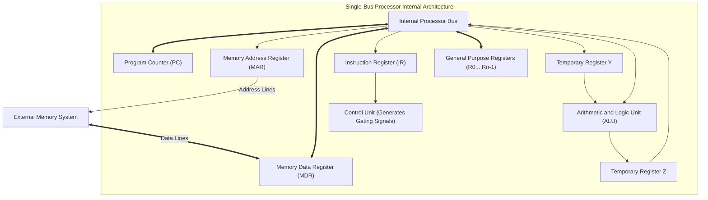
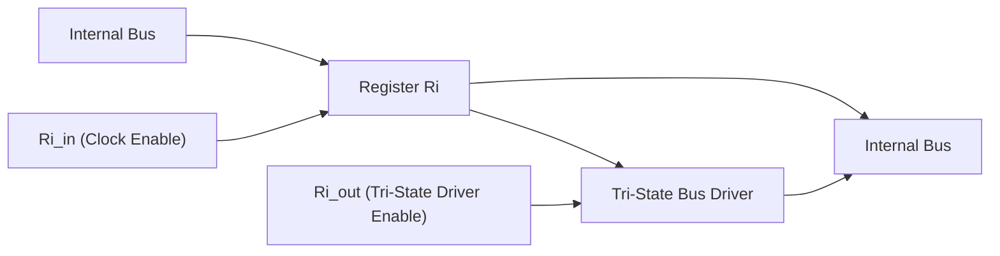

[DLCD Index](../README.md) / [Unit 4: Computer Arithmetic and Control Design](Introduction.md)

# L06 - Fundamental Processing Concepts

In Unit 3, we treated the Central Processing Unit as a unified module that fetches instructions and reads/writes memory. Now, we open the silicon lid and step directly inside the CPU.

How do registers actually exchange data? How does the ALU perform an addition when both operands reside in different registers? And how are microscopic electronic control pulses coordinated across clock cycles to read from and write to primary memory?

In this lecture, we examine the **Single-Bus Processor Organization**, analyze **register gating signals ($R_{\text{in}}, R_{\text{out}}$)**, understand why temporary registers **$Y$ and $Z$** are mandatory, and trace fundamental **register transfers, ALU operations, and memory fetch/store handshakes**.

---

## Single-Bus Processor Organization

In a single-bus processor, all internal general-purpose registers, the Program Counter (PC), Instruction Register (IR), Memory Address Register (MAR), Memory Data Register (MDR), and the Arithmetic and Logic Unit (ALU) are interconnected by a single shared internal communication path: the **Internal Processor Bus**.

Notice the layout:
- Only **one data word** can be transmitted across the internal processor bus at any given instant.
- Registers connect to the bus through electronic switches called **gating signals**.

---

## Register Gating Signals: $R_{\text{in}}$ and $R_{\text{out}}$

Every register inside the CPU is equipped with two electronic control inputs:

1. **Input Gating ($R_{i\text{in}}$)**:
   When $R_{i\text{in}} = 1$, the register's internal clock-enable pins are asserted. On the next rising clock edge, the register latches whatever data is currently present on the internal processor bus. When $R_{i\text{in}} = 0$, the register ignores the bus.
2. **Output Gating ($R_{i\text{out}}$)**:
   Registers connect their output pins to the bus through **Tri-State Drivers**. 
   - When $R_{i\text{out}} = 1$, the driver turns on, placing the register's stored word onto the internal bus.
   - When $R_{i\text{out}} = 0$, the driver enters a **High-Impedance (Hi-Z)** disconnected state.

### The Iron Rule of Bus Multiplexing
At any given instant:
- **At most ONE register can assert $R_{\text{out}}$**. If two registers assert $R_{\text{out}}$ simultaneously, a catastrophic electrical short circuit occurs on the bus wires.
- **Multiple registers can assert $R_{\text{in}}$ simultaneously**. A single data word on the bus can be latched into two or three destination registers at the exact same clock edge.

---

## Why are Temporary Registers $Y$ and $Z$ Mandatory?

Look closely at the ALU in our single-bus diagram:
The ALU has **two data inputs** (Operand 1 and Operand 2) and **one data output** (Result).

Now consider the physical dilemma of a single bus:
1. **The Dual-Input Dilemma**: The ALU needs two operands to perform an addition ($A + B$). But a single bus can only carry *one* operand at a time! 
   - If register $R_1$ drives the bus, $R_2$ cannot drive the bus simultaneously.
   - **The Solution (Register $Y$)**: The processor must first place $R_1$ on the bus and latch it into a dedicated temporary buffer: **Register $Y$**. In the next cycle, $R_2$ is placed on the bus to serve as the second ALU input, while Register $Y$ continuously supplies the first input!
2. **The Output Feedback Race Hazard**: Why can't the ALU output drive the internal bus directly?
   - While the ALU is calculating, the second operand ($R_2$) is actively driving the bus.
   - If the ALU output drove the bus at the same time, the incoming operand would be overwritten before the calculation finished, triggering an uncontrolled feedback loop.
   - **The Solution (Register $Z$)**: The ALU output is latched into an isolated holding buffer: **Register $Z$**. Only after the ALU finishes and the bus is cleared does the control unit assert $Z_{\text{out}}$ to broadcast the result onto the bus.

Registers $Y$ and $Z$ are completely invisible to software programmers, but physically indispensable to single-bus hardware.

---

## Fundamental Operations Across Control Steps

Every machine instruction is broken down into a sequence of discrete clock-cycle steps ($T_1, T_2, T_3, \dots$). During each step, the Control Unit asserts a specific combination of gating signals.

---

### 1. Register Transfer
To copy the contents of register $R_1$ into register $R_4$ ($R_4 \leftarrow R_1$):

$$\mathbf{T_1: \quad R_{1\text{out}}, \; R_{4\text{in}}}$$

- **Hardware Action**: The control unit asserts $R_{1\text{out}}$, placing $R_1$'s data onto the internal bus, and simultaneously asserts $R_{4\text{in}}$. On the rising clock edge of step $T_1$, register $R_4$ latches the bus contents.

---

### 2. Performing an Arithmetic Operation
To add the contents of register $R_1$ and $R_2$ and store the sum in $R_3$ ($R_3 \leftarrow R_1 + R_2$):

$$\mathbf{T_1: \quad R_{1\text{out}}, \; Y_{\text{in}}}$$
$$\mathbf{T_2: \quad R_{2\text{out}}, \; \text{Add}, \; Z_{\text{in}}}$$
$$\mathbf{T_3: \quad Z_{\text{out}}, \; R_{3\text{in}}}$$

Let's trace each step:
- **Step $T_1$**: Register $R_1$ drives the bus; Register $Y$ latches the first operand.
- **Step $T_2$**: Register $R_2$ drives the bus (supplying the second ALU input). The Control Unit commands the ALU to perform $\text{Add}$. The ALU computes $(Y + \text{Bus})$, and the resulting sum is latched into Register $Z$.
- **Step $T_3$**: Register $Z$ drives the sum onto the bus; destination register $R_3$ latches the sum.

The complete addition requires exactly **three clock steps**.

---

### 3. Fetching a Word from Memory

Communication with external RAM requires interfacing through the **MAR** (address) and **MDR** (data).

Because primary RAM is located off-chip, a memory read takes longer than an internal register transfer. The CPU must wait for the memory controller to assert the **Memory Function Completed (MFC)** handshake signal.

To fetch the data word stored at memory address $[R_1]$ and place it into register $R_2$ ($R_2 \leftarrow \text{Memory}[R_1]$):

$$\mathbf{T_1: \quad R_{1\text{out}}, \; \text{MAR}_{\text{in}}, \; \text{READ}}$$
$$\mathbf{T_2: \quad \text{WMFC}}$$
$$\mathbf{T_3: \quad \text{MDR}_{\text{out}}, \; R_{2\text{in}}}$$

Let's trace the hardware handshake:
- **Step $T_1$**: Address in $R_1$ is transferred to the **MAR**. The Control Unit asserts the external **READ** signal on the memory control bus.
- **Step $T_2$ ($\text{WMFC}$ - Wait for Memory Function Completed)**:
  The CPU stalls its step counter. The external memory reads the requested row and places the data onto the external data bus. When data is stable, the memory controller asserts **MFC**, which automatically latches the external data lines into the **MDR** ($\text{MDR} \leftarrow \text{Memory Data Bus}$). Upon receiving MFC, the processor unfreezes and advances to step $T_3$.
- **Step $T_3$**: The newly read data word is transferred from the **MDR** over the internal processor bus into destination register $R_2$.

---

### 4. Storing a Word into Memory

To store the contents of register $R_2$ into memory address $[R_1]$ ($\text{Memory}[R_1] \leftarrow R_2$):

$$\mathbf{T_1: \quad R_{1\text{out}}, \; \text{MAR}_{\text{in}}}$$
$$\mathbf{T_2: \quad R_{2\text{out}}, \; \text{MDR}_{\text{in}}, \; \text{WRITE}}$$
$$\mathbf{T_3: \quad \text{WMFC}}$$

- **Step $T_1$**: Destination address in $R_1$ is loaded into the **MAR**.
- **Step $T_2$**: Data word in $R_2$ is transferred over the internal bus into the **MDR**. The Control Unit asserts the external **WRITE** command on the control bus.
- **Step $T_3$ ($\text{WMFC}$)**: The CPU waits until the external memory controller finishes writing the bits into RAM and asserts MFC.

---

## Key Takeaways

- In a **Single-Bus Processor**, all internal registers, the PC, IR, MAR, MDR, and ALU share a single internal communication bus.
- Registers connect to the bus via **$R_{\text{in}}$ (clock enable)** and **$R_{\text{out}}$ (tri-state driver enable)** gating signals. At most one register can assert $R_{\text{out}}$ at any instant.
- Temporary **Register $Y$** is mandatory to hold the first ALU operand while the second operand is driven onto the single bus.
- Temporary **Register $Z$** is mandatory to buffer the ALU output and prevent feedback race hazards.
- Internal ALU operations execute across three steps: load operand into $Y$, compute and latch into $Z$, and write $Z$ to the destination register.
- Memory transfers interface through the **MAR** and **MDR**, synchronized by the asynchronous **Wait for Memory Function Completed ($\text{WMFC}$)** control signal.

---

Now that we understand the atomic micro-operations of register transfers, ALU calculations, and memory reads/writes, how does a complete instruction execute from start to finish? In the next lecture, we dissect the [**Execution of a Complete Instruction**](L07%20-%20Execution%20of%20a%20Complete%20Instruction.md), writing clock-cycle control sequences for ALU operations, memory loads, and conditional branches.
