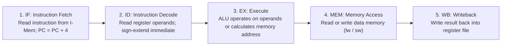
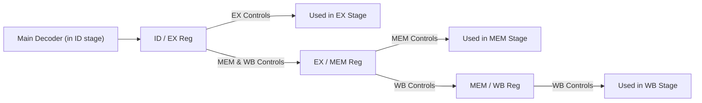
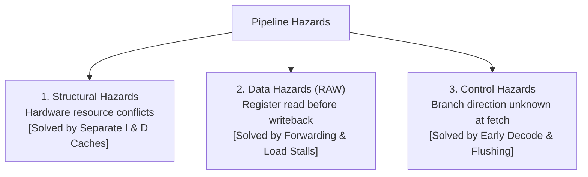
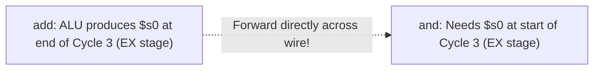
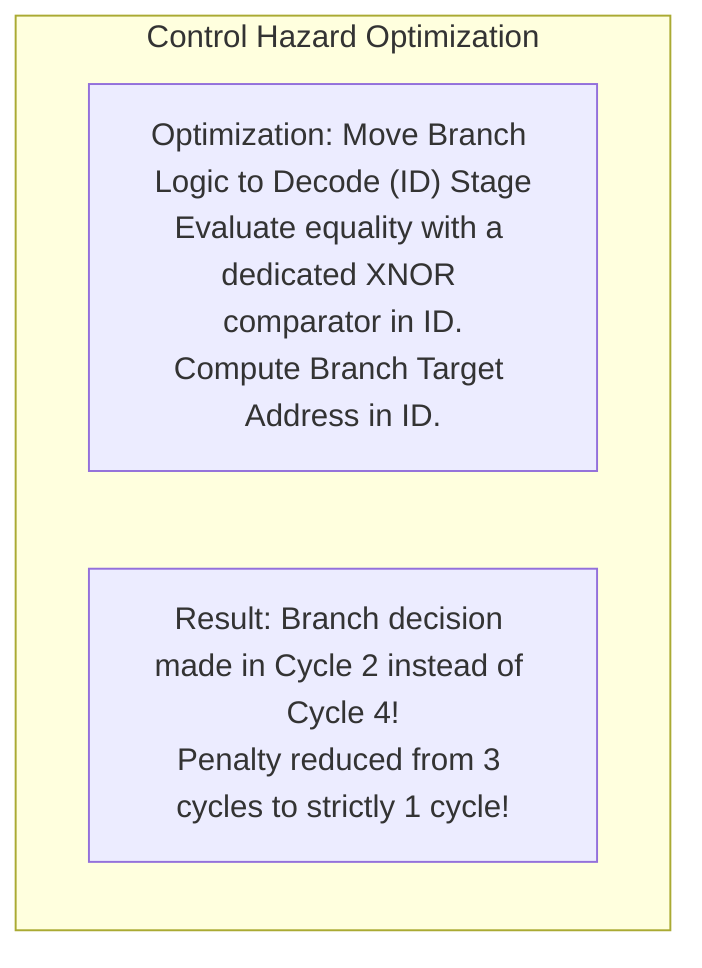

[DLCD Index](../README.md) / [Unit 4: Microarchitecture - Single-Cycle, Multi-Cycle, and Pipelined Processors](Introduction.md)

# L06 - Pipelined MIPS Processor Architecture and Hazards

In the previous lectures, we explored two architectural extremes: the Single-Cycle processor (which achieves $\text{CPI} = 1$ but suffers from a slow, bloated clock cycle) and the Multi-Cycle processor (which runs at 3 GHz but suffers from an average $\text{CPI} = 4.12$ due to sequencing overhead).

How can we build a processor that captures the best of both worlds—achieving both the **blazing clock frequency** of short stages AND an **ideal throughput of one instruction per clock cycle ($\text{CPI} = 1$)**?

The crowning achievement of modern computer engineering is **Pipelining**.

In this lecture, we examine the classic **5-stage RISC pipeline**, construct the pipelined datapath with its pipeline registers, propagate control signals in unison with data, and master the resolution of the three classic pipeline hazards: **Structural Hazards**, **Data Hazards** (resolved via Forwarding and Load-Stalls), and **Control Hazards** (resolved via Early Branch Evaluation and Flushing).

---

## The 5-Stage RISC Pipeline

Pipelining applies the principle of an industrial assembly line to digital execution. Rather than waiting for one instruction to complete all of its operations before fetching the next, a pipelined processor overlaps the execution of five consecutive instructions simultaneously.

Every MIPS instruction is decomposed into **five canonical pipeline stages**:



1. **IF (Instruction Fetch)**: Read the 32-bit instruction word from Instruction Memory using the PC, and increment the PC by 4.
2. **ID (Instruction Decode & Register Read)**: Decode the opcode, read source registers `$rs` and `$rt` from the Register File, and sign-extend the 16-bit immediate.
3. **EX (Execute / Address Calculation)**: The ALU performs arithmetic operations, evaluates conditional comparisons, or adds base + offset for memory addresses.
4. **MEM (Memory Access)**: Read or write Data Memory (active only for `lw` and `sw`).
5. **WB (Writeback)**: Write the calculation result or loaded memory word back into the destination register inside the Register File.

---

## Quantitative Throughput Analysis: Single-Cycle vs. Pipeline

Let's evaluate the real-world speedup of pipelining using standard CMOS stage delays from Harris & Harris:
- $\text{Fetch (IF)} = 250\text{ ps}$
- $\text{Decode (ID)} = 150\text{ ps}$
- $\text{Execute (EX)} = 200\text{ ps}$
- $\text{Memory (MEM)} = 250\text{ ps}$
- $\text{Writeback (WB)} = 100\text{ ps}$

### Single-Cycle Processor
An instruction must complete all five stages in one clock cycle:
- $\text{Instruction Latency} = 250 + 150 + 200 + 250 + 100 = \mathbf{950\text{ ps}}$
- $\text{Clock Period } T_c = 950\text{ ps}$
- $\text{Throughput} = \frac{1}{950\text{ ps}} \approx \mathbf{1.05\text{ billion instructions/sec}}$

### Pipelined Processor
The clock period is set by the **slowest single stage** ($\text{IF}$ or $\text{MEM} = 250\text{ ps}$):
- $\text{Clock Period } T_c = \max(250, 150, 200, 250, 100) = \mathbf{250\text{ ps}}$
- $\text{Instruction Latency} = 5 \times 250\text{ ps} = 1250\text{ ps}$ (slightly higher due to stage quantization)
- **Throughput**: Once the pipeline is full, **one instruction completes every 250 ps**:
  $$\text{Throughput} = \frac{1}{250\text{ ps}} = \mathbf{4.0\text{ billion instructions/sec}}$$

Pipelining increases instruction throughput by nearly **$4\times$**!

---

## Pipelined Datapath and Pipeline Registers

To chop the continuous datapath into five independent stages that operate concurrently on different instructions, we insert **Pipeline Registers** between adjacent stages:


- **`IF/ID` Register**: Stores the fetched instruction word ($\text{Instr}$) and the incremented $\text{PC}+4$.
- **`ID/EX` Register**: Stores operands `RD1` and `RD2`, the sign-extended immediate, register addresses `Rs`, `Rt`, and `Rd`, and all control signals for EX, MEM, and WB stages.
- **`EX/MEM` Register**: Stores the `ALUResult`, the data to write to memory (`WriteData`), the chosen destination register address (`WriteReg`), the `Zero` flag, and control signals for MEM and WB stages.
- **`MEM/WB` Register**: Stores the `ReadData` from memory, the `ALUResult`, the destination register address (`WriteReg`), and WB control signals.

### The Pipeline Register Timing Rule
Notice a critical rule of pipelining: **all data and control signals associated with a specific instruction must travel down the pipeline in unison with that instruction!**

A classic novice bug is illustrated in the writeback path:
If the destination register address (`WriteReg`) is taken directly from the Decode stage instead of being carried down through the `ID/EX`, `EX/MEM`, and `MEM/WB` pipeline registers, an instruction in the Writeback stage will accidentally overwrite the register needed by whatever newer instruction happens to be in the Decode stage! The pipeline registers act as conveyor belts preserving the identity of each instruction.

---

## Pipelined Control: Propagating Signals Down the Pipe

The pipelined processor uses the exact same combinational Main Decoder and ALU Decoder as the single-cycle processor!
The control unit sits in the **Decode (ID) stage**. Once the control signals are generated:
- Signals used in the **Execute stage** (`ALUSrc`, `ALUOp`, `RegDst`) are consumed in EX.
- Signals used in the **Memory stage** (`MemWrite`, `Branch`) travel into the `ID/EX` register, then into the `EX/MEM` register, and are consumed in MEM.
- Signals used in the **Writeback stage** (`RegWrite`, `MemtoReg`) travel all the way through to the `MEM/WB` register and are consumed in WB.



---

## Pipeline Hazards and Their Resolution

In an ideal pipeline, every stage is occupied and one instruction completes on every clock cycle ($\text{CPI} = 1.0$).
In reality, instruction dependencies create **Hazards**—situations where the next instruction cannot execute in its designated clock cycle:



---

## 1. Structural Hazards: Resource Contention

A **Structural Hazard** occurs when two instructions attempt to use the exact same physical hardware resource simultaneously.

Consider memory: if our processor had only one single shared memory (like the multi-cycle design), look at what happens in Cycle 4:
- Instruction 1 (in the MEM stage) must read or write data memory.
- Simultaneously, Instruction 4 (in the IF stage) must fetch a new instruction!
Because a single-ported memory cannot perform two accesses at once, the pipeline would be forced to stall.

### Solution
MIPS resolves this by using a **Harvard Memory Architecture** at the core level: physically separate **Instruction Cache (I-Cache)** and **Data Cache (D-Cache)**. Instruction fetch and data memory access never conflict.

Similarly, the Register File is accessed simultaneously: written in WB and read in ID. MIPS solves this by **splitting the clock cycle**:
- Register writes occur during the **first half of the clock cycle** ($0 \to \frac{T_c}{2}$).
- Register reads occur during the **second half of the clock cycle** ($\frac{T_c}{2} \to T_c$).
An instruction in ID reads the updated value written by an instruction in WB within the exact same clock period!

---

## 2. Data Hazards: Read-After-Write (RAW) Dependencies

A **Data Hazard** occurs when an instruction attempts to read a register before a preceding instruction has written its result back to the register file.

Consider this instruction sequence:
```assembly
add $s0, $s1, $s2       # Writes $s0 in Writeback (Cycle 5)
and $t0, $s0, $t1       # Needs $s0 in Execute (Cycle 3)!
or  $t2, $s0, $t3       # Needs $s0 in Execute (Cycle 4)!
sub $t4, $s0, $t5       # Reads $s0 in Decode (Cycle 5) -> OK via split clock!
```



Notice the crucial physical reality: the `add` instruction **already computes its result at the end of Cycle 3 inside the ALU**! The data physically exists in hardware; it simply hasn't traveled all the way through the pipeline registers to be written into the register file in Cycle 5.

### Solution 1: Forwarding (Bypassing)
Instead of waiting two full clock cycles for the result to travel to the register file and be read back, we add direct hardware bypass wires!

The **Forwarding Unit** detects when a source register of an instruction in the EX stage (`RsE` or `RtE`) matches the destination register of an older instruction currently in the `EX/MEM` or `MEM/WB` pipeline register:
- If `RsE == WriteRegM` and $\text{RegWriteM} = 1$: Forward the result directly from the `EX/MEM` register to the first ALU operand!
- If `RtE == WriteRegM` and $\text{RegWriteM} = 1$: Forward the result directly from the `EX/MEM` register to the second ALU operand!
- If the hazard matches the older `MEM/WB` stage, forward from the `MEM/WB` register.

By placing multiplexers at the ALU inputs, data is forwarded instantaneously, **completely eliminating stalls for arithmetic dependencies**!

---

## The Load-Use Data Hazard: When Forwarding Isn't Enough

Can forwarding solve all data hazards? **No!**

Consider a load instruction followed immediately by a dependent instruction:
```assembly
lw  $s0, 40($t1)        # Data read from Memory at END of Cycle 4 (MEM stage)
and $t2, $s0, $t3       # Needs $s0 at START of Cycle 4 (EX stage)!
```

Notice the temporal impossibility: the `lw` instruction does not receive its data from Data Memory until the **end of Cycle 4**. But the `and` instruction needs that data at the **start of Cycle 4** to feed its ALU.

Even with forwarding, the data physically does not exist yet. Hardware cannot forward data **backward in time**!


### Solution 2: The Load-Use Pipeline Stall (Bubble)
When a Load-Use dependency is detected:
- The **Hazard Unit** forces the pipeline to **stall for exactly one clock cycle**:
  1. It disables the Program Counter update ($\text{PCEn} = 0$) and disables the `IF/ID` pipeline register ($\text{IF/IDEn} = 0$), freezing the dependent instruction in the Decode stage and freezing the next instruction in Fetch.
  2. It asserts a synchronous clear ($\text{FlushE} = 1$) on the `ID/EX` register, inserting an all-zero instruction (**a bubble or `nop`**) into the Execute stage.
- During the stall cycle, the `lw` instruction advances safely from MEM to WB.
- On the following cycle, the loaded data is forwarded directly from the `MEM/WB` register into the ALU!

A Load-Use hazard imposes a **1-cycle performance penalty**. Compilers reorder independent instructions to fill this load delay slot whenever possible.

---

## 3. Control Hazards: Branching and Pipeline Flushes

A **Control Hazard** occurs when the processor must fetch the next instruction before the direction and target of a conditional branch (`beq`) have been decided.

In our unoptimized pipeline, the branch condition ($rs == rt$) and branch target are evaluated in the **Memory (MEM) stage** (Cycle 4):
- While the branch is traveling through IF, ID, and EX, the processor fetches **three sequential instructions** behind it.
- If the branch is TAKEN, those three fetched instructions are completely wrong!
- Waiting until the MEM stage would require stalling for **3 full clock cycles** at every single branch instruction, crippling processor throughput.



### Early Branch Evaluation in the Decode Stage
To minimize the branch penalty, we make two hardware modifications:
1. We add a fast **Equality Comparator** directly inside the Decode stage, comparing registers `RD1` and `RD2` using XNOR gates.
2. We add a dedicated branch target adder inside the Decode stage: $\text{BTA} = (\text{PC} + 4) + (\text{SignImm} \ll 2)$.

Now, the branch decision is made in **Cycle 2 (ID)**!

### Branch Prediction and Flushing
The processor employs static branch prediction: **Predict Not Taken**. It optimistically fetches the next sequential instruction ($\text{PC}+4$).
- If the branch is **Not Taken**: The prediction was correct! Zero cycles are lost; the pipeline runs at full speed.
- If the branch is **Taken**: The single instruction that was fetched into the `IF/ID` register during Cycle 2 is incorrect. The Hazard Unit asserts **`FlushD`**, clearing the `IF/ID` register to all zeros (`nop`).
- The branch penalty is reduced from three cycles down to **only one single cycle**!

---

## Performance Summary Across All Three Microarchitectures

Let's contrast the three MIPS processors executing our 100-billion instruction benchmark ($I = 100 \times 10^9$):

| Microarchitecture | Clock Period ($T_c$) | Clock Frequency ($f$) | Average CPI | Execution Time (100B Instructions) | Relative Speedup |
|:---|:---:|:---:|:---:|:---:|:---:|
| **Single-Cycle** | $925\text{ ps}$ | $1.08\text{ GHz}$ | **$1.0$** | **$92.5\text{ seconds}$** | $1.0\times$ (Baseline) |
| **Multi-Cycle** | $325\text{ ps}$ | $3.08\text{ GHz}$ | **$4.12$** | **$133.9\text{ seconds}$** | $0.69\times$ (Slower!) |
| **Pipelined (with Hazards)** | **$250\text{ ps}$** | **$4.00\text{ GHz}$** | **$\approx 1.15$** | **$\approx 28.8\text{ seconds}$** | **$3.2\times$ faster than Single-Cycle!** |

The pipelined processor achieves a massive **$3.2\times$ wall-clock speedup** over the single-cycle machine and is **$4.6\times$ faster** than the multi-cycle machine! Pipelining combines the short cycle time of partitioned stages with the near-unity CPI of concurrent execution.

---

## Key Takeaways

- The classic RISC pipeline partitions execution into five stages: Instruction Fetch (IF), Instruction Decode (ID), Execute (EX), Memory Access (MEM), and Writeback (WB).
- Pipeline registers (`IF/ID`, `ID/EX`, `EX/MEM`, `MEM/WB`) separate stages, carrying data and control signals forward in unison with the instruction.
- Pipelining multiplies throughput ($1/T_c$) while keeping CPI near 1.0; latency for an individual instruction increases slightly due to stage quantization.
- Structural hazards (simultaneous memory access) are eliminated by using separate Instruction and Data caches (Harvard L1 architecture).
- Data hazards (RAW) are resolved by **Forwarding** from `EX/MEM` or `MEM/WB` directly into the EX stage, completely avoiding stalls for ALU dependencies.
- The Load-Use hazard cannot be solved by forwarding alone; it requires inserting a **1-cycle stall (bubble)** in the Decode stage.
- Control hazards are minimized by moving the branch comparator into the Decode stage, reducing the branch misprediction penalty to **1 cycle**.

---

Congratulations! You have completed the entire progression of Digital Logic and Computer Design—from the digital abstraction and Boolean algebra, through latches and Finite State Machines, across memory arrays and the MIPS Instruction Set Architecture, all the way to building a fully functional, hazard-resolved, gigahertz Pipelined MIPS Microprocessor!
