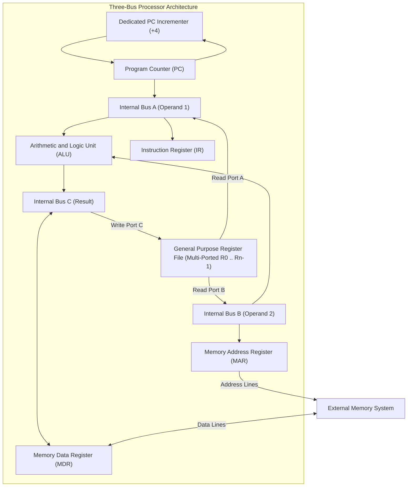
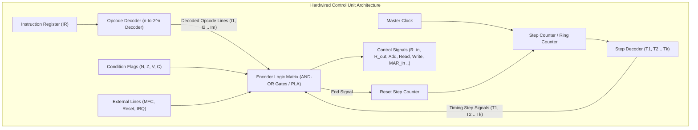
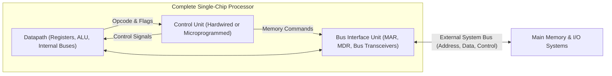
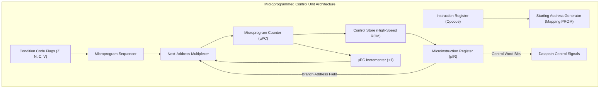
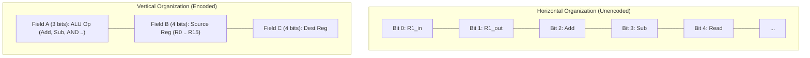
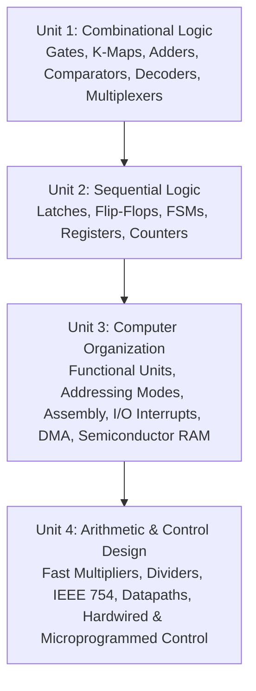

[DLCD Index](../README.md) / [Unit 4: Computer Arithmetic and Control Design](Introduction.md)

# L07 - Multiple-Bus Organization and Control Unit Design

In the preceding lectures, we mapped out the internal processor datapath: registers, ALUs, buses, and memory interfaces. We determined exactly which electronic gating signals ($R_{\text{in}}, R_{\text{out}}, \text{Add}, \text{Read}, \text{MAR}_{\text{in}}$) must be asserted during each clock cycle to execute complete instructions.

However, in a single-bus processor, an operation as simple as adding two registers ($R_3 \leftarrow R_1 + R_2$) required three separate clock cycles because only one operand could travel across the bus at a time. Furthermore, we must ask: **What physical circuit acts as the conductor of this orchestra? What hardware mechanism generates these hundreds of timing and gating pulses at gigahertz speeds?**

In this final lecture of Unit 4, we examine the **Three-Bus CPU Architecture**, analyze how multi-port register files eliminate temporary buffers, and explore the two classic paradigms of control unit synthesis: **Hardwired Control** and **Microprogrammed Control**.

---

## Multiple-Bus Organization

The single-bus design has one virtue: minimal wiring complexity. But it creates a severe traffic jam:
- Only **one data word** can travel across the bus per clock cycle.
- Intermediate temporary registers ($Y$ and $Z$) are mandatory to hold operands and prevent race hazards.
- The ALU is frequently stalled while operands are shuffled between buffers.

To break this bottleneck and achieve high instruction throughput, modern processors use a **Multiple-Bus Organization**.

---

### The Three-Bus Processor Architecture

In a **Three-Bus Processor**, the internal datapath provides three independent parallel buses: **Bus A**, **Bus B**, and **Bus C**:

### Architectural Features of the Three-Bus Datapath:
1. **Multi-Port Register File**:
   All general-purpose registers are grouped into a unified register file equipped with **three independent access ports**:
   - Two output ports (Read Port A and Read Port B) that read two arbitrary registers simultaneously onto Bus A and Bus B.
   - One input port (Write Port C) that latches the result from Bus C on the clock edge.
2. **Direct ALU Interfacing (No Registers $Y$ and $Z$!)**:
   - The first ALU input connects directly to Bus A.
   - The second ALU input connects directly to Bus B.
   - The ALU output connects directly to Bus C.
   - Because Bus A, Bus B, and Bus C are electrically independent, operands flow into the ALU and the result flows out without feedback race conditions.
3. **Dedicated PC Incrementer**:
   A dedicated incrementer circuit adds 4 to the Program Counter ($\text{PC} \leftarrow \text{PC} + 4$) autonomously, freeing the main ALU from incrementing the PC during instruction fetch.

### Single-Cycle Execution of Register Addition
Consider executing the three-operand instruction:
$$\mathbf{\text{Add } R_4, R_5, R_6 \quad (R_4 \leftarrow R_5 + R_6)}$$

In a three-bus architecture, after the instruction is fetched into the IR, the entire addition executes in **exactly ONE clock cycle**:

$$\mathbf{T_1: \quad R_{5\text{outA}}, \; R_{6\text{outB}}, \; \text{Add}, \; R_{4\text{inC}}, \; \text{End}}$$

- Register $R_5$ drives its contents onto Bus A.
- Register $R_6$ drives its contents onto Bus B.
- The ALU computes $(A + B)$ and drives the sum onto Bus C.
- Register $R_4$ latches the sum from Bus C.
- The Control Unit asserts $\text{End}$ to reset the step counter.

What took three clock cycles in a single-bus CPU now takes a single cycle!

---

## Control Unit Design: Hardwired vs. Microprogrammed

The **Control Unit (CU)** is the nerve center of the processor. It inspects the opcode in the Instruction Register (IR), tracks timing steps, tests status flags, and drives the hundreds of gating lines across the datapath.

Throughout computing history, two fundamental philosophies have governed control unit design:
1. **Hardwired Control**: The control unit is a purely combinational finite state machine built from logic gates and decoders.
2. **Microprogrammed Control**: The control unit is a miniature computer that reads control words out of an internal firmware Read-Only Memory (ROM).

---

## Hardwired Control Unit Design

A **Hardwired Control Unit** generates control signals directly using fixed combinational logic circuits:

### Building Blocks of Hardwired Control:
1. **Step Counter & Decoder**: A modulo-$k$ counter driven by the processor clock. Its outputs are decoded by a 1-of-$k$ decoder to produce non-overlapping timing step pulses: $T_1, T_2, T_3, \dots, T_k$.
2. **Opcode Decoder**: Takes the $n$-bit opcode field from the IR and decodes it into unique instruction select wires ($I_{\text{Add}}, I_{\text{Sub}}, I_{\text{Move}}, \dots$).
3. **Encoder Combinational Logic Matrix**: A network of AND-OR gates (or Programmable Logic Array) that synthesizes the Boolean equation for every control wire.
4. **The `End` Signal**: Asserted at the final micro-step of any instruction; it resets the step counter to step $T_1$, immediately launching the fetch phase of the next instruction.

### Deriving Hardwired Control Equations
To generate the physical circuit for any control signal, an engineer writes a Sum-of-Products equation matching the Control Signal Activation Table. For instance:

$$\mathbf{\text{MAR}_{\text{in}} = T_1 + T_4 \cdot \text{Add} + T_4 \cdot \text{Move} + \dots}$$
$$\mathbf{Z_{\text{in}} = T_1 + T_6 \cdot \text{Add} + T_4 \cdot \text{Branch} + \dots}$$

Because signals propagate directly through silicon gates with zero memory lookup overhead, **hardwired control delivers the fastest possible execution speed**. This makes hardwired control the universal choice for high-speed RISC processors (ARM, RISC-V, MIPS).

However, hardwired control is rigid: if a design bug is discovered or an instruction opcode is modified, the physical silicon masks must be discarded and refabricated.

---

## A Complete Processor Structure

The complete processor integrates three major subsystems into a unified chip:

---

## Microprogrammed Control Unit Design

In 1951, Maurice Wilkes proposed a revolutionary alternative to complex gate networks:
> **What if the Control Unit is designed not as a tangled web of hardware gates, but as a stored program executing inside the CPU?**

In **Microprogrammed Control**, each control signal is represented as a bit in a binary word called a **Control Word (CW)**. A sequence of control words that performs a machine instruction is a **Microprogram**.

These microprograms are stored in a dedicated high-speed Read-Only Memory inside the CPU called the **Control Store (Control ROM)**:

### Microprogrammed Execution Cycle:
1. **Instruction Fetch & Mapping**: When a machine instruction enters the IR, its opcode is fed to a Starting Address Generator (Mapping PROM). This generator outputs the starting address of that instruction's microprogram routine in the Control Store.
2. **Latch Address**: The starting address is loaded into the **Microprogram Counter ($\mu\text{PC}$)**.
3. **Read Control Word**: The Control Store reads the microinstruction into the **Microinstruction Register ($\mu\text{IR}$)**.
4. **Assert Control Lines**: The bits of the $\mu\text{IR}$ directly drive the processor datapath control wires.
5. **Next Address Generation**: The microprogram sequencer either increments the $\mu\text{PC}$ ($\mu\text{PC} + 1$) for sequential micro-steps or branches to a new micro-address based on status flags.

---

### Horizontal vs. Vertical Microinstructions

How are bits packed inside each microinstruction word in the Control Store?

#### 1. Horizontal Microinstructions:
- **Format**: Each control wire has its own dedicated bit in the microinstruction word (unencoded or minimally encoded).
- **Control Word Width**: Very wide (e.g., $40$ to $100+$ bits).
- **Advantages**: Maximum concurrency (multiple independent control signals can be asserted in parallel); zero decoding latency.
- **Disadvantages**: Large Control Store ROM area required; poor bit utilization (many bits remain 0 in any given cycle).

#### 2. Vertical Microinstructions:
- **Format**: Mutually exclusive control signals are grouped and encoded into compact binary fields (e.g., selecting one of 16 source registers requires only 4 bits instead of 16 separate wires). Decoders expand the fields at the ROM outputs.
- **Control Word Width**: Narrow (e.g., $16$ to $24$ bits).
- **Advantages**: Compact Control Store ROM size; efficient memory utilization.
- **Disadvantages**: Slower execution due to the propagation delay of the intermediate decoders; lower concurrency.

---

## Comparison: Hardwired vs. Microprogrammed Control

| Feature | Hardwired Control Unit | Microprogrammed Control Unit |
| :--- | :--- | :--- |
| **Implementation** | Pure combinational logic gates, decoders, and step counters | High-speed Read-Only Memory (Control Store ROM) and $\mu\text{PC}$ |
| **Execution Speed** | **Blazing Fast** (Direct gate propagation delay) | **Slower** (Limited by Control Store ROM access latency) |
| **Design Flexibility** | **Rigid** (Any modification requires new silicon masks) | **Highly Flexible** (Changes made by editing ROM microcode) |
| **Instruction Complexity** | Best suited for simple, uniform instructions | Ideal for complex, multi-step CISC instruction sets |
| **Silicon Area** | Grows rapidly with instruction set complexity | Compact and regular ROM layout; area scales linearly |
| **Architecture Standard** | Universal in **RISC** (ARM, RISC-V, MIPS) | Historical in **CISC** (IBM 360, VAX, early x86) |

---

## Coursework Synthesis: From Transistors to General-Purpose Computers

Across the four units of Digital Logic and Computer Design, we have assembled the complete computing machine:

We began with microscopic silicon switches (transistors and logic gates) and systematically synthesized:
1. Combinational data decoders and arithmetic adders.
2. Clocked bistable latches, registers, and finite state machines.
3. System buses, memory-mapped I/O interfaces, interrupt arbitration, and 2D dynamic RAM arrays.
4. High-speed Booth multipliers, Wallace tree compressors, floating-point ALUs, and the dual control engines—Hardwired and Microprogrammed—that bring the hardware to life.

---

## Key Takeaways

- A **Three-Bus Processor** (Buses A, B, and C) with a multi-ported register file eliminates temporary registers $Y$ and $Z$, enabling complete register-to-register additions (`Add R4, R5, R6`) to execute in a **single clock cycle**.
- The **Control Unit** generates gating and timing signals across successive clock steps to orchestrate the datapath.
- **Hardwired Control** synthesizes control signals directly using opcode decoders, step counters, and combinational AND-OR logic matrices. It offers maximum execution speed and powers modern RISC processors.
- **Microprogrammed Control** treats control signals as stored binary words (microinstructions) in a high-speed Control Store ROM, sequenced by a Microprogram Counter ($\mu\text{PC}$).
- **Horizontal Microinstructions** provide wide, unencoded words with maximum concurrency and zero decoding delay; **Vertical Microinstructions** use compact encoded fields to save ROM area at the cost of decoder latency.
- Hardwired control optimizes for speed and simplicity, while microprogramming optimizes for complex instruction sets and post-design flexibility.
