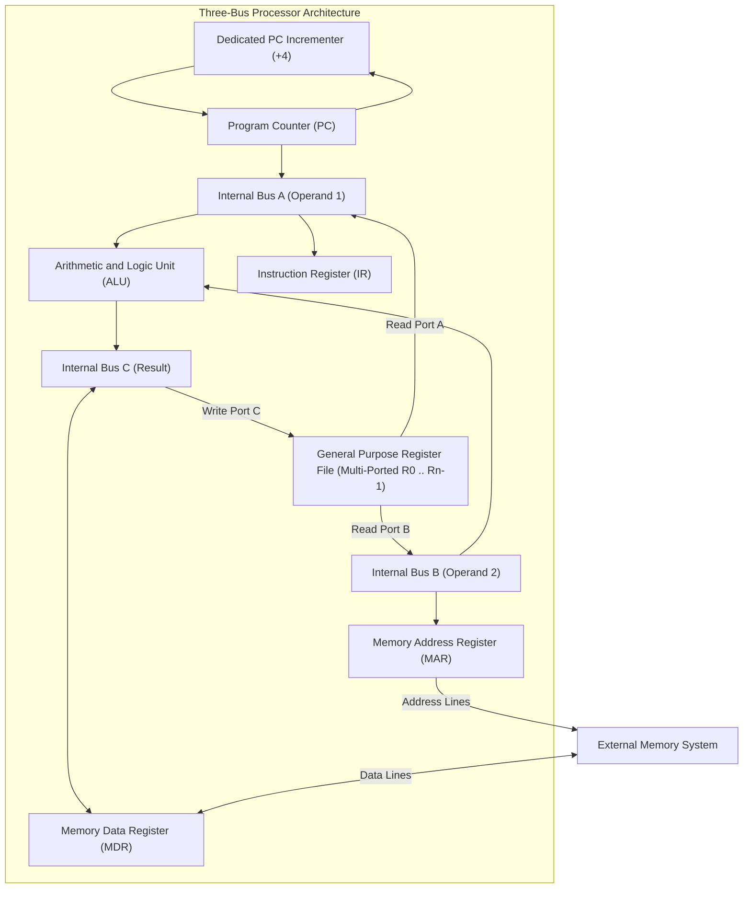

[DLCD Index](../README.md) / [Unit 4: Computer Arithmetic and Control Design](Introduction.md)

# L08 - Multiple-Bus Organization

In Lectures 6 and 7, we saw how a single internal processor bus coordinates register transfers, ALU calculations, and memory handshakes. The single-bus design has one clear virtue: it is simple to route and requires minimal silicon area.

However, the single bus creates a severe architectural traffic jam:
- Only **one data word** can travel across the bus per clock cycle.
- An operation as elementary as adding two registers ($R_3 \leftarrow R_1 + R_2$) required **three separate clock cycles** ($T_1$: move $R_1 \to Y$; $T_2$: add $R_2$ to $Y \to Z$; $T_3$: move $Z \to R_3$).
- The ALU was repeatedly stalled, and valuable processor cycles were squandered on intermediate buffer shuffling.

To break this bottleneck and achieve high instruction throughput, modern processor architectures replace the single bus with **Multiple-Bus Organizations**.

In this lecture, we examine the **Three-Bus CPU Architecture**, analyze how multi-port register files eliminate temporary registers $Y$ and $Z$, and discover how ALU operations execute in a **single clock cycle**.

---

## The Three-Bus Processor Architecture

In a **Three-Bus Processor**, the internal data path is constructed using three independent parallel buses: **Bus A**, **Bus B**, and **Bus C**.

Look at the connectivity of the three buses:
1. **Bus A**: Connects to the **first input** of the ALU. It carries the first source operand directly from the register file.
2. **Bus B**: Connects to the **second input** of the ALU. It carries the second source operand directly from the register file.
3. **Bus C**: Connects to the **output** of the ALU. It transfers the calculated result directly into the destination register in the register file.

---

## Multi-Port Register Files

How can the register file output two different registers onto Bus A and Bus B simultaneously, while also accepting a result from Bus C?

The register file is built with **Multi-Ported Storage Cells**:
- **Two Independent Read Ports**: Two separate internal decoders allow the CPU to read register $R_i$ onto Bus A and register $R_j$ onto Bus B at the exact same instant.
- **One Independent Write Port**: A third decoder allows the CPU to write the word arriving on Bus C into destination register $R_k$ on the active clock edge.

Because the register file can read two operands and write one result concurrently, all data routing occurs in parallel.

---

## Eliminating Temporary Registers $Y$ and $Z$

In Lecture 6, we proved that single-bus processors are physically forced to include temporary holding registers **$Y$ and $Z$**:
- Register $Y$ was needed because the single bus could not deliver two operands simultaneously.
- Register $Z$ was needed because the ALU output could not drive the bus while the bus was driving the input.

In a Three-Bus architecture:
1. **Register $Y$ is completely eliminated!** 
   Operand 1 travels on Bus A and Operand 2 travels on Bus B. Both arrive at the ALU inputs simultaneously. There is no need to buffer either operand!
2. **Register $Z$ is bypassed!** 
   The ALU output drives Bus C, which is completely isolated from input buses A and B. There is zero risk of feedback oscillation. The result flows straight from the ALU through Bus C into the destination register.

---

## Executing an ALU Instruction in a Single Clock Step

Let's witness the immense speedup of the three-bus architecture.
Consider adding two registers and storing the result in a third:
$$\mathbf{R_3 \leftarrow R_1 + R_2}$$

In a single-bus CPU, this required 3 clock cycles.
In our three-bus CPU, it requires **EXACTLY ONE CLOCK CYCLE**:

$$\mathbf{T_1: \quad R_{1\text{outA}}, \; R_{2\text{outB}}, \; \text{Add}, \; R_{3\text{inC}}, \; \text{End}}$$

Let's trace what happens during this single clock pulse:
1. Register $R_1$ drives Bus A ($R_{1\text{outA}}$).
2. Register $R_2$ drives Bus B ($R_{2\text{outB}}$).
3. The ALU receives both inputs simultaneously and computes $(A + B)$ ($\text{Add}$).
4. The sum is driven onto Bus C and presented to the input of register $R_3$ ($R_{3\text{inC}}$).
5. On the active clock edge at the end of step $T_1$, register $R_3$ latches the sum, and the instruction terminates ($\text{End}$)!

Execution time drops from 3 cycles to 1 cycle—a **300% throughput increase**!

---

## Complete Instruction Trace: `Add (R3), R1`

Now let's compare a complex memory-referencing instruction on both architectures:
$$\mathbf{\text{Add } (R_3), R_1} \implies R_1 \leftarrow R_1 + \text{Memory}[R_3]$$

In Lecture 7, this instruction required **7 clock steps** on a single-bus machine.

Let's write the control sequence for our Three-Bus CPU:

| Step | Active Control Signals (Three-Bus CPU) | Hardware Operations Executed |
| :---: | :---: | :---: |
| **$T_1$** | $\text{PC}_{\text{outA}}, \text{MAR}_{\text{inB}}, \text{READ}, \text{IncPC}$ | PC drives Bus A $\to$ MAR; issue Memory Read; dedicated incrementer updates PC $\leftarrow \text{PC}+4$ |
| **$T_2$** | $\text{WMFC}$ | Wait for memory controller to latch instruction word into MDR |
| **$T_3$** | $\text{MDR}_{\text{outB}}, \text{IR}_{\text{inA}}$ | Latch instruction into IR; Control Unit decodes opcode |
| **$T_4$** | $R_{3\text{outB}}, \text{MAR}_{\text{inB}}, \text{READ}$ | Load operand address from $R_3$ into MAR; issue Memory Read |
| **$T_5$** | $\text{WMFC}$ | Wait for operand data to arrive in MDR |
| **$T_6$** | $R_{1\text{outA}}, \text{MDR}_{\text{outB}}, \text{Add}, R_{1\text{inC}}, \text{End}$ | $R_1$ on Bus A, MDR on Bus B; ALU adds simultaneously; result written to $R_1$ via Bus C; End! |

Look at step $T_6$:
The CPU does not need separate cycles to load $Y$, calculate $Z$, and write back. In step $T_6$, $R_1$ drives Bus A, MDR drives Bus B, the ALU adds them, and the result is written directly into $R_1$ over Bus C in a single cycle!

Total execution steps drop from **7 steps down to 4 steps** (excluding memory wait states).

---

## Dedicated PC Incrementer

Notice another crucial architectural optimization in step $T_1$:
In a single-bus machine, we were forced to route the Program Counter through the main ALU to compute $\text{PC} + 4$, temporarily hijacking the ALU.

In a modern multiple-bus processor, the PC is equipped with its own **Dedicated PC Incrementer**:
- A small, hardwired $+4$ adder sitting directly adjacent to the PC register.
- Every time the PC is used to fetch an instruction, the incrementer updates $\text{PC} \leftarrow \text{PC} + 4$ autonomously.
- The main ALU is never disturbed, leaving it 100% available for user calculations.

---

## Architectural Comparison: Single-Bus vs. Three-Bus

| Metric | Single-Bus Processor | Three-Bus Processor |
| :---: | :---: | :---: |
| **Buses** | 1 shared internal bus | 3 independent parallel buses (A, B, C) |
| **Register File Ports** | Single read / single write port | **Dual read ports, single write port** |
| **Temporary Registers** | **Requires $Y$ and $Z$** | **Eliminates $Y$ and $Z$ completely** |
| **ALU Execution Time** | 3 clock steps per operation | **1 clock step per operation** |
| **Silicon Area / Routing** | Minimal area; easy routing | High routing density; extra metal layers |
| **Power Dissipation** | Low | Higher (driving three wide parallel buses) |
| **Instruction Throughput** | Low (High CPI: $4 - 8$ cycles/inst) | **Extremely High (Low CPI: $1 - 2$ cycles/inst)** |
| **Modern Application** | Ultra-low-power microcontrollers | **All modern desktop, mobile, and server CPUs** |

Furthermore, multiple-bus data paths are the indispensable physical foundation for **Instruction Pipelining**. A pipelined processor can fetch instruction 3 on Bus A, decode instruction 2 on Bus B, and write back instruction 1 on Bus C simultaneously, achieving an ideal throughput of **1 instruction executed per clock cycle ($\text{CPI} = 1$)**!

---

## Key Takeaways

- The Single-Bus architecture creates a throughput bottleneck because only one word can travel across the bus per cycle, requiring 3 cycles for a basic register addition.
- The **Three-Bus Architecture** provides two source buses (Bus A and Bus B) to feed the two ALU inputs, and one destination bus (Bus C) connected to the ALU output.
- Multi-ported register files allow two registers to be read onto Bus A and Bus B simultaneously while a third register is written from Bus C.
- Three buses completely **eliminate temporary registers $Y$ and $Z$**, allowing two-operand ALU instructions ($R_3 \leftarrow R_1 + R_2$) to execute in **exactly one clock cycle**.
- A **Dedicated PC Incrementer** updates the Program Counter autonomously during the fetch phase, freeing the main ALU for computation.
- While multiple-bus architectures require greater silicon area and routing density, they dramatically lower Cycles Per Instruction (CPI) and serve as the structural engine of pipelining.

---

Whether a processor uses a single-bus or three-bus data path, one fundamental question remains: **What circuitry actually decides which gating signals ($R_{\text{in}}, R_{\text{out}}, \text{Add}, \text{Read}$) turn on during each clock cycle?** 

How do we design the "brain" of the processor? In the next lecture, we examine [**Hardwired Control Unit Design**](L09%20-%20Hardwired%20Control%20Unit%20Design.md), using combinational logic matrices and step counters to synthesize blazing-fast control units.
