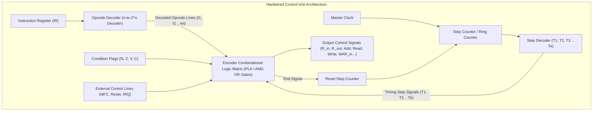
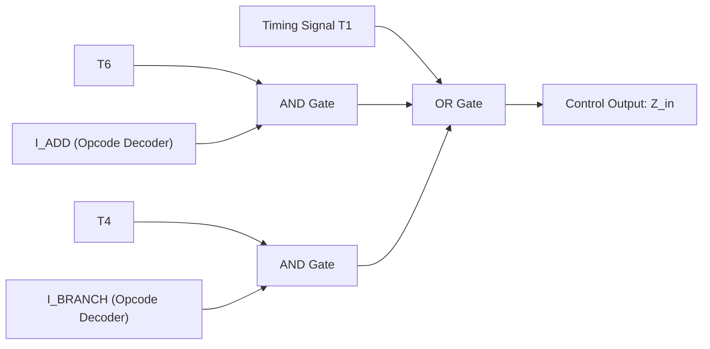
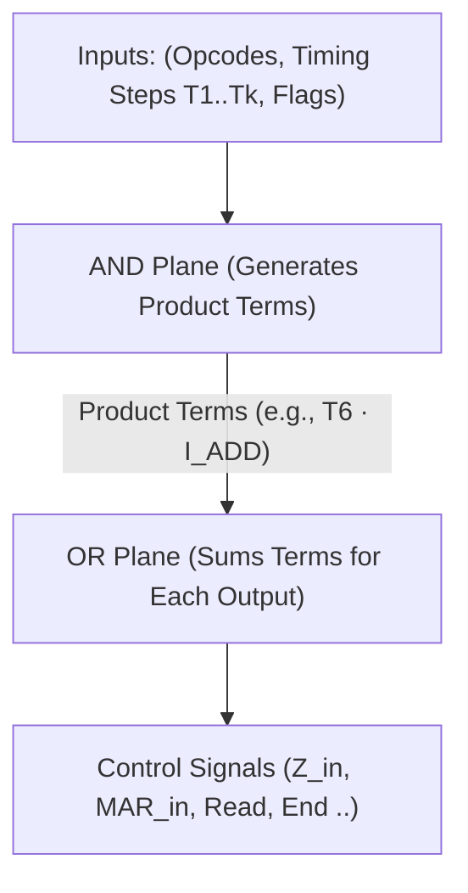

[DLCD Index](../README.md) / [Unit 4: Computer Arithmetic and Control Design](Introduction.md)

# L09 - Hardwired Control Unit Design

In the preceding lectures, we mapped out the data path: registers, ALUs, buses, and memory interfaces. We determined exactly which electronic gating signals ($R_{\text{in}}, R_{\text{out}}, \text{Add}, \text{Read}, \text{MAR}_{\text{in}}$) must be asserted during each clock cycle to execute instructions like `Add` and `Move`.

Now we confront the central control question of computer engineering:
**What physical circuit acts as the conductor of this orchestra? What hardware mechanism generates these hundreds of timing and gating pulses at gigahertz speeds?**

The component responsible is the **Control Unit (CU)**. 

Throughout computing history, control units have been built using one of two competing philosophies: **Hardwired Control** (pure combinational logic gates) and **Microprogrammed Control** (firmware ROM lookup tables).

In this lecture, we examine the architecture of a **Hardwired Control Unit**, analyze how step counters and instruction decoders drive the combinational logic matrix, and derive exact Boolean equations for processor control wires.

---

## What is a Hardwired Control Unit?

A **Hardwired Control Unit** is a finite state machine constructed entirely from **fixed combinational logic gates, decoders, and step counters**. 

The control signals are generated as direct Boolean functions of:
1. The currently decoded instruction opcode.
2. The current timing step ($T_1, T_2, T_3, \dots$).
3. The condition code flags ($N, Z, V, C$).
4. External control bus lines (such as $\text{MFC}$ and $\text{Reset}$).

Because the control signals flow directly through physical gates without any intermediate memory access, **hardwired control units operate at the maximum possible speed of silicon**.

---

## Architecture of a Hardwired Control Unit

A hardwired control unit is composed of four primary hardware modules:

Let's dissect each module:

### 1. The Opcode Decoder
The Instruction Register (IR) holds the current machine instruction. The upper bits of the IR (the opcode field) are routed into an $n$-to-$2^n$ line decoder (the exact MSI circuit we designed in Unit 1, Lecture 9!).
- The decoder asserts **exactly one output line** corresponding to the active instruction (e.g., line $I_{\text{ADD}} = 1$, or $I_{\text{MOVE}} = 1$, or $I_{\text{BRANCH}} = 1$).

### 2. The Step Counter (Timing Generator)
The step counter coordinates the sequential progression through clock cycles ($T_1, T_2, T_3, \dots$):
- It is typically built from a **Synchronous Modulo-$k$ Counter** (Unit 2, Lecture 9) feeding a decoder, or directly from a **Ring Counter** (Unit 2, Lecture 10).
- On each active clock edge, the active timing signal advances: $T_1 \to T_2 \to T_3 \dots$
- When an instruction completes, the control unit asserts the **$\text{End}$** signal, which immediately resets the step counter back to $T_1$ to begin fetching the next instruction!

### 3. Condition Flags and External Inputs
The status flags ($N, Z, V, C$) and memory handshake line ($\text{MFC}$) enter the control matrix directly to enable conditional branching and memory wait states.

### 4. The Encoder (Combinational Logic Matrix)
The **Encoder** is the physical core of the control unit. It takes all the decoded opcode lines ($I_k$), all the timing step lines ($T_j$), and the condition flags, and synthesizes the final control wires using an array of AND and OR gates (or a **Programmable Logic Array - PLA**).

---

## Deriving Boolean Equations for Control Signals

How does an engineer determine the gate layout inside the encoder matrix?

We return to the **Control Signal Activation Table** we constructed in Lecture 7!
Every control wire is expressed as a **Sum-of-Products (SOP)** Boolean expression:

$$\mathbf{\text{Control Signal} = \sum (\text{Decoded Opcode } I_k \cdot \text{Timing Step } T_j \cdot \text{Condition})}$$

Let's derive the exact Boolean equations for several critical processor control wires:

---

### 1. Control Signal: $Z_{\text{in}}$ (Latch ALU output into Register $Z$)

Review the instructions in our architecture to see when $Z_{\text{in}}$ must be asserted:
- In step $T_1$ for **all instructions** (to latch $\text{PC} + 4$ into $Z$).
- In step $T_6$ during the execution of the `Add` instruction ($R_1 \leftarrow R_1 + \text{Memory}[R_3]$).
- In step $T_4$ during the execution of the `Branch_if_zero` instruction (to compute $\text{Target} = Y + \text{Offset}$).

Combining these terms with an OR gate gives the exact hardware equation:

$$\mathbf{Z_{\text{in}} = T_1 + T_6 \cdot I_{\text{ADD}} + T_4 \cdot I_{\text{BRANCH}} + \dots}$$

Look at that circuit: whenever $T_1$ is high, OR gate output $Z_{\text{in}}$ fires. When the opcode is `Add` and the step counter hits $T_6$, $Z_{\text{in}}$ fires. The circuit translates timing and instructions into voltages with zero delay!

---

### 2. Control Signal: $\text{MAR}_{\text{in}}$ (Load Memory Address Register)

When must an address be loaded into the MAR?
- In step $T_1$ for **all instructions** (to fetch the instruction address from the PC).
- In step $T_4$ for `Add (R3), R1` (to load operand address from $R_3$).
- In step $T_4$ for `Move (R1), R2` (to load source address from $R_1$).
- In step $T_4$ for `Move R2, (R1)` (to load destination address from $R_1$).

The synthesized Boolean equation is:

$$\mathbf{\text{MAR}_{\text{in}} = T_1 + T_4 \cdot I_{\text{ADD}} + T_4 \cdot I_{\text{MOVE\_LOAD}} + T_4 \cdot I_{\text{MOVE\_STORE}} + \dots}$$
Factoring terms:
$$\mathbf{\text{MAR}_{\text{in}} = T_1 + T_4 \cdot (I_{\text{ADD}} + I_{\text{MOVE\_LOAD}} + I_{\text{MOVE\_STORE}} + \dots)}$$

---

### 3. Control Signal: $\text{MDR}_{\text{out}}$ (Drive Data from MDR to Internal Bus)

When does the MDR drive the internal bus?
- In step $T_3$ for **all instructions** (to transfer the fetched instruction into the IR).
- In step $T_6$ for `Add (R3), R1` (to feed the memory operand into the ALU).
- In step $T_6$ for `Move (R1), R2` (to load data into register $R_2$).

$$\mathbf{\text{MDR}_{\text{out}} = T_3 + T_6 \cdot (I_{\text{ADD}} + I_{\text{MOVE\_LOAD}} + \dots)}$$

---

### 4. Control Signal: $\text{End}$ (Terminate Instruction & Reset Counter)

When does the current instruction finish?
- In step $T_7$ for `Add (R3), R1`.
- In step $T_6$ for `Move (R1), R2`.
- In step $T_5$ for `Branch_if_zero` (both taken and not-taken paths).

$$\mathbf{\text{End} = T_7 \cdot I_{\text{ADD}} + T_6 \cdot I_{\text{MOVE\_LOAD}} + T_5 \cdot I_{\text{BRANCH}} + \dots}$$

The $\text{End}$ line loops back to the asynchronous clear pin of the step counter, immediately rolling it back to $T_1$ on the next clock pulse.

---

## Implementation via Programmable Logic Arrays (PLA)

In early mainframes, engineers wired these equations using discrete TTL AND and OR gates. In modern Integrated Circuits, however, hardwired control matrices are implemented as **Programmable Logic Arrays (PLAs)**:

A PLA consists of:
1. An **AND Plane**: Generates all required product terms ($T_6 \cdot I_{\text{ADD}}$, $T_1$, $T_4 \cdot I_{\text{BRANCH}}$).
2. An **OR Plane**: Sums the appropriate product terms to produce each output control wire.

The PLA provides a regular, compact physical layout on the silicon die, dramatically reducing wire routing parasitic capacitance.

---

## Architectural Evaluation: Strengths and Weaknesses

Hardwired control represents the extreme performance boundary of computer architecture:

### Advantages:
1. **Blazing Speed**: Because signals propagate purely through combinational logic gates, control pulses are asserted within fractions of a nanosecond. There is zero memory access latency.
2. **Optimal for RISC**: In Reduced Instruction Set Computers (ARM, RISC-V, MIPS), instructions are simple, uniform, and fixed in length. The control equations are straightforward, making hardwired control the universal choice for modern multi-gigahertz processors.

### Disadvantages:
1. **Complete Inflexibility**: The logic is physically etched into silicon. If a design bug is discovered, or if architects want to add a new instruction, the entire chip mask must be discarded and refabricated at a cost of millions of dollars!
2. **Complex for CISC**: In Complex Instruction Set Computers (like x86), which have hundreds of variable-length instructions, the PLA and gate matrices become so vast and tangled that design, verification, and timing closure become nearly impossible.

---

## Key Takeaways

- The **Control Unit** generates the timing and gating signals that coordinate the data path and memory transfers.
- A **Hardwired Control Unit** is a finite state machine constructed exclusively from combinational logic gates, decoders, and a step counter.
- The **Step Counter** produces one-hot timing pulses ($T_1, T_2, \dots$), advancing on each clock edge and resetting when $\text{End} = 1$.
- The **Opcode Decoder** converts the instruction register opcode into individual one-hot instruction signals ($I_k$).
- Every output control signal is expressed as a **Sum-of-Products (SOP) Boolean expression** combining timing steps, opcodes, and condition flags:
  $$\mathbf{\text{Control Signal} = \sum (I_k \cdot T_j \cdot \text{Condition})}$$
- Hardwired control offers maximum physical speed, making it the standard for RISC architectures, but lacks flexibility and becomes unmanageably complex for CISC machines.

---

How do you design a control unit for a computer with hundreds of complex, variable-length instructions without drowning in an ocean of millions of logic gates? In 1951, Maurice Wilkes proposed a revolutionary alternative: **Microprogramming**. In our final lecture, we explore [**Microprogrammed Control Unit Design**](L10%20-%20Microprogrammed%20Control%20Unit%20Design.md), treating hardware control as software firmware stored in a Control Store ROM.
