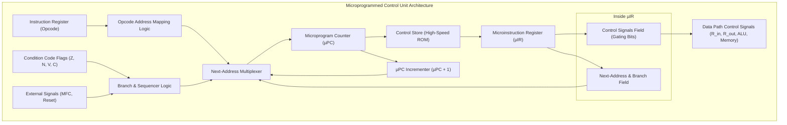
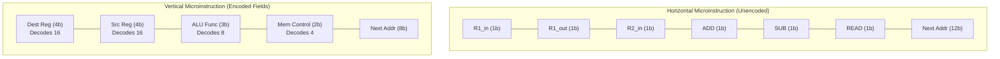
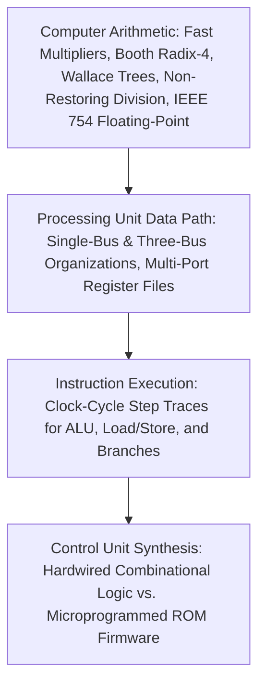

[DLCD Index](../README.md) / [Unit 4: Computer Arithmetic and Control Design](Introduction.md)

# L10 - Microprogrammed Control Unit Design

In Lecture 9, we synthesized a hardwired control unit using step counters, opcode decoders, and combinational logic matrices. Hardwired control delivers blazing, single-gate speed—making it the undisputed choice for simple, uniform RISC architectures.

However, as computers evolved in the 1960s and 1970s, processors grew immensely complex. Complex Instruction Set Computers (CISC)—such as the IBM System/360, DEC VAX, and Intel x86—supported hundreds of instructions, variable-length formats, and dozens of addressing modes.

Designing a hardwired gate matrix for such a machine became an engineering nightmare:
- The Boolean equations sprawled across thousands of tangled terms.
- A single logic bug discovered after fabrication required throwing away the silicon masks and refabricating the chip at astronomical cost.
- Adding a new instruction required redesigning the entire processor core.

In 1951, Maurice Wilkes at Cambridge University proposed a revolutionary alternative:
**What if we design the Control Unit not as a tangled web of hardware gates, but as a software program executing inside the CPU?**

This methodology is called **Microprogramming**. In this final lecture of Unit 4, we examine the architecture of a **Microprogrammed Control Unit**, contrast **horizontal against vertical microinstructions**, trace microprogram sequencing, and evaluate the grand trade-offs between hardwired and microprogrammed systems.

---

## The Concept of Microprogramming

To understand microprogramming, look closely at what the Control Unit does during each clock step ($T_1, T_2, \dots$):
It asserts a specific set of 1s and 0s on a collection of control wires:
- $R_{1\text{out}} = 1$
- $Y_{\text{in}} = 1$
- $\text{Add} = 0$
- $\text{Read} = 0$

Maurice Wilkes realized:
> **A set of control signals active during one clock cycle can be represented as a binary word called a Microinstruction. A sequence of microinstructions that executes a complete machine instruction is a Microprogram.**

```
Microinstruction Word:
+-------+--------+-----+------+-----+---------+------+-------------------+
| R1in  | R1out  | Add | Read | MAR | MDRout  | ...  | Next Address / Br |
+-------+--------+-----+------+-----+---------+------+-------------------+
    0       1       0     0      1       0               Step T4 Target
```

Instead of generating these bits using complex combinational gates, we store them in a dedicated high-speed Read-Only Memory inside the CPU: the **Control Store (Control Memory)**!

Executing an instruction simply means:
1. Translating the machine opcode into a starting address in the Control Store ROM.
2. Reading microinstructions sequentially from the ROM.
3. The bits read from the ROM **are** the physical control wires driving the data path!

---

## Architecture of a Microprogrammed Control Unit

A microprogrammed control unit is structured like a miniature, self-contained computer inside the CPU:



Let's examine each component:
1. **Control Store (Control Memory)**: A high-speed ROM storing all microprograms (firmware) for every machine instruction supported by the CPU.
2. **Microprogram Counter ($\mu\text{PC}$)**: A register that holds the memory address of the **next microinstruction** to be fetched from the Control Store.
3. **Microinstruction Register ($\mu\text{IR}$)**: A buffer that holds the microinstruction currently being executed. It is partitioned into two sections:
   - **Control Field**: The bits that drive the processor gating signals ($R_{\text{in}}, R_{\text{out}}, \text{Add}, \text{MAR}_{\text{in}}, \dots$).
   - **Next-Address Field**: Information indicating how to calculate the address of the next microinstruction.
4. **Opcode Address Mapping Logic**: When a new instruction enters the IR, this circuit maps the opcode into the starting address of its corresponding microprogram in the Control Store.
5. **Next-Address Multiplexer**: Selects the next $\mu\text{PC}$ value among three sources:
   - The **Incrementer ($\mu\text{PC} + 1$)** for normal sequential execution.
   - The **Next-Address Field** of the current microinstruction for branching.
   - The **Opcode Mapping Logic** when initiating a newly fetched instruction.

---

## Microinstruction Formats: Horizontal vs. Vertical

How should the control bits be arranged inside a microinstruction word?
Two competing design formats exist:



---

### 1. Horizontal Microinstructions
- **Unencoded / Minimally Encoded**: Every single control wire in the processor is allocated its own dedicated 1-bit position in the microinstruction word.
- If the processor has 80 control signals, the control field is 80 bits wide!
- **Advantages**:
  - **Maximum Parallelism**: In a single clock cycle, the microinstruction can activate multiple functional units simultaneously (e.g., read $R_1$, add in the ALU, and initiate a memory read).
  - **Zero Decoding Delay**: The bits in the $\mu\text{IR}$ connect directly to the hardware gates with no intervening decoders.
- **Disadvantages**:
  - Extremely wide microinstructions ($64\text{ to } 128\text{ bits}$).
  - Sparse bit utilization: most bits in any given cycle are `0`, wasting expensive ROM space.

---

### 2. Vertical Microinstructions
- **Highly Encoded**: Mutually exclusive control signals are grouped together and encoded into compact binary fields using decoders.
  - For example, if a processor has 16 general-purpose registers, only one register can drive Bus A at a time. Instead of using 16 separate output bits, we encode them into a **4-bit field ($2^4 = 16$)** and place a 4-to-16 line decoder at the output!
  - An ALU with 8 functions is encoded into a **3-bit field ($2^3 = 8$)**.
- **Advantages**:
  - Very compact microinstructions ($16\text{ to } 32\text{ bits}$ wide).
  - High memory density; significantly smaller Control Store ROM.
- **Disadvantages**:
  - **Slower Execution**: The encoded bits must pass through decoders before reaching the hardware gates, adding propagation delay.
  - **Reduced Parallelism**: Only one action can be selected within each encoded field per clock cycle.

---

### Comparison of Microinstruction Formats

| Feature | Horizontal Microinstructions | Vertical Microinstructions |
| :---: | :---: | :---: |
| **Bit Width** | Wide ($60 - 120\text{ bits}$) | Narrow ($16 - 32\text{ bits}$) |
| **Encoding** | Unencoded (1 bit per control wire) | Highly encoded into functional fields |
| **Decoding Logic** | None (Direct connection to gates) | Requires decoders ($n$-to-$2^n$) |
| **Execution Speed** | Very fast (No decoder delay) | Slower (Decoder propagation delay) |
| **Parallel Control** | High (Can assert many gates at once) | Low (Only 1 operation per field) |
| **ROM Area Cost** | Large, sparse memory footprint | Compact, efficient memory footprint |

Modern CISC processors strike a balance, using **Field-Encoded (Diagonal)** microinstructions: grouping strictly mutually exclusive signals (like register select lines) into small encoded fields while leaving critical timing lines unencoded.

---

## Microprogram Sequencing and Execution Trace

Let's trace how a microprogram executes inside the Control Store.

Suppose the processor supports instructions stored at the following micro-addresses:
- Address `0` to `2`: The Universal Instruction Fetch Microprogram.
- Address `10` to `13`: The `Add (R3), R1` Microprogram.
- Address `20` to `22`: The `Move (R1), R2` Microprogram.

---

### The Microprogram Trace:

```
Control Store Address    Microinstruction Content                             Next Address Action
---------------------    -------------------------------------------------    -------------------
Address 0:               PC_out, MAR_in, READ, Select4, Add, Z_in             µPC <- µPC + 1 (Step 1)
Address 1:               Z_out, PC_in, Y_in, WMFC                             µPC <- µPC + 1 (Step 2)
Address 2:               MDR_out, IR_in                                       Branch to Opcode Mapping!
-------------------------------------------------------------------------------------------------
[Opcode Mapping Logic decodes 'Add' opcode in IR and loads Address 10 into µPC!]
-------------------------------------------------------------------------------------------------
Address 10:              R3_out, MAR_in, READ                                 µPC <- µPC + 1 (Step 4)
Address 11:              R1_out, Y_in, WMFC                                   µPC <- µPC + 1 (Step 5)
Address 12:              MDR_out, Add, Z_in                                   µPC <- µPC + 1 (Step 6)
Address 13:              Z_out, R1_in                                         Branch to Address 0 (Fetch next!)
```

Look at how clear and structured this execution flow is:
1. Steps 0, 1, and 2 execute the universal fetch sequence.
2. At the end of Address 2, the next-address multiplexer selects the **Opcode Mapping Logic**. The opcode `Add` maps directly to address `10`.
3. Addresses 10, 11, 12, and 13 execute the specific micro-operations for `Add (R3), R1`.
4. The microinstruction at Address 13 specifies an unconditional branch back to Address `0`, starting the next instruction fetch!

Hardware execution is transformed into clean, modular firmware routines.

---

## Hardwired vs. Microprogrammed Control: The Grand Comparison

| Feature | Hardwired Control Unit | Microprogrammed Control Unit |
| :---: | :---: | :---: |
| **Physical Construction** | Fixed combinational gates, PLAs, and step counters | Control Store ROM, $\mu\text{PC}$, and $\mu\text{IR}$ |
| **Execution Speed** | **Blazing Fast** (Fraction of a nanosecond) | Slower (Throttled by ROM access times) |
| **Flexibility / Modification** | **Completely Rigid**: Changes require discarding and refabricating the silicon | **Extremely Flexible**: Bugs fixed by patching the microcode ROM! |
| **Design Complexity** | High and tangled; difficult to debug | Structured, modular, and software-like |
| **Chip Area Cost** | Compact for simple instruction sets; explodes for CISC | Larger fixed ROM footprint, but scales gracefully |
| **Architectural Domain** | **RISC Processors** (ARM, RISC-V, MIPS) | **CISC Processors** (Intel x86, Mainframes) |

---

## The Modern Convergence: Micro-Ops ($\mu\text{ops}$) in Modern x86

You might ask: *If hardwired control is faster, but microprogramming is more flexible for CISC, what do modern processors like the Intel Core i9 or AMD Ryzen use?*

Modern x86 processors use an ingenious **Hybrid Architecture**:
- The CPU front-end acts as a **Hardware Decoder / Translator**.
- Complex, variable-length x86 instructions are read and broken down into simple, fixed-length RISC-like micro-operations called **$\mu\text{ops}$ (Micro-Ops)**.
- Common, simple x86 instructions (90% of code) are translated into $\mu\text{ops}$ by blazing-fast **hardwired decoders**.
- Complex, legacy, or multi-step x86 instructions are translated by a **Microcode ROM**.
- Once translated into $\mu\text{ops}$, the instructions are executed by a deeply pipelined, multi-bus, out-of-order **hardwired RISC execution core**!

This hybrid design delivers the best of both worlds: complete backward compatibility with 40 years of CISC x86 software, running at the blistering gigahertz speeds of a hardwired RISC engine.

---

## Unit 4 Summary: The Climax of Computer Design

With microprogramming complete, we have reached the summit of Unit 4 and finished our journey across Digital Logic and Computer Design:



We now understand every layer of digital computation:
- How silicon switches compute Boolean logic (Unit 1).
- How feedback and clocks store state in flip-flops, registers, and counters (Unit 2).
- How processors organize memory, execute assembly instructions, and handle I/O via interrupts and DMA (Unit 3).
- How ALUs multiply, divide, and handle floating-point decimals, and how the Control Unit commands the entire system through hardwired gates or microcode firmware (Unit 4).

---

## Key Takeaways

- As instruction sets expanded in CISC computers, hardwired control units became unmanageably complex, prone to bugs, and impossible to modify after fabrication.
- **Microprogramming** (Maurice Wilkes, 1951) treats control signal generation as a firmware program: **Microinstructions** contain control bits stored in an on-chip **Control Store ROM**.
- A microprogrammed control unit uses an **Opcode Mapping circuit**, a **Microprogram Counter ($\mu\text{PC}$)**, a **Control Store ROM**, and a **Microinstruction Register ($\mu\text{IR}$)**.
- **Horizontal Microinstructions** allocate one dedicated bit per control wire, maximizing parallel execution at the expense of very wide, sparse ROM words.
- **Vertical Microinstructions** encode mutually exclusive signals into compact binary fields, reducing ROM width at the expense of decoder delay and lower parallelism.
- **Hardwired control** is faster and ideal for RISC; **microprogrammed control** is modular, flexible, and patchable, historically ideal for CISC.
- Modern high-performance x86 processors combine both: translating complex CISC instructions into **$\mu\text{ops}$** using hardware decoders and microcode ROMs, then executing them on a high-speed hardwired execution engine.

---

This concludes **Unit 4: Computer Arithmetic and Processing Unit / Control Unit Design**, completing all coursework notes across all four units of Digital Logic and Computer Design.

To navigate the entire vault, explore cross-unit conceptual connections, and review architectural summaries, visit the [**DLCD Master Index**](../INDEX.md) and [**Vault README**](../README.md).
