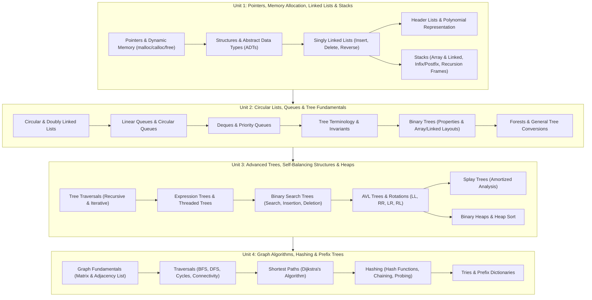

# Data Structures and Applications: Complete Coursework Curriculum and Topic Index

Welcome to the comprehensive coursework study vault for **Data Structures and Applications (DSA)**.

This vault contains exhaustive, highly structured, and intuitive coursework notes synthesizing lecture decks from PES University and foundational principles from the prescribed textbooks:
- **T1: Ellis Horowitz, Sartaj Sahni, and Susan Anderson-Freed**, *Fundamentals of Data Structures in C* (2nd Edition, Silicon Press).
- **T2: Mark Allen Weiss**, *Data Structures and Algorithm Analysis in C* (2nd Edition, Pearson).
- **R1: Thomas H. Cormen, Charles E. Leiserson, Ronald L. Rivest, and Clifford Stein**, *Introduction to Algorithms* (3rd/4th Edition, MIT Press).

Every note is written in a think-out-loud, pedagogical style: explaining the physical realities of memory addresses, pointer dereferencing, dynamic allocation mechanics, cache locality, invariants, and asymptotic time/space complexities governing computer algorithms.

For notes on the programming language strategy and roadmap (C to Java), see the [Preface](Preface.md).

---

## Data Structures Architectural Map

The diagram below maps the four units of this curriculum to the structural continuum of data organization—from linear pointer mechanics to hierarchical search structures, non-linear relational graphs, and constant-time key-value stores:

---

## Master Table of Contents

### [Unit 1: Pointers, Memory Allocation, Linked Lists, and Stacks](Unit%201/Introduction.md)

- [**Unit 1 Introduction & Roadmap**](Unit%201/Introduction.md) — Dynamic memory fundamentals, pointer arithmetic, and linear data abstraction.
- [**L01 - Review of Pointers and Dynamic Memory Allocation**](Unit%201/L01%20-%20Review%20of%20Pointers%20and%20Dynamic%20Memory%20Allocation.md) — Memory addresses, pointer arithmetic, double pointers, dynamic heap management (`malloc`, `calloc`, `realloc`, `free`), memory leaks, and dangling pointers.
- [**L02 - Structures and Abstract Data Types**](Unit%201/L02%20-%20Structures%20and%20Abstract%20Data%20Types.md) — Structures in C, self-referential structures, memory alignment and padding, Abstract Data Types (ADTs), and interface vs. implementation abstraction.
- [**L03 - Singly Linked Lists - Fundamentals and Insertion**](Unit%201/L03%20-%20Singly%20Linked%20Lists%20-%20Fundamentals%20and%20Insertion.md) — Node architecture, dynamic allocation, inserting at beginning, end, and arbitrary position, and handling empty list edge cases.
- [**L04 - Singly Linked Lists - Deletion and Traversal**](Unit%201/L04%20-%20Singly%20Linked%20Lists%20-%20Deletion%20and%20Traversal.md) — Deleting from beginning, end, and by key value, linear traversal, searching, reversing a singly linked list in-place, and Big-$O$ complexity.
- [**L05 - Header Linked Lists and Circular Header Nodes**](Unit%201/L05%20-%20Header%20Linked%20Lists%20and%20Circular%20Header%20Nodes.md) — Grounded header lists vs. circular header lists, metadata encapsulation, and eliminating boundary condition edge-case code.
- [**L06 - Polynomial Representation and Arithmetic**](Unit%201/L06%20-%20Polynomial%20Representation%20and%20Arithmetic.md) — Modeling polynomials using linked lists (coefficient, exponent, link), polynomial addition, polynomial multiplication, and symbolic differentiation.
- [**L07 - Specialized Lists - Multilists and Skip Lists**](Unit%201/L07%20-%20Specialized%20Lists%20-%20Multilists%20and%20Skip%20Lists.md) — Multilists, sparse matrix representation with orthogonal row and column headers, Skip List architecture, probabilistic height assignment, and $O(\log n)$ search efficiency.
- [**L08 - Stacks - Representation and Operations**](Unit%201/L08%20-%20Stacks%20-%20Representation%20and%20Operations.md) — The LIFO principle, Stack ADT, array implementation with overflow and underflow detection, linked list stack implementation, and $O(1)$ push/pop mechanics.
- [**L09 - Applications of Stacks - Infix, Prefix, and Postfix**](Unit%201/L09%20-%20Applications%20of%20Stacks%20-%20Infix,%20Prefix,%20and%20Postfix.md) — Arithmetic notation, operator precedence and associativity, Shunting-Yard algorithm for Infix to Postfix/Prefix conversion, and stack-based Postfix evaluation.
- [**L10 - Applications of Stacks - Function Calls and Recursion**](Unit%201/L10%20-%20Applications%20of%20Stacks%20-%20Function%20Calls%20and%20Recursion.md) — Run-time stack frames, parameter passing, return address linkage, tracing recursion activation records, the Tower of Hanoi, and converting recursive algorithms to iterative stacks.

---

### [Unit 2: Circular Lists, Queues, and Trees](Unit%202/Introduction.md)

- [**Unit 2 Introduction & Roadmap**](Unit%202/Introduction.md) — Circular structures, FIFO queuing systems, and the transition to hierarchical trees.
- [**L01 - Circular Linked Lists**](Unit%202/L01%20-%20Circular%20Linked%20Lists.md) — Structure, tail pointer optimization for $O(1)$ head/tail operations, insertion, deletion, and round-robin scheduling models.
- [**L02 - Doubly Linked Lists**](Unit%202/L02%20-%20Doubly%20Linked%20Lists.md) — Bidirectional pointers (`prev`, `next`), node structure, symmetric insertion and deletion, circular doubly linked lists, and memory overhead tradeoffs.
- [**L03 - Linear Queues - Array and Linked Implementations**](Unit%202/L03%20-%20Linear%20Queues%20-%20Array%20and%20Linked%20Implementations.md) — The FIFO principle, Queue ADT, array-based queue with front/rear indices, linear queue false overflow problem, and linked list queue implementation.
- [**L04 - Circular Queues**](Unit%202/L04%20-%20Circular%20Queues.md) — Modular arithmetic ring buffer, wrapping pointers via $(rear + 1) \pmod{MAX}$, full vs. empty queue disambiguation, and boundary condition handling.
- [**L05 - Deques and Priority Queues**](Unit%202/L05%20-%20Deques%20and%20Priority%20Queues.md) — Double-Ended Queues (Input-restricted and Output-restricted Deques), Priority Queue ADT, ordered vs. unordered array implementations, and priority-based scheduling.
- [**L06 - Applications of Queues**](Unit%202/L06%20-%20Applications%20of%20Queues.md) — CPU process scheduling, printer spooling, breadth-first search queues, asynchronous message buffers, and handling producer-consumer synchronization.
- [**L07 - Introduction to Trees and Terminology**](Unit%202/L07%20-%20Introduction%20to%20Trees%20and%20Terminology.md) — Non-linear hierarchical structures, formal definitions: root, parent, child, siblings, ancestors, descendants, leaf nodes, degree, depth, height, and levels.
- [**L08 - Binary Trees - Properties and Representations**](Unit%202/L08%20-%20Binary%20Trees%20-%20Properties%20and%20Representations.md) — Binary tree types (Full, Complete, Perfect, Degenerate), mathematical properties ($2^h - 1$ maximum nodes, $n = n_0 + n_1 + n_2$, $n_0 = n_2 + 1$), array representation ($2i, 2i+1$), and dynamic linked representations.
- [**L09 - Forests and Conversion to Binary Trees**](Unit%202/L09%20-%20Forests%20and%20Conversion%20to%20Binary%20Trees.md) — General multiway trees, Left-Child Right-Sibling (LCRS) representation, converting general trees to binary trees, and transforming forest collections into single binary trees.

---

### [Unit 3: Advanced Trees and Heaps](Unit%203/Introduction.md)

- [**Unit 3 Introduction & Roadmap**](Unit%203/Introduction.md) — Tree traversals, search tree invariants, self-balancing rotations, and heap priority structures.
- [**L01 - Binary Tree Traversals**](Unit%203/L01%20-%20Binary%20Tree%20Traversals.md) — Inorder, Preorder, Postorder, and Level-Order traversals, recursive implementations, iterative implementations using explicit stacks, and reconstructing trees from traversal pairs.
- [**L02 - Expression Trees**](Unit%203/L02%20-%20Expression%20Trees.md) — Arithmetic expression representation as binary trees, constructing expression trees from postfix expressions using stacks, infix evaluation via inorder traversal, and prefix/postfix generation.
- [**L03 - Threaded Binary Trees**](Unit%203/L03%20-%20Threaded%20Binary%20Trees.md) — Utilizing null pointer fields, singly vs. fully threaded binary trees, inorder threads, thread tags, and $O(1)$ auxiliary space stackless inorder traversal.
- [**L04 - Binary Search Trees - Insertion and Search**](Unit%203/L04%20-%20Binary%20Search%20Trees%20-%20Insertion%20and%20Search.md) — The BST property ($L < R < R_{right}$), recursive and iterative search algorithms, node insertion mechanics, finding minimum and maximum keys, and best-case vs. worst-case time complexity.
- [**L05 - Binary Search Trees - Deletion**](Unit%203/L05%20-%20Binary%20Search%20Trees%20-%20Deletion.md) — The three deletion cases: leaf node deletion, single-child node deletion, and two-child node deletion using inorder successor or inorder predecessor.
- [**L06 - AVL Trees - Balanced Search Trees**](Unit%203/L06%20-%20AVL%20Trees%20-%20Balanced%20Search%20Trees.md) — The degeneration problem of unbalanced BSTs, AVL balance factor ($BF = h_L - h_R \in \{-1, 0, +1\}$), height bounds ($h \le 1.44 \log_2 n$), and rebalancing triggers.
- [**L07 - AVL Rotations**](Unit%203/L07%20-%20AVL%20Rotations.md) — Four fundamental rebalancing operations: Left-Left (Single Right Rotation), Right-Right (Single Left Rotation), Left-Right (Double Rotation), and Right-Left (Double Rotation), step-by-step balance restoration.
- [**L08 - Splay Trees**](Unit%203/L08%20-%20Splay%20Trees.md) — Self-adjusting binary search trees, access locality, the splay operation (Zig, Zig-Zig, and Zig-Zag steps), amortized $O(\log n)$ performance, and trade-offs against AVL trees.
- [**L09 - Binary Heaps and Heap Sort**](Unit%203/L09%20-%20Binary%20Heaps%20and%20Heap%20Sort.md) — The Complete Binary Tree property, Max-Heap and Min-Heap order properties, array-based indexing, `heapify` operation ($O(n)$ bottom-up construction), insert/delete-max, and the Heap Sort algorithm.

---

### [Unit 4: Graphs and Hashing](Unit%204/Introduction.md)

- [**Unit 4 Introduction & Roadmap**](Unit%204/Introduction.md) — Non-linear relational networks, graph search algorithms, shortest path finding, hash functions, and tries.
- [**L01 - Graph Fundamentals and Representations**](Unit%204/L01%20-%20Graph%20Fundamentals%20and%20Representations.md) — Graph definitions: vertices, directed and undirected edges, degree, in-degree, out-degree, paths, cycles, adjacency matrix vs. adjacency list representations, memory requirements, and edge-lookup tradeoffs.
- [**L02 - Breadth-First Search**](Unit%204/L02%20-%20Breadth-First%20Search.md) — BFS algorithm mechanics, queue-based exploration, level-by-level traversal, shortest path in unweighted graphs, and time/space complexity analysis.
- [**L03 - Depth-First Search**](Unit%204/L03%20-%20Depth-First%20Search.md) — DFS algorithm mechanics, recursive implementation and explicit stack tracking, DFS tree edges, back edges, forward edges, and cross edges.
- [**L04 - Graph Connectivity and Cycle Detection**](Unit%204/L04%20-%20Graph%20Connectivity%20and%20Cycle%20Detection.md) — Connected components in undirected graphs, strongly connected components (SCC) in directed graphs, cycle detection using DFS recursion coloring (White-Gray-Black), and topological sorting.
- [**L05 - Shortest Path Algorithms - Dijkstra**](Unit%204/L05%20-%20Shortest%20Path%20Algorithms%20-%20Dijkstra.md) — Single-source shortest path problem, non-negative edge weight invariant, relaxation step, priority queue greedy selection, Dijkstra's algorithm trace, and Big-$O$ complexity.
- [**L06 - Hashing - Fundamentals and Hash Functions**](Unit%204/L06%20-%20Hashing%20-%20Fundamentals%20and%20Hash%20Functions.md) — Direct addressing limitations, hash table architecture, load factor ($\alpha = n/m$), properties of ideal hash functions, division method, multiplication method, and universal hashing.
- [**L07 - Collision Resolution - Open Hashing**](Unit%204/L07%20-%20Collision%20Resolution%20-%20Open%20Hashing.md) — Separate chaining with linked lists, load factor dynamics, average-case vs. worst-case search complexity, dynamic resizing (rehashing), and memory cache behavior.
- [**L08 - Collision Resolution - Closed Hashing**](Unit%204/L08%20-%20Collision%20Resolution%20-%20Closed%20Hashing.md) — Open addressing principles, Linear Probing and primary clustering, Quadratic Probing and secondary clustering, Double Hashing, deletion with lazy deletion flags, and load factor constraints ($\alpha < 1$).
- [**L09 - Tries - Prefix Trees**](Unit%204/L09%20-%20Tries%20-%20Prefix%20Trees.md) — Trie node architecture, character transitions, string search and insertion in $O(L)$ time, auto-complete, prefix matching, memory overhead, and compressed tries (Radix trees).

---

## Pedagogical Structure & Navigation Rules

Every lecture note follows a rigorous, uniform format:
1. **Breadcrumb**: Direct link back to this master index and unit roadmap.
2. **Pedagogical Mechanics**: Physical and algorithmic motivation explained intuitively before formal code definitions.
3. **Mermaid Visualizations**: Graph, tree, pointer, and array diagrams illustrating every structural transition.
4. **Complete C Implementations**: Production-quality C code with explicit memory allocation, error handling, and pointer updates.
5. **Complexity Analysis**: Step-by-step derivation of best, worst, and average-case time and space complexities.
6. **Key Takeaways & Forward Bridges**: Concise bulleted takeaways followed by a natural narrative transition to the next topic.
