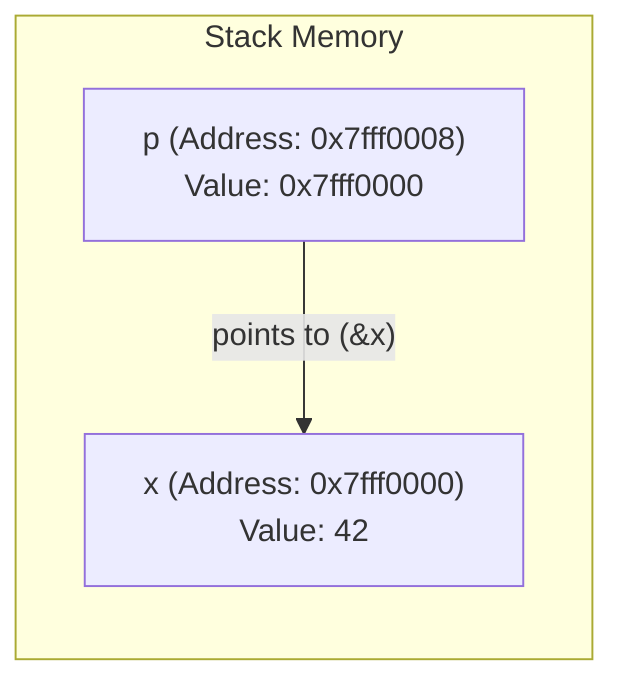
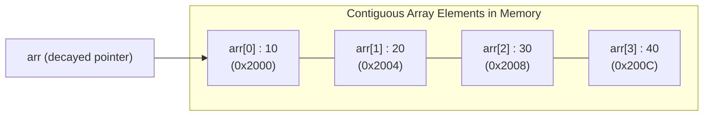
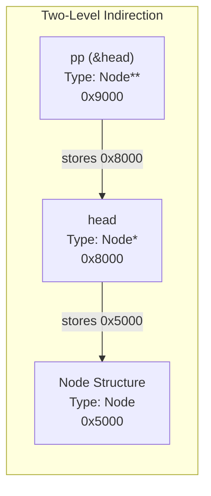
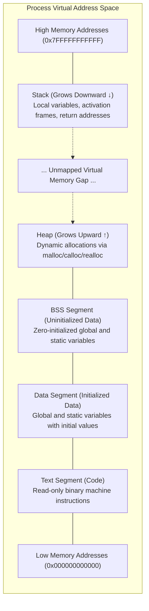
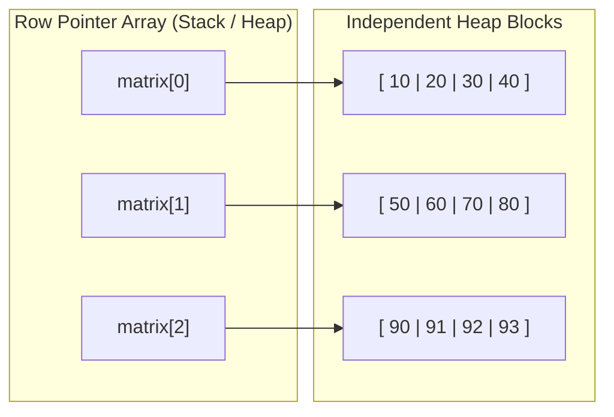

[DSA Index](../README.md) / [Unit 1: Pointers, Memory Allocation, Linked Lists, and Stacks](Introduction.md)

# L01: Review of Pointers and Dynamic Memory Allocation

Before we can build any dynamic data structure—whether it is a linked list, an AVL tree, or an adjacency graph—we need to demystify how physical computer memory works and how our programs interact with it. 

Every variable we declare lives somewhere in physical RAM. But in modern operating systems, our program does not see physical RAM directly. Instead, the OS and hardware provide an abstraction called virtual memory: a massive, contiguous byte-addressable array of memory cells. 

Every single byte in this array has a unique numerical identifier called its memory address.

---

## Memory Addresses and Pointer Fundamentals

What exactly is a pointer? At its bare physical level, a pointer is nothing more than a variable whose stored value happens to be the memory address of another location in memory.

When we declare an integer variable `int x = 42;`, the compiler reserves a chunk of memory (typically 4 bytes on modern 64-bit architectures) to hold the binary representation of `42`. When we declare a pointer `int *p = &x;`, `p` itself occupies 8 bytes (on a 64-bit machine) and stores the starting memory address of `x`.



Notice something fundamental here: there are two distinct operations involved:
1. The **Address-of Operator (`&`)**: Extracts the physical location (address) of an existing variable.
2. The **Dereference Operator (`*`)**: Follows the pointer to read or write the actual value sitting at that target memory address.

```c
#include <stdio.h>

int main(void) {
    int value = 100;
    int *ptr = &value;

    printf("Value of value: %d\n", value);
    printf("Address of value (&value): %p\n", (void *)&value);
    printf("Value stored in ptr: %p\n", (void *)ptr);
    printf("Value pointed to by ptr (*ptr): %d\n", *ptr);

    // Modifying target value through dereferencing
    *ptr = 250;
    printf("New value of value: %d\n", value);

    return 0;
}
```

When we execute `*ptr = 250;`, the CPU takes the address stored inside `ptr` (`0x7fff0000`), navigates to that memory offset, and overwrites the 4 bytes with the integer representation of `250`. `value` never changed its address, but its contents were modified through an alias.

---

## Pointer Arithmetic and Scale Factors

Now, what happens if we add an integer to a pointer? Let's say `p` holds the address `0x1000`. Does `p + 1` yield `0x1001`?

No. In C, pointer arithmetic is automatically scaled by the size of the underlying data type to which the pointer points:

$$\text{Effective Address} = \text{Base Address} + (i \times \text{sizeof}(*p))$$

If `p` is an `int*` on a machine where `sizeof(int) == 4`, adding `1` moves the pointer forward by 4 bytes: `0x1000 + 4 = 0x1004`. If `p` is a `double*` where `sizeof(double) == 8`, adding `1` moves it forward by 8 bytes.

```c
#include <stdio.h>

int main(void) {
    int arr[3] = {10, 20, 30};
    int *p = arr;

    printf("p: %p, *p: %d\n", (void *)p, *p);
    p = p + 1;
    printf("p + 1: %p, *(p + 1): %d\n", (void *)p, *p);

    // Pointer subtraction yields distance in element count, not raw bytes
    int *start = &arr[0];
    int *end = &arr[2];
    ptrdiff_t diff = end - start;
    printf("Element distance: %td elements\n", diff);

    return 0;
}
```

So pointer subtraction (`end - start`) does not return the raw difference in bytes. It divides the raw byte difference by `sizeof(type)` to give the number of array elements separating the two pointers.

---

## Pointers and Arrays: Equivalence and Differences

In C, arrays and pointers are intimately linked, but they are not identical.

When an array identifier appears in an expression (with two exceptions: `sizeof(arr)` and `&arr`), it **decays** into a pointer pointing to its first element (`&arr[0]`).



This decay means that array indexing is purely syntactic sugar for pointer arithmetic and dereferencing:

$$\text{arr}[i] \iff *(\text{arr} + i)$$

Because addition is commutative:

$$*(\text{arr} + i) \iff *(i + \text{arr}) \iff i[\text{arr}]$$

Writing `2[arr]` is completely valid in C and compiles to the exact same machine code as `arr[2]`.

The moment we examine mutability, however, the difference becomes clear:
- An array name (`arr`) is an immutable, non-modifiable lvalue. You cannot assign `arr = p;` or increment `arr++`. The compiler binds its address permanently to the allocated stack block.
- A pointer variable (`int *p`) is a distinct, mutable storage location. You can reassign it, increment it (`p++`), or point it elsewhere at will.

---

## Double Pointers: Pointers to Pointers

What happens when we want to change where a pointer points inside a function?

Think about how standard pass-by-value works in C. If we pass an `int x` into a function `void foo(int a)`, `a` receives a local copy of `x`. Modifying `a` leaves `x` untouched. To allow `foo` to modify `x`, we must pass the address of `x` (`int *ptr`).

Now follow that exact same logic one level higher. If we pass a pointer `int *p` into a function, the function receives a local copy of the pointer. If the function changes where its local pointer points, the caller's pointer is completely unchanged.

The moment we need a function to modify the caller's pointer—such as allocating memory or modifying the head of a linked list—we must pass the address of the pointer itself: an `int **`.



Let's see this in concrete code:

```c
#include <stdio.h>
#include <stdlib.h>

void allocate_buffer_broken(int *p, size_t size) {
    p = (int *)malloc(size * sizeof(int));
    // p is local to this function. When this function returns,
    // the allocated memory is leaked, and the caller's pointer is unchanged.
}

void allocate_buffer_correct(int **p, size_t size) {
    *p = (int *)malloc(size * sizeof(int));
    // *p dereferences the double pointer, directly overwriting the caller's pointer variable.
}

int main(void) {
    int *buffer = NULL;

    allocate_buffer_broken(buffer, 10);
    printf("After broken: %p (still NULL!)\n", (void *)buffer);

    allocate_buffer_correct(&buffer, 10);
    printf("After correct: %p (valid heap address)\n", (void *)buffer);

    free(buffer);
    buffer = NULL;
    return 0;
}
```

---

## The Memory Segments of a C Process

To understand why dynamic memory allocation exists, we must inspect how an executing process organizes its virtual address space:



Each segment has a dedicated role:
- **Text Segment**: Contains the compiled machine instructions. It is read-only to prevent programs from accidentally overwriting their own code.
- **Data Segment**: Stores global and static variables that have explicit non-zero initialization (e.g., `int global_var = 10;`).
- **BSS Segment**: Stores uninitialized global and static variables. The OS automatically initializes this entire segment to zero before `main()` executes.
- **Stack Segment**: Automatically managed LIFO structure storing function activation records, local variables, and return addresses. It is fast, but strictly bound to lexical scope and limited in size (typically 8 MB on Linux).
- **Heap Segment**: A pool of unorganized memory managed manually by the programmer at runtime. Memory allocated here persists across function calls until explicitly released.

---

## Dynamic Memory Allocation: `malloc`, `calloc`, `realloc`, and `free`

Stack allocation has two severe limitations:
1. The size must be known at compile time or at function entry (even with Variable Length Arrays, the size cannot outlive the stack frame).
2. Stack memory is automatically reclaimed when the enclosing function returns. You cannot return a pointer to a local stack array.

Heap allocation solves both issues. In C, the standard library provides four functions declared in `<stdlib.h>`:

### 1. `malloc` (Memory Allocation)

```c
void *malloc(size_t size);
```

`malloc` requests `size` contiguous bytes from the heap. 
- It returns a generic `void *` pointing to the first byte, or `NULL` if the system has exhausted available memory.
- The allocated memory is **uninitialized**; it contains whatever arbitrary leftover garbage data happened to be in those physical pages.

```c
int *arr = (int *)malloc(100 * sizeof(int));
if (arr == NULL) {
    perror("Failed to allocate memory");
    exit(EXIT_FAILURE);
}
```

### 2. `calloc` (Contiguous Allocation)

```c
void *calloc(size_t num_elements, size_t element_size);
```

`calloc` allocates memory for an array of `num_elements`, each of size `element_size` bytes.
- Unlike `malloc`, `calloc` initializes **every single byte to zero**.
- It provides built-in multiplication overflow detection: if `num_elements * element_size` would overflow `size_t`, `calloc` fails safely and returns `NULL`.

### 3. `realloc` (Re-allocation)

```c
void *realloc(void *ptr, size_t new_size);
```

`realloc` dynamically resizes a previously allocated heap block pointed to by `ptr`.
- If contiguous space is available immediately after the block, it expands in-place.
- If contiguous space is blocked by another allocation, it allocates a completely new block of `new_size`, copies over the existing data, frees the old block internally, and returns a pointer to the new location.
- If `new_size` is smaller, it shrinks the block and returns the remainder to the heap manager.

Now, notice this critical anti-pattern:

```c
// DANGEROUS ANTI-PATTERN:
ptr = realloc(ptr, new_size);
```

Why is this dangerous? If `realloc` fails because the system is out of memory, it returns `NULL`. By assigning `NULL` directly back to `ptr`, the original memory address is permanently lost, causing an irrecoverable memory leak.

The safe pattern always uses a temporary pointer:

```c
int *temp = (int *)realloc(arr, new_size * sizeof(int));
if (temp == NULL) {
    // Handle error; arr is still valid and untouched
    free(arr);
    exit(EXIT_FAILURE);
}
arr = temp; // Safe to overwrite only upon confirmed success
```

### 4. `free` (Deallocation)

```c
void free(void *ptr);
```

`free` releases the allocated memory back to the operating system or runtime heap manager.
- Calling `free(NULL)` is a defined no-op; it does nothing and is completely safe.
- Calling `free` on an address that was not returned by a dynamic allocator, or freeing the same block twice ("double free"), causes undefined behavior or immediate process crashes.

---

## Dynamic 2D Array Allocation

Let's look at how dynamic allocation extends to two-dimensional structures. In data structures, we often need a matrix whose dimensions ($R \times C$) are determined at runtime.

There are two primary strategies:

### Strategy 1: Array of Pointers (Ragged or Independent Rows)



In this model, we allocate an array of pointers (`int **`), then loop through and allocate each row independently.

```c
#include <stdio.h>
#include <stdlib.h>

int **create_matrix_ragged(int rows, int cols) {
    int **matrix = (int **)malloc(rows * sizeof(int *));
    if (!matrix) return NULL;

    for (int i = 0; i < rows; i++) {
        matrix[i] = (int *)malloc(cols * sizeof(int));
        if (!matrix[i]) {
            // Unwind previously allocated rows if any step fails
            for (int j = 0; j < i; j++) {
                free(matrix[j]);
            }
            free(matrix);
            return NULL;
        }
    }
    return matrix;
}

void free_matrix_ragged(int **matrix, int rows) {
    if (!matrix) return;
    for (int i = 0; i < rows; i++) {
        free(matrix[i]);
    }
    free(matrix);
}
```

Notice the downside: the rows are scattered across disparate heap pages, destroying CPU cache locality. Furthermore, deallocation requires $O(R)$ separate calls to `free()`.

### Strategy 2: Contiguous Block with Row Pointers

A far more cache-friendly approach allocates all elements in a single contiguous block, followed by setting up row pointers:

```c
int **create_matrix_contiguous(int rows, int cols) {
    int **matrix = (int **)malloc(rows * sizeof(int *));
    int *data = (int *)malloc(rows * cols * sizeof(int));

    if (!matrix || !data) {
        free(matrix);
        free(data);
        return NULL;
    }

    for (int i = 0; i < rows; i++) {
        matrix[i] = data + (i * cols);
    }
    return matrix;
}

void free_matrix_contiguous(int **matrix) {
    if (!matrix) return;
    free(matrix[0]); // Frees the entire contiguous data block
    free(matrix);    // Frees the pointer array
}
```

This guarantees that `matrix[i][j]` is laid out contiguously in memory, maximizing cache hits while still supporting the convenient `matrix[i][j]` syntax.

---

## Memory Pitfalls: Leaks, Dangling Pointers, and Wild Pointers

Dynamic memory management grants complete control, but manual management carries severe risks.

### 1. Memory Leaks
A memory leak occurs when dynamically allocated memory loses all references pointing to it before being freed. The memory remains marked as "in use" by the allocator and cannot be reclaimed until the process terminates.

```c
void leak_memory(void) {
    int *p = (int *)malloc(1024 * sizeof(int));
    // p goes out of scope here! The 4096 bytes on the heap are permanently lost.
}
```

### 2. Dangling Pointers
A dangling pointer points to a memory location that has already been deallocated by `free()`. Accessing it triggers undefined behavior: reading it may yield corrupt data; writing to it may overwrite heap metadata and cause silent memory corruption.

```c
int *p = (int *)malloc(sizeof(int));
*p = 50;
free(p);
// p is now dangling!

*p = 100; // UNDEFINED BEHAVIOR: Memory corruption!
```

To eliminate dangling pointers, always zero them out immediately following deallocation:

```c
free(p);
p = NULL; // Any subsequent dereference immediately segfaults safely instead of corrupting data
```

### 3. Wild Pointers
A wild pointer is a pointer variable that has not been initialized to anything (not even `NULL`). It holds a random address left behind on the stack.

```c
int *wild; // Uninitialized
*wild = 42; // Catastrophic: writing to an arbitrary, unknown memory address
```

---

## Complexity Summary of Memory and Pointer Operations

| Operation | Time Complexity | Auxiliary Space Complexity | Explanation |
| :--- | :--- | :--- | :--- |
| **Address Calculation (`&x`)** | $O(1)$ | $O(1)$ | Resolved directly at compile/link time or via stack register offsets. |
| **Dereference (`*p`)** | $O(1)$ | $O(1)$ | Single machine load/store instruction. |
| **Pointer Arithmetic (`p + i`)** | $O(1)$ | $O(1)$ | Scaled integer addition (`LEA` instruction on x86). |
| **`malloc(size)`** | $O(1)$ amortized | $O(\text{size})$ heap | Heap manager searches free-list buckets (bins). |
| **`calloc(n, size)`** | $O(n \times \text{size})$ | $O(n \times \text{size})$ heap | Zeroing memory pages requires linear byte writes. |
| **`realloc(ptr, new_size)`** | $O(n)$ worst-case | $O(\text{new\_size})$ heap | When relocating, copies $n$ old bytes to new block. |
| **`free(ptr)`** | $O(1)$ | $O(1)$ | Boundary tag coalesce and insertion into free-list. |

---

## Key Takeaways

- A pointer is fundamentally a variable storing a memory address in the virtual address space.
- Pointer arithmetic is automatically scaled by the size of the underlying type (`sizeof(*p)`).
- Array variables decay into pointers to their first element in most expressions, making `arr[i]` completely equivalent to `*(arr + i)`.
- Modifying a pointer inside a function requires passing a double pointer (`Type **`), following standard pass-by-value mechanics.
- The heap provides dynamically sized, persistent memory that must be explicitly managed with `malloc`, `calloc`, `realloc`, and `free`.
- Always verify allocation return values against `NULL`, use temporary pointers during `realloc`, and set freed pointers to `NULL` to avoid dangling references.

Now that we have established how raw bytes are addressed and dynamically allocated on the heap, the natural next step is to bundle heterogeneous data types into meaningful structured units. Let's move to [L02 - Structures and Abstract Data Types](L02%20-%20Structures%20and%20Abstract%20Data%20Types.md) to examine how user-defined structures, self-referential links, and abstract interfaces provide the formal framework for dynamic data structures.
