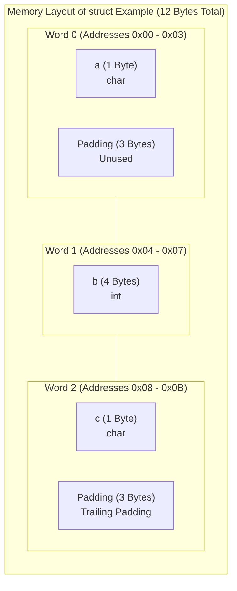
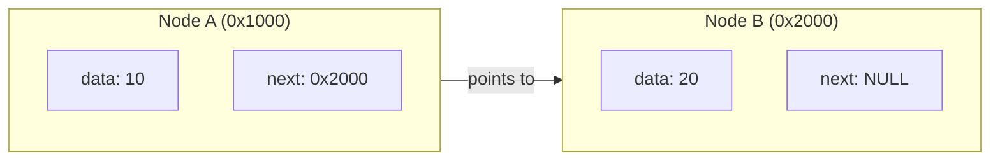
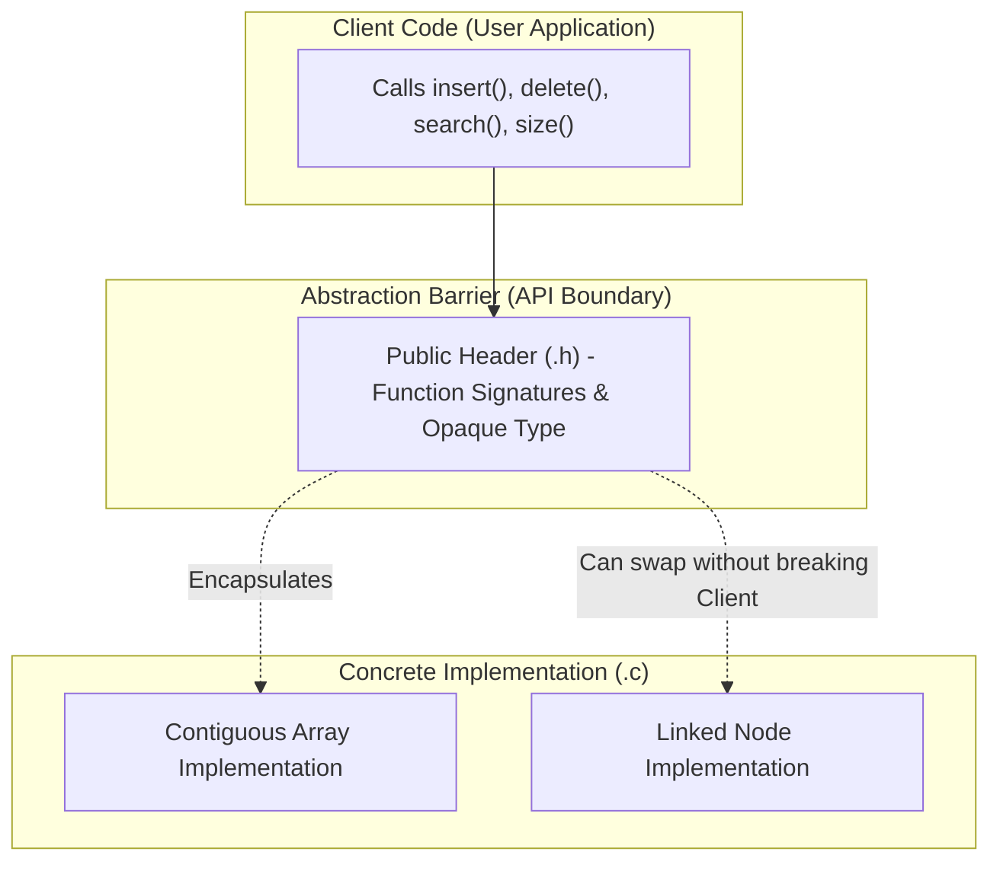

[DSA Index](../README.md) / [Unit 1: Pointers, Memory Allocation, Linked Lists, and Stacks](Introduction.md)

# L02: Structures and Abstract Data Types

In raw C, primitive types like `int`, `float`, and `char` allow us to manipulate isolated values. But real-world data is rarely isolated. A student record has a name, a roll number, and a GPA. A bank account has an account number, owner identity, and balance. 

To model real-world concepts, we need a way to aggregate heterogeneous data types into a single cohesive unit. In C, that mechanism is the **Structure** (`struct`).

Beyond the mechanical syntax of C structures, however, lies one of the most foundational principles in all of computer science: the **Abstract Data Type (ADT)**. An ADT separates *what* operations a data structure supports from *how* those operations are physically implemented in bits and bytes.

---

## Defining Structures in C

A structure is a user-defined composite data type that groups variables of different types under a single name. Each variable within a structure is known as a **member** or **field**.

```c
// Defining a structure tag
struct Student {
    int roll_no;
    char name[50];
    double gpa;
};

// Creating instances
struct Student s1;
```

To avoid writing the `struct` keyword repeatedly, we often use `typedef` to create an alias:

```c
typedef struct Student {
    int roll_no;
    char name[50];
    double gpa;
} Student;

Student s2 = {101, "Alice", 3.95};
```

---

## Memory Layout, Alignment, and Structure Padding

Now, let's ask a mechanical question: how much memory does a structure occupy?

Suppose we define the following structure on a standard 64-bit architecture:

```c
struct Example {
    char a;     // 1 byte
    int b;      // 4 bytes
    char c;     // 1 byte
};
```

You might expect `sizeof(struct Example)` to be $1 + 4 + 1 = 6$ bytes. 

Let's run `sizeof(struct Example)`. The output is **12 bytes**.

Why does this happen? The CPU does not read memory one byte at a time. It reads memory in aligned chunks called **words** (typically 4 or 8 bytes). If a 4-byte integer is stored across two separate word boundaries, the CPU would need two memory access cycles and extra bitwise shifts to assemble the integer.

To maximize bus efficiency and avoid unaligned access penalties, compilers enforce **structure alignment**:
1. Every member must be aligned to an address that is a multiple of its own size. A 4-byte `int` must start at an address divisible by 4.
2. The total size of the structure must be a multiple of the largest member's alignment requirement.

To satisfy these rules, the compiler automatically inserts invisible **padding bytes**:



Notice what happened:
- `char a` occupies byte 0.
- Bytes 1, 2, and 3 are dead padding so that `int b` can start on an aligned 4-byte boundary (byte 4).
- `int b` occupies bytes 4, 5, 6, and 7.
- `char c` occupies byte 8.
- Bytes 9, 10, and 11 are trailing padding so that the overall struct size (12) is a multiple of the largest member alignment (4 bytes).

### Optimizing Struct Packing by Reordering Fields

Now here's the thing — we can eliminate wasted padding bytes simply by ordering structure members from largest to smallest:

```c
struct Optimized {
    int b;      // 4 bytes (offset 0)
    char a;     // 1 byte  (offset 4)
    char c;     // 1 byte  (offset 5)
    // 2 bytes trailing padding to round up to multiple of 4
};
```

Now, `sizeof(struct Optimized)` is **8 bytes** instead of 12! We cut memory consumption by 33% simply by rearranging fields. In high-performance systems and massive node networks, this difference is substantial.

---

## Accessing Members: The Dot Operator vs The Arrow Operator

When dealing with structures, there are two distinct ways to access internal fields:

1. **Direct Member Access (`.` operator)**: Used when working directly with a structure variable.
2. **Indirect Member Access (`->` operator)**: Used when working with a pointer to a structure.

The arrow operator is pure syntactic shorthand for dereferencing followed by member access:

$$\text{ptr}->\text{field} \iff (*\text{ptr}).\text{field}$$

```c
#include <stdio.h>
#include <stdlib.h>

typedef struct {
    int id;
    float score;
} Record;

int main(void) {
    Record r1 = {1, 98.5f};
    Record *ptr = &r1;

    // Direct access
    printf("ID: %d, Score: %.1f\n", r1.id, r1.score);

    // Indirect access via pointer
    printf("ID: %d, Score: %.1f\n", ptr->id, ptr->score);

    // Dynamic allocation of a structure
    Record *dynamic_rec = (Record *)malloc(sizeof(Record));
    if (dynamic_rec != NULL) {
        dynamic_rec->id = 2;
        dynamic_rec->score = 87.0f;
        free(dynamic_rec);
    }

    return 0;
}
```

Notice why parentheses are mandatory if you write `(*ptr).field`: the dot operator (`.`) has higher operator precedence than the dereference operator (`*`). Writing `*ptr.field` would be parsed by the compiler as `*(ptr.field)`, which causes a compilation error because `ptr` is a pointer, not a struct. The `->` operator was specifically introduced to eliminate this syntactical awkwardness.

---

## Self-Referential Structures: The Engine of Linked Data Structures

Now we arrive at the pivotal architectural leap required for linked lists, trees, and graphs: **Self-Referential Structures**.

What happens if a structure attempts to include an instance of itself directly?

```c
// ILLEGAL CODE:
struct BadNode {
    int data;
    struct BadNode next; // COMPILER ERROR!
};
```

Why does the compiler reject this? Think about the memory calculation. To determine `sizeof(struct BadNode)`, the compiler needs to know the size of its member `next`. But `next` is a `struct BadNode`, which contains another `struct BadNode`, which contains another, ad infinitum. It is an infinitely recursive definition with infinite memory size.

The moment we change `next` to a **pointer**, everything changes:

```c
// LEGAL AND FOUNDATIONAL:
struct Node {
    int data;
    struct Node *next; // Exactly 8 bytes on a 64-bit system
};
```

A pointer has a fixed, known size (8 bytes on 64-bit systems) regardless of what it points to. The compiler knows exactly how much memory a `struct Node` requires: 4 bytes for `data` + 4 bytes padding + 8 bytes for `next` = 16 bytes.



This structure is called *self-referential* because one of its members points to another structure of the exact same type. By chaining these nodes together in heap memory via pointers, we can construct dynamic data structures of arbitrary size.

---

## Passing Structures to Functions: Value vs Pointer

When passing structures to functions, we have two fundamental choices:

### 1. Pass by Value
```c
void display_record(Record r); // Copies entire struct
```
The entire structure is duplicated byte-for-byte onto the function's stack frame. If the structure is large (e.g., contains large arrays), pass-by-value causes substantial CPU overhead from copying bytes and rapidly burns through stack space. Furthermore, modifications inside the function never affect the caller's structure.

### 2. Pass by Pointer
```c
void update_record(Record *r);        // Allows mutation
void display_record(const Record *r); // Fast, zero-copy, read-only
```
Only an 8-byte memory address is pushed onto the stack, regardless of whether the structure occupies 16 bytes or 16,000 bytes. Adding the `const` qualifier guarantees read-only semantics while maintaining $O(1)$ zero-copy parameter passing.

---

## Abstract Data Types (ADTs)

Now, let's step back from the physical C code and examine the conceptual paradigm: the **Abstract Data Type (ADT)**.

An Abstract Data Type is a mathematical model for data types where the data type is defined by its **behavior** (semantics) from the point of view of a *user* of the data, specifically in terms of:
1. The values it can hold.
2. The operations that can be performed on it.
3. The axiomatic properties/invariants governing those operations.

Crucially, an ADT says **nothing** about how those operations are implemented or how the data is laid out in physical memory.



Consider the `List` ADT:
- **Operations**: `create()`, `insert(index, element)`, `delete(index)`, `get(index)`, `size()`.
- **Contract**: Calling `insert(0, x)` followed by `get(0)` returns `x`.
- **Implementation Independence**: The list could be implemented internally as a dynamic contiguous array, a singly linked list, a doubly linked list, or an unrolled list. The client code using the list does not know, and does not care.

### Implementing Information Hiding in C via Opaque Pointers

In object-oriented languages like C++ or Java, encapsulation is achieved using `private` fields. In C, we achieve complete data hiding using **opaque pointers** (sometimes called the PIMPL idiom or incomplete types).

Here is how a production-grade `DynamicArray` ADT is constructed:

#### The Public Interface (`DynamicArray.h`)
```c
#ifndef DYNAMIC_ARRAY_H
#define DYNAMIC_ARRAY_H

#include <stddef.h>
#include <stdbool.h>

// Incomplete type declaration: clients know the type exists,
// but cannot inspect or access its internal struct fields.
typedef struct DynamicArray DynamicArray;

DynamicArray *da_create(size_t initial_capacity);
void da_destroy(DynamicArray *da);

bool da_push_back(DynamicArray *da, int value);
bool da_get(const DynamicArray *da, size_t index, int *out_value);
size_t da_size(const DynamicArray *da);

#endif
```

#### The Private Implementation (`DynamicArray.c`)
```c
#include "DynamicArray.h"
#include <stdlib.h>

struct DynamicArray {
    int *data;
    size_t size;
    size_t capacity;
};

DynamicArray *da_create(size_t initial_capacity) {
    if (initial_capacity == 0) initial_capacity = 4;
    
    DynamicArray *da = (DynamicArray *)malloc(sizeof(DynamicArray));
    if (!da) return NULL;

    da->data = (int *)malloc(initial_capacity * sizeof(int));
    if (!da->data) {
        free(da);
        return NULL;
    }

    da->size = 0;
    da->capacity = initial_capacity;
    return da;
}

void da_destroy(DynamicArray *da) {
    if (da) {
        free(da->data);
        free(da);
    }
}

bool da_push_back(DynamicArray *da, int value) {
    if (!da) return false;

    if (da->size == da->capacity) {
        size_t new_capacity = da->capacity * 2;
        int *new_data = (int *)realloc(da->data, new_capacity * sizeof(int));
        if (!new_data) return false;

        da->data = new_data;
        da->capacity = new_capacity;
    }

    da->data[da->size++] = value;
    return true;
}

bool da_get(const DynamicArray *da, size_t index, int *out_value) {
    if (!da || index >= da->size || !out_value) return false;
    *out_value = da->data[index];
    return true;
}

size_t da_size(const DynamicArray *da) {
    return da ? da->size : 0;
}
```

Notice what we achieved here: client code `#include`ing `DynamicArray.h` cannot do `da->size = -5;` or `da->capacity = 0;`. The compiler will throw an incomplete type error because the definition of `struct DynamicArray` is completely private to `DynamicArray.c`. 

This guarantees that internal invariants can never be violated by external callers.

---

## Complexity Analysis: Struct Operations vs Dynamic Abstractions

| Operation | Time Complexity | Space Complexity | Explanation |
| :--- | :--- | :--- | :--- |
| **Direct Field Access (`s.field`)** | $O(1)$ | $O(1)$ | Direct offset computed at compile time. |
| **Pointer Field Access (`ptr->field`)** | $O(1)$ | $O(1)$ | Base address dereference + fixed field offset. |
| **Pass Struct by Value ($N$ bytes)** | $O(N)$ | $O(N)$ stack | Requires copying all $N$ bytes onto activation frame. |
| **Pass Struct by Pointer** | $O(1)$ | $O(1)$ stack | Copies only single pointer address (8 bytes). |
| **Dynamic Array Push (Amortized)** | $O(1)$ amortized | $O(1)$ auxiliary | Geometric resizing ($2\times$) keeps amortized cost constant. |
| **Dynamic Array Push (Worst Case)** | $O(N)$ | $O(N)$ auxiliary | Occurs when buffer reallocates and copies all elements. |

---

## Key Takeaways

- Structures aggregate heterogeneous variables into a single composite type.
- Compilers align data members to word boundaries, automatically inserting padding bytes. Reordering members from largest to smallest minimizes memory waste.
- Direct member access uses `.`, while indirect pointer member access uses `->` (shorthand for `(*p).member`).
- Self-referential structures cannot contain direct instances of themselves, but can contain pointers to their own type, forming the physical backbone of linked lists and trees.
- Abstract Data Types (ADTs) separate interface from implementation. In C, opaque pointers cleanly encapsulate internal representations and enforce invariants.

With our understanding of self-referential structures and abstract data interfaces firmly in place, we can now overcome the fundamental drawback of arrays: contiguous memory rigidity. Let's proceed to [L03 - Singly Linked Lists - Fundamentals and Insertion](L03%20-%20Singly%20Linked%20Lists%20-%20Fundamentals%20and%20Insertion.md) to build our first fully dynamic, non-contiguous linear data structure.
