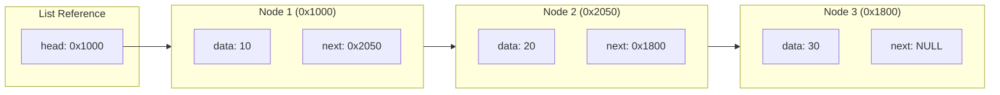
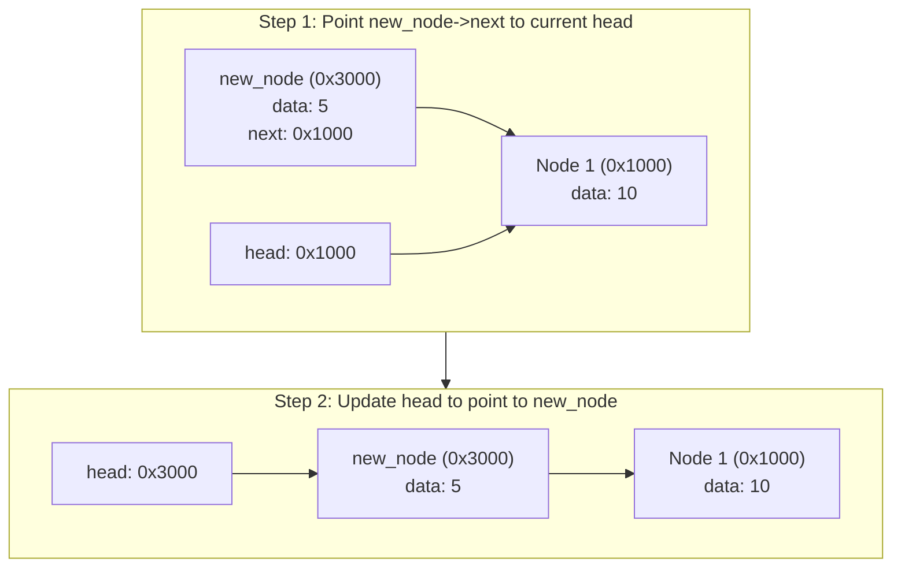
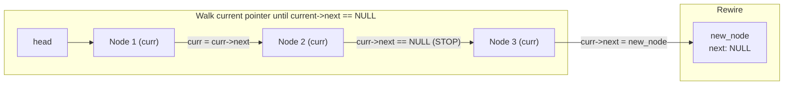
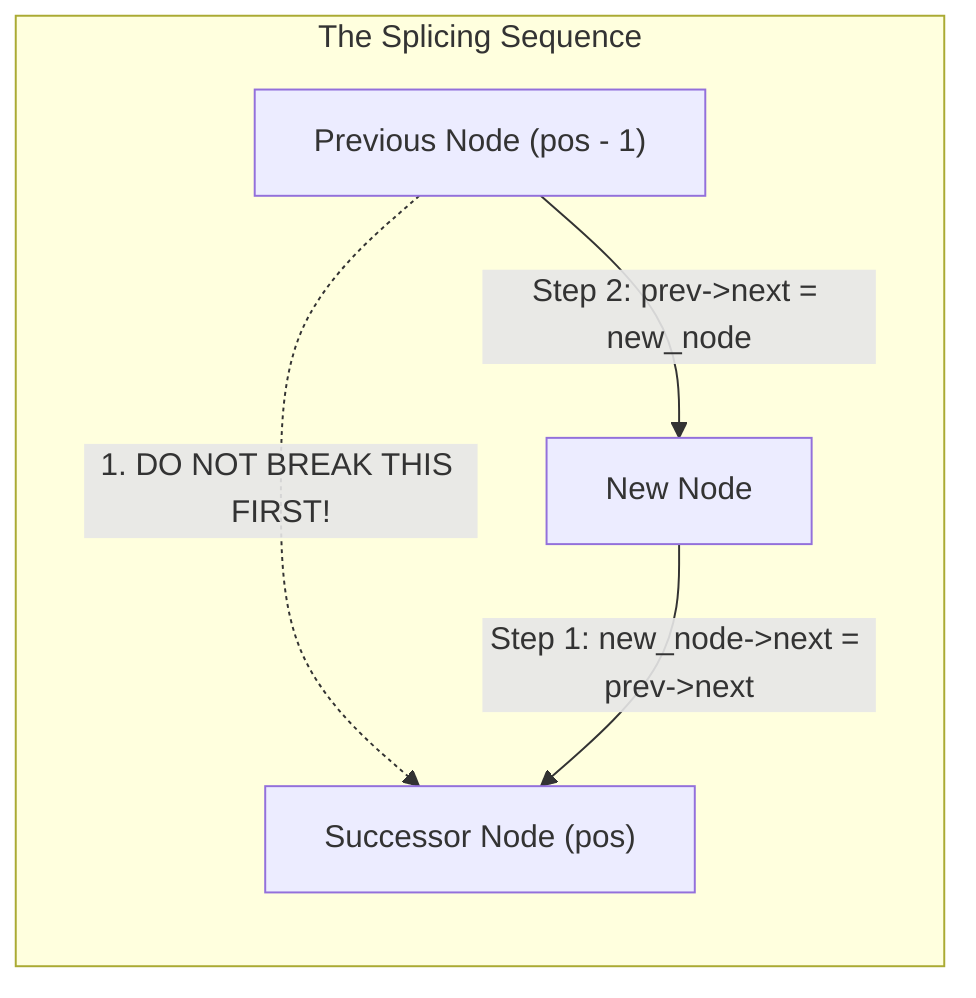

[DSA Index](../README.md) / [Unit 1: Pointers, Memory Allocation, Linked Lists, and Stacks](Introduction.md)

# L03: Singly Linked Lists - Fundamentals and Insertion

Arrays are the most intuitive linear data structures: elements are packed tightly in contiguous memory, granting instant $O(1)$ random access through index arithmetic. 

Yet, contiguous memory imposes two severe architectural penalties:
1. **Costly Resizing and Shifting**: Inserting an element at the beginning or middle of an array requires shifting every subsequent element rightward by one slot—an $O(n)$ operation.
2. **Contiguous Allocation Requirement**: If an array requires 100 megabytes of memory, the operating system must find a single unbroken 100-megabyte block of virtual address space. If memory is fragmented into smaller free chunks, the allocation fails even if the total free memory across the system far exceeds 100 megabytes.

To overcome the rigid constraints of contiguous memory, we need a data structure that can grow one element at a time, allocating nodes anywhere in heap memory and linking them together. 

This brings us to the **Singly Linked List**.

---

## Anatomy of a Singly Linked List

A singly linked list is a linear collection of discrete data containers called **nodes**. Unlike array elements, nodes in a linked list are not stored in contiguous memory addresses; they can be scattered across arbitrary locations in the heap.

Each node consists of two essential parts:
1. **Data Field**: Holds the payload (e.g., an integer, character, float, or composite structure).
2. **Next Pointer (`next`)**: Stores the memory address of the next node in the sequence.



Notice the structural invariants:
- The entire list is accessed through a single pointer called **`head`**, which points to the first node.
- The last node in the chain has its `next` pointer explicitly set to **`NULL`**, indicating the termination of the list (a "grounded" list).
- An empty list is represented simply by `head == NULL`.

In C, we define this node using the self-referential structure we studied in Lecture 2:

```c
typedef struct Node {
    int data;
    struct Node *next;
} Node;
```

---

## The Node Factory: Safe Dynamic Allocation

Before we can insert nodes into our list, we write a dedicated helper function to allocate and initialize a new node cleanly on the heap:

```c
#include <stdio.h>
#include <stdlib.h>

Node *create_node(int value) {
    Node *new_node = (Node *)malloc(sizeof(Node));
    if (new_node == NULL) {
        perror("Failed to allocate node memory");
        exit(EXIT_FAILURE);
    }
    new_node->data = value;
    new_node->next = NULL;
    return new_node;
}
```

By ensuring that `new_node->next` is initialized to `NULL` upon creation, we eliminate the hazard of uninitialized wild pointers pointing to random heap junk.

---

## Insertion at the Beginning (Prepend / Head Insertion)

Inserting a new node at the very beginning of the list is the simplest and fastest operation:
- It requires no traversal.
- It operates strictly in $O(1)$ time regardless of whether the list contains 10 nodes or 10 million nodes.

Let's visualize the step-by-step rewiring:



Now, why do we use a double pointer `Node **head_ref`?

Recall Lecture 1: C is strictly pass-by-value. If we passed `Node *head`, the function would modify its local copy of `head`, leaving the caller's list unmodified. By passing `&head` (a `Node **`), the function dereferences `head_ref` and directly overwrites the caller's head variable.

```c
void insert_beginning(Node **head_ref, int value) {
    Node *new_node = create_node(value);
    
    // Connect new node to the current start of the list
    new_node->next = *head_ref;
    
    // Update head to point to the newly allocated node
    *head_ref = new_node;
}
```

Notice that this code works flawlessly even when the list is initially empty (`*head_ref == NULL`). `new_node->next` becomes `NULL`, and `*head_ref` becomes `new_node`. There is no need for a special branch or `if` statement.

---

## Insertion at the End (Append / Tail Insertion)

To insert a node at the end of a singly linked list, we must first locate the final node in the chain—the node whose `next` pointer is `NULL`.

The moment we examine this requirement, we see the trade-off compared to an array: unless we maintain a separate `tail` pointer, we must traverse the entire list from the beginning to the end, making append an $O(n)$ operation.



Here is the implementation:

```c
void insert_end(Node **head_ref, int value) {
    Node *new_node = create_node(value);

    // Edge Case: The list is empty
    if (*head_ref == NULL) {
        *head_ref = new_node;
        return;
    }

    // Traverse to the last node
    Node *current = *head_ref;
    while (current->next != NULL) {
        current = current->next;
    }

    // Attach the new node to the end
    current->next = new_node;
}
```

Notice the critical loop condition: `current->next != NULL` versus `current != NULL`.
- If we wrote `while (current != NULL)`, `current` would step *past* the last node and become `NULL`. We would lose our reference to the last node and have nowhere to attach `new_node`.
- By writing `while (current->next != NULL)`, the traversal halts *at* the last node, allowing us to update `current->next = new_node`.

---

## Insertion at an Arbitrary Position

What if we want to insert a node at a specific 1-based index `position` (where position 1 is the head)?

This operation requires traversing to the node immediately preceding the target index (`position - 1`), then splicing the new node into the chain.

The order of pointer assignments here is life-or-death for our data structure:



The moment we do that, we have a problem if we get the order wrong:
- If we execute `prev->next = new_node` first, we overwrite the pointer to the rest of the list! The successor node and all remaining nodes are immediately orphaned in heap memory, causing a catastrophic memory leak and breaking the list.
- We must **first** connect `new_node->next = prev->next`, and only then execute `prev->next = new_node`.

Let's inspect the complete implementation with robust bounds checking:

```c
bool insert_at_position(Node **head_ref, int value, int position) {
    if (position < 1) {
        fprintf(stderr, "Invalid position: %d\n", position);
        return false;
    }

    // Case 1: Inserting at the beginning
    if (position == 1) {
        insert_beginning(head_ref, value);
        return true;
    }

    // Traverse to position - 1
    Node *current = *head_ref;
    for (int i = 1; i < position - 1 && current != NULL; i++) {
        current = current->next;
    }

    // Case 2: Position is out of bounds (greater than list length + 1)
    if (current == NULL) {
        fprintf(stderr, "Position %d is out of bounds\n", position);
        return false;
    }

    // Case 3: Splice the new node
    Node *new_node = create_node(value);
    new_node->next = current->next;
    current->next = new_node;
    return true;
}
```

---

## Sorted Insertion into an Ordered List

Another frequent pattern is maintaining an ordered linked list: whenever a new value arrives, it is inserted into its proper sorted location so that the list remains monotonically increasing at all times.

```c
void insert_sorted(Node **head_ref, int value) {
    Node *new_node = create_node(value);

    // Case 1: List is empty OR new value is smaller than current head
    if (*head_ref == NULL || (*head_ref)->data >= value) {
        new_node->next = *head_ref;
        *head_ref = new_node;
        return;
    }

    // Case 2: Traverse until we find a node whose successor is >= value
    Node *current = *head_ref;
    while (current->next != NULL && current->next->data < value) {
        current = current->next;
    }

    // Splice new node between current and current->next
    new_node->next = current->next;
    current->next = new_node;
}
```

Notice how clean the short-circuit evaluation in `while (current->next != NULL && current->next->data < value)` is: if `current->next` is `NULL`, the second condition is never evaluated, preventing any null pointer dereference.

---

## Complete Verification Driver

Here is a complete, executable C program illustrating all insertion modes:

```c
#include <stdio.h>
#include <stdlib.h>
#include <stdbool.h>

typedef struct Node {
    int data;
    struct Node *next;
} Node;

Node *create_node(int value) {
    Node *n = (Node *)malloc(sizeof(Node));
    if (!n) { perror("malloc failed"); exit(EXIT_FAILURE); }
    n->data = value;
    n->next = NULL;
    return n;
}

void insert_beginning(Node **head_ref, int value) {
    Node *n = create_node(value);
    n->next = *head_ref;
    *head_ref = n;
}

void insert_end(Node **head_ref, int value) {
    Node *n = create_node(value);
    if (*head_ref == NULL) {
        *head_ref = n;
        return;
    }
    Node *curr = *head_ref;
    while (curr->next != NULL) curr = curr->next;
    curr->next = n;
}

void print_list(const Node *head) {
    const Node *curr = head;
    while (curr != NULL) {
        printf("%d -> ", curr->data);
        curr = curr->next;
    }
    printf("NULL\n");
}

void free_list(Node **head_ref) {
    Node *curr = *head_ref;
    while (curr != NULL) {
        Node *temp = curr;
        curr = curr->next;
        free(temp);
    }
    *head_ref = NULL;
}

int main(void) {
    Node *head = NULL;

    printf("Inserting 30, 20, 10 at beginning:\n");
    insert_beginning(&head, 30);
    insert_beginning(&head, 20);
    insert_beginning(&head, 10);
    print_list(head); // 10 -> 20 -> 30 -> NULL

    printf("Inserting 40, 50 at end:\n");
    insert_end(&head, 40);
    insert_end(&head, 50);
    print_list(head); // 10 -> 20 -> 30 -> 40 -> 50 -> NULL

    free_list(&head);
    return 0;
}
```

---

## Complexity Analysis: Insertion Operations

| Operation | Time Complexity (Best) | Time Complexity (Worst) | Auxiliary Space Complexity | Explanation |
| :--- | :--- | :--- | :--- | :--- |
| **Insert at Beginning** | $O(1)$ | $O(1)$ | $O(1)$ | Immediate pointer rewiring; zero traversal. |
| **Insert at End (No Tail Ptr)** | $O(1)$ *(empty)* | $O(n)$ | $O(1)$ | Must traverse all $n$ nodes to reach terminating `NULL`. |
| **Insert at End (With Tail Ptr)** | $O(1)$ | $O(1)$ | $O(1)$ | Immediate rewiring through `tail->next = new_node`. |
| **Insert at Position $k$** | $O(1)$ *(if $k=1$)* | $O(n)$ | $O(1)$ | Must traverse $k - 1$ steps before rewiring. |
| **Sorted Insertion** | $O(1)$ *(if smallest)* | $O(n)$ | $O(1)$ | Must scan elements until order condition is met. |

---

## Key Takeaways

- A singly linked list eliminates contiguous allocation constraints by dispersing nodes throughout the heap and linking them with pointers.
- Every node stores a payload and a `next` pointer; the final node points to `NULL`.
- Modifying the list head from within a helper function requires passing a pointer to the head pointer (`Node **head_ref`).
- When inserting a node into an existing chain, always set `new_node->next` to the successor node *before* updating `prev->next` to avoid orphaning the rest of the list.
- Prepending is an $O(1)$ operation, while appending without a tail reference is $O(n)$ due to linear traversal.

Now that we have mastered creating nodes and inserting them into arbitrary locations in a list, we must examine the reverse operations: finding elements, freeing memory, and deleting nodes without triggering segmentation faults or memory leaks. Let's head to [L04 - Singly Linked Lists - Deletion and Traversal](L04%20-%20Singly%20Linked%20Lists%20-%20Deletion%20and%20Traversal.md).
