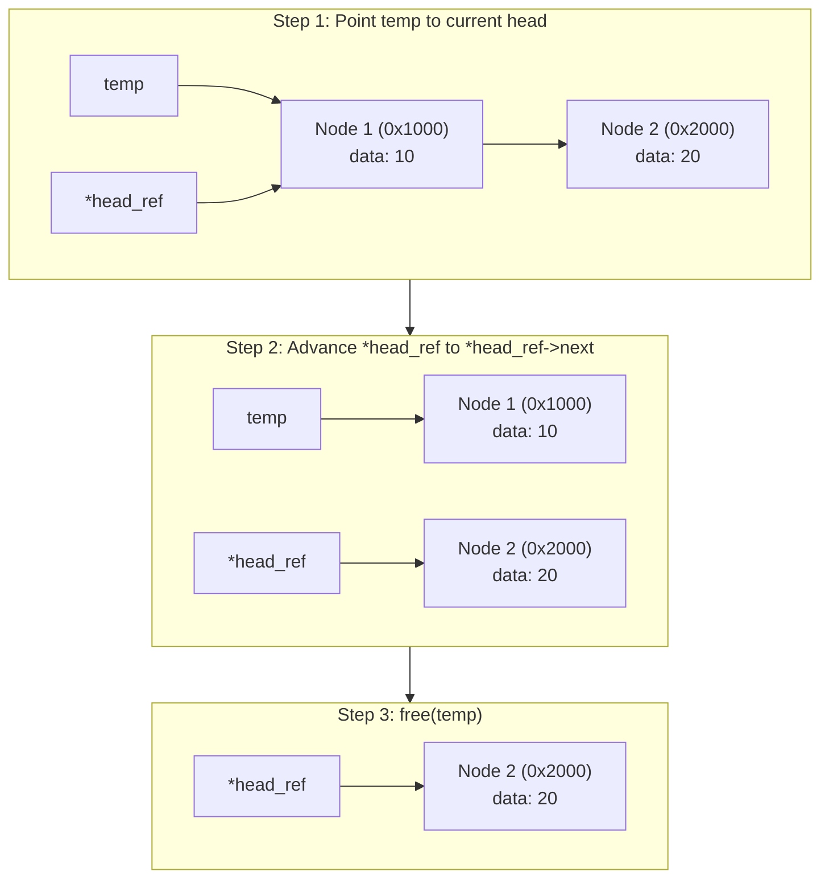
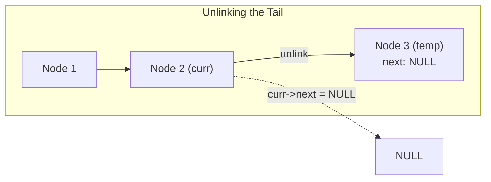
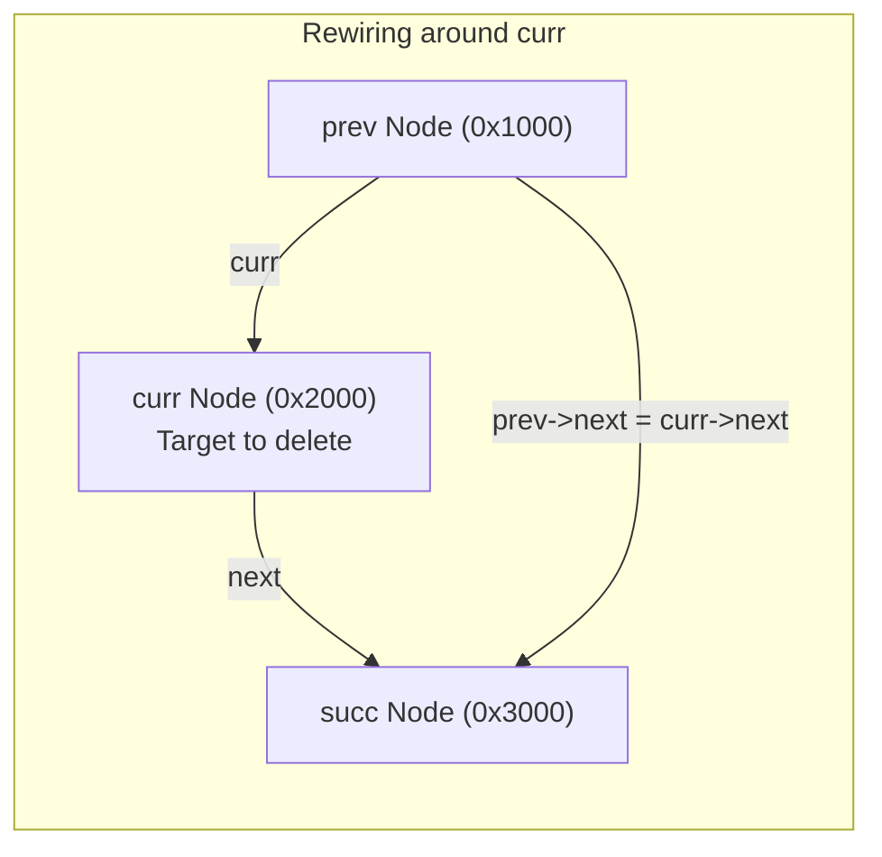
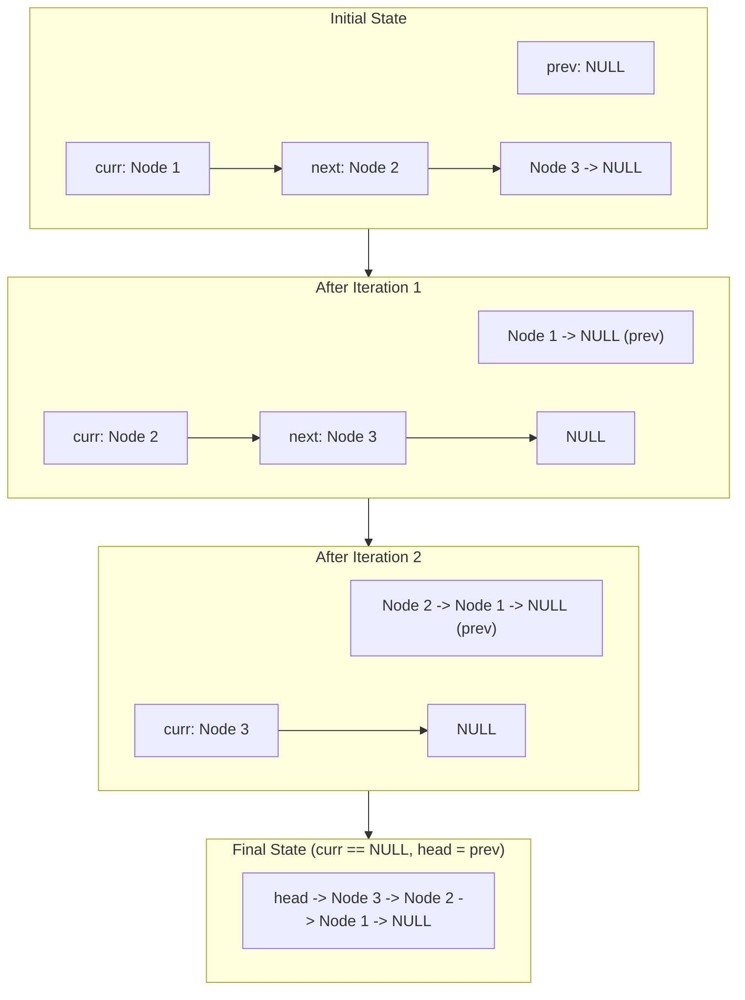

[DSA Index](../README.md) / [Unit 1: Pointers, Memory Allocation, Linked Lists, and Stacks](Introduction.md)

# L04: Singly Linked Lists - Deletion and Traversal

Creating and inserting nodes allows a linked list to grow dynamically. But in real-world applications, data structures must also shrink, be searched, and undergo structural transformations.

Unlike contiguous arrays where deleting an element merely requires sliding subsequent elements backward into already allocated space, deleting a node in a linked list requires physical heap deallocation. If you unlink a node without freeing it, you create a memory leak. If you free a node before updating pointers, you trigger a use-after-free undefined behavior bug.

In this lecture, we examine the mechanics of list traversal, safe node deletion across all boundary conditions, list destruction, and the classical algorithm for in-place pointer reversal.

---

## Linear Traversal and Search

Traversing a linked list means visiting every node sequentially from `head` to `NULL`.

The canonical idiom for traversing a singly linked list uses a temporary cursor pointer:

```c
void traverse(const Node *head) {
    const Node *curr = head;
    while (curr != NULL) {
        // Process curr->data
        curr = curr->next;
    }
}
```

Notice why we never advance `head` directly in read-only operations: if we wrote `head = head->next`, we would lose our reference to the beginning of the list, permanently leaking all prior nodes. Using a separate `curr` pointer keeps the original list intact.

### Searching for a Key

Searching a singly linked list is inherently linear ($O(n)$): because nodes are scattered in heap memory without contiguous indexing, we cannot perform binary search even if the list is sorted. We must inspect nodes sequentially:

```c
bool search(const Node *head, int target, int *out_index) {
    const Node *curr = head;
    int index = 0;

    while (curr != NULL) {
        if (curr->data == target) {
            if (out_index != NULL) *out_index = index;
            return true;
        }
        curr = curr->next;
        index++;
    }
    return false;
}
```

---

## Deletion from the Beginning (Head Deletion)

Deleting the first node is an $O(1)$ operation. However, there is a specific order of execution required to avoid dangling references or memory leaks:



Here is the implementation:

```c
bool delete_beginning(Node **head_ref) {
    // Edge Case: Underflow (empty list)
    if (*head_ref == NULL) {
        return false;
    }

    Node *temp = *head_ref;
    *head_ref = (*head_ref)->next;
    free(temp);
    return true;
}
```

Notice what happens if you attempt this shortcut:

```c
// CATASTROPHIC BUG:
*head_ref = (*head_ref)->next;
// Who frees the old node? Nobody. Memory leaked!

// EQUALLY CATASTROPHIC:
free(*head_ref);
*head_ref = (*head_ref)->next; // USE-AFTER-FREE! *head_ref was already freed!
```

The temporary pointer `temp` is essential: it retains the heap address of the node to be freed while `*head_ref` safely migrates forward to the successor node.

---

## Deletion from the End (Tail Deletion)

To delete the last node in a singly linked list, we must find the penultimate (second-to-last) node, because its `next` pointer must be set to `NULL`.

This operation involves three distinct cases:
1. **Empty list**: Nothing to delete (underflow).
2. **Single-node list**: The only node is deleted, and `*head_ref` becomes `NULL`.
3. **Multi-node list**: Traverse until `curr->next->next == NULL`.



Let's inspect the code:

```c
bool delete_end(Node **head_ref) {
    if (*head_ref == NULL) return false;

    // Case 2: Only one node in the list
    if ((*head_ref)->next == NULL) {
        free(*head_ref);
        *head_ref = NULL;
        return true;
    }

    // Case 3: Multiple nodes. Find second-to-last node
    Node *curr = *head_ref;
    while (curr->next->next != NULL) {
        curr = curr->next;
    }

    // curr is now at the penultimate node; curr->next is the tail
    free(curr->next);
    curr->next = NULL;
    return true;
}
```

Look closely at the condition: `curr->next->next != NULL`. If `curr->next` is the last node, then `curr->next->next` is `NULL`. That is our exact stopping criterion.

---

## Deletion of a Node by Value (Key Deletion)

Now consider the general case: a user gives us a key `value`, and we must search for the first occurrence of that value and delete it from the list.

The target node could reside in one of three places:
1. At the very head of the list.
2. In the middle of the list.
3. At the very end of the list.
4. Or it might not exist at all.



The algorithm uses a trailing pointer technique:

```c
bool delete_key(Node **head_ref, int key) {
    if (*head_ref == NULL) return false;

    Node *curr = *head_ref;
    Node *prev = NULL;

    // Case 1: The head node itself holds the key
    if (curr->data == key) {
        *head_ref = curr->next;
        free(curr);
        return true;
    }

    // Case 2: Search for key while tracking previous node
    while (curr != NULL && curr->data != key) {
        prev = curr;
        curr = curr->next;
    }

    // Key was not found in the entire list
    if (curr == NULL) {
        return false;
    }

    // Case 3: Key found in intermediate or tail node
    prev->next = curr->next;
    free(curr);
    return true;
}
```

Notice how clean the invariant is: `prev` always lags exactly one node behind `curr`. Once `curr->data == key`, `prev->next` bypasses `curr` by pointing directly to `curr->next`, safely isolating `curr` for deallocation.

---

## Safely Destroying the Entire List

When a program finishes using a linked list, every dynamically allocated node must be returned to the heap. 

Let's look at a common beginner pitfall:

```c
// DANGEROUS BUG:
void destroy_broken(Node *head) {
    while (head != NULL) {
        free(head);
        head = head->next; // USE-AFTER-FREE! Reading freed memory!
    }
}
```

The moment `free(head)` executes, the bytes representing `head->next` are surrendered to the memory allocator. Accessing `head->next` on the very next line is undefined behavior. On debug allocators, `free()` overwrites memory with poison patterns (e.g., `0xDEADBEEF`), causing an immediate crash or an infinite loop.

Here is the correct, safe teardown:

```c
void destroy_list(Node **head_ref) {
    Node *curr = *head_ref;
    while (curr != NULL) {
        Node *next_node = curr->next; // Save reference BEFORE freeing
        free(curr);
        curr = next_node;            // Step safely to saved reference
    }
    *head_ref = NULL;                // Zero out caller's pointer
}
```

By saving `curr->next` into `next_node` *before* destroying `curr`, we never read deallocated memory.

---

## Reversing a Singly Linked List In-Place

One of the most classical and revealing algorithmic challenges in pointer manipulation is reversing a singly linked list in-place in $O(n)$ time and $O(1)$ auxiliary space.

We cannot create new nodes—we must reverse the direction of every single pointer arrow using existing nodes.

To accomplish this, we maintain a three-pointer sliding window:
1. `prev`: Points to the already-reversed portion of the list (initially `NULL`).
2. `curr`: Points to the node currently being reversed (initially `head`).
3. `next`: Temporarily preserves the unvisited remainder of the list before we overwrite `curr->next`.



Let's walk through the exact four-step assignment dance inside the loop:

```c
void reverse_list(Node **head_ref) {
    Node *prev = NULL;
    Node *curr = *head_ref;
    Node *next = NULL;

    while (curr != NULL) {
        // Step 1: Save the forward link
        next = curr->next;

        // Step 2: Reverse the current node's pointer
        curr->next = prev;

        // Step 3: Advance prev to current node
        prev = curr;

        // Step 4: Advance curr to next node
        curr = next;
    }

    // Step 5: Update the head pointer to the new first node (prev)
    *head_ref = prev;
}
```

Notice what happens at the boundary when the loop finishes: `curr` has stepped into `NULL`, while `prev` points to what was originally the tail of the list. Setting `*head_ref = prev` cleanly anchors the newly inverted list.

---

## Complete Verification Driver

```c
#include <stdio.h>
#include <stdlib.h>
#include <stdbool.h>

typedef struct Node {
    int data;
    struct Node *next;
} Node;

Node *create_node(int val) {
    Node *n = (Node *)malloc(sizeof(Node));
    n->data = val;
    n->next = NULL;
    return n;
}

void append(Node **head_ref, int val) {
    Node *n = create_node(val);
    if (!*head_ref) { *head_ref = n; return; }
    Node *c = *head_ref;
    while (c->next) c = c->next;
    c->next = n;
}

void print_list(const Node *head) {
    while (head) {
        printf("%d -> ", head->data);
        head = head->next;
    }
    printf("NULL\n");
}

int main(void) {
    Node *head = NULL;
    for (int i = 1; i <= 5; i++) append(&head, i * 10);

    printf("Original list:\n");
    print_list(head); // 10 -> 20 -> 30 -> 40 -> 50 -> NULL

    printf("Deleting key 30:\n");
    delete_key(&head, 30);
    print_list(head); // 10 -> 20 -> 40 -> 50 -> NULL

    printf("Reversing list:\n");
    reverse_list(&head);
    print_list(head); // 50 -> 40 -> 20 -> 10 -> NULL

    printf("Deleting from beginning and end:\n");
    delete_beginning(&head); // Deletes 50
    delete_end(&head);       // Deletes 10
    print_list(head); // 40 -> 20 -> NULL

    destroy_list(&head);
    return 0;
}
```

---

## Complexity Analysis: Deletion and Traversal Operations

| Operation | Time Complexity (Best) | Time Complexity (Worst) | Auxiliary Space Complexity | Explanation |
| :--- | :--- | :--- | :--- | :--- |
| **Traverse / Print** | $O(n)$ | $O(n)$ | $O(1)$ | Must touch every node from `head` to `NULL`. |
| **Search (Unsorted)** | $O(1)$ *(at head)* | $O(n)$ | $O(1)$ | Linear sequential scan. |
| **Delete Beginning** | $O(1)$ | $O(1)$ | $O(1)$ | Direct pointer update and single `free()`. |
| **Delete End** | $O(1)$ *(1-node list)*| $O(n)$ | $O(1)$ | Must traverse to second-to-last node. |
| **Delete Key** | $O(1)$ *(at head)* | $O(n)$ | $O(1)$ | Traversal to key location + constant rewiring. |
| **Reverse In-Place** | $O(n)$ | $O(n)$ | $O(1)$ | Single pass over $n$ nodes with 3 cursor pointers. |
| **Destroy List** | $O(n)$ | $O(n)$ | $O(1)$ | Linear pass freeing each individual heap block. |

---

## Key Takeaways

- Deleting a node always requires capturing a temporary pointer before unlinking to prevent use-after-free bugs and memory leaks.
- Deleting the head node operates in $O(1)$ time, while deleting the tail node requires $O(n)$ time to locate the penultimate node.
- Key deletion uses a trailing `prev` pointer to rewire `prev->next = curr->next` once the target is found.
- Destroying an entire list requires caching `curr->next` before calling `free(curr)`.
- In-place reversal uses a 3-pointer sliding window (`prev`, `curr`, `next`) to invert pointer directions in a single $O(n)$ pass without auxiliary memory allocation.

Notice how in every singly linked list algorithm we wrote, we had to handle special edge cases: "Is the list empty? Is the target at the head? Is there only one node?". This proliferation of special-case branching occurs because standard singly linked lists lack a fixed sentinel anchor. Let's head to [L05 - Header Linked Lists and Circular Header Nodes](L05%20-%20Header%20Linked%20Lists%20and%20Circular%20Header%20Nodes.md) to discover how header and circular sentinel nodes elegantly eliminate special boundary cases altogether.
