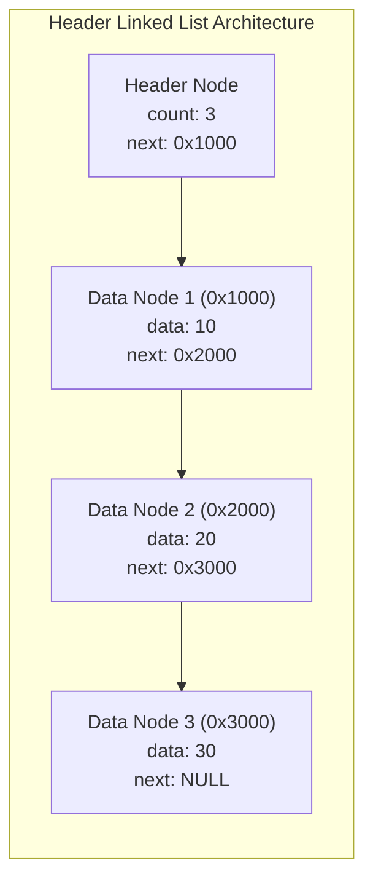
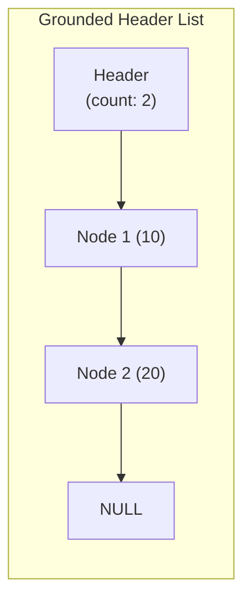
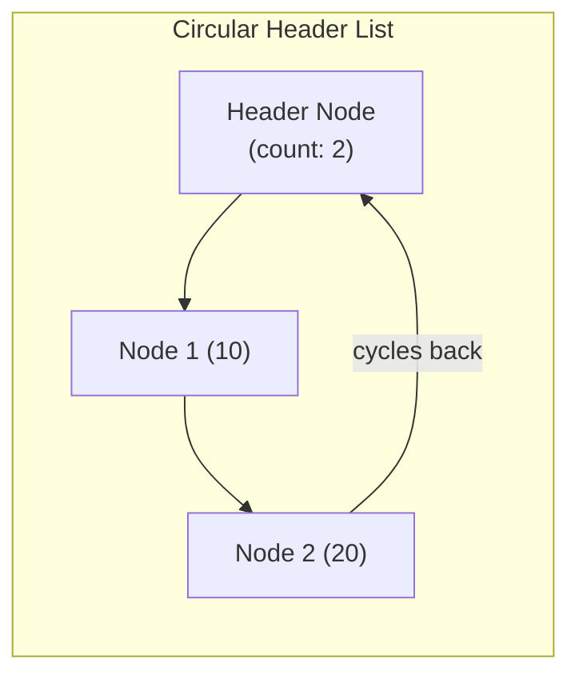
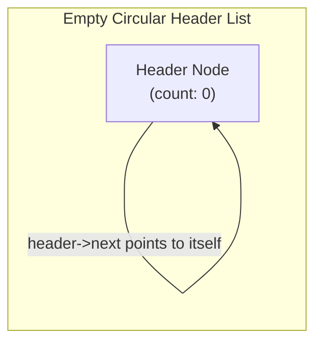

[DSA Index](../README.md) / [Unit 1: Pointers, Memory Allocation, Linked Lists, and Stacks](Introduction.md)

# L05: Header Linked Lists and Circular Header Nodes

In standard singly linked lists, writing robust code is notoriously prone to edge-case bugs. Every time we write an insertion or deletion function, we are forced to write defensive conditional branches:

```c
// The repetitive edge-case boilerplate of standard lists:
if (*head_ref == NULL) { /* special case */ }
if (position == 1)    { /* special case */ }
if (prev == NULL)        { /* special case */ }
```

Why do these special cases exist? Because the list pointer `head` can be `NULL`, and the first node in the list has no predecessor. 

What if we could guarantee that every node in our list—even the very first data node—*always* has a predecessor? And what if the list variable itself *never* changes its address, eliminating the need for awkward double pointers?

This is precisely what **Header Linked Lists** and **Circular Header Nodes** accomplish.

---

## What is a Header Node?

A **Header Node** (also referred to as a **Sentinel Node** or **Dummy Node**) is a special, permanently allocated node placed at the very front of a linked list. 

The header node does not hold user payload data. Instead:
- It serves as a fixed, permanent anchor for the list.
- It can store global **metadata** about the list (such as the total element count, maximum value, or a direct pointer to the tail node).
- Its `next` pointer points to the first actual data-bearing node.



Notice something critical: an empty header list is **not** `NULL`. An empty header list is a valid, allocated header node whose `next` pointer points to `NULL` (or to itself in circular variants), with `count == 0`.

---

## Grounded Header Lists vs Circular Header Lists

There are two primary architectural variants of header linked lists:

### 1. Grounded Header List
In a grounded header list, the header points to the first data node, and the last data node terminates with `next = NULL`.



### 2. Circular Header List
In a circular header list, the last node does not point to `NULL`. Instead, its `next` pointer cycles back to point directly to the **Header Node**. 



Now, look at how an empty circular list is represented:



In an empty circular header list, `header->next == header`. There are no null pointers anywhere in the system.

---

## Eliminating Boundary Conditions

Let's inspect why header nodes simplify our algorithms so drastically.

### 1. No Double Pointers Required
In standard singly linked lists, modifying the first node required passing `Node **head_ref` because the `head` pointer itself changed value. With a header node, the header itself is allocated once at list creation and is *never* deleted or moved. The client only needs to pass a single pointer `HeaderNode *head`.

### 2. Universal Insertion Mechanics
In a standard list, inserting at the beginning required a separate branch:
```c
// Standard list requires a branch:
if (position == 1) { new_node->next = head; head = new_node; }
else { prev->next = new_node; }
```

With a header node, inserting at the beginning is mechanically identical to inserting anywhere else! The header node acts as `prev`.

```c
// Universal insertion with header node:
new_node->next = prev->next;
prev->next = new_node;
header->count++;
```
Whether inserting at index 1, index 5, or into an empty list, the exact same two pointer assignments execute without a single `if` statement.

### 3. Universal Deletion Mechanics
Similarly, deleting the first data node no longer requires overwriting the list variable:
```c
// Universal deletion with header node:
Node *temp = prev->next;
prev->next = temp->next;
free(temp);
header->count--;
```
The header node acts as `prev`, so the code to delete the first element is completely identical to deleting an element in the middle.

---

## C Implementation: Circular Header Linked List

Let's build a complete, production-grade circular header linked list.

### Structure Definitions

```c
#include <stdio.h>
#include <stdlib.h>
#include <stdbool.h>

typedef struct Node {
    int data;
    struct Node *next;
} Node;

typedef struct HeaderList {
    int count;          // Encapsulated metadata
    Node *head;         // Points to header sentinel node
} HeaderList;
```

### Initializing the Circular Header List

When creating the list, we allocate the sentinel node and configure it to point to itself:

```c
HeaderList *create_circular_header_list(void) {
    HeaderList *list = (HeaderList *)malloc(sizeof(HeaderList));
    if (!list) { perror("malloc failed"); exit(EXIT_FAILURE); }

    // Allocate the sentinel header node
    list->head = (Node *)malloc(sizeof(Node));
    if (!list->head) { perror("malloc failed"); exit(EXIT_FAILURE); }

    list->head->data = -1;       // Sentinel placeholder data
    list->head->next = list->head; // Points to itself
    list->count = 0;

    return list;
}
```

### Universal Insertion at the Front

```c
void insert_front(HeaderList *list, int value) {
    Node *new_node = (Node *)malloc(sizeof(Node));
    new_node->data = value;

    // Splice immediately after the sentinel header
    new_node->next = list->head->next;
    list->head->next = new_node;

    list->count++;
}
```

Notice that this works seamlessly whether the list is currently empty or contains 50 elements. If empty, `list->head->next` was `list->head`. `new_node->next` becomes `list->head`, and `list->head->next` becomes `new_node`. The circular invariant is maintained automatically.

### Universal Insertion at the End

To insert at the end, we walk until `curr->next == list->head`:

```c
void insert_end(HeaderList *list, int value) {
    Node *new_node = (Node *)malloc(sizeof(Node));
    new_node->data = value;

    // Traverse to the last node
    Node *curr = list->head;
    while (curr->next != list->head) {
        curr = curr->next;
    }

    // Splice between last node and sentinel header
    new_node->next = list->head;
    curr->next = new_node;

    list->count++;
}
```

### Sorted Insertion Without Special Cases

In standard lists, inserting into a sorted list requires checking if the new element is smaller than `head->data`. In a circular header list, the header sentinel sits behind everything, allowing uniform traversal:

```c
void insert_sorted(HeaderList *list, int value) {
    Node *new_node = (Node *)malloc(sizeof(Node));
    new_node->data = value;

    Node *curr = list->head;
    // Walk while successor is not header AND successor data is smaller
    while (curr->next != list->head && curr->next->data < value) {
        curr = curr->next;
    }

    new_node->next = curr->next;
    curr->next = new_node;
    list->count++;
}
```

Look at that loop: zero special branches for empty lists, zero special branches for prepending smaller elements. The sentinel handles every boundary condition.

### Deleting a Node by Value

```c
bool delete_value(HeaderList *list, int target) {
    Node *curr = list->head;

    // Search for predecessor of target
    while (curr->next != list->head && curr->next->data != target) {
        curr = curr->next;
    }

    // Target not found
    if (curr->next == list->head) {
        return false;
    }

    // Unlink and free
    Node *temp = curr->next;
    curr->next = temp->next;
    free(temp);

    list->count--;
    return true;
}
```

### Traversing and Printing

The loop condition simply steps through nodes until it wraps back around to the sentinel:

```c
void print_list(const HeaderList *list) {
    printf("List (Count: %d): [HEADER] -> ", list->count);
    Node *curr = list->head->next;
    while (curr != list->head) {
        printf("%d -> ", curr->data);
        curr = curr->next;
    }
    printf("[WRAP TO HEADER]\n");
}
```

### Safe Destruction

We iterate through all data nodes, freeing each, and finally free the sentinel header and the list wrapper:

```c
void destroy_header_list(HeaderList **list_ref) {
    if (!list_ref || !*list_ref) return;

    HeaderList *list = *list_ref;
    Node *curr = list->head->next;

    while (curr != list->head) {
        Node *temp = curr;
        curr = curr->next;
        free(temp);
    }

    // Free the sentinel node
    free(list->head);
    // Free the wrapper
    free(list);

    *list_ref = NULL;
}
```

---

## Complete Verification Driver

```c
int main(void) {
    HeaderList *list = create_circular_header_list();

    printf("Inserting 40, 10, 30, 20 in sorted order:\n");
    insert_sorted(list, 40);
    insert_sorted(list, 10);
    insert_sorted(list, 30);
    insert_sorted(list, 20);
    print_list(list); 
    // Output: [HEADER] -> 10 -> 20 -> 30 -> 40 -> [WRAP TO HEADER]

    printf("\nDeleting 10 (smallest / first real node):\n");
    delete_value(list, 10);
    print_list(list);

    printf("\nDeleting 40 (largest / last real node):\n");
    delete_value(list, 40);
    print_list(list);

    destroy_header_list(&list);
    return 0;
}
```

---

## Complexity Comparison: Standard List vs Header List

| Operation | Standard Singly Linked List | Circular Header Linked List | Advantage of Header Node |
| :--- | :--- | :--- | :--- |
| **Get Element Count** | $O(n)$ *(traversal)* | $O(1)$ | Metadata field in header stores size directly. |
| **Insert at Beginning** | $O(1)$ *(requires `Node**`)* | $O(1)$ *(clean `list` pointer)* | No special empty list branch; no double pointer. |
| **Insert at End** | $O(n)$ | $O(n)$ *(or $O(1)$ with tail)* | Sentinel node eliminates empty-list check. |
| **Delete Beginning** | $O(1)$ *(must modify `head`)*| $O(1)$ | Sentinel node absorbs predecessor role cleanly. |
| **Delete Key** | $O(n)$ *(special head check)*| $O(n)$ *(universal loop)* | Single loop without special `prev == NULL` logic. |
| **Memory Overhead** | 0 bytes extra | 1 sentinel node (16B) + struct | Negligible overhead for dramatic code simplification. |

---

## Key Takeaways

- A Header (Sentinel) Node is a dedicated, permanent anchor node placed at the start of a list that does not store payload data.
- Header nodes eliminate the need for double pointers (`Node **`) because the header itself is never deallocated or relocated during insertion or deletion.
- In a circular header list, the empty state is represented by `header->next == header`, completely eliminating `NULL` pointer dereference hazards.
- Every data node is guaranteed to have a predecessor (the sentinel if it is first), unifying insertion, deletion, and search logic across all boundary positions.
- Encapsulating metadata (such as element count) in the header struct reduces size queries from $O(n)$ to $O(1)$.

Now that we understand how header nodes and linked lists manage dynamic ordered elements cleanly, we can explore how linked structures represent complex mathematical entities. Let's move to [L06 - Polynomial Representation and Arithmetic](L06%20-%20Polynomial%20Representation%20and%20Arithmetic.md) to discover how linked lists solve the problem of sparse polynomial manipulation and algebraic arithmetic.
