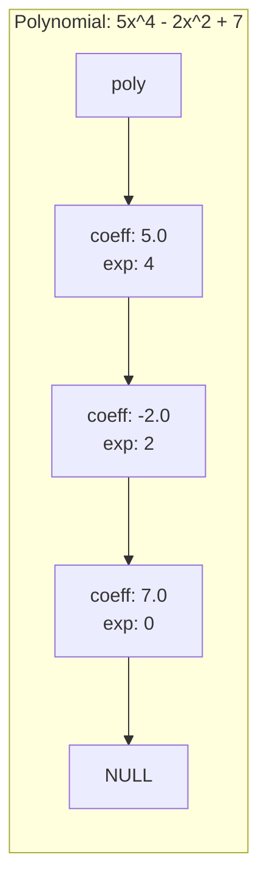
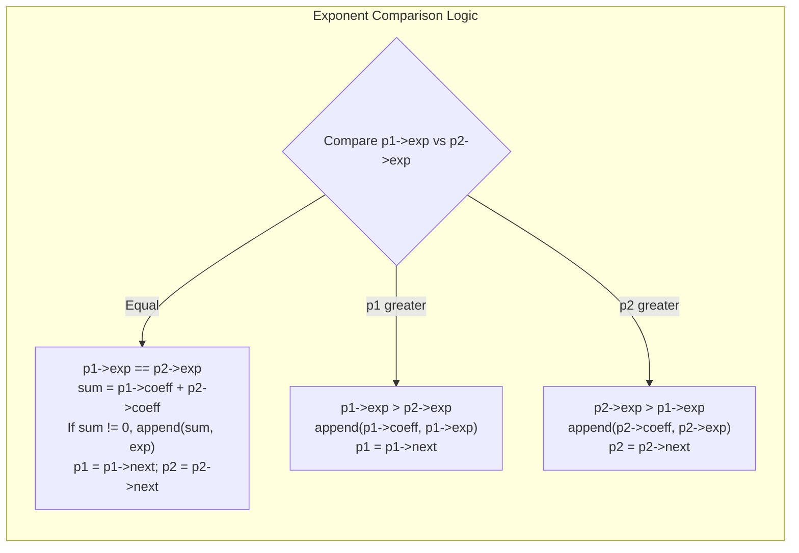
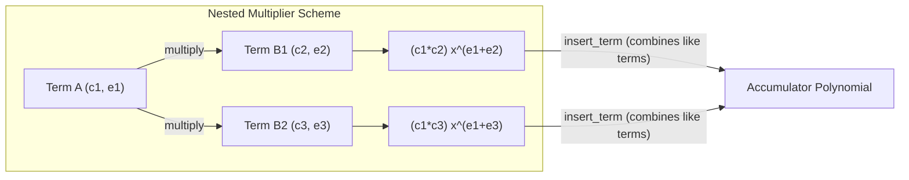

[DSA Index](../README.md) / [Unit 1: Pointers, Memory Allocation, Linked Lists, and Stacks](Introduction.md)

# L06: Polynomial Representation and Arithmetic

In algebra, a single-variable polynomial is an expression of the form:

$$P(x) = c_n x^{e_n} + c_{n-1} x^{e_{n-1}} + \dots + c_1 x^{e_1} + c_0 x^{e_0}$$

where each term consists of a numerical coefficient $c_i$ and an integer exponent $e_i$.

How should we represent such an expression in computer memory?

The most naive approach is to use an array where the array index corresponds directly to the exponent: `A[exp] = coeff`. For a dense polynomial like $3x^3 + 2x^2 + x + 5$, an array of size 4 works well.

Now, consider a sparse polynomial:

$$P(x) = 1000x^{1000} + 1$$

To represent this two-term polynomial in an array, we must allocate an array of 1,001 elements. One thousand and one memory slots, of which 999 are completely empty (zero). If the exponent is $10^9$, array allocation fails entirely due to out-of-memory errors.

Linked lists provide the ideal solution: we allocate memory **only for non-zero terms**.

---

## Polynomial Node Architecture

A polynomial is modeled as a singly linked list where every node represents a single non-zero monomial term.

Each node contains three fields:
1. **`coeff`**: The coefficient (floating-point or integer).
2. **`exp`**: The non-negative exponent (power of $x$).
3. **`next`**: A pointer to the next term in the polynomial.



### Invariant: Strict Descending Exponent Order
To make algebraic operations efficient, we enforce a strict invariant:
$$\text{Terms in the linked list are always maintained in strictly descending order of exponents: } e_1 > e_2 > e_3 > \dots > e_k \ge 0$$

Maintaining this invariant ensures that terms with the highest degree appear first, and terms with identical exponents can be combined in a single pass without quadratic searches.

In C, we define the term structure as follows:

```c
typedef struct Term {
    float coeff;
    int exp;
    struct Term *next;
} Term;
```

---

## Term Insertion and Consolidation

When inserting terms into a polynomial linked list, we must handle three distinct scenarios:
1. **Exponent does not exist yet**: Splice a new node in the correct sorted position.
2. **Exponent already exists**: Simply add the incoming coefficient to the existing node's coefficient (combine like terms). If the resulting coefficient becomes zero (e.g., $3x^2 + (-3x^2) = 0$), remove that node entirely.
3. **Incoming coefficient is zero**: Discard it immediately; polynomials never store zero-coefficient terms.

```c
#include <stdio.h>
#include <stdlib.h>
#include <stdbool.h>
#include <math.h>

Term *create_term(float coeff, int exp) {
    Term *new_term = (Term *)malloc(sizeof(Term));
    if (!new_term) { perror("malloc failed"); exit(EXIT_FAILURE); }
    new_term->coeff = coeff;
    new_term->exp = exp;
    new_term->next = NULL;
    return new_term;
}

void insert_term(Term **poly_ref, float coeff, int exp) {
    // Zero coefficients are mathematically meaningless in sparse storage
    if (fabs(coeff) < 1e-6) return;

    // Case 1: Empty list or incoming exponent is strictly greater than head exponent
    if (*poly_ref == NULL || exp > (*poly_ref)->exp) {
        Term *new_term = create_term(coeff, exp);
        new_term->next = *poly_ref;
        *poly_ref = new_term;
        return;
    }

    // Case 2: Incoming exponent matches head exponent
    if ((*poly_ref)->exp == exp) {
        (*poly_ref)->coeff += coeff;
        if (fabs((*poly_ref)->coeff) < 1e-6) {
            Term *temp = *poly_ref;
            *poly_ref = (*poly_ref)->next;
            free(temp);
        }
        return;
    }

    // Case 3: Search insertion point in the rest of the chain
    Term *curr = *poly_ref;
    while (curr->next != NULL && curr->next->exp > exp) {
        curr = curr->next;
    }

    // Subcase 3a: Term with identical exponent already exists
    if (curr->next != NULL && curr->next->exp == exp) {
        curr->next->coeff += coeff;
        if (fabs(curr->next->coeff) < 1e-6) {
            Term *temp = curr->next;
            curr->next = temp->next;
            free(temp);
        }
    } 
    // Subcase 3b: Splice new term between curr and curr->next
    else {
        Term *new_term = create_term(coeff, exp);
        new_term->next = curr->next;
        curr->next = new_term;
    }
}
```

---

## Polynomial Addition: The Two-Pointer Merge

Now we come to the core algebraic operation: adding two polynomials, $A(x)$ and $B(x)$.

Because both lists are maintained in strictly descending exponent order, adding them is mathematically identical to the merge step of Merge Sort. We do not need nested loops. We traverse both lists simultaneously using two pointers (`p1` and `p2`), comparing their exponents at each step:



### Trace Example
Let $A(x) = 5x^4 + 3x^2 + 1$ and $B(x) = 2x^4 - 3x^2 + 6x$.
1. $e_A = 4, e_B = 4$: Exponents match. Sum $= 5 + 2 = 7$. Output $7x^4$. Both advance.
2. $e_A = 2, e_B = 2$: Exponents match. Sum $= 3 + (-3) = 0$. Zero coefficient, discard. Both advance.
3. $p_1$ is at $1$ ($e_A = 0$), $p_2$ is at $6x$ ($e_B = 1$). $e_B > e_A$. Output $6x^1$. $p_2$ advances.
4. $p_2$ is `NULL`. Append remaining $p_1$ terms: Output $1x^0$.
5. Final Result: $7x^4 + 6x + 1$.

### C Implementation

```c
Term *add_polynomials(const Term *p1, const Term *p2) {
    Term *result = NULL;
    Term *tail = NULL; // Maintains tail pointer for O(1) appending

    void append_term(float c, int e) {
        if (fabs(c) < 1e-6) return;
        Term *n = create_term(c, e);
        if (result == NULL) {
            result = n;
            tail = n;
        } else {
            tail->next = n;
            tail = n;
        }
    }

    while (p1 != NULL && p2 != NULL) {
        if (p1->exp == p2->exp) {
            float sum = p1->coeff + p2->coeff;
            append_term(sum, p1->exp);
            p1 = p1->next;
            p2 = p2->next;
        } else if (p1->exp &gt; p2->exp) {
            append_term(p1->coeff, p1->exp);
            p1 = p1->next;
        } else {
            append_term(p2->coeff, p2->exp);
            p2 = p2->next;
        }
    }

    // Append any trailing terms from p1
    while (p1 != NULL) {
        append_term(p1->coeff, p1->exp);
        p1 = p1->next;
    }

    // Append any trailing terms from p2
    while (p2 != NULL) {
        append_term(p2->coeff, p2->exp);
        p2 = p2->next;
    }

    return result;
}
```

Notice the efficiency: because both input lists are sorted, every node is visited exactly once. If $p_1$ has $m$ terms and $p_2$ has $n$ terms, polynomial addition completes strictly in $O(m + n)$ linear time.

---

## Polynomial Multiplication

Multiplying two polynomials $A(x) \times B(x)$ follows the distributive property of multiplication: every term in $A$ must multiply every term in $B$.

When multiplying two individual terms $(c_1 x^{e_1}) \times (c_2 x^{e_2})$, the algebraic rules dictate:
$$\text{Product} = (c_1 \times c_2) \cdot x^{e_1 + e_2}$$



Because multiple term products may produce the exact same resulting exponent (e.g., $x^3 \cdot x^1 = x^4$ and $x^2 \cdot x^2 = x^4$), we insert each partial product into an accumulator list using our sorted `insert_term()` function, which automatically combines like terms:

```c
Term *multiply_polynomials(const Term *p1, const Term *p2) {
    Term *result = NULL;

    for (const Term *ptr1 = p1; ptr1 != NULL; ptr1 = ptr1->next) {
        for (const Term *ptr2 = p2; ptr2 != NULL; ptr2 = ptr2->next) {
            float coeff_product = ptr1->coeff * ptr2->coeff;
            int exp_sum = ptr1->exp + ptr2->exp;
            insert_term(&result, coeff_product, exp_sum);
        }
    }

    return result;
}
```

---

## Symbolic Differentiation

Linked lists make symbolic calculus transformations straightforward. 

The derivative of a monomial term $c \cdot x^e$ with respect to $x$ is:

$$\frac{d}{dx} \left(c \cdot x^e\right) = (c \cdot e) \cdot x^{e-1}$$

For constant terms ($e = 0$), the derivative is $0$, meaning constant terms vanish completely from the resulting polynomial.

```c
Term *differentiate(const Term *poly) {
    Term *result = NULL;
    Term *tail = NULL;

    for (const Term *curr = poly; curr != NULL; curr = curr->next) {
        // Constant terms vanish upon differentiation
        if (curr->exp == 0) continue;

        float new_coeff = curr->coeff * curr->exp;
        int new_exp = curr->exp - 1;

        Term *n = create_term(new_coeff, new_exp);
        if (result == NULL) {
            result = n;
            tail = n;
        } else {
            tail->next = n;
            tail = n;
        }
    }

    return result;
}
```

---

## Verification and Formatting Driver

```c
#include <stdio.h>

void print_polynomial(const Term *poly) {
    if (poly == NULL) {
        printf("0\n");
        return;
    }

    for (const Term *curr = poly; curr != NULL; curr = curr->next) {
        if (curr != poly && curr->coeff > 0) {
            printf(" + ");
        } else if (curr->coeff < 0) {
            printf(" - ");
        }

        float abs_coeff = fabs(curr->coeff);
        if (curr->exp == 0) {
            printf("%.1f", abs_coeff);
        } else if (curr->exp == 1) {
            printf("%.1fx", abs_coeff);
        } else {
            printf("%.1fx^%d", abs_coeff, curr->exp);
        }
    }
    printf("\n");
}

void free_poly(Term **poly_ref) {
    Term *curr = *poly_ref;
    while (curr) {
        Term *temp = curr;
        curr = curr->next;
        free(temp);
    }
    *poly_ref = NULL;
}

int main(void) {
    Term *P1 = NULL;
    Term *P2 = NULL;

    // P1 = 4x^3 + 3x^2 + 5
    insert_term(&P1, 4.0f, 3);
    insert_term(&P1, 3.0f, 2);
    insert_term(&P1, 5.0f, 0);

    // P2 = 2x^2 + 6x + 1
    insert_term(&P2, 2.0f, 2);
    insert_term(&P2, 6.0f, 1);
    insert_term(&P2, 1.0f, 0);

    printf("P1(x) = "); print_polynomial(P1);
    printf("P2(x) = "); print_polynomial(P2);

    Term *sum = add_polynomials(P1, P2);
    printf("P1 + P2 = "); print_polynomial(sum);

    Term *prod = multiply_polynomials(P1, P2);
    printf("P1 * P2 = "); print_polynomial(prod);

    Term *diff = differentiate(P1);
    printf("d/dx(P1) = "); print_polynomial(diff);

    free_poly(&P1);
    free_poly(&P2);
    free_poly(&sum);
    free_poly(&prod);
    free_poly(&diff);

    return 0;
}
```

---

## Complexity Analysis: Polynomial Operations

| Operation | Time Complexity | Auxiliary Space Complexity | Explanation |
| :--- | :--- | :--- | :--- |
| **Insert Term** | $O(k)$ | $O(1)$ | Scans existing $k$ terms in list to find exponent or splice point. |
| **Polynomial Addition ($m, n$ terms)** | $O(m + n)$ | $O(m + n)$ | Single simultaneous linear scan of both ordered inputs. |
| **Polynomial Multiplication** | $O(m \cdot n \cdot k)$ | $O(m \cdot n)$ | $m \times n$ term products, each inserted into accumulator of size $k \le m \cdot n$. |
| **Differentiation ($m$ terms)** | $O(m)$ | $O(m)$ | Single linear pass transforming each term and appending in $O(1)$. |
| **Destroy Polynomial** | $O(m)$ | $O(1)$ | Linear deallocation of all heap nodes. |

---

## Key Takeaways

- Contiguous arrays waste massive amounts of memory when storing sparse polynomials with large exponents.
- Linked lists provide optimal spatial efficiency by allocating heap nodes exclusively for non-zero monomial terms.
- Maintaining terms in strictly descending order of exponents allows polynomial addition to run in linear $O(m + n)$ time using a two-pointer merge algorithm.
- Polynomial multiplication computes all pairwise products $(c_i \cdot c_j)x^{e_i + e_j}$ and combines like terms in an accumulator list.
- Symbolic differentiation processes each node independently in $O(m)$ time, cleanly dropping constant terms.

While polynomials use a single chain of pointers to link terms linearly, many real-world systems require multidimensional cross-referencing—such as sparse matrices that must be traversed both row-wise and column-wise, or sorted lists that require fast logarithmic searches. Let's head to [L07 - Specialized Lists - Multilists and Skip Lists](L07%20-%20Specialized%20Lists%20-%20Multilists%20and%20Skip%20Lists.md) to explore multi-pointer structures.
