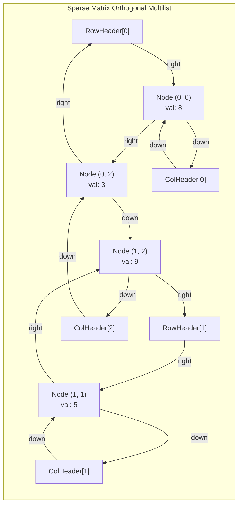
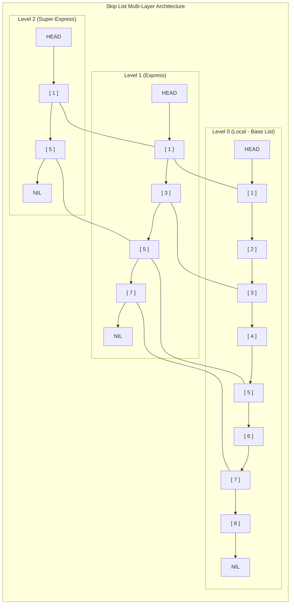

[DSA Index](../README.md) / [Unit 1: Pointers, Memory Allocation, Linked Lists, and Stacks](Introduction.md)

# L07: Specialized Lists - Multilists and Skip Lists

So far, every linked list we have constructed has been strictly one-dimensional: each node has a single successor pointer (`next`). 

Real-world relationships, however, are seldom one-dimensional. Consider a university database: a student enrolls in multiple courses, and each course contains multiple students. Or consider a massive $10,000 \times 10,000$ numerical matrix in physics simulation where only 500 entries are non-zero: storing this in a traditional 2D array wastes 400 megabytes of memory on zeros, yet storing it as independent row lists prevents column-wise traversal.

Furthermore, sorted linked lists suffer from a fundamental algorithmic deficiency: **the $O(n)$ search barrier**. Even when elements are perfectly sorted, we cannot jump to the middle of a linked list in $O(1)$ time to perform binary search. We are forced to step through every node sequentially.

In this lecture, we examine two specialized multi-pointer data structures designed to solve these exact problems: **Multilists** (Orthogonal Lists) and **Skip Lists**.

---

## Multilists and Orthogonal Lists

A **Multilist** is a linked data structure where individual nodes participate simultaneously in two or more distinct linked chains. 

The canonical application of a multilist is the **Orthogonal Linked List** representation of sparse matrices.

### Sparse Matrix Problem
Suppose we have a $1,000 \times 1,000$ matrix containing only 20 non-zero entries. An array representation allocates $1,000,000$ integers. In contrast, an orthogonal multilist allocates nodes *only* for the 20 non-zero values.

To allow both row-wise and column-wise traversals, every non-zero node contains:
- `row`: The row index.
- `col`: The column index.
- `value`: The numerical payload.
- `right`: Pointer to the next non-zero entry in the same row.
- `down`: Pointer to the next non-zero entry in the same column.



Notice the architecture:
- Every row forms a circular linked list managed by a row header.
- Every column forms an independent circular linked list managed by a column header.
- The non-zero node at `(0, 2)` belongs simultaneously to Row List 0 and Column List 2.
- Traversing a specific row requires scanning only the non-zero entries in that row via the `right` pointer. Traversing a specific column follows the `down` pointer.

```c
typedef struct MatrixNode {
    int row;
    int col;
    double value;
    struct MatrixNode *right;
    struct MatrixNode *down;
} MatrixNode;

typedef struct SparseMatrix {
    int total_rows;
    int total_cols;
    MatrixNode **row_heads; // Array of row header pointers
    MatrixNode **col_heads; // Array of col header pointers
} SparseMatrix;
```

---

## Skip Lists: Overcoming the $O(n)$ Search Barrier

Now, let's tackle the search problem in sorted lists.

In an array, sorted data enables binary search in $O(\log n)$ time because array indices allow instant random access to the median element. In a sorted singly linked list, even though the data is sorted, finding an element still takes $O(n)$ time because we cannot skip elements.

What if we built "express train lanes" on top of our local lane?

Imagine a subway system:
- The **Local Lane** stops at every single station: $1, 2, 3, 4, 5, 6, 7, 8$.
- The **Express Lane** stops only at alternate stations: $1, 3, 5, 7$.
- The **Super-Express Lane** stops only at major hubs: $1, 5$.



If we want to search for `6`:
1. Start at **Level 2** from `HEAD`: step to `1`, then look at `5`. Since $5 < 6$, step to `5`. Next node at Level 2 is `NIL`. We cannot advance further at Level 2.
2. Drop down to **Level 1** at node `5`: look ahead to `7`. Since $7 > 6$, do not step to `7`.
3. Drop down to **Level 0** at node `5`: step forward to `6`. Target found!

Instead of visiting 6 nodes, we inspected only 3! By adding multi-level forward pointers, we cut the search path in half at each layer.

---

## Probabilistic Balancing: Pugh's Randomization

In an ideal skip list where every $k$-th level contains exactly half the nodes of level $k-1$, search is strictly $O(\log n)$. 

However, maintaining rigid geometric intervals during dynamic insertions and deletions would require moving and rebuilding pointer towers throughout the entire list—an expensive $O(n)$ rebalancing operation that destroys the whole advantage.

In 1989, William Pugh made a profound breakthrough: **replace deterministic balancing with probabilistic randomization**.

Instead of enforcing that every second node has a Level 1 pointer, we determine the height of each node when it is inserted by flipping an unbiased coin:
- Every node has a Level 0 pointer (probability 1.0).
- Flip a coin: if Heads (probability $p = 0.5$), the node gets a Level 1 pointer.
- Flip again: if Heads, the node gets a Level 2 pointer.
- Repeat until Tails or until reaching a fixed `MAX_LEVEL`.

$$\text{Probability that a node reaches level } k = p^k = \left(\frac{1}{2}\right)^k$$

Because coin flips are independent, the expected number of nodes at level $k$ is $n / 2^k$. Without performing a single tree rotation or global rebalance, the list organizes itself into a balanced logarithmic hierarchy with high probability.

---

## Skip List Node Architecture and Data Structures

A Skip List node must hold an array of forward pointers whose size depends on its randomly assigned level:

```c
#include <stdio.h>
#include <stdlib.h>
#include <stdbool.h>
#include <limits.h>

#define MAX_LEVEL 16
#define P_FACTOR 0.5f

typedef struct SkipNode {
    int key;
    int value;
    struct SkipNode *forward[]; // Flexible array member of forward pointers
} SkipNode;

typedef struct SkipList {
    int level;          // Current maximum active level in the skip list
    SkipNode *header;   // Sentinel header node
} SkipList;
```

### Allocating a Node of Arbitrary Height
In C99, flexible array members allow us to allocate a struct and its array in a single contiguous memory block:

```c
SkipNode *create_skip_node(int level, int key, int value) {
    // Allocate struct memory + space for (level + 1) forward pointers
    size_t alloc_size = sizeof(SkipNode) + (level + 1) * sizeof(SkipNode *);
    SkipNode *node = (SkipNode *)malloc(alloc_size);
    if (!node) { perror("malloc failed"); exit(EXIT_FAILURE); }

    node->key = key;
    node->value = value;
    for (int i = 0; i <= level; i++) {
        node->forward[i] = NULL;
    }
    return node;
}
```

### Random Level Generator

```c
int random_level(void) {
    int lvl = 0;
    // Flip a coin: while rand() / RAND_MAX < 0.5, increment level
    while (((float)rand() / (float)RAND_MAX) < P_FACTOR && lvl < MAX_LEVEL - 1) {
        lvl++;
    }
    return lvl;
}
```

---

## Skip List Operations: Search, Insert, and Destroy

### 1. The Search Algorithm

We search from the highest active level down to level 0:
- At level $i$, walk forward as long as `curr->forward[i]->key < target`.
- When the next key is $\ge \text{target}$ (or `NULL`), drop down to level $i - 1$.
- At level 0, step forward once. If `curr->key == target`, key is found!

```c
bool skip_search(const SkipList *list, int target_key, int *out_value) {
    SkipNode *curr = list->header;

    for (int i = list->level; i >= 0; i--) {
        while (curr->forward[i] != NULL && curr->forward[i]->key < target_key) {
            curr = curr->forward[i];
        }
    }

    // Step to the candidate node at Level 0
    curr = curr->forward[0];

    if (curr != NULL && curr->key == target_key) {
        if (out_value) *out_value = curr->value;
        return true;
    }
    return false;
}
```

### 2. The Insertion Algorithm

Insertion requires two distinct phases:
1. **Find and record predecessors**: Traverse the list exactly as in search, but keep track of the last node visited at *every* level in an `update[]` array.
2. **Splice the new node across layers**: Generate a random level $L$. If $L$ is higher than the current list level, update the header pointers. Then, for every level $i \le L$, wire `new_node->forward[i] = update[i]->forward[i]` and `update[i]->forward[i] = new_node`.

```c
void skip_insert(SkipList *list, int key, int value) {
    SkipNode *update[MAX_LEVEL];
    SkipNode *curr = list->header;

    // Phase 1: Track predecessors at every level
    for (int i = list->level; i >= 0; i--) {
        while (curr->forward[i] != NULL && curr->forward[i]->key < key) {
            curr = curr->forward[i];
        }
        update[i] = curr;
    }

    curr = curr->forward[0];

    // If key already exists, overwrite value
    if (curr != NULL && curr->key == key) {
        curr->value = value;
        return;
    }

    // Phase 2: Generate random height for new node
    int rlevel = random_level();

    // If new level exceeds current list level, initialize update pointers to header
    if (rlevel > list->level) {
        for (int i = list->level + 1; i <= rlevel; i++) {
            update[i] = list->header;
        }
        list->level = rlevel;
    }

    // Phase 3: Allocate and splice node into all levels up to rlevel
    SkipNode *new_node = create_skip_node(rlevel, key, value);
    for (int i = 0; i <= rlevel; i++) {
        new_node->forward[i] = update[i]->forward[i];
        update[i]->forward[i] = new_node;
    }
}
```

Notice how elegant the splicing is: across every level up to `rlevel`, `update[i]` is the exact predecessor of `new_node`. The pointer splicing is identical to ordinary singly linked list insertion, executed across $L$ parallel tiers.

### 3. List Destruction

To free the skip list, we only need to traverse the base list (**Level 0**), because Level 0 contains every single node in the structure:

```c
void skip_destroy(SkipList **list_ref) {
    if (!list_ref || !*list_ref) return;

    SkipList *list = *list_ref;
    SkipNode *curr = list->header->forward[0];

    while (curr != NULL) {
        SkipNode *next = curr->forward[0];
        free(curr);
        curr = next;
    }

    free(list->header);
    free(list);
    *list_ref = NULL;
}
```

---

## Complete Verification Driver

```c
SkipList *skip_create(void) {
    SkipList *list = (SkipList *)malloc(sizeof(SkipList));
    list->level = 0;
    list->header = create_skip_node(MAX_LEVEL - 1, INT_MIN, 0);
    return list;
}

int main(void) {
    srand(42); // Seed for reproducible testing
    SkipList *sl = skip_create();

    int test_keys[] = {18, 7, 26, 3, 12, 9, 21, 35};
    int n = sizeof(test_keys) / sizeof(test_keys[0]);

    for (int i = 0; i < n; i++) {
        skip_insert(sl, test_keys[i], test_keys[i] * 100);
    }

    int query = 12;
    int val = 0;
    if (skip_search(sl, query, &val)) {
        printf("Key %d found! Stored value = %d\n", query, val);
    } else {
        printf("Key %d not found.\n", query);
    }

    query = 99;
    if (!skip_search(sl, query, &val)) {
        printf("Key %d correctly reported as absent.\n", query);
    }

    skip_destroy(&sl);
    return 0;
}
```

---

## Complexity Analysis: Linked Lists vs BSTs vs Skip Lists

| Data Structure | Search (Avg) | Search (Worst) | Insert (Avg) | Delete (Avg) | Space Complexity | Implementation Complexity |
| :--- | :--- | :--- | :--- | :--- | :--- | :--- |
| **Singly Linked List** | $O(n)$ | $O(n)$ | $O(1)$ *(front)* | $O(n)$ | $O(n)$ | Very Low |
| **Sorted Linked List** | $O(n)$ | $O(n)$ | $O(n)$ | $O(n)$ | $O(n)$ | Very Low |
| **AVL / Red-Black Tree**| $O(\log n)$ | $O(\log n)$ | $O(\log n)$ | $O(\log n)$ | $O(n)$ | High (Complex rotations) |
| **Skip List (Probabilistic)** | $O(\log n)$ | $O(n)$ | $O(\log n)$ | $O(\log n)$ | $O(n)$ | Moderate (Zero rotations) |

Why do modern systems like Redis (for Sorted Sets) and LevelDB (for MemTables) choose Skip Lists over Red-Black Trees? 
1. **Concurrency**: Locking a Skip List during concurrent mutations requires only fine-grained pointer locking on affected levels, whereas tree rotations in Red-Black Trees require restructuring the entire tree root-to-leaf, causing catastrophic lock contention.
2. **Simplicity**: No balance factors, no color flips, no zig-zag tree rotations.

---

## Key Takeaways

- Multilists allow a single node to belong simultaneously to multiple independent lists (such as orthogonal row and column chains in sparse matrices).
- Orthogonal lists compress massive sparse matrices by allocating nodes exclusively for non-zero coordinates while supporting both row-wise and column-wise traversals.
- Skip Lists break the $O(n)$ search barrier of sorted linked lists by constructing a multi-layer hierarchy of forward pointer "express lanes".
- Using probabilistic coin flips (Pugh's algorithm), skip lists achieve average $O(\log n)$ search, insertion, and deletion without requiring complex tree balancing rotations.
- Memory destruction of a skip list is trivial: traversing Level 0 visits and frees every node in the entire structure.

Now that we have explored linear and multi-linked lists in depth, we turn to one of the most foundational and ubiquitous abstract data types in all of computing: the **Stack**. Let's move to [L08 - Stacks - Representation and Operations](L08%20-%20Stacks%20-%20Representation%20and%20Operations.md) to dissect the mechanics of Last-In, First-Out (LIFO) storage.
