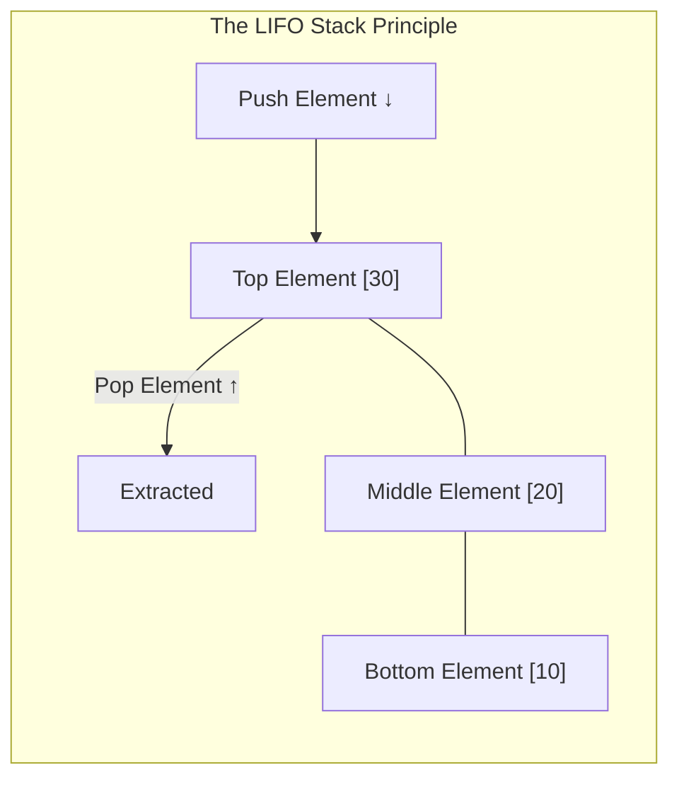
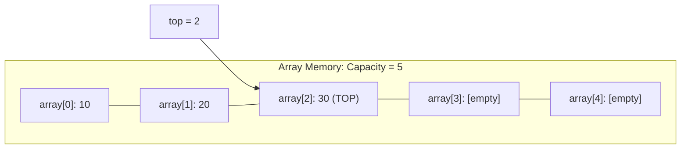
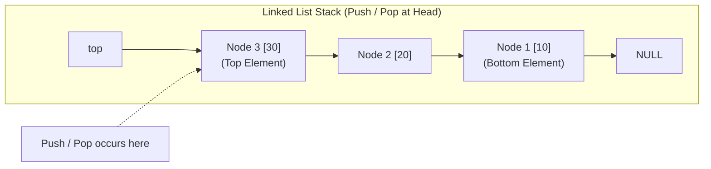
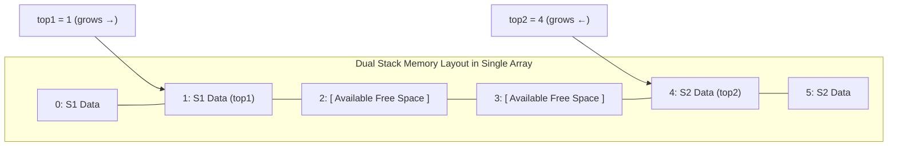

[DSA Index](../README.md) / [Unit 1: Pointers, Memory Allocation, Linked Lists, and Stacks](Introduction.md)

# L08: Stacks - Representation and Operations

In everyday programming, we frequently encounter situations where the order of processing must be strictly inverted:
- When you click "Undo" in a text editor, the most recently typed character must be erased first.
- When you click the browser's "Back" button, you visit the page you opened most recently.
- When a function calls another function, the CPU must finish the innermost function before returning to the outer caller.

All these systems rely on a single, elegant abstract data type: the **Stack**.

A stack is a linear collection governed by a single behavioral rule: **Last-In, First-Out (LIFO)**. The element that was added most recently is always the very first element to be removed.

---

## The Stack Abstract Data Type (ADT)

In a stack, access is strictly restricted: you cannot insert or delete elements in the middle, and you cannot inspect elements arbitrarily. All insertions and removals occur exclusively at a single designated end called the **top**.



The Stack ADT defines six core operations:
1. **`push(element)`**: Inserts an element onto the top of the stack.
2. **`pop()`**: Removes and returns the top element. Fails if the stack is empty (Stack Underflow).
3. **`peek()` / `top()`**: Returns the top element without removing it. Fails on underflow.
4. **`isEmpty()`**: Returns `true` if the stack contains zero elements.
5. **`isFull()`**: Returns `true` if the underlying storage has exhausted its capacity (relevant for fixed arrays).
6. **`size()`**: Returns the number of elements currently stored.

Every fundamental operation (`push`, `pop`, `peek`, `isEmpty`) runs strictly in **$O(1)$ constant time**.

---

## Contiguous Array Representation of Stacks

The most straightforward way to implement a stack in C is using a contiguous array paired with an integer tracking the index of the top element.

### The Mechanics of the `top` Index
- When the stack is **empty**, `top = -1`.
- To **push**: we increment `top` (`top++`), then store the data at `array[top]`.
- To **pop**: we retrieve `array[top]`, then decrement `top` (`top--`).



Notice the boundary conditions:
- **Stack Underflow**: Attempting to `pop()` or `peek()` when `top == -1`.
- **Stack Overflow**: Attempting to `push()` when `top == capacity - 1`.

### Dynamically Resizing Array Stack Implementation

Rather than hard-coding a static array limit that could cause an overflow crash, we can design a dynamic array stack that doubles its capacity automatically whenever it fills up:

```c
#include <stdio.h>
#include <stdlib.h>
#include <stdbool.h>

typedef struct ArrayStack {
    int *data;
    int top;
    size_t capacity;
} ArrayStack;

ArrayStack *as_create(size_t initial_capacity) {
    ArrayStack *stack = (ArrayStack *)malloc(sizeof(ArrayStack));
    if (!stack) { perror("malloc failed"); exit(EXIT_FAILURE); }

    stack->capacity = initial_capacity > 0 ? initial_capacity : 4;
    stack->data = (int *)malloc(stack->capacity * sizeof(int));
    if (!stack->data) { perror("malloc failed"); exit(EXIT_FAILURE); }

    stack->top = -1; // -1 denotes an empty stack
    return stack;
}

bool as_is_empty(const ArrayStack *stack) {
    return stack->top == -1;
}

bool as_push(ArrayStack *stack, int value) {
    // Dynamic capacity expansion
    if (stack->top == (int)stack->capacity - 1) {
        size_t new_cap = stack->capacity * 2;
        int *new_data = (int *)realloc(stack->data, new_cap * sizeof(int));
        if (!new_data) return false;

        stack->data = new_data;
        stack->capacity = new_cap;
    }

    stack->data[++stack->top] = value;
    return true;
}

bool as_pop(ArrayStack *stack, int *out_value) {
    // Underflow protection
    if (as_is_empty(stack)) {
        return false;
    }

    *out_value = stack->data[stack->top--];
    return true;
}

bool as_peek(const ArrayStack *stack, int *out_value) {
    if (as_is_empty(stack)) {
        return false;
    }

    *out_value = stack->data[stack->top];
    return true;
}

void as_destroy(ArrayStack **stack_ref) {
    if (!stack_ref || !*stack_ref) return;
    free((*stack_ref)->data);
    free(*stack_ref);
    *stack_ref = NULL;
}
```

Notice the beauty of the geometric expansion strategy ($2\times$): while an occasional `push` takes $O(n)$ to copy memory during a reallocation, the **amortized** time complexity across $N$ push operations remains strictly $O(1)$.

---

## Linked List Representation of Stacks

What if we cannot afford sporadic $O(n)$ reallocation pauses (e.g., in real-time embedded systems), or we do not want any memory wasted on unused array capacity?

We can implement a stack as a **Singly Linked List**.

Now, consider an architectural question: should the top of the stack be at the **head** of the linked list, or at the **tail**?

Let's trace both options:
- **Top at Tail**: To push, we append in $O(1)$ (with a tail pointer). But to pop, we must delete the last node. Remember Lecture 4: deleting the tail node in a singly linked list requires traversing to the penultimate node—an $O(n)$ operation!
- **Top at Head**: Inserting at the head is $O(1)$. Deleting from the head is $O(1)$. 

Therefore, in a linked list stack, **the head of the list is always the top of the stack**.



### Linked Stack Implementation

```c
typedef struct StackNode {
    int data;
    struct StackNode *next;
} StackNode;

typedef struct LinkedStack {
    StackNode *top;
    size_t count;
} LinkedStack;

LinkedStack *ls_create(void) {
    LinkedStack *stack = (LinkedStack *)malloc(sizeof(LinkedStack));
    stack->top = NULL;
    stack->count = 0;
    return stack;
}

bool ls_is_empty(const LinkedStack *stack) {
    return stack->top == NULL;
}

void ls_push(LinkedStack *stack, int value) {
    StackNode *new_node = (StackNode *)malloc(sizeof(StackNode));
    if (!new_node) { perror("malloc failed"); exit(EXIT_FAILURE); }

    new_node->data = value;
    new_node->next = stack->top;
    stack->top = new_node;
    stack->count++;
}

bool ls_pop(LinkedStack *stack, int *out_value) {
    if (ls_is_empty(stack)) {
        return false;
    }

    StackNode *temp = stack->top;
    *out_value = temp->data;
    stack->top = stack->top->next;
    free(temp);

    stack->count--;
    return true;
}

bool ls_peek(const LinkedStack *stack, int *out_value) {
    if (ls_is_empty(stack)) {
        return false;
    }
    *out_value = stack->top->data;
    return true;
}

void ls_destroy(LinkedStack **stack_ref) {
    if (!stack_ref || !*stack_ref) return;

    StackNode *curr = (*stack_ref)->top;
    while (curr) {
        StackNode *temp = curr;
        curr = curr->next;
        free(temp);
    }

    free(*stack_ref);
    *stack_ref = NULL;
}
```

Notice that with a linked stack, stack overflow can never happen unless physical RAM is completely exhausted by the operating system.

---

## Space-Efficient Two Stacks in a Single Array

A classic university coursework design problem: suppose you have a fixed-size buffer of capacity $N$, and your system requires **two independent stacks**.

If you partition the buffer statically into two halves (`Stack 1: 0 to N/2 - 1` and `Stack 2: N/2 to N - 1`), you might trigger an overflow in Stack 1 even while Stack 2 is completely empty! That is terrible memory utilization.

Can we let both stacks share the same buffer dynamically?

Yes! We anchor them at opposite ends of the array and let them grow toward each other:
- **Stack 1**: Starts at index `0` and grows **upward** (`top1++`).
- **Stack 2**: Starts at index `N - 1` and grows **downward** (`top2--`).



Now, when does Stack Overflow occur?
Only when there is zero physical space left in the array:

$$\text{Overflow Condition: } \text{top1} + 1 == \text{top2}$$

As long as free slots exist anywhere in the buffer, either stack can continue pushing elements freely.

```c
typedef struct DualStack {
    int *data;
    int top1;
    int top2;
    int capacity;
} DualStack;

DualStack *ds_create(int capacity) {
    DualStack *ds = (DualStack *)malloc(sizeof(DualStack));
    ds->capacity = capacity;
    ds->data = (int *)malloc(capacity * sizeof(int));
    ds->top1 = -1;              // Stack 1 starts before leftmost index
    ds->top2 = capacity;        // Stack 2 starts after rightmost index
    return ds;
}

bool ds_push1(DualStack *ds, int val) {
    if (ds->top1 + 1 == ds->top2) {
        printf("Stack 1 Overflow!\n");
        return false;
    }
    ds->data[++ds->top1] = val;
    return true;
}

bool ds_push2(DualStack *ds, int val) {
    if (ds->top1 + 1 == ds->top2) {
        printf("Stack 2 Overflow!\n");
        return false;
    }
    ds->data[--ds->top2] = val;
    return true;
}

bool ds_pop1(DualStack *ds, int *out_val) {
    if (ds->top1 == -1) return false;
    *out_val = ds->data[ds->top1--];
    return true;
}

bool ds_pop2(DualStack *ds, int *out_val) {
    if (ds->top2 == ds->capacity) return false;
    *out_val = ds->data[ds->top2++];
    return true;
}
```

---

## Array Stack vs Linked Stack: Trade-Off Analysis

| Feature | Dynamic Array Stack | Linked List Stack |
| :--- | :--- | :--- |
| **Push Time Complexity** | $O(1)$ amortized (occasional $O(n)$) | Strictly $O(1)$ worst-case |
| **Pop Time Complexity** | Strictly $O(1)$ | Strictly $O(1)$ |
| **Per-Element Memory Overhead** | Zero extra bytes per element | 8 bytes pointer overhead per node |
| **Cache Locality** | Outstanding (contiguous memory) | Poor (nodes scattered in heap) |
| **Maximum Capacity** | Bound by realloc limit | Bound only by available system RAM |
| **System Latency Consistency** | Occasional resize stalls | Smooth, predictable $O(1)$ per operation |

---

## Complexity Analysis: Stack Operations

| Operation | Array Stack (Static) | Dynamic Array Stack | Linked Stack | Explanation |
| :--- | :--- | :--- | :--- | :--- |
| **`push()`** | $O(1)$ | $O(1)$ amortized | $O(1)$ | Top element index/pointer update. |
| **`pop()`** | $O(1)$ | $O(1)$ | $O(1)$ | Decrement top or unlink head node. |
| **`peek()`** | $O(1)$ | $O(1)$ | $O(1)$ | Direct read at top offset. |
| **`isEmpty()`** | $O(1)$ | $O(1)$ | $O(1)$ | Single integer / pointer equality check. |
| **`destroy()`** | $O(1)$ | $O(1)$ | $O(n)$ | Linked stack must free each node individually. |
| **Auxiliary Space** | $O(\text{capacity})$ | $O(\text{capacity})$ | $O(n)$ | Array preallocates buffer; linked allocates on demand. |

---

## Key Takeaways

- A stack is a linear LIFO (Last-In, First-Out) data structure with all mutations restricted to the top element.
- In an array stack, `top = -1` indicates underflow, and dynamic geometric resizing guarantees $O(1)$ amortized push operations.
- In a linked list stack, the head of the list must serve as the top to guarantee worst-case $O(1)$ push and pop operations.
- Sharing an array between two stacks with opposing growth directions eliminates premature overflow and maximizes buffer utilization.
- Stacks are the fundamental algorithmic engine behind expression parsing, undo histories, and program call stacks.

Now that we have mastered the internal representation and mechanics of stacks, we are ready to apply them to solve one of the classic compiler problems: parsing and evaluating mathematical expressions. Let's proceed to [L09 - Applications of Stacks - Infix, Prefix, and Postfix](L09%20-%20Applications%20of%20Stacks%20-%20Infix,%20Prefix,%20and%20Postfix.md).
