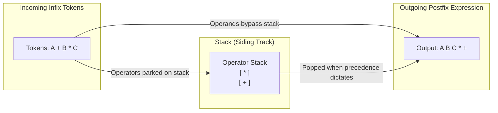
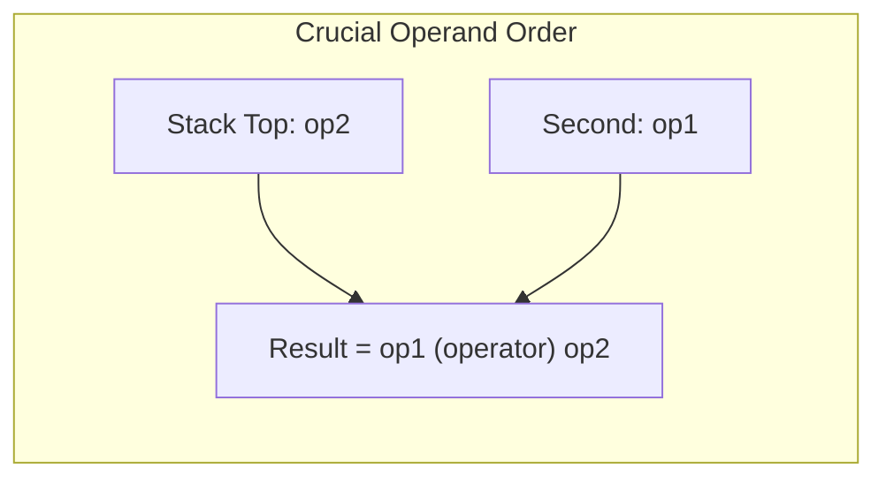

[DSA Index](../README.md) / [Unit 1: Pointers, Memory Allocation, Linked Lists, and Stacks](Introduction.md)

# L09: Applications of Stacks - Infix, Prefix, and Postfix

Humans are taught from childhood to write mathematical expressions in **infix notation**: the operator sits directly between two operands, such as $3 + 4$. 

While infix is natural for human reading, it is notoriously cumbersome and ambiguous for computers to parse. Consider this simple expression:

$$2 + 3 \times 4$$

Does this evaluate to $(2 + 3) \times 4 = 20$, or $2 + (3 \times 4) = 14$? 

To resolve this ambiguity, humans rely on implicit conventions: operator precedence rules (PEMDAS/BODMAS), left-to-right associativity, and explicit parentheses. A computer executing an expression sequentially from left to right would need to constantly scan ahead, backtrack, look for matching closing parentheses, and remember pending higher-precedence operations.

In the 1920s, Polish logician Jan Łukasiewicz discovered that by placing operators *before* or *after* their operands, **parentheses and precedence rules become completely unnecessary**.

In this lecture, we examine arithmetic notations and use stacks to implement **Edsger Dijkstra's Shunting-Yard Algorithm** for infix-to-postfix conversion and postfix expression evaluation.

---

## Arithmetic Notations Compared

There are three fundamental notations for writing arithmetic expressions:

1. **Infix Notation**: Operators are placed *between* operands:
   $$A + B \times C$$
2. **Postfix Notation (Reverse Polish Notation - RPN)**: Operators are placed *after* their operands:
   $$A\ B\ C \times +$$
3. **Prefix Notation (Polish Notation)**: Operators are placed *before* their operands:
   $$+\ A \times B\ C$$

| Infix Expression | Postfix (RPN) | Prefix | Notes |
| :--- | :--- | :--- | :--- |
| `A + B` | `A B +` | `+ A B` | Trivial binary operation. |
| `(A + B) * C` | `A B + C *` | `* + A B C` | Parentheses force addition before multiplication. |
| `A + B * C` | `A B C * +` | `+ A * B C` | Multiplication binds tighter than addition. |
| `A + B - C` | `A B + C -` | `- + A B C` | Left-to-right associativity: `(A + B) - C`. |
| `A ^ B ^ C` | `A B C ^ ^` | `^ A ^ B C` | Right-to-left associativity: `A ^ (B ^ C)`. |

Notice the remarkable property of Postfix and Prefix: **there are zero parentheses**, yet there is zero ambiguity. The order of evaluation is strictly dictated by the linear position of the operators.

---

## Operator Precedence and Associativity

To convert an infix expression into postfix, an algorithm must know two mechanical rules:

1. **Precedence**: Which operator takes priority?
   - Level 3 (Highest): Exponentiation (`^`)
   - Level 2: Multiplication (`*`) and Division (`/`)
   - Level 1 (Lowest): Addition (`+`) and Subtraction (`-`)
2. **Associativity**: When two operators share the same precedence, in which direction do they evaluate?
   - **Left-to-Right**: `+`, `-`, `*`, `/` (e.g., $10 - 4 - 2 \implies (10 - 4) - 2 = 4$)
   - **Right-to-Left**: `^` (e.g., $2 \text{ \textasciicircum } 3 \text{ \textasciicircum } 2 \implies 2 \text{ \textasciicircum } (3 \text{ \textasciicircum } 2) = 2^9 = 512$)

---

## Infix to Postfix: The Shunting-Yard Algorithm

Invented by Edsger Dijkstra in 1961, the **Shunting-Yard Algorithm** is named after the railroad switching yard where train cars are shunted onto siding tracks before being reassembled in a different order.

In this analogy:
- The input string is the incoming train track.
- The **Stack** is the siding track (holding operators temporarily).
- The output string is the outgoing track.



### The Strict Mechanistic Rules

Scan the infix expression token by token from left to right:

1. **If Token is an Operand** (letters, numbers):
   - Immediately append it directly to the output.
2. **If Token is a Left Parenthesis `(`**:
   - Push it directly onto the operator stack. It acts as a barrier marking a new sub-expression.
3. **If Token is a Right Parenthesis `)`**:
   - Continuously pop operators from the stack and append them to the output until a matching `(` is popped.
   - Discard both parentheses (never output them).
4. **If Token is an Operator `op1`**:
   - While the stack is not empty, and the top of the stack `top_op` is not `(`, and:
     - `precedence(top_op) > precedence(op1)`, OR
     - `precedence(top_op) == precedence(op1)` AND `op1` is **Left-Associative**:
     - Pop `top_op` from the stack and append it to the output.
   - Push `op1` onto the stack.
5. **At End of Input String**:
   - Pop every remaining operator from the stack to the output.

### Step-by-Step Trace: `A + B * (C ^ D - E)`

| Token Scanned | Action Taken | Operator Stack | Postfix Output Buffer |
| :---: | :--- | :--- | :--- |
| `A` | Operand $\to$ Output | `[ ]` | `A` |
| `+` | Push operator | `[ + ]` | `A` |
| `B` | Operand $\to$ Output | `[ + ]` | `A B` |
| `*` | Prec(`*`) > Prec(`+`) $\to$ Push | `[ +, * ]` | `A B` |
| `(` | Push parenthesis | `[ +, *, ( ]` | `A B` |
| `C` | Operand $\to$ Output | `[ +, *, ( ]` | `A B C` |
| `^` | Push operator | `[ +, *, (, ^ ]` | `A B C` |
| `D` | Operand $\to$ Output | `[ +, *, (, ^ ]` | `A B C D` |
| `-` | Prec(`^`) > Prec(`-`) $\to$ Pop `^`, push `-` | `[ +, *, (, - ]` | `A B C D ^` |
| `E` | Operand $\to$ Output | `[ +, *, (, - ]` | `A B C D ^ E` |
| `)` | Pop until `(` | `[ +, * ]` | `A B C D ^ E -` |
| *End* | Pop remaining operators | `[ ]` | `A B C D ^ E - * +` |

---

## Evaluating Postfix Expressions

Now that we have a postfix expression, evaluating it is astonishingly simple and fast. We do not need to worry about operator precedence or parentheses at all.

### The Postfix Evaluation Algorithm

We scan the postfix string from left to right using an **Operand Stack**:

1. **If Token is a Number**:
   - Push its numerical value onto the stack.
2. **If Token is an Operator $\star$**:
   - Pop the top operand: $op_2 = \text{pop}()$.
   - Pop the next operand: $op_1 = \text{pop}()$.
   - Compute $\text{result} = op_1 \star op_2$.
   - Push $\text{result}$ back onto the stack.
3. **At End of Expression**:
   - The final remaining value on the stack is the evaluation result.



Notice something critical here: **the order of popped operands matters for non-commutative operations**!
- The first element popped from the stack is the **second operand** ($op_2$).
- The second element popped is the **first operand** ($op_1$).
- In subtraction or division: $op_1 - op_2$ or $op_1 / op_2$. Swapping them yields completely incorrect results!

---

## Complete C Implementation

Here is a self-contained, robust C program implementing both Infix-to-Postfix conversion and Postfix evaluation:

```c
#include <stdio.h>
#include <stdlib.h>
#include <string.h>
#include <ctype.h>
#include <stdbool.h>
#include <math.h>

#define MAX_SIZE 256

// --- Char Stack for Conversion ---
typedef struct {
    char data[MAX_SIZE];
    int top;
} CharStack;

void cs_init(CharStack *s) { s->top = -1; }
bool cs_is_empty(const CharStack *s) { return s->top == -1; }
void cs_push(CharStack *s, char c) { s->data[++s->top] = c; }
char cs_pop(CharStack *s) { return s->data[s->top--]; }
char cs_peek(const CharStack *s) { return s->data[s->top]; }

// --- Double Stack for Evaluation ---
typedef struct {
    double data[MAX_SIZE];
    int top;
} DoubleStack;

void ds_init(DoubleStack *s) { s->top = -1; }
void ds_push(DoubleStack *s, double d) { s->data[++s->top] = d; }
double ds_pop(DoubleStack *s) { return s->data[s->top--]; }

// Precedence resolution
int precedence(char op) {
    switch (op) {
        case '^': return 3;
        case '*':
        case '/': return 2;
        case '+':
        case '-': return 1;
        default:  return 0;
    }
}

// Associativity check
bool is_right_associative(char op) {
    return op == '^';
}

// Infix to Postfix Converter
void infix_to_postfix(const char *infix, char *postfix) {
    CharStack stack;
    cs_init(&stack);
    int k = 0;

    for (int i = 0; infix[i] != '\0'; i++) {
        char ch = infix[i];

        if (isspace(ch)) continue;

        // Operands
        if (isalnum(ch)) {
            postfix[k++] = ch;
        }
        // Left Parenthesis
        else if (ch == '(') {
            cs_push(&stack, ch);
        }
        // Right Parenthesis
        else if (ch == ')') {
            while (!cs_is_empty(&stack) && cs_peek(&stack) != '(') {
                postfix[k++] = cs_pop(&stack);
            }
            if (!cs_is_empty(&stack)) {
                cs_pop(&stack); // Discard '('
            }
        }
        // Operators
        else {
            while (!cs_is_empty(&stack) && cs_peek(&stack) != '(') {
                char top_op = cs_peek(&stack);
                int p_top = precedence(top_op);
                int p_curr = precedence(ch);

                if (p_top > p_curr || (p_top == p_curr && !is_right_associative(ch))) {
                    postfix[k++] = cs_pop(&stack);
                } else {
                    break;
                }
            }
            cs_push(&stack, ch);
        }
    }

    // Drain remaining operators
    while (!cs_is_empty(&stack)) {
        postfix[k++] = cs_pop(&stack);
    }
    postfix[k] = '\0';
}

// Postfix Evaluator (Single-digit operands for demonstration)
double evaluate_postfix(const char *postfix) {
    DoubleStack stack;
    ds_init(&stack);

    for (int i = 0; postfix[i] != '\0'; i++) {
        char ch = postfix[i];

        if (isdigit(ch)) {
            ds_push(&stack, (double)(ch - '0'));
        } else {
            double op2 = ds_pop(&stack);
            double op1 = ds_pop(&stack);
            double res = 0.0;

            switch (ch) {
                case '+': res = op1 + op2; break;
                case '-': res = op1 - op2; break;
                case '*': res = op1 * op2; break;
                case '/': res = op1 / op2; break;
                case '^': res = pow(op1, op2); break;
            }
            ds_push(&stack, res);
        }
    }
    return ds_pop(&stack);
}

int main(void) {
    const char *infix = "2 + 3 * (4 ^ 2 - 1)";
    char postfix[MAX_SIZE];

    infix_to_postfix(infix, postfix);
    printf("Infix Expression:   %s\n", infix);
    printf("Postfix Expression: %s\n", postfix);

    double result = evaluate_postfix(postfix);
    printf("Evaluated Result:   %.2f\n", result); // 2 + 3 * (16 - 1) = 2 + 45 = 47

    return 0;
}
```

---

## Infix to Prefix Conversion Algorithm

How do we convert Infix to **Prefix** notation?

Instead of writing a completely new, complicated parsing algorithm, we can leverage our existing Postfix algorithm using a simple three-step inversion symmetry:

1. **Reverse** the infix expression string.
2. In the reversed string, swap every `(` to `)` and every `)` to `(`.
3. Convert the modified string to Postfix using Shunting-Yard (with one minor tweak: for equal precedence, treat operators as right-associative to preserve original left-associativity upon reversal).
4. **Reverse** the resulting postfix expression. The result is the exact Prefix expression!

---

## Complexity Analysis: Expression Conversion and Evaluation

| Algorithm | Time Complexity | Auxiliary Space Complexity | Explanation |
| :--- | :--- | :--- | :--- |
| **Infix to Postfix (Shunting-Yard)** | $O(N)$ | $O(N)$ | Every token is scanned once; pushed and popped at most once. |
| **Postfix Evaluation** | $O(N)$ | $O(N)$ | Single linear scan through $N$ tokens with constant-time stack pushes/pops. |
| **Infix to Prefix** | $O(N)$ | $O(N)$ | String reversals ($O(N)$) + Shunting-Yard ($O(N)$). |

Notice that the time complexity is strictly linear $O(N)$ with respect to expression length—an optimal parsing result that allows compilers and calculators to evaluate complex equations in real time.

---

## Key Takeaways

- Infix notation requires parentheses, precedence, and associativity rules to resolve ambiguity.
- Postfix (RPN) and Prefix notations place operators outside operands, eliminating all parentheses and ambiguity.
- Dijkstra's Shunting-Yard algorithm uses an operator stack to buffer lower-precedence operators until higher-precedence sub-expressions finish.
- Evaluating a postfix expression uses an operand stack where operators pop their operands, compute the result, and push it back.
- When popping operands for non-commutative operations (`-`, `/`), the first popped element is the right-hand operand ($op_2$), and the second popped element is the left-hand operand ($op_1$).

We have seen how stacks solve expression parsing and evaluation. But the stack is not merely a data structure we write in C—it is the physical architectural foundation upon which all modern programming languages execute functions. Let's move to [L10 - Applications of Stacks - Function Calls and Recursion](L10%20-%20Applications%20of%20Stacks%20-%20Function%20Calls%20and%20Recursion.md) to explore the hardware call stack, activation records, and the mechanics of recursion.
