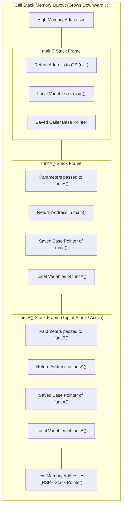
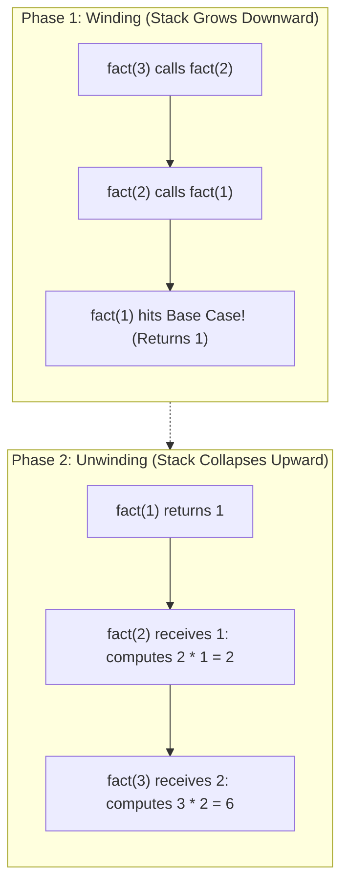
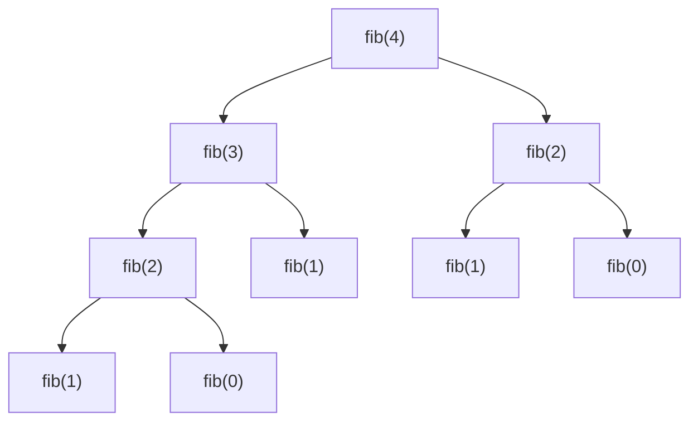
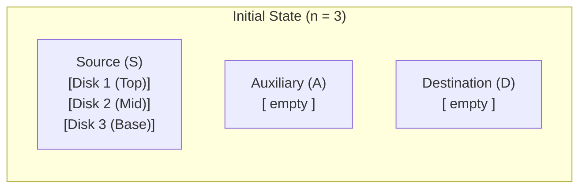

[DSA Index](../README.md) / [Unit 1: Pointers, Memory Allocation, Linked Lists, and Stacks](Introduction.md)

# L10: Applications of Stacks - Function Calls and Recursion

Whenever you write a function call in C—such as `printf("%d", add(5, 3));`—have you ever paused to ask how the physical computer hardware keeps track of what is happening?

Think about what must occur under the hood:
1. The CPU is executing instructions inside `main()`.
2. It abruptly jumps its instruction pointer (`RIP`) to a completely different memory address where `add()` resides.
3. It allocates space for `add()`'s parameters and local variables.
4. When `add()` finishes executing, how does the CPU know where to jump back?
5. How are the local variables of `main()` restored to the exact state they had before the jump?

The answer is the **Call Stack** (also known as the execution stack or run-time stack). The stack ADT is not just a high-level data structure we construct in user space—it is the very engine of computation built into every modern CPU architecture.

In this lecture, we examine the anatomy of run-time stack frames, trace the mechanics of recursion, analyze the Tower of Hanoi, explore tail-call optimization, and convert recursive algorithms to iterative loops using explicit user stacks.

---

## The Anatomy of an Activation Record (Stack Frame)

When a function is called, a contiguous block of memory called an **Activation Record** (or **Stack Frame**) is pushed onto the system call stack.

An activation record encapsulates everything required for a single invocation of a function:
1. **Return Address**: The memory address of the machine instruction immediately following the call site, telling the CPU where to resume execution once the callee finishes.
2. **Parameters / Arguments**: Values passed into the function (or passed in registers per the ABI).
3. **Previous Frame Pointer**: The saved base pointer of the caller's stack frame (`RBP`), establishing a linked chain of frames.
4. **Local Variables**: Automatic storage duration variables declared inside the function body.
5. **Saved Registers**: CPU registers preserved so the caller finds its environment untouched upon return.



Notice the LIFO behavior:
- When `main()` calls `funcA()`, a frame for `funcA()` is pushed.
- When `funcA()` calls `funcB()`, a frame for `funcB()` is pushed.
- `funcB()` must complete and pop its frame before `funcA()` can proceed.
- Finally, `funcA()` pops its frame, restoring execution back to `main()`.

---

## The Mechanics of Recursion: Winding and Unwinding

**Recursion** occurs when a function solves a problem by calling a copy of itself on a smaller subproblem.

Every valid recursive function must possess two fundamental components:
1. **The Base Case**: A terminating condition that produces a result directly without making further recursive calls.
2. **The Recursive Step**: A reduction that makes a self-call with an input strictly closer to the base case.

### The Two Phases of Recursive Execution

Recursive execution unfolds in two distinct physical phases:

1. **The Winding Phase (Pushing)**: 
   The function calls itself repeatedly. With each invocation, a new activation record is pushed onto the call stack. Local variables and return addresses accumulate in memory.
2. **The Unwinding Phase (Popping)**: 
   The base case condition evaluates to true. No further calls are made. The base case returns a concrete value, allowing the innermost frame to pop. The returned value feeds into the waiting caller, which computes its result, pops its frame, and cascades returns backward until `main()` is reached.



Let's trace classic factorial:

```c
#include <stdio.h>

long long factorial(int n) {
    // Base Case
    if (n <= 1) {
        return 1;
    }
    // Recursive Step
    return n * factorial(n - 1);
}
```

Now, notice what happens during `n * factorial(n - 1)`:
`factorial(n)` **cannot** perform the multiplication `n * ...` until `factorial(n - 1)` has completely finished and returned its answer! 

Therefore, the value of `n` must remain frozen in the activation record on the call stack across the entire lifetime of the child calls. If $n = 100,000$, we push 100,000 stack frames.

### Stack Overflow
What happens if the base case is missing or incorrect?
```c
void infinite_recursion(int x) {
    infinite_recursion(x + 1); // Never hits a base case!
}
```
Every invocation consumes stack memory. Because the stack segment has a rigid operating system limit (typically 8 MB on Linux), the stack pointer eventually collides with unmapped virtual memory, triggering a hardware trap: **Segmentation fault (core dumped)**, commonly known as a **Stack Overflow**.

---

## Tree Recursion and the Fibonacci Bottleneck

When a recursive function makes more than one self-call per invocation, it generates **tree recursion**.

Consider the naive Fibonacci implementation:

$$F(0) = 0, \quad F(1) = 1, \quad F(n) = F(n-1) + F(n-2)$$

```c
int fib(int n) {
    if (n <= 0) return 0;
    if (n == 1) return 1;
    return fib(n - 1) + fib(n - 2);
}
```

Let's visualize the execution tree for `fib(4)`:



Look closely at what is happening here:
- `fib(2)` is computed multiple times completely independently from scratch.
- The number of recursive calls doubles at each level, leading to an astronomical **Time Complexity of $O(2^n)$**. For $n = 50$, this requires over $10^{15}$ operations—taking days of CPU time for an answer that can be computed in a simple 50-step loop!

Now, what is the **Auxiliary Space Complexity** of naive Fibonacci?
Beginners often mistakenly guess $O(2^n)$ space. 

Notice something fundamental about the call stack: the CPU executes depth-first! It fully explores and collapses the left subtree before ever starting the right subtree. At any single moment in time, the maximum number of frames on the stack is strictly equal to the **maximum depth of the recursion tree**:

$$\text{Max Stack Frames} = n \implies \text{Auxiliary Space Complexity} = O(n)$$

---

## Case Study: The Tower of Hanoi

The **Tower of Hanoi** is a classical mathematical puzzle invented by French mathematician Édouard Lucas in 1883.

### The Rules
- You have three pegs: **Source ($S$)**, **Destination ($D$)**, and **Auxiliary ($A$)**.
- You have $n$ disks of differing diameters stacked on Source in decreasing order of size.
- Objective: Move all $n$ disks from Source to Destination.
- Constraints:
  1. Only one disk can be moved at a time.
  2. A larger disk can never be placed on top of a smaller disk.



### The Recursive Leap of Faith
How do we move $n$ disks from $S$ to $D$ using $A$?
1. Recursively move the top $n - 1$ disks from **Source** to **Auxiliary** (using Destination as temporary spare).
2. Move the single largest disk ($n$) directly from **Source** to **Destination**.
3. Recursively move the $n - 1$ disks from **Auxiliary** to **Destination** (using Source as temporary spare).

```c
#include <stdio.h>

void tower_of_hanoi(int n, char source, char destination, char auxiliary) {
    // Base Case: Only 1 disk to move
    if (n == 1) {
        printf("Move disk 1 from %c to %c\n", source, destination);
        return;
    }

    // Step 1: Move top n - 1 disks from source to auxiliary
    tower_of_hanoi(n - 1, source, auxiliary, destination);

    // Step 2: Move the nth disk from source to destination
    printf("Move disk %d from %c to %c\n", n, source, destination);

    // Step 3: Move the n - 1 disks from auxiliary to destination
    tower_of_hanoi(n - 1, auxiliary, destination, source);
}
```

### Mathematical Recurrence and Complexity
The number of moves $M(n)$ required satisfies the recurrence relation:

$$M(n) = 2M(n-1) + 1, \quad M(1) = 1$$

Solving by repeated substitution:
$$M(n) = 2^n - 1$$

For $n = 3$ disks, it takes exactly $2^3 - 1 = 7$ moves:
1. Move disk 1 from S to D
2. Move disk 2 from S to A
3. Move disk 1 from D to A
4. Move disk 3 from S to D
5. Move disk 1 from A to S
6. Move disk 2 from A to D
7. Move disk 1 from S to D

The time complexity is strictly $O(2^n)$, and the auxiliary stack space is $O(n)$.

---

## Tail Recursion and Tail-Call Optimization (TCO)

A recursive function is said to be **Tail-Recursive** if the recursive call is the absolute final instruction executed by the function. There must be **zero pending operations** after the recursive call returns.

Let's compare:

### Non-Tail-Recursive
```c
long long fact_non_tail(int n) {
    if (n <= 1) return 1;
    return n * fact_non_tail(n - 1); // NOT tail-recursive!
    // Multiplication by n must happen AFTER fact_non_tail returns.
}
```

### Tail-Recursive (Using an Accumulator)
```c
long long fact_tail_helper(int n, long long accumulator) {
    if (n <= 1) return accumulator;
    // Tail-recursive! Nothing remains to be done after the call returns.
    return fact_tail_helper(n - 1, n * accumulator);
}

long long fact_tail(int n) {
    return fact_tail_helper(n, 1);
}
```

Why does this distinction matter so profoundly?

In `fact_tail_helper()`, the caller has no further work to do with its local variables after making the call. Therefore, a smart optimizing compiler (`gcc -O2`) does **not** push a new stack frame! It simply overwrites the parameters in the current frame and jumps back to the top of the function (`JMP` instruction).

This optimization—**Tail-Call Optimization (TCO)**—transforms a recursive function into an iterative machine loop under the hood, slashing auxiliary stack space from **$O(n)$ down to strictly $O(1)$**!

---

## Simulating Recursion with an Explicit Heap Stack

What if our recursion tree is deep ($n = 500,000$), our algorithm is not tail-recursive, and we cannot afford a stack overflow crash?

We can convert any recursive algorithm into an iterative algorithm by managing our own **explicit Stack on the heap**.

Heap memory can be gigabytes in size, whereas the system call stack is capped at a few megabytes.

Let's simulate the recursive pre-order traversal of a binary structure using an explicit heap stack:

```c
#include <stdio.h>
#include <stdlib.h>

typedef struct SimNode {
    int value;
    struct SimNode *left;
    struct SimNode *right;
} SimNode;

void iterative_traversal(SimNode *root) {
    if (root == NULL) return;

    // Explicit user stack allocated on the heap
    SimNode **stack = (SimNode **)malloc(1024 * sizeof(SimNode *));
    int top = -1;

    // Push root onto stack
    stack[++top] = root;

    while (top >= 0) {
        // Pop top node
        SimNode *curr = stack[top--];
        printf("%d ", curr->value);

        // Push right child first so left child is popped and processed first (LIFO)
        if (curr->right) {
            stack[++top] = curr->right;
        }
        if (curr->left) {
            stack[++top] = curr->left;
        }
    }

    free(stack);
}
```

Notice what we did: we replaced the invisible, memory-constrained operating system call stack with an explicit, heap-allocated array stack under our complete control.

---

## Complexity Analysis: Recursive Algorithms

| Algorithm | Time Complexity | Auxiliary Space Complexity | Space Dominant Factor |
| :--- | :--- | :--- | :--- |
| **Factorial (Naive Recursive)** | $O(n)$ | $O(n)$ | $n$ nested stack frames during winding. |
| **Factorial (Tail-Recursive + TCO)** | $O(n)$ | $O(1)$ | Compiler reuses single frame via loop jump. |
| **Fibonacci (Naive Recursive)** | $O(2^n)$ | $O(n)$ | Max depth of binary recursion tree. |
| **Fibonacci (Memoized / Iterative)** | $O(n)$ | $O(1)$ iterative | Single loop maintaining two prior terms. |
| **Tower of Hanoi ($n$ disks)** | $O(2^n)$ | $O(n)$ | Max call stack depth is $n$. |
| **Simulated Stack Traversal** | $O(n)$ | $O(h)$ | Explicit heap stack bounded by tree height $h$. |

---

## Key Takeaways

- Every function invocation allocates an Activation Record (Stack Frame) on the system call stack storing parameters, local variables, frame pointers, and return addresses.
- Recursion operates via a two-phase lifecycle: the Winding phase (stack expansion) followed by the Unwinding phase (base case returns and frame deallocation).
- Stack Overflow occurs when recursive depth exhausts the operating system's stack segment limit due to missing or unreachable base cases.
- In tree recursion (such as naive Fibonacci or Tower of Hanoi), time complexity is exponential ($O(2^n)$), but auxiliary space complexity is strictly proportional to the maximum height of the tree ($O(n)$).
- Tail recursion allows optimizing compilers to perform Tail-Call Optimization (TCO), converting recursive calls into $O(1)$ space iterative jumps.
- When recursion risks blowing the operating system call stack, we can allocate an explicit Stack data structure on the heap to safely handle deep traversals.

---

## Next Steps in Data Structures

We have completed the foundational journey of **Unit 1**: from physical pointers and heap allocation, to user-defined structures and abstract data types, through singly linked lists, header sentinels, polynomial arithmetic, skip lists, and stack evaluation mechanics.

Linear data structures, however, are only the beginning. What happens when a list must cycle endlessly without terminating in `NULL`? How do we handle First-In, First-Out (FIFO) scheduling where elements enter at one end and leave at the other? And how do we organize data hierarchically into nonlinear trees?

Continue your exploration in [Unit 2: Circular Lists, Queues, and Trees](../Unit%202/Introduction.md) and dive directly into [L01 - Circular Linked Lists](../Unit%202/L01%20-%20Circular%20Linked%20Lists.md).
