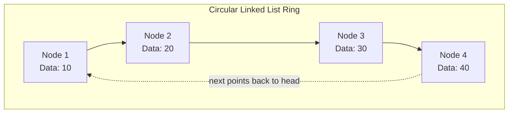
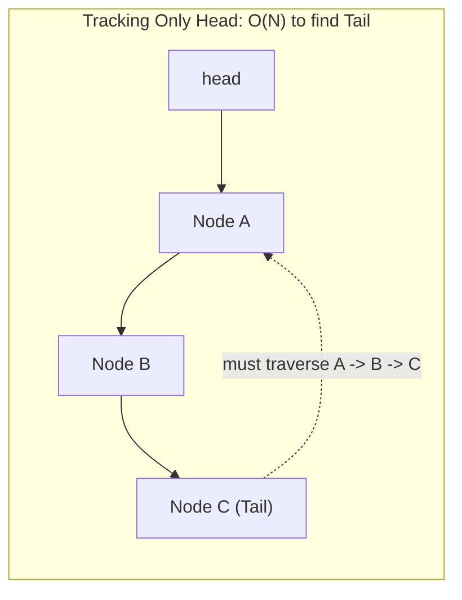
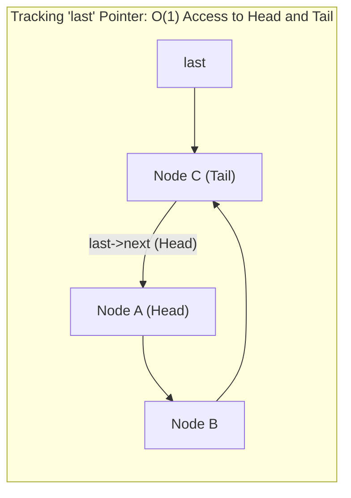
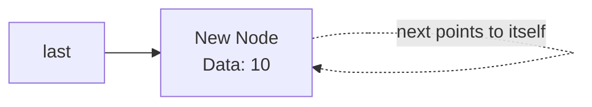
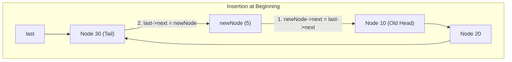
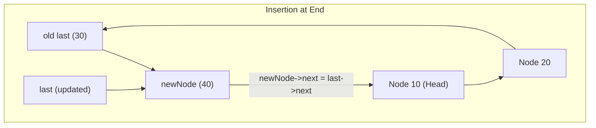
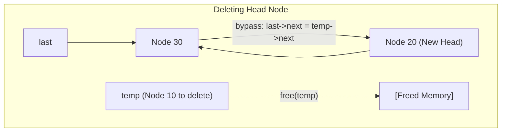

[DSA Index](../README.md) / [Unit 2: Circular Lists, Queues, and Trees](Introduction.md)

---

# Circular Linked Lists

In a standard linear singly linked list, every node points to its successor, and the final node's pointer points to `NULL`. That `NULL` marks a hard boundary. The moment traversal reaches it, the journey is over. If you need to revisit an earlier node or loop through the collection again, you have no choice but to reset your pointer back to `head`.

Now think about how many real-world computing systems operate. 

An operating system scheduler cycles through active threads indefinitely, allocating CPU time slices one after another. A music streaming application loops through a playlist on repeat. A turn-based multiplayer game rotates turns among players in an unbroken ring. 

In none of these cases does the data naturally terminate at a `NULL` wall. What we need is a data structure whose tail reconnects directly to its head — a **Circular Linked List**.

---

## What is a Circular Linked List?

A circular linked list is a sequence of nodes where each node contains data and a link to the next node, but with one critical distinction: the `next` pointer of the last node points back to the first node of the list instead of `NULL`.



Notice something fundamental here — in an active circular linked list, **there are no `NULL` pointers**. 

Every node has a valid successor. This simple topological change gives the structure two immediate properties:
1. You can start at any arbitrary node and reach any other node in the list simply by moving forward.
2. If you are not careful with your loop termination conditions, your code will spin in an infinite loop forever.

---

## Architectural Decision: Head Pointer vs. Last Pointer

When managing a linear linked list, we almost always track a single pointer: `head`. Let's see what happens if we maintain only a `head` pointer in a circular linked list.

Suppose we want to insert a new node at the very beginning (as the new head). 
- We create the new node.
- Its `next` must point to the current `head`.
- But wait — the last node's `next` pointer is currently pointing to `head`! To keep the circle intact, that last node must now be updated to point to our new node.
- How do we find that last node? Since we only have `head`, we must traverse all $N$ nodes from `head` until we find the node whose `next == head`.

That means an insertion at the head takes $O(N)$ time simply because we have to locate the tail!



Now, what if instead of tracking `head`, we maintain a pointer called `last` (or `tail`) that points directly to the final node?

Look at what this gives us:
- Where is the head node? It is simply `last->next`!
- Where is the tail node? It is `last` itself!



By keeping a single reference to `last`, we obtain instantaneous $O(1)$ access to both the beginning and the end of the list. Inserting at the beginning takes $O(1)$. Inserting at the end also takes $O(1)$. 

Throughout this lecture, we will maintain a `last` pointer to implement our circular linked list operations with optimal time efficiency.

---

## Node Structure and Memory Layout

In C, the circular singly linked list node is identical in structure to a linear singly linked list node. The circularity is purely behavioral — it lives in how we set the pointer values, not in the `struct` definition.

```c
#include <stdio.h>
#include <stdlib.h>

struct Node {
    int data;
    struct Node *next;
};
```

When dynamically allocating a node:
- `sizeof(struct Node)` bytes are reserved on the heap.
- The `data` field stores the payload.
- The `next` pointer holds the 64-bit memory address of another node.

---

## Traversing a Circular Linked List

In a linear linked list, traversal is straightforward:
```c
struct Node *temp = head;
while (temp != NULL) {
    printf("%d ", temp->data);
    temp = temp->next;
}
```

If you try running that same logic on a circular linked list, `temp` is never `NULL`, and the loop never halts.

What if we try `while (temp != last->next)`?
If we initialize `temp = last->next` (the head node), the loop condition `temp != last->next` is immediately false, and the loop body never executes even once!

The elegant solution is a `do-while` loop. A `do-while` loop executes the body first, advancing `temp`, and only then checks whether we have cycled back to the starting point:

```c
void traverse(struct Node *last) {
    if (last == NULL) {
        printf("List is empty.\n");
        return;
    }

    struct Node *temp = last->next; // Start at head
    printf("List elements: ");
    do {
        printf("%d -> ", temp->data);
        temp = temp->next;
    } while (temp != last->next);
    printf("(back to head: %d)\n", temp->data);
}
```

Let's trace this step-by-step for a 3-node list `[10 -> 20 -> 30 -> (10)]` where `last` points to `30`:
1. `temp` is set to `last->next` (Node 10).
2. Iteration 1: Prints `10`. `temp` moves to `temp->next` (Node 20). Condition check: is `Node 20 != Node 10`? Yes.
3. Iteration 2: Prints `20`. `temp` moves to `temp->next` (Node 30). Condition check: is `Node 30 != Node 10`? Yes.
4. Iteration 3: Prints `30`. `temp` moves to `temp->next` (Node 10). Condition check: is `Node 10 != Node 10`? No!
5. Loop terminates cleanly after visiting every single element exactly once.

---

## Insertion Operations

Let's dissect the three fundamental insertion scenarios.

### 1. Insertion into an Empty List

When the list is empty, `last == NULL`. 
When we insert the very first node:
- Its `next` pointer cannot point to `NULL`.
- It must point to itself to maintain circularity!
- `last` then points to this solitary node.



```c
struct Node* insertInEmpty(struct Node *last, int data) {
    if (last != NULL) {
        return last; // List is not empty
    }

    struct Node *newNode = (struct Node *)malloc(sizeof(struct Node));
    if (newNode == NULL) {
        printf("Memory allocation failed.\n");
        return NULL;
    }

    newNode->data = data;
    newNode->next = newNode; // Points to itself
    last = newNode;
    return last;
}
```

### 2. Insertion at the Beginning (Head)

Suppose we have nodes `[10 -> 20 -> 30]` with `last` pointing to `30`. We want to insert `5` at the beginning.

The sequence of pointer rewirings is vital:
1. Create `newNode` with `data = 5`.
2. Connect `newNode->next` to the current head, which is `last->next`.
3. Update `last->next` to point to `newNode`.
4. Do we update `last`? No! The last node of the list remains unchanged (`30`).



```c
struct Node* insertAtBeginning(struct Node *last, int data) {
    if (last == NULL) {
        return insertInEmpty(last, data);
    }

    struct Node *newNode = (struct Node *)malloc(sizeof(struct Node));
    newNode->data = data;

    // Step 1: Connect new node to the current head
    newNode->next = last->next;
    // Step 2: Make last node point to the new head
    last->next = newNode;

    return last; // 'last' pointer itself does not move
}
```

### 3. Insertion at the End (Tail)

Now suppose we want to append `40` to the end of `[10 -> 20 -> 30]`.

Notice the similarity with inserting at the beginning:
1. Create `newNode` with `data = 40`.
2. Point `newNode->next` to the current head (`last->next`).
3. Point `last->next` to `newNode`.
4. Now, what is the new tail of the list? `newNode`! So we simply advance `last = newNode`.



```c
struct Node* insertAtEnd(struct Node *last, int data) {
    if (last == NULL) {
        return insertInEmpty(last, data);
    }

    struct Node *newNode = (struct Node *)malloc(sizeof(struct Node));
    newNode->data = data;

    // Connect new node to head
    newNode->next = last->next;
    // Connect old tail to new node
    last->next = newNode;
    // Update last pointer to the new node
    last = newNode;

    return last;
}
```

Notice how clean this is: inserting at the end takes exactly the same pointer assignments as inserting at the beginning, plus one line: updating `last`. Both operations are strictly $O(1)$.

### 4. Insertion After a Specific Node

To insert a node after an existing node with value `key`:
1. Search for the node containing `key`.
2. If found, rewire:
   - `newNode->next = temp->next`
   - `temp->next = newNode`
3. Edge case: If `temp == last`, our new node is now the last node in the list! We must update `last = newNode`.

```c
struct Node* insertAfter(struct Node *last, int key, int data) {
    if (last == NULL) return NULL;

    struct Node *temp = last->next;
    do {
        if (temp->data == key) {
            struct Node *newNode = (struct Node *)malloc(sizeof(struct Node));
            newNode->data = data;
            newNode->next = temp->next;
            temp->next = newNode;

            if (temp == last) {
                last = newNode; // Inserted after tail, new node becomes tail
            }
            return last;
        }
        temp = temp->next;
    } while (temp != last->next);

    printf("Key %d not found in the list.\n", key);
    return last;
}
```

---

## Deletion Operations

Deleting nodes from a circular list requires careful handling of boundary conditions:
- Deleting the only node in the list.
- Deleting the head node.
- Deleting the last node.
- Deleting an intermediate node.

### 1. Deleting the First Node (Head)

To delete the head node (`last->next`):
- If the list has only one node (`last->next == last`), freeing it leaves the list empty (`last = NULL`).
- Otherwise, identify the head (`temp = last->next`).
- Update `last->next` to bypass the head and point to the second node: `last->next = temp->next`.
- Free the memory: `free(temp)`.



```c
struct Node* deleteHead(struct Node *last) {
    if (last == NULL) {
        printf("List is already empty.\n");
        return NULL;
    }

    struct Node *head = last->next;

    // Single-node case
    if (last == head) {
        free(last);
        return NULL;
    }

    // Bypass head
    last->next = head->next;
    free(head);
    return last;
}
```

Time complexity: strictly $O(1)$.

### 2. Deleting the Last Node (Tail)

Now consider deleting the tail node. 

The moment we do that, we hit an asymmetry. To delete `last`, we need to change the `next` pointer of the node **immediately preceding** `last` so that it points to the head (`last->next`).

Can we reach the predecessor of `last` in $O(1)$ time? 
No! In a singly linked circular list, links only point forward. To reach the second-to-last node, we must traverse all the way around the ring starting from the head until `temp->next == last`.

```c
struct Node* deleteTail(struct Node *last) {
    if (last == NULL) {
        printf("List is empty.\n");
        return NULL;
    }

    struct Node *head = last->next;

    // Single-node case
    if (last == head) {
        free(last);
        return NULL;
    }

    // Traverse to find the second-to-last node
    struct Node *temp = head;
    while (temp->next != last) {
        temp = temp->next;
    }

    // 'temp' is now the node before 'last'
    temp->next = head;
    free(last);
    last = temp; // Update last pointer

    return last;
}
```

Because of the unidirectional pointer constraint, deleting the tail in a singly circular linked list takes $O(N)$ time.

### 3. Deleting an Arbitrary Node by Key

To delete any node by its key value:
- If the node to delete is the head, invoke `deleteHead`.
- If the node is elsewhere, keep a pair of pointers `curr` and `prev` to perform the standard link bypass: `prev->next = curr->next`.
- If `curr == last`, update `last = prev`.

```c
struct Node* deleteNode(struct Node *last, int key) {
    if (last == NULL) return NULL;

    struct Node *curr = last->next;
    struct Node *prev = last;

    // Case 1: Only one node in the list
    if (curr == last && curr->data == key) {
        free(curr);
        return NULL;
    }

    // Case 2: Deleting the head node
    if (curr->data == key) {
        last->next = curr->next;
        free(curr);
        return last;
    }

    // Case 3: Deleting an internal node or tail
    prev = curr;
    curr = curr->next;
    while (curr != last->next) {
        if (curr->data == key) {
            prev->next = curr->next;
            if (curr == last) {
                last = prev; // Update tail if last node was deleted
            }
            free(curr);
            return last;
        }
        prev = curr;
        curr = curr->next;
    }

    printf("Node with value %d not found.\n", key);
    return last;
}
```

---

## Complete Working Program

Here is an end-to-end C program demonstrating creation, insertion, traversal, and deletion:

```c
#include <stdio.h>
#include <stdlib.h>

struct Node {
    int data;
    struct Node *next;
};

struct Node* insertInEmpty(struct Node *last, int data) {
    if (last != NULL) return last;
    struct Node *newNode = (struct Node *)malloc(sizeof(struct Node));
    newNode->data = data;
    newNode->next = newNode;
    return newNode;
}

struct Node* insertAtBeginning(struct Node *last, int data) {
    if (last == NULL) return insertInEmpty(last, data);
    struct Node *newNode = (struct Node *)malloc(sizeof(struct Node));
    newNode->data = data;
    newNode->next = last->next;
    last->next = newNode;
    return last;
}

struct Node* insertAtEnd(struct Node *last, int data) {
    if (last == NULL) return insertInEmpty(last, data);
    struct Node *newNode = (struct Node *)malloc(sizeof(struct Node));
    newNode->data = data;
    newNode->next = last->next;
    last->next = newNode;
    return newNode;
}

struct Node* deleteHead(struct Node *last) {
    if (last == NULL) return NULL;
    struct Node *head = last->next;
    if (last == head) {
        free(last);
        return NULL;
    }
    last->next = head->next;
    free(head);
    return last;
}

void printList(struct Node *last) {
    if (last == NULL) {
        printf("List is empty.\n");
        return;
    }
    struct Node *temp = last->next;
    do {
        printf("%d -> ", temp->data);
        temp = temp->next;
    } while (temp != last->next);
    printf("(head: %d)\n", temp->data);
}

int main(void) {
    struct Node *last = NULL;

    last = insertInEmpty(last, 10);
    last = insertAtBeginning(last, 5);
    last = insertAtEnd(last, 20);
    last = insertAtEnd(last, 30);

    printf("Initial Circular List:\n");
    printList(last);

    printf("\nAfter deleting head:\n");
    last = deleteHead(last);
    printList(last);

    return 0;
}
```

---

## Complexity Analysis

| Operation | Best Case | Average Case | Worst Case | Auxiliary Space |
| :--- | :--- | :--- | :--- | :--- |
| **Insert at Beginning** (with `last`) | $O(1)$ | $O(1)$ | $O(1)$ | $O(1)$ |
| **Insert at End** (with `last`) | $O(1)$ | $O(1)$ | $O(1)$ | $O(1)$ |
| **Insert After Node** | $O(1)$ | $O(N)$ | $O(N)$ | $O(1)$ |
| **Delete Head** (with `last`) | $O(1)$ | $O(1)$ | $O(1)$ | $O(1)$ |
| **Delete Tail** (singly circular) | $O(N)$ | $O(N)$ | $O(N)$ | $O(1)$ |
| **Delete Arbitrary Node** | $O(1)$ | $O(N)$ | $O(N)$ | $O(1)$ |
| **Traversal / Search** | $O(N)$ | $O(N)$ | $O(N)$ | $O(1)$ |

---

## Comparison: Linear vs. Circular Singly Linked Lists

| Dimension | Linear Singly Linked List | Circular Singly Linked List (with `last`) |
| :--- | :--- | :--- |
| **Termination** | Last node points to `NULL`. | Last node points to `last->next` (head). |
| **Loop Condition** | `while (temp != NULL)` | `do { ... } while (temp != last->next)` |
| **Reachability** | Any node can only reach downstream nodes. | Any node can eventually reach every other node. |
| **Insert at Head** | $O(1)$ | $O(1)$ |
| **Insert at Tail** | $O(N)$ with `head`; $O(1)$ with `tail`. | $O(1)$ directly using `last`. |
| **Memory Overhead** | 1 pointer (`next`) per node. | 1 pointer (`next`) per node (identical overhead). |
| **Risk Factor** | Accidental dereference of `NULL`. | Accidental infinite loops if condition is wrong. |

---

## Key Takeaways

- A circular linked list replaces the terminal `NULL` pointer of the last node with a link back to the first node.
- Maintaining a `last` pointer instead of a `head` pointer provides $O(1)$ time complexity for both head and tail insertions because `head` is trivially available as `last->next`.
- Traversal requires a `do-while` loop; standard `while(temp != NULL)` loops will result in an infinite execution loop.
- Singly circular linked lists still suffer from an asymmetric flaw: deleting the tail node requires $O(N)$ time because finding the predecessor of `last` demands traversing the entire ring.

Now here's the thing — while a circular singly linked list solves our loop-around needs, it still traps us in a forward-only universe. To step backward, we have to travel the entire perimeter of the ring. What if every node could look both forward and backward with equal ease? We explore this in [L02 - Doubly Linked Lists](L02%20-%20Doubly%20Linked%20Lists.md).
