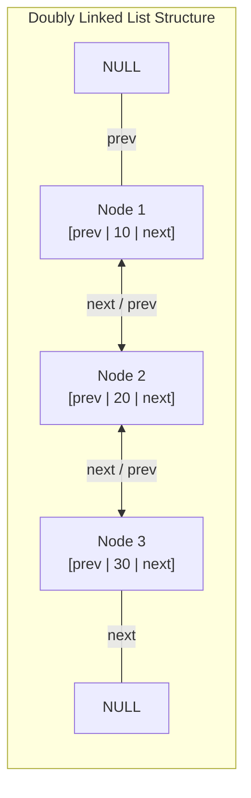
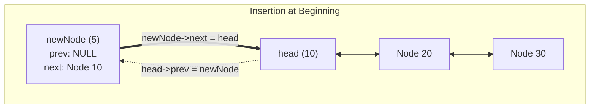
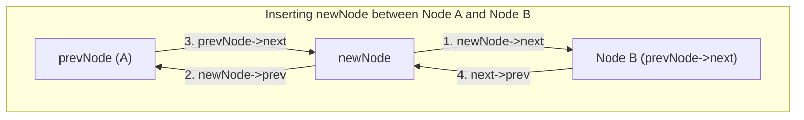
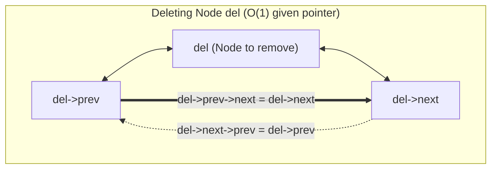
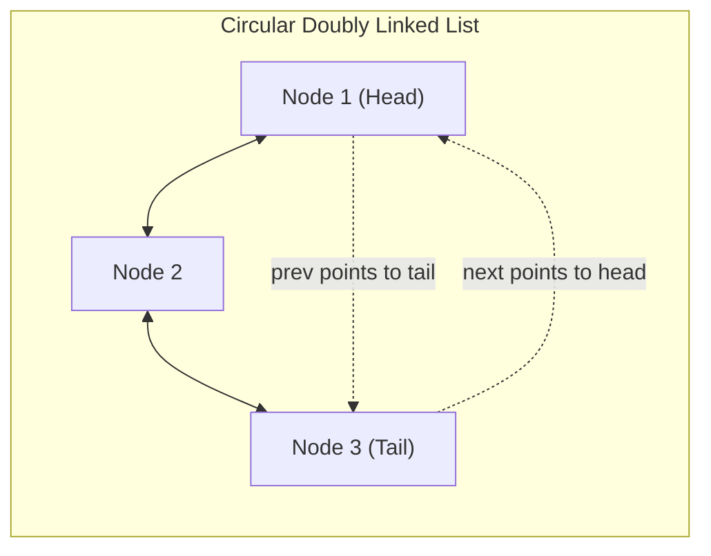

[DSA Index](../README.md) / [Unit 2: Circular Lists, Queues, and Trees](Introduction.md)

---

# Doubly Linked Lists

In a singly linked list, every node only knows what lies ahead. It holds a pointer to its successor, but has no memory of its predecessor. 

Now think about what happens when you need to step backward. 

Suppose you are implementing a text editor where the user presses the left arrow key, or a web browser where the user clicks the "Back" button, or an undo stack in a graphics program. If your data structure only links forward, stepping backward one step forces you to start all the way at the beginning and traverse all the way back up to the node right before you. 

The moment you need frequent bidirectional navigation, a singly linked list becomes computationally prohibitive. What we need is a node architecture that looks both ways: a **Doubly Linked List**.

---

## Anatomy of a Doubly Linked List Node

In a doubly linked list, each node contains three distinct parts:
1. `data`: The actual payload stored in the node.
2. `prev`: A memory pointer holding the address of the preceding node.
3. `next`: A memory pointer holding the address of the succeeding node.



Notice the boundary conditions:
- The `prev` pointer of the first node (`head`) points to `NULL`, signifying that no node precedes it.
- The `next` pointer of the last node (`tail`) points to `NULL`, signifying the end of the sequence.

In C, we express this node layout as:

```c
#include <stdio.h>
#include <stdlib.h>

struct Node {
    int data;
    struct Node *prev;
    struct Node *next;
};
```

On a modern 64-bit architecture, each pointer occupies 8 bytes. With a 4-byte `int` (and 4 bytes of compiler padding), each node requires 24 bytes in memory. We are intentionally spending extra memory on the `prev` pointer in exchange for constant-time bidirectional operations.

---

## Traversal: Moving in Both Directions

Because each node connects to both its neighbors, we can traverse the list in both directions with equal ease.

### Forward Traversal

Starting from `head`, we advance along the `next` pointers until reaching `NULL`:

```c
void traverseForward(struct Node *head) {
    struct Node *temp = head;
    printf("Forward: ");
    while (temp != NULL) {
        printf("%d <-> ", temp->data);
        temp = temp->next;
    }
    printf("NULL\n");
}
```

### Backward Traversal

Starting from `tail`, we step backward along the `prev` pointers until reaching `NULL`:

```c
void traverseBackward(struct Node *tail) {
    struct Node *temp = tail;
    printf("Backward: ");
    while (temp != NULL) {
        printf("%d <-> ", temp->data);
        temp = temp->prev;
    }
    printf("NULL\n");
}
```

This symmetry is the defining superpower of doubly linked lists.

---

## Insertion Mechanics

Inserting into a doubly linked list requires managing twice as many pointers as a singly linked list. If you update pointers in the wrong sequence, you can inadvertently orphan downstream nodes in memory. 

Let's dissect each case step-by-step.

### 1. Insertion at the Beginning

Suppose we have an existing list `[10 <=> 20 <=> 30]` and want to insert `5` as the new head.



The pointer sequence is:
1. Allocate memory for `newNode` and set `newNode->data = 5`.
2. Set `newNode->prev = NULL` (since it will be the first node).
3. Set `newNode->next = head`.
4. If the list is not empty, set `head->prev = newNode`.
5. Update `head = newNode`.

```c
struct Node* insertAtBeginning(struct Node *head, int data) {
    struct Node *newNode = (struct Node *)malloc(sizeof(struct Node));
    newNode->data = data;
    newNode->prev = NULL;
    newNode->next = head;

    if (head != NULL) {
        head->prev = newNode;
    }

    head = newNode;
    return head;
}
```

Time complexity is strictly $O(1)$.

### 2. Insertion at the End

To insert at the end of the list:
- If the list is empty (`head == NULL`), `newNode` becomes the head with both `prev` and `next` set to `NULL`.
- Otherwise, traverse to the last node (`temp->next == NULL`).
- Connect `temp->next = newNode`.
- Connect `newNode->prev = temp`.
- Set `newNode->next = NULL`.

```c
struct Node* insertAtEnd(struct Node *head, int data) {
    struct Node *newNode = (struct Node *)malloc(sizeof(struct Node));
    newNode->data = data;
    newNode->next = NULL;

    if (head == NULL) {
        newNode->prev = NULL;
        return newNode;
    }

    struct Node *temp = head;
    while (temp->next != NULL) {
        temp = temp->next;
    }

    temp->next = newNode;
    newNode->prev = temp;

    return head;
}
```

If we track only `head`, locating the tail takes $O(N)$ time. If we maintain an explicit `tail` pointer, this insertion becomes $O(1)$.

### 3. Insertion After a Given Node

Now consider the general case: inserting `newNode` immediately after a given node `prevNode`.

Look at the four distinct links that must be established:
1. `newNode->next = prevNode->next`
2. `newNode->prev = prevNode`
3. `prevNode->next = newNode`
4. If `prevNode` is not the last node, `newNode->next->prev = newNode`



The order of operations matters tremendously here! If you execute step 3 before step 1, you overwrite `prevNode->next` before copying it to `newNode->next`, permanently losing the address of Node B.

```c
void insertAfter(struct Node *prevNode, int data) {
    if (prevNode == NULL) {
        printf("The given previous node cannot be NULL.\n");
        return;
    }

    struct Node *newNode = (struct Node *)malloc(sizeof(struct Node));
    newNode->data = data;

    // Step 1: Connect newNode's next to prevNode's successor
    newNode->next = prevNode->next;

    // Step 2: Connect newNode's prev back to prevNode
    newNode->prev = prevNode;

    // Step 3: If prevNode was not the last node, link successor back to newNode
    if (prevNode->next != NULL) {
        prevNode->next->prev = newNode;
    }

    // Step 4: Link prevNode forward to newNode
    prevNode->next = newNode;
}
```

---

## Deletion Mechanics

Deletion in a doubly linked list reveals its greatest algorithmic advantage. 

In a singly linked list, even if you are handed a direct pointer to the node you wish to delete, you cannot delete it in $O(1)$ time because you cannot access its predecessor without traversing from `head`. 

In a doubly linked list, **every node holds the address of its predecessor**. That means if you have a pointer to any node, you can delete it in strictly $O(1)$ time!

### 1. Deleting the Head Node

To delete `head`:
1. Check if the list is empty.
2. Store `head` in a temporary pointer: `temp = head`.
3. Advance `head = head->next`.
4. If the new `head` is not `NULL`, set `head->prev = NULL`.
5. Free `temp`.

```c
struct Node* deleteHead(struct Node *head) {
    if (head == NULL) {
        printf("List is empty.\n");
        return NULL;
    }

    struct Node *temp = head;
    head = head->next;

    if (head != NULL) {
        head->prev = NULL;
    }

    free(temp);
    return head;
}
```

### 2. Deleting the Tail Node

To delete the tail node:
1. Traverse to the last node (or use `tail` directly if available).
2. If it is the only node in the list (`head->next == NULL`), free it and return `NULL`.
3. Otherwise, set the predecessor's `next` pointer to `NULL`: `temp->prev->next = NULL`.
4. Free the node.

```c
struct Node* deleteTail(struct Node *head) {
    if (head == NULL) return NULL;
    if (head->next == NULL) {
        free(head);
        return NULL;
    }

    struct Node *temp = head;
    while (temp->next != NULL) {
        temp = temp->next;
    }

    temp->prev->next = NULL;
    free(temp);

    return head;
}
```

### 3. Deleting a Specific Node Given Its Pointer

Now observe the elegance of deleting an arbitrary node `del`:



The algorithm is a clean two-line bypass:
1. If `del->prev != NULL`, set `del->prev->next = del->next`.
2. If `del->next != NULL`, set `del->next->prev = del->prev`.
3. If `del == head`, update `head = del->next`.
4. Free `del`.

```c
struct Node* deleteNode(struct Node *head, struct Node *del) {
    if (head == NULL || del == NULL) {
        return head;
    }

    // If node to be deleted is head
    if (head == del) {
        head = del->next;
    }

    // Update successor's prev pointer
    if (del->next != NULL) {
        del->next->prev = del->prev;
    }

    // Update predecessor's next pointer
    if (del->prev != NULL) {
        del->prev->next = del->next;
    }

    free(del);
    return head;
}
```

Notice what just happened: there was **no traversal loop whatsoever**. The deletion executed in strictly $O(1)$ time. This exact property is why doubly linked lists are used as the backbone of high-performance LRU (Least Recently Used) cache implementations.

---

## Complete Working Program

Here is a complete, self-contained C program demonstrating bidirectional manipulation:

```c
#include <stdio.h>
#include <stdlib.h>

struct Node {
    int data;
    struct Node *prev;
    struct Node *next;
};

struct Node* insertAtBeginning(struct Node *head, int data) {
    struct Node *newNode = (struct Node *)malloc(sizeof(struct Node));
    newNode->data = data;
    newNode->prev = NULL;
    newNode->next = head;

    if (head != NULL) head->prev = newNode;
    return newNode;
}

struct Node* insertAtEnd(struct Node *head, int data) {
    struct Node *newNode = (struct Node *)malloc(sizeof(struct Node));
    newNode->data = data;
    newNode->next = NULL;

    if (head == NULL) {
        newNode->prev = NULL;
        return newNode;
    }

    struct Node *temp = head;
    while (temp->next != NULL) {
        temp = temp->next;
    }

    temp->next = newNode;
    newNode->prev = temp;
    return head;
}

void printList(struct Node *head) {
    struct Node *temp = head;
    printf("List (forward): ");
    while (temp != NULL) {
        printf("%d <-> ", temp->data);
        temp = temp->next;
    }
    printf("NULL\n");
}

int main(void) {
    struct Node *head = NULL;

    head = insertAtBeginning(head, 20);
    head = insertAtBeginning(head, 10);
    head = insertAtEnd(head, 30);
    head = insertAtEnd(head, 40);

    printList(head);

    // Delete node 20 (head->next)
    printf("Deleting node %d...\n", head->next->data);
    head->next->prev->next = head->next->next;
    head->next->next->prev = head->next->prev;
    free(head->next);

    printList(head);
    return 0;
}
```

---

## Complexity Analysis

| Operation | Best Case | Average Case | Worst Case | Auxiliary Space |
| :--- | :--- | :--- | :--- | :--- |
| **Insert at Beginning** | $O(1)$ | $O(1)$ | $O(1)$ | $O(1)$ |
| **Insert at End** (with `head` only) | $O(N)$ | $O(N)$ | $O(N)$ | $O(1)$ |
| **Insert at End** (with `tail` pointer) | $O(1)$ | $O(1)$ | $O(1)$ | $O(1)$ |
| **Insert After Node** | $O(1)$ | $O(1)$ | $O(1)$ | $O(1)$ |
| **Delete Head** | $O(1)$ | $O(1)$ | $O(1)$ | $O(1)$ |
| **Delete Tail** (with `tail` pointer) | $O(1)$ | $O(1)$ | $O(1)$ | $O(1)$ |
| **Delete Node** (given node pointer) | $O(1)$ | $O(1)$ | $O(1)$ | $O(1)$ |
| **Search by Value** | $O(1)$ | $O(N)$ | $O(N)$ | $O(1)$ |

---

## Comparison: Singly vs. Doubly Linked Lists

| Characteristic | Singly Linked List | Doubly Linked List |
| :--- | :--- | :--- |
| **Pointers Per Node** | 1 (`next`) | 2 (`prev`, `next`) |
| **Memory per Node (64-bit)** | 16 bytes (approx) | 24 bytes (approx) |
| **Direction of Traversal** | Forward only | Forward and Backward |
| **Delete Given Node Pointer** | Requires $O(N)$ search for predecessor | Strictly $O(1)$ via `del->prev` |
| **Insertion Before Node** | Requires $O(N)$ search | Strictly $O(1)$ |
| **Implementation Complexity** | Simple (2 pointer rewirings) | Moderate (4 pointer rewirings) |

---

## Circular Doubly Linked Lists

Can we combine the ring topology of circular lists with the bidirectional power of doubly linked lists? 

Yes: in a **Circular Doubly Linked List (CDLL)**:
- `head->prev` points directly to the last node (`tail`).
- `tail->next` points directly to `head`.



In a CDLL, not a single pointer is wasted on `NULL`. From `head`, reaching the tail node requires zero traversal — it is simply `head->prev`!

---

## Key Takeaways

- Doubly linked lists introduce a `prev` pointer in addition to `next`, providing symmetrical bidirectional traversal.
- The fundamental advantage of a DLL is constant-time $O(1)$ deletion of any node when given a direct reference to that node, eliminating the need to search for predecessors.
- Inserting a node between two existing nodes involves updating 4 pointers in a strict order to prevent dangling references or memory loss.
- The trade-off is memory overhead (an extra pointer per node) and added maintenance complexity during pointer updates.

So far, we have looked at lists where elements can be inserted and deleted anywhere at will. But what happens when we intentionally restrict where data can enter and exit? What happens when fairness and chronological ordering are non-negotiable? We enter the world of First-In, First-Out architectures in [L03 - Linear Queues - Array and Linked Implementations](L03%20-%20Linear%20Queues%20-%20Array%20and%20Linked%20Implementations.md).
