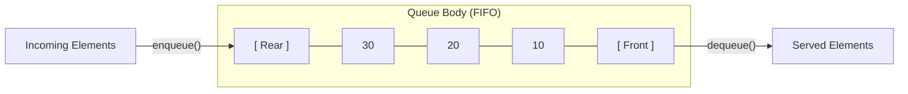
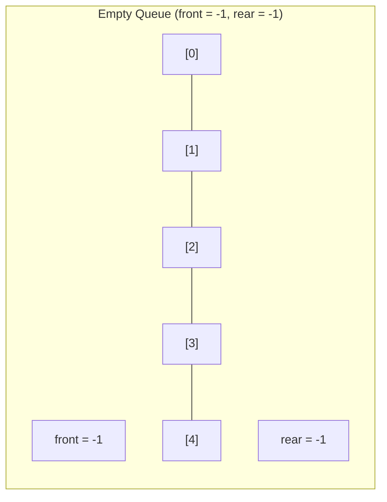
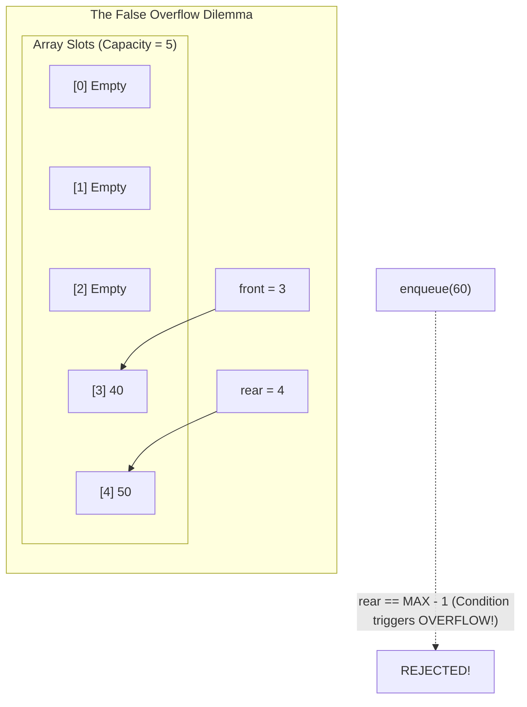
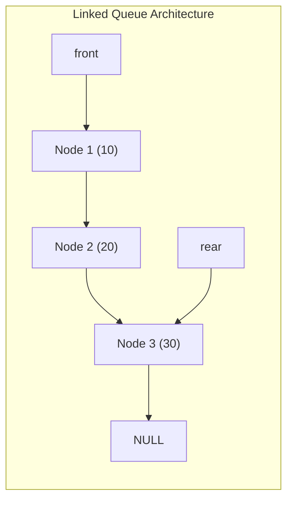
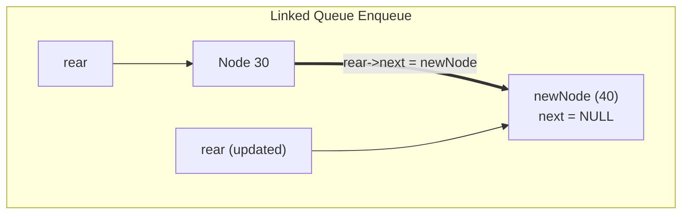
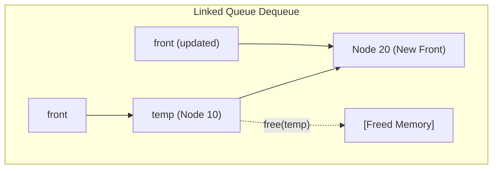

[DSA Index](../README.md) / [Unit 2: Circular Lists, Queues, and Trees](Introduction.md)

---

# Linear Queues - Array and Linked Implementations

In a stack, data enters and exits through the exact same door. The last item pushed is the first item popped — a Last-In, First-Out (LIFO) discipline. That model is ideal for backtracking, function call stacks, and expression evaluation. 

Now think about what happens when you need to model real-world fairness.

When print jobs arrive at an office printer, the first document submitted should be the first document printed. When customer requests hit a web server, requests should be processed in the order they arrived. When packets land at a network router's interface, they should be forwarded chronologically.

For these systems, LIFO is unfair and broken. What we need is an architecture that enforces **First-In, First-Out (FIFO)**: the first element inserted is the first element removed. This is the **Queue**.

---

## The Queue Abstract Data Type (ADT)

A Queue is an ordered linear collection where operations are restricted to opposite ends:
- Elements are inserted at the back: the **rear** (or tail).
- Elements are removed from the front: the **front** (or head).



### Core Operations

1. `enqueue(data)`: Appends an element to the rear of the queue.
2. `dequeue()`: Removes and returns the element at the front of the queue.
3. `peek()` / `front()`: Returns the element at the front without removing it.
4. `isEmpty()`: Checks whether the queue contains zero elements.
5. `isFull()`: Checks whether the queue has reached its maximum capacity (relevant for fixed-size buffers).

---

## Contiguous Array Implementation of Linear Queue

Let's construct a queue using a fixed-size contiguous array `arr` of size `MAX`.

To track where elements enter and leave, we need two integer indices:
- `front`: tracks the index of the element waiting to be dequeued.
- `rear`: tracks the index of the most recently inserted element.

### Initializing the Queue

When the queue is completely empty, where should `front` and `rear` point?

The standard convention is to set both to `-1`:
```c
int front = -1;
int rear = -1;
```

A value of `-1` indicates that no valid array indices are currently occupied.



### Enqueue Operation

When a new element arrives:
1. First, check if the array is full: if `rear == MAX - 1`, we cannot insert any more elements.
2. If the queue was empty (`front == -1`), set `front = 0`.
3. Increment `rear` by 1: `rear++`.
4. Place the data at `arr[rear]`.

```c
void enqueue(int queue[], int *front, int *rear, int max, int data) {
    if (*rear == max - 1) {
        printf("Queue Overflow! Cannot enqueue %d.\n", data);
        return;
    }

    if (*front == -1) {
        *front = 0; // First element being inserted
    }

    (*rear)++;
    queue[*rear] = data;
    printf("Enqueued: %d (front: %d, rear: %d)\n", data, *front, *rear);
}
```

### Dequeue Operation

When removing an element:
1. First, check if the queue is empty: if `front == -1` or `front > rear`, there are no elements to serve (Queue Underflow).
2. Retrieve the data item: `data = queue[front]`.
3. Advance `front`: `front++`.
4. Edge case: If `front` surpasses `rear`, all elements have been consumed! We reset both pointers back to `-1` to re-initialize an empty queue.

```c
int dequeue(int queue[], int *front, int *rear) {
    if (*front == -1 || *front > *rear) {
        printf("Queue Underflow! No elements to dequeue.\n");
        return -1;
    }

    int data = queue[*front];
    (*front)++;

    // If the queue has now become empty, reset indices
    if (*front > *rear) {
        *front = -1;
        *rear = -1;
    }

    return data;
}
```

---

## The False Overflow (Array Drift) Problem

Now examine the behavior of this linear array implementation closely.

Suppose we allocate an array of capacity `MAX = 5`.
1. We enqueue 5 elements: `10, 20, 30, 40, 50`.
   - `front = 0`
   - `rear = 4`
   - The queue is legitimately full.
2. Now, we dequeue 3 elements (`10, 20, 30`).
   - `front` advances to index `3`.
   - `rear` remains at index `4`.
   - Indices `0, 1, 2` are now completely unoccupied!
3. Next, we attempt to enqueue a new element: `60`.



Look at what happens:
- The enqueue condition checks `if (rear == MAX - 1)`.
- Since `rear == 4`, the queue shouts: **Queue Overflow!**
- But more than half the array (slots 0, 1, and 2) is completely empty!

This phenomenon is called **False Overflow** (or **Array Drift**). 

As enqueues push `rear` to the right and dequeues push `front` to the right, the entire queue drifts rightward like a glacier. Eventually, `rear` hits the right boundary wall, rendering the queue unusable even though vast memory lies empty behind `front`.

### Why Not Just Shift Elements Left?

Could we fix this by shifting all remaining elements to index 0 every time we dequeue?
```c
for (int i = 0; i < rear; i++) {
    queue[i] = queue[i + 1];
}
rear--;
```

Yes, that eliminates the drift. But think about the computational cost: every single `dequeue()` operation now requires moving every remaining element in memory, dragging its time complexity down from an instantaneous $O(1)$ to an expensive $O(N)$. 

That violates our requirement for high-throughput queues.

---

## Linked List Implementation of Linear Queue

To eliminate both fixed-capacity limits and the false overflow problem, we can implement the queue dynamically using a singly linked list.

In a linked queue:
- `front` points to the head node of the list.
- `rear` points to the tail node of the list.



### Node Structure

```c
#include <stdio.h>
#include <stdlib.h>

struct Node {
    int data;
    struct Node *next;
};

struct Queue {
    struct Node *front;
    struct Node *rear;
};
```

### Dynamic Enqueue Operation

To enqueue `data`:
1. Allocate a new node dynamically on the heap.
2. Set its `data = data` and `next = NULL`.
3. If the queue is empty (`rear == NULL`), both `front` and `rear` point to this new node.
4. Otherwise, attach the new node to the tail: `rear->next = newNode`, and advance `rear = newNode`.



```c
void enqueueLinked(struct Queue *q, int data) {
    struct Node *newNode = (struct Node *)malloc(sizeof(struct Node));
    if (newNode == NULL) {
        printf("Heap Overflow! Cannot allocate memory.\n");
        return;
    }

    newNode->data = data;
    newNode->next = NULL;

    // If queue is currently empty
    if (q->rear == NULL) {
        q->front = q->rear = newNode;
        return;
    }

    // Attach to rear and update rear pointer
    q->rear->next = newNode;
    q->rear = newNode;
}
```

Time complexity is strictly $O(1)$. No capacity limit exists beyond physical system memory.

### Dynamic Dequeue Operation

To dequeue an element:
1. Check if the queue is empty: `q->front == NULL`. If so, report underflow.
2. Preserve `temp = q->front` and retrieve `data = temp->data`.
3. Advance `q->front = q->front->next`.
4. If `q->front` becomes `NULL`, the queue is now completely empty, so set `q->rear = NULL` as well.
5. Free the memory occupied by `temp`.



```c
int dequeueLinked(struct Queue *q) {
    if (q->front == NULL) {
        printf("Queue Underflow! Queue is empty.\n");
        return -1;
    }

    struct Node *temp = q->front;
    int data = temp->data;

    q->front = q->front->next;

    // If front becomes NULL, queue is empty, so rear must also be NULL
    if (q->front == NULL) {
        q->rear = NULL;
    }

    free(temp);
    return data;
}
```

Both `enqueue` and `dequeue` operate in strictly $O(1)$ time with zero shifting and zero false overflow.

---

## Complete Working Program (Linked Queue)

Here is a complete, executable C program implementing a dynamic linked queue:

```c
#include <stdio.h>
#include <stdlib.h>

struct Node {
    int data;
    struct Node *next;
};

struct Queue {
    struct Node *front;
    struct Node *rear;
};

struct Queue* createQueue(void) {
    struct Queue *q = (struct Queue *)malloc(sizeof(struct Queue));
    q->front = q->rear = NULL;
    return q;
}

void enqueue(struct Queue *q, int data) {
    struct Node *newNode = (struct Node *)malloc(sizeof(struct Node));
    newNode->data = data;
    newNode->next = NULL;

    if (q->rear == NULL) {
        q->front = q->rear = newNode;
        return;
    }

    q->rear->next = newNode;
    q->rear = newNode;
}

int dequeue(struct Queue *q) {
    if (q->front == NULL) {
        printf("Queue Underflow!\n");
        return -1;
    }

    struct Node *temp = q->front;
    int data = temp->data;

    q->front = q->front->next;
    if (q->front == NULL) {
        q->rear = NULL;
    }

    free(temp);
    return data;
}

void displayQueue(struct Queue *q) {
    if (q->front == NULL) {
        printf("Queue is empty.\n");
        return;
    }

    struct Node *temp = q->front;
    printf("Queue (front to rear): ");
    while (temp != NULL) {
        printf("%d ", temp->data);
        temp = temp->next;
    }
    printf("\n");
}

int main(void) {
    struct Queue *q = createQueue();

    enqueue(q, 10);
    enqueue(q, 20);
    enqueue(q, 30);
    displayQueue(q);

    printf("Dequeued: %d\n", dequeue(q));
    printf("Dequeued: %d\n", dequeue(q));
    displayQueue(q);

    enqueue(q, 40);
    enqueue(q, 50);
    displayQueue(q);

    return 0;
}
```

---

## Complexity Analysis

| Operation | Array Linear Queue | Linked List Queue |
| :--- | :--- | :--- |
| **Enqueue** | $O(1)$ | $O(1)$ |
| **Dequeue** | $O(1)$ (with drift) / $O(N)$ (with shifting) | $O(1)$ strictly |
| **Peek** | $O(1)$ | $O(1)$ |
| **isEmpty** | $O(1)$ | $O(1)$ |
| **isFull** | $O(1)$ | $O(1)$ (only when RAM is exhausted) |
| **Auxiliary Space** | $O(MAX)$ contiguous | $O(N)$ dynamic ($24$ bytes/node) |

---

## Comparison: Array Queue vs. Linked Queue

| Dimension | Linear Array Queue | Linked List Queue |
| :--- | :--- | :--- |
| **Memory Allocation** | Static / Contiguous at compile time. | Dynamic / Heap nodes allocated on demand. |
| **Capacity** | Fixed upper bound (`MAX`). | Dynamically bounded only by system RAM. |
| **Memory Overhead** | Zero pointer overhead per element. | Overhead of 1 pointer per node (8 bytes on 64-bit). |
| **False Overflow** | Severe: unusable space created at front. | Non-existent: nodes are freed immediately. |
| **Cache Locality** | Excellent (cache line prefetching). | Poor (pointer chasing across heap fragments). |

---

## Key Takeaways

- A queue enforces the First-In, First-Out (FIFO) discipline: insertions occur strictly at `rear`, and deletions occur strictly at `front`.
- The linear array implementation suffers from False Overflow (Array Drift), where the queue reports overflow when `rear == MAX - 1` even if the front slots have been emptied by dequeues.
- Shifting elements left on every dequeue eliminates drift but degrades dequeue time from $O(1)$ to $O(N)$.
- The linked list implementation completely solves false overflow and capacity limits, providing strictly $O(1)$ enqueue and dequeue operations at the cost of pointer overhead.

Now here's the thing — linked lists solve false overflow, but dynamic heap allocation introduces memory overhead and cache misses. What if we want the blistering speed and tight cache locality of contiguous arrays without falling victim to array drift? What if the array could wrap around upon hitting the end? We explore this in [L04 - Circular Queues](L04%20-%20Circular%20Queues.md).
