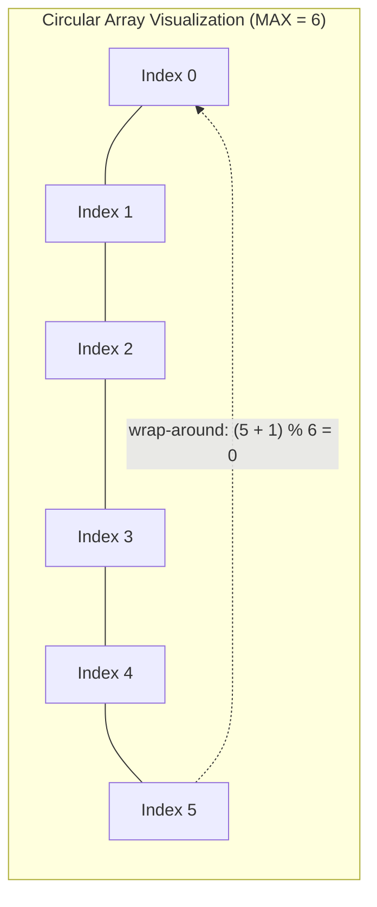
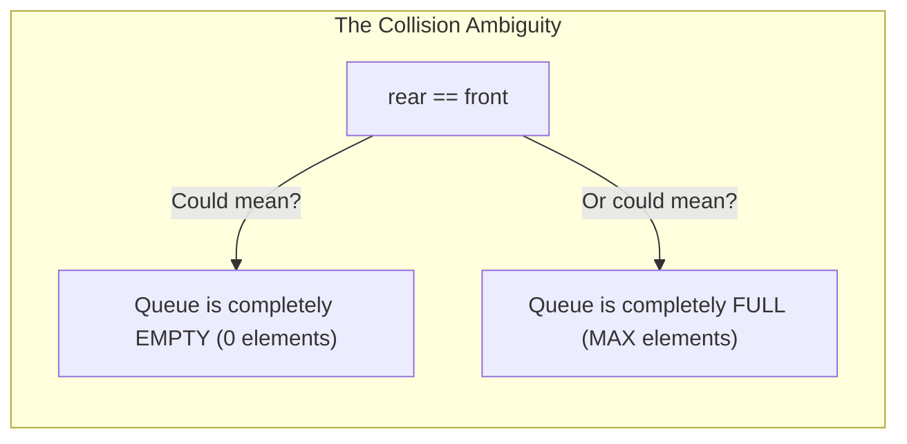

[DSA Index](../README.md) / [Unit 2: Circular Lists, Queues, and Trees](Introduction.md)

---

# Circular Queues

In the previous lecture, we exposed the fatal flaw of linear array queues: **False Overflow**. As elements are enqueued and dequeued, the `front` and `rear` indices march inexorably to the right. When `rear` reaches the end of the array, the queue declares itself full, even if the front slots have been completely emptied by previous dequeues.

We noted that shifting elements left to reclaim that space turns an instantaneous $O(1)$ operation into a sluggish $O(N)$ chore. 

So how do we reclaim those vacant front slots without moving a single byte of existing data?

We bend the array into a ring.

---

## The Concept of a Circular Queue

A **Circular Queue** (also known as a **Ring Buffer**) is a queue implemented over a fixed-size contiguous array where the last position is logically connected directly back to the first position.



When `rear` reaches the end of the array (`MAX - 1`), it doesn't slam into a brick wall. Instead, if slots at the beginning of the array have been evacuated by previous `dequeue` calls, `rear` smoothly wraps around to index `0`.

---

## The Engine: Modulo Arithmetic

In linear arithmetic, incrementing an index is simple:
$$\text{index} = \text{index} + 1$$

When $\text{index} = MAX - 1$, the next increment yields $MAX$, which is out of bounds.

In circular arithmetic, we replace standard incrementation with **modulo arithmetic**:
$$\text{index} = (\text{index} + 1) \pmod{MAX}$$

Let's trace this for an array of capacity $MAX = 5$:
- If $\text{index} = 0 \implies (0 + 1) \pmod 5 = 1$
- If $\text{index} = 1 \implies (1 + 1) \pmod 5 = 2$
- If $\text{index} = 2 \implies (2 + 1) \pmod 5 = 3$
- If $\text{index} = 3 \implies (3 + 1) \pmod 5 = 4$
- If $\text{index} = 4 \implies (4 + 1) \pmod 5 = 0$

Notice how naturally index 4 transitions back to index 0. The modulo operator eliminates branch conditions and provides seamless, continuous wrap-around.

---

## The Disambiguation Dilemma: Empty vs. Full

Now we run into a fascinating algorithmic puzzle.

In a circular array, both `front` and `rear` rotate in the same circular direction:
- Every `enqueue` advances `rear = (rear + 1) % MAX`.
- Every `dequeue` advances `front = (front + 1) % MAX`.

What happens when the queue is completely empty? `front` and `rear` point to the same location.
What happens when the queue is completely full? `rear` wraps around and catches up to `front`, so `front` and `rear` point to the same location again!



How does our program distinguish between having 0 items and having $MAX$ items if the pointers look identical?

Engineers resolve this dilemma through three distinct strategies:

### Strategy 1: The "Leave One Slot Empty" Convention
In this classic textbook approach, we deliberately sacrifice one array slot. In an array of size $MAX$, we only store up to $MAX - 1$ elements.
- **Empty condition:** `front == rear`
- **Full condition:** `(rear + 1) % MAX == front`

If advancing `rear` by one would collide with `front`, we declare the queue full before the collision can happen.

### Strategy 2: Explicit Element Counter (`count`)
We maintain an auxiliary integer variable `count` initialized to `0`.
- Every `enqueue` increments `count++`.
- Every `dequeue` decrements `count--`.
- **Empty condition:** `count == 0`
- **Full condition:** `count == MAX`

This allows us to utilize 100% of the array slots at the expense of maintaining an extra integer variable.

### Strategy 3: Pointer Reset (`front = -1, rear = -1`)
We initialize `front = -1` and `rear = -1`. 
- **Empty condition:** `front == -1`
- **Full condition:** `(rear + 1) % MAX == front`
- When the last remaining element is dequeued, we explicitly reset both pointers to `-1`.

Strategy 3 is the standard implementation taught in university curricula and provides full storage utilization with clean boundary handling. We will use this strategy in our code below.

---

## Step-by-Step Trace of Wrap-Around Mechanics

Let's walk through an array of capacity $MAX = 5$ using Strategy 3:

```mermaid
flowchart TD
    subgraph Step1["Step 1: Enqueue 10, 20, 30, 40"]
        direction LR
        S1_0["[0]: 10 (F)"] --- S1_1["[1]: 20"] --- S1_2["[2]: 30"] --- S1_3["[3]: 40 (R)"] --- S1_4["[4]: Empty"]
    end
    subgraph Step2["Step 2: Dequeue twice (removes 10, 20)"]
        direction LR
        S2_0["[0]: Empty"] --- S2_1["[1]: Empty"] --- S2_2["[2]: 30 (F)"] --- S2_3["[3]: 40 (R)"] --- S2_4["[4]: Empty"]
    end
    subgraph Step3["Step 3: Enqueue 50, then 60 (Wrap-around!)"]
        direction LR
        S3_0["[0]: 60 (R)"] --- S3_1["[1]: Empty"] --- S3_2["[2]: 30 (F)"] --- S3_3["[3]: 40"] --- S3_4["[4]: 50"]
    end
```



Let's trace the arithmetic of Step 3:
1. `50` is enqueued: `rear` advances from `3` to `(3 + 1) % 5 = 4`. `arr[4] = 50`.
2. Next, `60` is enqueued:
   - What would the next `rear` be? `(4 + 1) % 5 = 0`!
   - Is index `0` occupied? Where is `front`? `front` is at index `2`.
   - Since `(4 + 1) % 5 != 2`, slot 0 is completely free!
   - `rear` wraps around to `0`, and `arr[0] = 60`.

In a linear queue, inserting `60` would have failed with False Overflow. In a circular queue, it reuses the empty slot seamlessly.

---

## C Implementation of Circular Queue

Here is a complete, production-grade C implementation:

```c
#include <stdio.h>
#include <stdbool.h>

#define MAX 5

struct CircularQueue {
    int items[MAX];
    int front;
    int rear;
};

void initQueue(struct CircularQueue *q) {
    q->front = -1;
    q->rear = -1;
}

bool isFull(struct CircularQueue *q) {
    // Condition 1: rear is right behind front after wrap-around
    // Condition 2: front is at 0 and rear is at MAX - 1
    return ((q->rear + 1) % MAX == q->front);
}

bool isEmpty(struct CircularQueue *q) {
    return (q->front == -1);
}

void enqueue(struct CircularQueue *q, int value) {
    if (isFull(q)) {
        printf("Circular Queue Overflow! Cannot insert %d.\n", value);
        return;
    }

    // If queue is initially empty
    if (isEmpty(q)) {
        q->front = 0;
        q->rear = 0;
    } else {
        q->rear = (q->rear + 1) % MAX;
    }

    q->items[q->rear] = value;
    printf("Enqueued %d at index %d (front: %d, rear: %d)\n", 
           value, q->rear, q->front, q->rear);
}

int dequeue(struct CircularQueue *q) {
    if (isEmpty(q)) {
        printf("Circular Queue Underflow! Queue is empty.\n");
        return -1;
    }

    int data = q->items[q->front];
    printf("Dequeued %d from index %d\n", data, q->front);

    // Case 1: Queue had only one element, now empty
    if (q->front == q->rear) {
        q->front = -1;
        q->rear = -1;
    } else {
        // Case 2: Advance front circularly
        q->front = (q->front + 1) % MAX;
    }

    return data;
}

void display(struct CircularQueue *q) {
    if (isEmpty(q)) {
        printf("Queue is empty.\n");
        return;
    }

    printf("Circular Queue contents: ");
    int i = q->front;
    while (true) {
        printf("%d ", q->items[i]);
        if (i == q->rear) break;
        i = (i + 1) % MAX;
    }
    printf("\n");
}
```

### Traversing the Circular Queue

Notice how the `display()` function traverses the ring:
```c
int i = q->front;
while (true) {
    printf("%d ", q->items[i]);
    if (i == q->rear) break;
    i = (i + 1) % MAX;
}
```
Starting from `front`, we print each slot and advance using `(i + 1) % MAX` until we reach `rear`. This guarantees correct traversal regardless of whether `front <= rear` or `rear < front` (after wrap-around).

---

## Complete Working Program

Let's test the complete lifecycle of a circular queue:

```c
int main(void) {
    struct CircularQueue q;
    initQueue(&q);

    // Fill the queue
    enqueue(&q, 10);
    enqueue(&q, 20);
    enqueue(&q, 30);
    enqueue(&q, 40);
    enqueue(&q, 50);

    // Should fail with Overflow
    enqueue(&q, 60);

    display(&q);

    // Dequeue 2 items (frees slots 0 and 1)
    dequeue(&q);
    dequeue(&q);

    display(&q);

    // Enqueue 2 items (should wrap around into slots 0 and 1)
    enqueue(&q, 60);
    enqueue(&q, 70);

    display(&q);

    return 0;
}
```

---

## Complexity Analysis

| Operation | Best Case | Average Case | Worst Case | Auxiliary Space |
| :--- | :--- | :--- | :--- | :--- |
| **Enqueue** | $O(1)$ | $O(1)$ | $O(1)$ | $O(1)$ |
| **Dequeue** | $O(1)$ | $O(1)$ | $O(1)$ | $O(1)$ |
| **Peek** | $O(1)$ | $O(1)$ | $O(1)$ | $O(1)$ |
| **isEmpty / isFull** | $O(1)$ | $O(1)$ | $O(1)$ | $O(1)$ |
| **Display / Traversal** | $O(N)$ | $O(N)$ | $O(N)$ | $O(1)$ |
| **Total Memory Overhead** | Fixed array size ($MAX \times \text{sizeof(int)}$) + 2 indices |

---

## Real-World Systems Applications

Why do production systems prefer Circular Queues over dynamic linked queues?

1. **Deterministic Memory Footprint:** In embedded hardware, aerospace controllers, and operating system kernels, dynamic heap allocation (`malloc`) is strictly forbidden because heap fragmentation causes non-deterministic latencies and memory exhaustion crashes. Circular queues allocate a fixed contiguous buffer once at initialization and never touch the heap again.
2. **Ring Buffers in Device Drivers:** When your network card receives Ethernet frames or your sound card receives audio samples, hardware DMAs write data into a circular ring buffer in RAM. The kernel driver reads from the front while the hardware writes to the rear.
3. **Lock-Free Single-Producer Single-Consumer (SPSC) Queues:** When one thread only produces (advancing `rear`) and another thread only consumes (advancing `front`), a circular queue can be made completely lock-free without mutexes using memory barriers.

---

## Key Takeaways

- A circular queue overcomes the false overflow flaw of linear array queues by connecting the end of the array back to the beginning via modulo arithmetic: `(index + 1) % MAX`.
- Wrap-around allows empty slots evacuated by previous dequeues to be recycled for future enqueues without shifting elements.
- The fundamental ambiguity between an empty and a full circular queue is resolved using `(rear + 1) % MAX == front` for full and `front == -1` for empty.
- All core queue operations maintain strict $O(1)$ time complexity while benefiting from contiguous array cache locality.

So far, all our queues have strictly enforced single-door FIFO: enter at rear, exit at front. But what if we need to insert and delete from both ends? Or what if some elements are so urgent that they need to bypass the line entirely? We explore these advanced variations in [L05 - Deques and Priority Queues](L05%20-%20Deques%20and%20Priority%20Queues.md).
