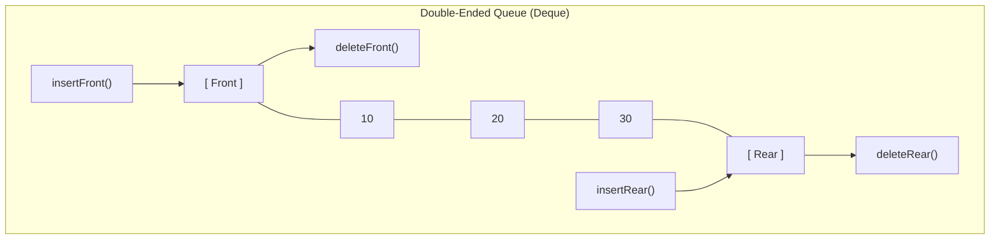
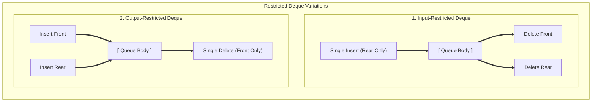
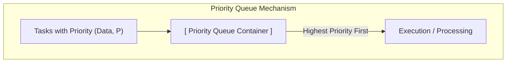
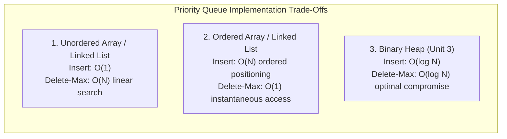

[DSA Index](../README.md) / [Unit 2: Circular Lists, Queues, and Trees](Introduction.md)

---

# Deques and Priority Queues

So far, our queues have enforced strict FIFO rules: you enter at the back, and you leave from the front. But computer science frequently presents problems where strict single-door FIFO is either too restrictive or fundamentally unfair.

Consider two scenarios:
1. In a web browser's navigation history or an operating system's work-stealing scheduler, threads need to push and pop tasks from both ends of a queue.
2. In a hospital emergency room or an operating system interrupt handler, tasks cannot wait in a passive FIFO line. A patient with cardiac arrest or a critical hardware interrupt must preempt all routine tasks immediately.

To solve these problems, we introduce two specialized queue variations: the **Double-Ended Queue (Deque)** and the **Priority Queue**.

---

## Double-Ended Queues (Deque)

A **Deque** (pronounced *"deck"*, short for **D**ouble-**E**nded **Que**ue) is a generalized queue where insertion and deletion can occur at **both the front and the rear**.



Notice what this versatility implies:
- If you restrict operations to `insertRear()` and `deleteRear()` (or `insertFront()` and `deleteFront()`), a Deque acts as a **Stack (LIFO)**.
- If you restrict operations to `insertRear()` and `deleteFront()`, a Deque acts as a **Linear Queue (FIFO)**.

A Deque is therefore a superset capable of acting as both a Stack and a Queue.

---

## Restricted Deque Variations

Depending on system constraints, engineers frequently deploy two restricted variations of Deques:



### 1. Input-Restricted Deque
- **Insertion** is permitted at only **one end** (typically the rear).
- **Deletion** is permitted at **both ends** (front and rear).

### 2. Output-Restricted Deque
- **Deletion** is permitted at only **one end** (typically the front).
- **Insertion** is permitted at **both ends** (front and rear).

---

## Circular Array Implementation of Deque

Implementing a Deque using a circular array requires mastering modulo arithmetic in **both directions**.

Moving forward is familiar:
$$\text{next\_index} = (\text{index} + 1) \pmod{MAX}$$

Now, how do we step **backward**?
In linear math, stepping backward is $\text{index} - 1$. But what happens when $\text{index} = 0$? 
$0 - 1 = -1$, which is invalid. In C, `(-1) % MAX` evaluates to `-1`, not `MAX - 1`!

To wrap backward correctly without generating negative numbers, we add $MAX$ before taking the modulo:
$$\text{prev\_index} = (\text{index} - 1 + MAX) \pmod{MAX}$$

Let's verify this for $MAX = 5$ at $\text{index} = 0$:
$$(0 - 1 + 5) \pmod 5 = 4 \pmod 5 = 4$$

The index wraps around smoothly to the final slot of the array.

### Core Deque Operations in C

```c
#include <stdio.h>
#include <stdbool.h>

#define MAX 5

struct Deque {
    int arr[MAX];
    int front;
    int rear;
};

void initDeque(struct Deque *dq) {
    dq->front = -1;
    dq->rear = -1;
}

bool isFull(struct Deque *dq) {
    return ((dq->front == 0 && dq->rear == MAX - 1) || 
            (dq->front == dq->rear + 1));
}

bool isEmpty(struct Deque *dq) {
    return (dq->front == -1);
}

void insertFront(struct Deque *dq, int val) {
    if (isFull(dq)) {
        printf("Deque Overflow at Front!\n");
        return;
    }

    if (isEmpty(dq)) {
        dq->front = dq->rear = 0;
    } else {
        // Step backward circularly
        dq->front = (dq->front - 1 + MAX) % MAX;
    }

    dq->arr[dq->front] = val;
    printf("Inserted %d at front (front: %d)\n", val, dq->front);
}

void insertRear(struct Deque *dq, int val) {
    if (isFull(dq)) {
        printf("Deque Overflow at Rear!\n");
        return;
    }

    if (isEmpty(dq)) {
        dq->front = dq->rear = 0;
    } else {
        // Step forward circularly
        dq->rear = (dq->rear + 1) % MAX;
    }

    dq->arr[dq->rear] = val;
    printf("Inserted %d at rear (rear: %d)\n", val, dq->rear);
}

int deleteFront(struct Deque *dq) {
    if (isEmpty(dq)) {
        printf("Deque Underflow at Front!\n");
        return -1;
    }

    int val = dq->arr[dq->front];

    if (dq->front == dq->rear) {
        dq->front = dq->rear = -1; // Reset to empty
    } else {
        dq->front = (dq->front + 1) % MAX;
    }

    return val;
}

int deleteRear(struct Deque *dq) {
    if (isEmpty(dq)) {
        printf("Deque Underflow at Rear!\n");
        return -1;
    }

    int val = dq->arr[dq->rear];

    if (dq->front == dq->rear) {
        dq->front = dq->rear = -1; // Reset to empty
    } else {
        // Step backward circularly
        dq->rear = (dq->rear - 1 + MAX) % MAX;
    }

    return val;
}
```

Every single operation (`insertFront`, `insertRear`, `deleteFront`, `deleteRear`) executes in strict $O(1)$ time.

---

## Priority Queues

Now let's break away from chronological ordering entirely.

A **Priority Queue** is an Abstract Data Type where each element is assigned a numerical **priority value**. 

The fundamental rule of a Priority Queue:
- An element with **higher priority** is always dequeued before an element with **lower priority**.
- If two elements share identical priority, they are served according to their arrival order (FIFO).



### Min-Priority vs. Max-Priority Queues

Depending on the convention of the system:
1. **Max-Priority Queue:** Higher numerical values denote higher priority (e.g., Priority 10 is served before Priority 1). Common in operating system process priorities.
2. **Min-Priority Queue:** Lower numerical values denote higher priority (e.g., Priority 1 is served before Priority 10). Common in pathfinding algorithms like Dijkstra's algorithm and Prim's Minimum Spanning Tree algorithm.

---

## Implementation Strategies and Trade-Offs

How should we implement a Priority Queue? There is a classic trade-off between insertion cost and extraction cost.



Let's analyze why:
- In an **unordered list**, we simply append new elements to the tail in $O(1)$ time. But when we need to dequeue the highest priority item, we must scan all $N$ elements to find the maximum, taking $O(N)$ time.
- In an **ordered list**, we maintain elements sorted by priority. Dequeuing is instantaneous $O(1)$ from the front. But inserting a new element requires traversing to find its correct sorted slot, taking $O(N)$ time.
- In advanced data structures (like the **Binary Heap**, which we cover in Unit 3), we balance this tension so that *both* insertions and deletions execute in $O(\log N)$ time.

---

## Ordered Linked List Implementation of Priority Queue

Let's implement a Min-Priority Queue using an ordered singly linked list where smaller numerical values represent higher priority.

Each node stores two attributes: `data` and `priority`.

```c
#include <stdio.h>
#include <stdlib.h>

struct PQNode {
    int data;
    int priority; // Lower integer = higher priority
    struct PQNode *next;
};

struct PQNode* createNode(int data, int priority) {
    struct PQNode *newNode = (struct PQNode *)malloc(sizeof(struct PQNode));
    newNode->data = data;
    newNode->priority = priority;
    newNode->next = NULL;
    return newNode;
}

// Inserts an item in its correct priority-sorted position: O(N)
struct PQNode* insert(struct PQNode *head, int data, int priority) {
    struct PQNode *newNode = createNode(data, priority);

    // Case 1: Empty list or newNode has higher priority than current head
    if (head == NULL || priority < head->priority) {
        newNode->next = head;
        return newNode;
    }

    // Case 2: Traverse to find the correct sorted insertion point
    struct PQNode *temp = head;
    while (temp->next != NULL && temp->next->priority <= priority) {
        temp = temp->next;
    }

    newNode->next = temp->next;
    temp->next = newNode;

    return head;
}

// Removes the highest priority element: O(1)
struct PQNode* deleteMin(struct PQNode *head, int *extractedData) {
    if (head == NULL) {
        printf("Priority Queue Underflow!\n");
        return NULL;
    }

    struct PQNode *temp = head;
    *extractedData = temp->data;
    head = head->next;
    free(temp);

    return head;
}

int peek(struct PQNode *head) {
    if (head == NULL) {
        printf("Priority Queue is empty!\n");
        return -1;
    }
    return head->data;
}

void printPQ(struct PQNode *head) {
    struct PQNode *temp = head;
    printf("Priority Queue (data, priority): ");
    while (temp != NULL) {
        printf("[%d, p:%d] -> ", temp->data, temp->priority);
        temp = temp->next;
    }
    printf("NULL\n");
}
```

### Complete Trace of Ordered Priority Queue

```c
int main(void) {
    struct PQNode *pq = NULL;
    int served;

    // Insert tasks: (task_id, priority)
    pq = insert(pq, 101, 3);
    pq = insert(pq, 102, 1); // Urgent!
    pq = insert(pq, 103, 4);
    pq = insert(pq, 104, 2);

    printPQ(pq);

    pq = deleteMin(pq, &served);
    printf("Served highest priority task: %d\n", served);

    printPQ(pq);
    return 0;
}
```

Output:
```text
Priority Queue (data, priority): [102, p:1] -> [104, p:2] -> [101, p:3] -> [103, p:4] -> NULL
Served highest priority task: 102
Priority Queue (data, priority): [104, p:2] -> [101, p:3] -> [103, p:4] -> NULL
```

Task `102` arrived second, but because its priority was `1`, it was placed at the front of the line and served first.

---

## Complexity Analysis

| Data Structure / Strategy | Enqueue Time | Dequeue Time | Peek Time | Auxiliary Space |
| :--- | :--- | :--- | :--- | :--- |
| **Deque (Circular Array)** | $O(1)$ (both ends) | $O(1)$ (both ends) | $O(1)$ | $O(MAX)$ |
| **Deque (Doubly Linked List)** | $O(1)$ (both ends) | $O(1)$ (both ends) | $O(1)$ | $O(N)$ |
| **PQ: Unordered Array / List** | $O(1)$ | $O(N)$ | $O(N)$ | $O(N)$ |
| **PQ: Ordered Linked List** | $O(N)$ | $O(1)$ | $O(1)$ | $O(N)$ |
| **PQ: Binary Heap (Unit 3 preview)**| $O(\log N)$ | $O(\log N)$ | $O(1)$ | $O(N)$ |

---

## Key Takeaways

- A Deque (Double-Ended Queue) allows insertions and deletions at both ends, functioning simultaneously as a generalized Stack and Queue.
- Stepping backward in a circular array requires adding $MAX$ before taking modulo: `(index - 1 + MAX) % MAX` to prevent negative arithmetic.
- Input-restricted deques permit insertion at one end only; output-restricted deques permit deletion at one end only.
- A Priority Queue serves elements by priority rather than arrival time. An ordered list provides $O(1)$ extraction at the cost of $O(N)$ insertion, while binary heaps achieve $O(\log N)$ for both.

Now that we have mastered linear queues, circular queues, deques, and priority queues, it is time to put them to work. How does an operating system multiplex a single CPU across dozens of running processes? How do we solve the ancient circular elimination riddle known as the Josephus Problem? We explore these practical applications in [L06 - Applications of Queues](L06%20-%20Applications%20of%20Queues.md).
