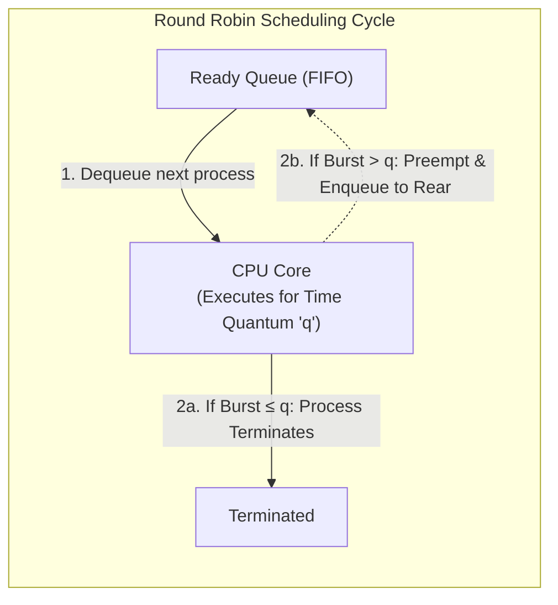
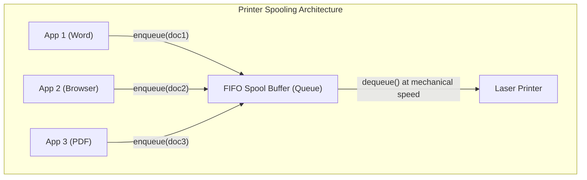
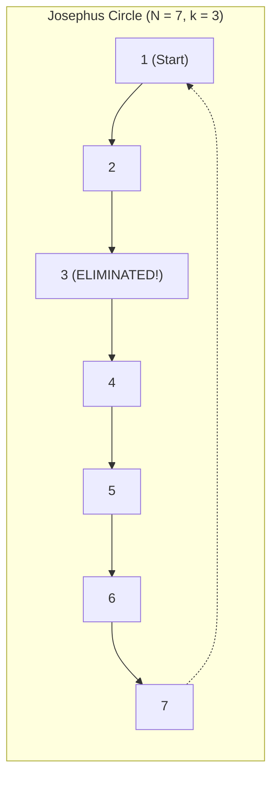

[DSA Index](../README.md) / [Unit 2: Circular Lists, Queues, and Trees](Introduction.md)

---

# Applications of Queues

We have studied the mechanics of queues in their linear, circular, double-ended, and priority variations. But data structures do not exist in an abstract vacuum. They are engineered to solve specific computational bottlenecks in real operating systems, networking stacks, and algorithmic simulations.

Whenever two subsystems operate at different speeds, whenever resources must be shared fairly among competing processes, or whenever an algorithmic problem involves cyclical elimination, the Queue is the foundational data structure of choice.

In this lecture, we examine three classical and practical applications of queues:
1. **Operating System Round Robin (RR) CPU Scheduling**
2. **Printer Spooling Buffers and Asynchronous Producer-Consumer Systems**
3. **The Mathematical Josephus Problem**

---

## 1. Operating System Process Scheduling: Round Robin

In a multitasking operating system, dozens or hundreds of processes want to execute, but there may be only a limited number of CPU cores. How does the kernel provide every process with a responsive, fair share of processing power without letting one compute-heavy process monopolize the CPU forever?

It uses **Round Robin (RR) Scheduling**, an algorithm powered directly by a FIFO Ready Queue.



### The Mechanism of Round Robin
1. The kernel maintains a **Ready Queue** containing all processes waiting for CPU time.
2. The scheduler defines a fixed time slice called the **Time Quantum ($q$)**.
3. The CPU dequeues the process at the front of the queue and lets it execute for up to $q$ time units.
4. Two outcomes are possible:
   - **Case A (Completion):** The process finishes its work within $q$. It releases the CPU and terminates.
   - **Case B (Preemption):** The process needs more time than $q$. The CPU's timer interrupt fires, preempts the process, context-switches it out, and **enqueues it at the rear of the ready queue**.
5. The scheduler immediately dequeues the next process at the front and repeats the cycle.

### Tracing Round Robin by Hand

Suppose we have 3 processes in the Ready Queue with Time Quantum $q = 4\text{ ms}$:
- Process $P_1$: Burst Time = $10\text{ ms}$
- Process $P_2$: Burst Time = $4\text{ ms}$
- Process $P_3$: Burst Time = $5\text{ ms}$

Initial Ready Queue: `[P1 (10), P2 (4), P3 (5)]`

1. **Cycle 1:** Dequeue $P_1$. Executes for $q = 4$. Remaining burst = $6$. Enqueue $P_1$ to rear.
   - Ready Queue: `[P2 (4), P3 (5), P1 (6)]`
2. **Cycle 2:** Dequeue $P_2$. Executes for $4\text{ ms}$. Remaining burst = $0$. $P_2$ terminates!
   - Ready Queue: `[P3 (5), P1 (6)]`
3. **Cycle 3:** Dequeue $P_3$. Executes for $q = 4$. Remaining burst = $1$. Enqueue $P_3$ to rear.
   - Ready Queue: `[P1 (6), P3 (1)]`
4. **Cycle 4:** Dequeue $P_1$. Executes for $q = 4$. Remaining burst = $2$. Enqueue $P_1$ to rear.
   - Ready Queue: `[P3 (1), P1 (2)]`
5. **Cycle 5:** Dequeue $P_3$. Executes for $1\text{ ms}$. Remaining burst = $0$. $P_3$ terminates!
   - Ready Queue: `[P1 (2)]`
6. **Cycle 6:** Dequeue $P_1$. Executes for $2\text{ ms}$. Remaining burst = $0$. $P_1$ terminates!
   - Ready Queue: `[]` (All processes completed).

Notice how cleanly the FIFO queue manages fairness: no process can starve, and every process gets regular turns.

### Complete C Simulation of Round Robin Scheduling

```c
#include <stdio.h>
#include <stdbool.h>

#define MAX 10

struct Process {
    int pid;
    int burstTime;
    int remainingTime;
};

struct Queue {
    int items[MAX];
    int front;
    int rear;
};

void initQueue(struct Queue *q) {
    q->front = -1;
    q->rear = -1;
}

bool isEmpty(struct Queue *q) {
    return (q->front == -1);
}

void enqueue(struct Queue *q, int processIdx) {
    if ((q->rear + 1) % MAX == q->front) return;
    if (isEmpty(q)) {
        q->front = q->rear = 0;
    } else {
        q->rear = (q->rear + 1) % MAX;
    }
    q->items[q->rear] = processIdx;
}

int dequeue(struct Queue *q) {
    if (isEmpty(q)) return -1;
    int idx = q->items[q->front];
    if (q->front == q->rear) {
        q->front = q->rear = -1;
    } else {
        q->front = (q->front + 1) % MAX;
    }
    return idx;
}

void simulateRoundRobin(struct Process proc[], int n, int quantum) {
    struct Queue q;
    initQueue(&q);

    for (int i = 0; i < n; i++) {
        proc[i].remainingTime = proc[i].burstTime;
        enqueue(&q, i);
    }

    int currentTime = 0;
    printf("--- Starting Round Robin Simulation (Quantum = %d ms) ---\n", quantum);

    while (!isEmpty(&q)) {
        int idx = dequeue(&q);

        if (proc[idx].remainingTime > quantum) {
            currentTime += quantum;
            proc[idx].remainingTime -= quantum;
            printf("Time %2d ms: Process P%d executed for %d ms (Remaining: %d ms)\n",
                   currentTime, proc[idx].pid, quantum, proc[idx].remainingTime);
            enqueue(&q, idx); // Re-queue at rear
        } else {
            currentTime += proc[idx].remainingTime;
            printf("Time %2d ms: Process P%d executed for %d ms and COMPLETED.\n",
                   currentTime, proc[idx].pid, proc[idx].remainingTime);
            proc[idx].remainingTime = 0;
        }
    }
    printf("--- All processes finished at time %d ms ---\n\n", currentTime);
}

int main(void) {
    struct Process proc[] = {
        {1, 10, 0},
        {2, 4, 0},
        {3, 5, 0}
    };
    simulateRoundRobin(proc, 3, 4);
    return 0;
}
```

---

## 2. Printer Spooling Buffers & Asynchronous Producer-Consumer

Consider the physical reality of an office printer connected to a high-speed workstation:
- A modern CPU can format and generate print pages at gigabytes per second.
- A mechanical laser printer can physically print only 20 to 40 pages per minute.

What happens if an application tries to send a 200-page document directly to the printer hardware? If the application had to wait synchronously for each physical page to print, the computer would freeze for 5 minutes.

To decouple fast producers from slow consumers, operating systems use a queue buffer called a **Spooler** (**S**imultaneous **P**eripheral **O**perations **O**n-**L**ine).



### Why a Queue is Mandatory Here
1. **Decoupling:** Applications enqueue print jobs in memory or disk and return to the user immediately ($O(1)$ response time).
2. **Fairness:** Documents are printed in the exact chronological order in which they were submitted.
3. **Rate Smoothing:** Burst traffic from multiple applications is absorbed by the queue without losing data.

This is the quintessential **Producer-Consumer** pattern used everywhere in computer science: network socket buffers, audio streaming pipelines, and message brokers like Apache Kafka.

---

## 3. The Josephus Problem

Now let's examine an ancient mathematical puzzle that demonstrates the algorithmic elegance of circular queues.

### The Problem Statement
$N$ people stand in a circle numbered $1$ to $N$. Counting begins at person $1$ and proceeds around the circle clockwise. In each step, exactly $k$ people are counted, and the $k$-th person is eliminated from the circle. The count then resumes with the next surviving person. 

The process continues until only **one person survives**. The challenge: given $N$ and $k$, identify the position of the survivor.



### The Queue-Based Solution
How do we model this circular elimination process using a queue?

Look at the mechanics of counting:
- Counting a person who survives is equivalent to **dequeuing them from the front and immediately enqueuing them at the rear**.
- We repeat this rotation $k - 1$ times.
- On the $k$-th count, we simply **dequeue the person and discard them**!

We repeat this cycle until the queue size shrinks to 1. The solitary remaining element is the survivor.

### Step-by-Step Walkthrough ($N = 7, k = 3$)

Initial queue: `[1, 2, 3, 4, 5, 6, 7]`

- **Round 1:**
  - Rotate 1: `[2, 3, 4, 5, 6, 7, 1]`
  - Rotate 2: `[3, 4, 5, 6, 7, 1, 2]`
  - Eliminate 3: `[4, 5, 6, 7, 1, 2]` (Person 3 eliminated)
- **Round 2:**
  - Rotate 4: `[5, 6, 7, 1, 2, 4]`
  - Rotate 5: `[6, 7, 1, 2, 4, 5]`
  - Eliminate 6: `[7, 1, 2, 4, 5]` (Person 6 eliminated)
- **Round 3:**
  - Rotate 7: `[1, 2, 4, 5, 7]`
  - Rotate 1: `[2, 4, 5, 7, 1]`
  - Eliminate 2: `[4, 5, 7, 1]` (Person 2 eliminated)
- **Round 4:**
  - Rotate 4: `[5, 7, 1, 4]`
  - Rotate 5: `[7, 1, 4, 5]`
  - Eliminate 7: `[1, 4, 5]` (Person 7 eliminated)
- **Round 5:**
  - Rotate 1: `[4, 5, 1]`
  - Rotate 4: `[5, 1, 4]`
  - Eliminate 5: `[1, 4]` (Person 5 eliminated)
- **Round 6:**
  - Rotate 1: `[4, 1]`
  - Rotate 4: `[1, 4]`
  - Eliminate 1: `[4]` (Person 1 eliminated)

Final Survivor: **Person 4**.

### Complete C Implementation of the Josephus Problem

```c
#include <stdio.h>
#include <stdlib.h>

struct Node {
    int data;
    struct Node *next;
};

struct Queue {
    struct Node *front;
    struct Node *rear;
};

struct Queue* createQueue(void) {
    struct Queue *q = (struct Queue *)malloc(sizeof(struct Queue));
    q->front = q->rear = NULL;
    return q;
}

void enqueue(struct Queue *q, int val) {
    struct Node *newNode = (struct Node *)malloc(sizeof(struct Node));
    newNode->data = val;
    newNode->next = NULL;

    if (q->rear == NULL) {
        q->front = q->rear = newNode;
        return;
    }
    q->rear->next = newNode;
    q->rear = newNode;
}

int dequeue(struct Queue *q) {
    if (q->front == NULL) return -1;
    struct Node *temp = q->front;
    int val = temp->data;

    q->front = q->front->next;
    if (q->front == NULL) q->rear = NULL;

    free(temp);
    return val;
}

int josephus(int n, int k) {
    struct Queue *q = createQueue();

    // Populate queue with numbers 1 to n
    for (int i = 1; i <= n; i++) {
        enqueue(q, i);
    }

    printf("Simulating Josephus elimination for N = %d, k = %d:\n", n, k);

    // Continue until only 1 person remains
    while (q->front != q->rear) {
        // Rotate (k - 1) people from front to rear
        for (int i = 1; i < k; i++) {
            int person = dequeue(q);
            enqueue(q, person);
        }

        // The k-th person is eliminated
        int eliminated = dequeue(q);
        printf("Person %d eliminated.\n", eliminated);
    }

    int survivor = dequeue(q);
    free(q);
    return survivor;
}

int main(void) {
    int n = 7, k = 3;
    int survivor = josephus(n, k);
    printf("The survivor is person %d\n", survivor);
    return 0;
}
```

### Complexity Analysis of Queue-Based Josephus

| Metric | Analysis |
| :--- | :--- |
| **Total Eliminations** | $N - 1$ rounds |
| **Rotations per Round** | $k - 1$ enqueue/dequeue operations |
| **Time Complexity** | $O(N \cdot k)$ |
| **Auxiliary Space Complexity** | $O(N)$ for the queue elements |

---

## Key Takeaways

- Queues bridge asynchronous systems operating at disparate speeds, preventing producer stalls and consumer starvation.
- Operating system Round Robin schedulers use FIFO queues to ensure bounded latency and starvation-free execution across competing threads.
- Printer spooling buffers decouple high-speed CPU processes from mechanical peripherals using FIFO buffers.
- The Josephus Problem can be simulated using a queue by rotating $k-1$ elements from front to rear and dequeuing the $k$-th element, executing in $O(N \cdot k)$ time.

Up to this point in our journey through data structures, every structure we have encountered — arrays, stacks, singly linked lists, circular lists, doubly linked lists, and queues — has been strictly **linear**. Every element had at most one predecessor and one successor.

Now think about how information exists in the real world: organization charts, family ancestries, file system directory hierarchies, and decision pathways. None of these are linear. To represent hierarchies, we must break free of the 1D line and move into non-linear, multi-branching structures. We begin this transformation in [L07 - Introduction to Trees and Terminology](L07%20-%20Introduction%20to%20Trees%20and%20Terminology.md).
