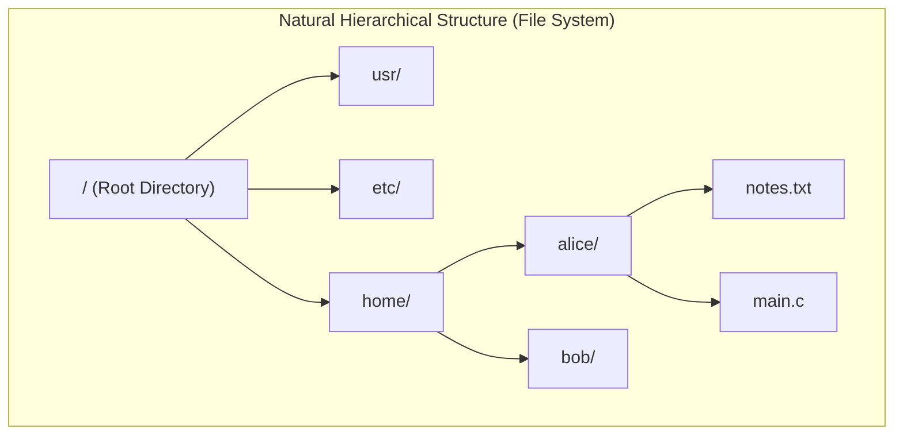
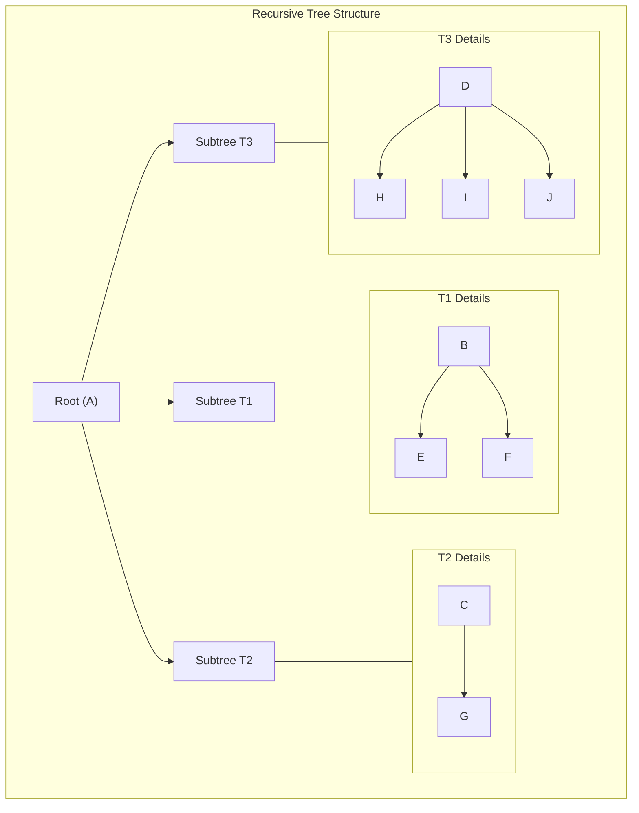
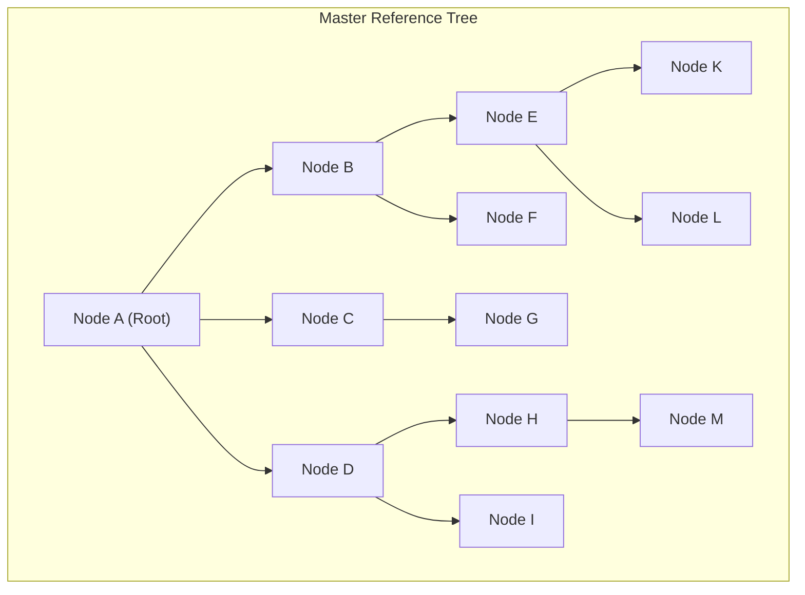
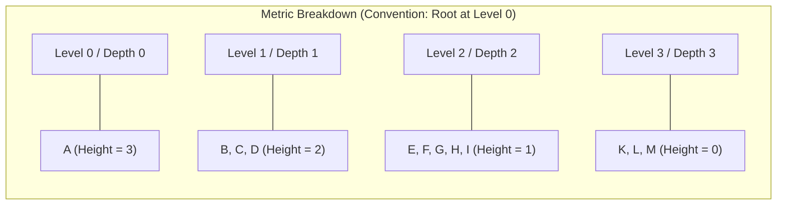

[DSA Index](../README.md) / [Unit 2: Circular Lists, Queues, and Trees](Introduction.md)

---

# Introduction to Trees and Terminology

Up to this point, every data structure we have explored — arrays, stacks, linked lists, circular lists, and queues — has been **linear**. In a linear data structure, elements are arranged in a single sequential line: every element (except the boundaries) has exactly one predecessor and exactly one successor.

Now think about how information naturally organizes in the physical world.

Consider your computer's file system: a root directory contains folders, which contain subfolders, which contain individual files. Consider a corporate hierarchy: a Chief Executive Officer oversees Vice Presidents, who manage Directors, who supervise Engineers. Consider the HTML Document Object Model (DOM) of a website: an `<html>` tag encloses `<head>` and `<body>`, which branch into `<div>`, `<p>`, and `<span>` elements.



None of these structures can be represented naturally in a 1D sequence without losing their parent-child relationships. 

To model hierarchical information, we must leave the linear world behind and step into non-linear, multi-branching data structures: **Trees**.

---

## What is a Tree?

In computer science, a **Tree** is a non-linear, hierarchical collection of entities called **nodes**, connected by directed or undirected links called **edges**, with one defining constraint: **there are no cycles**.

Formally, a tree is defined recursively:
> A Tree is a finite set of one or more nodes such that:
> 1. There is one specially designated node called the **Root**.
> 2. The remaining nodes are partitioned into $m \ge 0$ disjoint sets $T_1, T_2, \dots, T_m$, where each of these sets is itself a tree. These are called the **Subtrees** of the root.



Notice the recursive elegance: if you cut the edges connecting the root to its immediate children, you don't get broken fragments; you get smaller, complete trees.

---

## Fundamental Tree Terminology

To analyze, build, and traverse trees, we need a precise vocabulary. Let's define every critical tree concept using a single master reference tree:



### 1. Root
The topmost node in the tree hierarchy. It is the only node in the entire tree that has **no parent**. 
- In the master tree, **A** is the root.

### 2. Edge
The directed link connecting two nodes. An edge represents a parent-child relationship.
- The link connecting **A** to **B** is an edge.

### 3. Parent
The immediate predecessor of a node. Every node in a tree has exactly one parent, except the root, which has none.
- **A** is the parent of **B**, **C**, and **D**.
- **B** is the parent of **E** and **F**.

### 4. Child
The immediate successor of a node. 
- **E** and **F** are the children of **B**.

### 5. Siblings
Nodes that share the exact same parent node.
- **B**, **C**, and **D** are siblings (all children of **A**).
- **E** and **F** are siblings (both children of **B**).
- **E** and **G** are *not* siblings, because they have different parents.

### 6. Leaf (Terminal / External Node)
A node that has **no children** (its degree is 0). Leaves are the endpoints of the tree branches.
- In our master tree, the leaf nodes are **K**, **L**, **F**, **G**, **M**, and **I**.

### 7. Internal (Non-Terminal / Branch Node)
Any node that has **at least one child**. It is an intermediate decision or grouping node.
- In our master tree, internal nodes are **A**, **B**, **C**, **D**, **E**, and **H**.

### 8. Ancestor
Any node along the path from the root down to a given node (excluding the node itself).
- The ancestors of node **K** are **E**, **B**, and **A**.

### 9. Descendant
Any node reachable by traveling downward from a given node.
- The descendants of node **B** are **E**, **F**, **K**, and **L**.

### 10. Degree of a Node
The total number of children (or subtrees) attached to that node.
- Degree of **A** = 3 (children B, C, D).
- Degree of **B** = 2 (children E, F).
- Degree of **C** = 1 (child G).
- Degree of **K** = 0 (leaf node).

### 11. Degree of a Tree
The **maximum degree** among all nodes in the tree.
- For our master tree, the degree of the tree is **3** (since the maximum node degree is 3, exhibited by node A).

### 12. Path and Path Length
A **Path** is an unbroken sequence of consecutive edges connecting a sequence of nodes.
- The path from **A** to **K** is: $A \to B \to E \to K$.
- **Path Length** is the number of **edges** traversed along the path. 
- The path length from **A** to **K** is **3 edges**.

---

## Levels, Depth, and Height: Resolving the Confusion

In computer science literature and university examinations, terms like Level, Depth, and Height are frequently used interchangeably, which causes significant confusion. Let's make their definitions mathematically airtight.



### Depth of a Node
The **Depth** of a node $v$ is the number of edges from the root to $v$.
- $\text{Depth}(\text{Root}) = 0$.
- $\text{Depth}(B) = 1$.
- $\text{Depth}(E) = 2$.
- $\text{Depth}(K) = 3$.

Depth measures how far down a node sits relative to the root.

### Height of a Node
The **Height** of a node $v$ is the length of the **longest path from $v$ down to a leaf**.
- A leaf node always has a height of $0$: $\text{Height}(K) = 0$, $\text{Height}(F) = 0$.
- $\text{Height}(E) = 1$ (longest path $E \to K$ has 1 edge).
- $\text{Height}(B) = 2$ (longest path $B \to E \to K$ has 2 edges).
- $\text{Height}(A) = 3$ (longest path $A \to B \to E \to K$ has 3 edges).

Height measures how far up a node sits relative to its deepest descendant leaf.

### Height of the Tree
The **Height of a Tree** is defined as the height of its root node, which is identical to the maximum depth among all nodes in the tree.
- For our master tree, the **Height of the Tree is 3**.

### The Level Convention Dilemma
There are two competing academic conventions for Level:
- **Convention 1 (Standard Modern / Cormen & Silberschatz):** The root is at **Level 0**. Under this convention:
  $$\text{Level}(v) = \text{Depth}(v)$$
- **Convention 2 (Traditional Indian / European University):** The root is at **Level 1**. Under this convention:
  $$\text{Level}(v) = \text{Depth}(v) + 1$$

Always look at your exam or system context: if the root is considered Level 0, a tree with just the root node has height 0. If the root is Level 1, the height of a single-node tree is often defined as 1. Modern algorithmic theory almost uniformly adopts the **Level 0** convention.

---

## Fundamental Mathematical Properties of Trees

Every valid tree satisfies several strict mathematical invariants:

### Theorem 1: Edge-to-Node Invariant
> A tree with $N$ nodes always contains exactly $N - 1$ edges.

**Intuitive Proof:**
- Every node in a tree has exactly one incoming edge connecting it to its parent, *except* the root node.
- The root node has zero incoming edges.
- Therefore, counting the incoming edge for every non-root node yields exactly:
  $$E = N - 1$$

If a connected graph has $N$ nodes and $N$ edges, it is guaranteed to contain a cycle (it is not a tree). If it has $N - 2$ edges, it is disconnected (it is a forest).

### Theorem 2: Path Uniqueness
> In any tree, there exists **exactly one unique path** between the root and any arbitrary node $v$.

**Intuitive Proof:**
- Suppose there were two distinct paths from the root to node $v$.
- Following the first path to $v$ and then backtracking along the second path back to the root would form a closed cycle.
- But trees are acyclic by definition. Therefore, multiple paths cannot exist.

---

## Representing General Trees in Memory

How do we represent a tree node in C?

In a linear linked list, a node only needed one pointer: `struct Node *next`.
In a general tree, a node can have an arbitrary number of children. How do we design the node struct?

### Attempt 1: Fixed-Array Pointers (The Naive Approach)
If the maximum degree of the tree is $K$:
```c
struct TreeNode {
    int data;
    struct TreeNode *children[K]; // Fixed array of K child pointers
};
```

The moment we do that, we hit a massive waste of memory. 
If $K = 10$, but most nodes only have 1 or 2 children, 80% to 90% of all child pointers across the entire tree will be empty `NULL` pointers!

### Attempt 2: Dynamic Linked Child Lists (First-Child Next-Sibling)
Instead of a fixed array, every node maintains just **two pointers**:
1. `firstChild`: points to its first (leftmost) child.
2. `nextSibling`: points to its immediate brother/sister node sharing the same parent.

```c
struct TreeNode {
    int data;
    struct TreeNode *firstChild;
    struct TreeNode *nextSibling;
};
```

This brilliant representation (known as the **Left-Child Right-Sibling** representation) transforms an arbitrary general tree into a structure where every node has at most two pointers! We will explore this deep transformation in L09.

---

## Key Takeaways

- Trees are non-linear, hierarchical, connected, acyclic data structures with one unique root node.
- Any valid tree with $N$ nodes has exactly $N - 1$ edges and a single unique path between the root and any node.
- Terminology must be distinguished clearly: **Depth** measures downward distance from the root (Depth of root = 0), while **Height** measures upward distance from the deepest leaf (Height of leaf = 0).
- The degree of a node is its count of children; the degree of the tree is the maximum degree among all nodes.
- Representing general trees with fixed child arrays results in catastrophic memory waste; linked pointer representations solve this cleanly.

Now here's the thing — general trees with arbitrary degrees are flexible, but their variable branching makes algorithmic operations complex. What happens if we restrict every single node to have **at most two children**? We enter the most ubiquitous and mathematically elegant structure in all of computer science: the Binary Tree. We investigate this in [L08 - Binary Trees - Properties and Representations](L08%20-%20Binary%20Trees%20-%20Properties%20and%20Representations.md).
