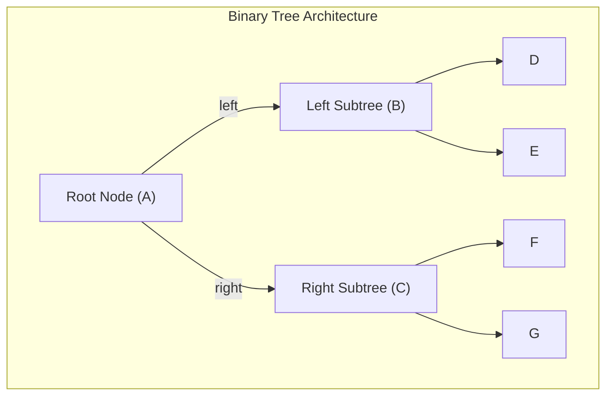
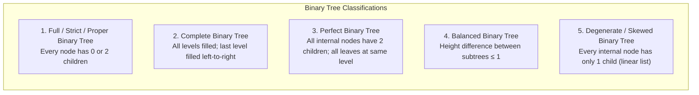
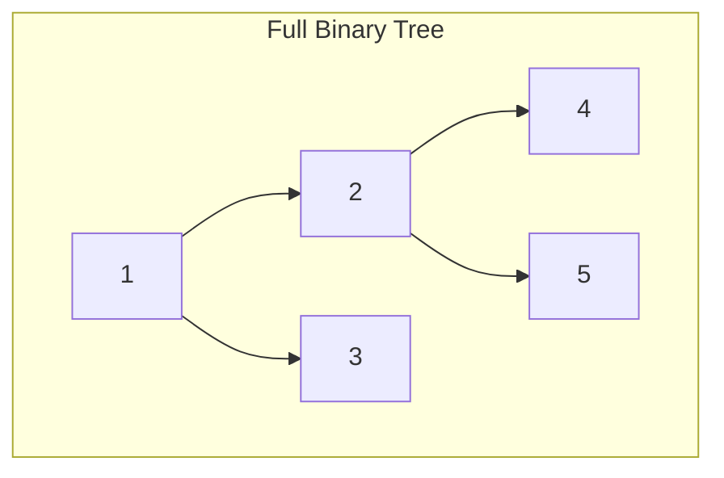
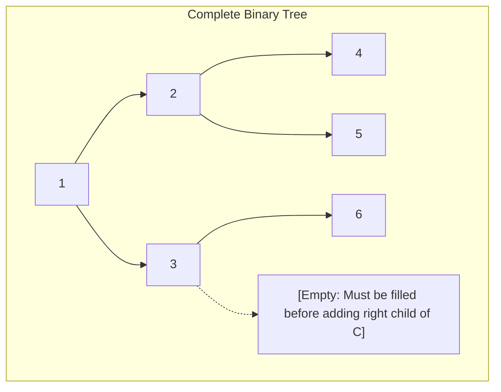
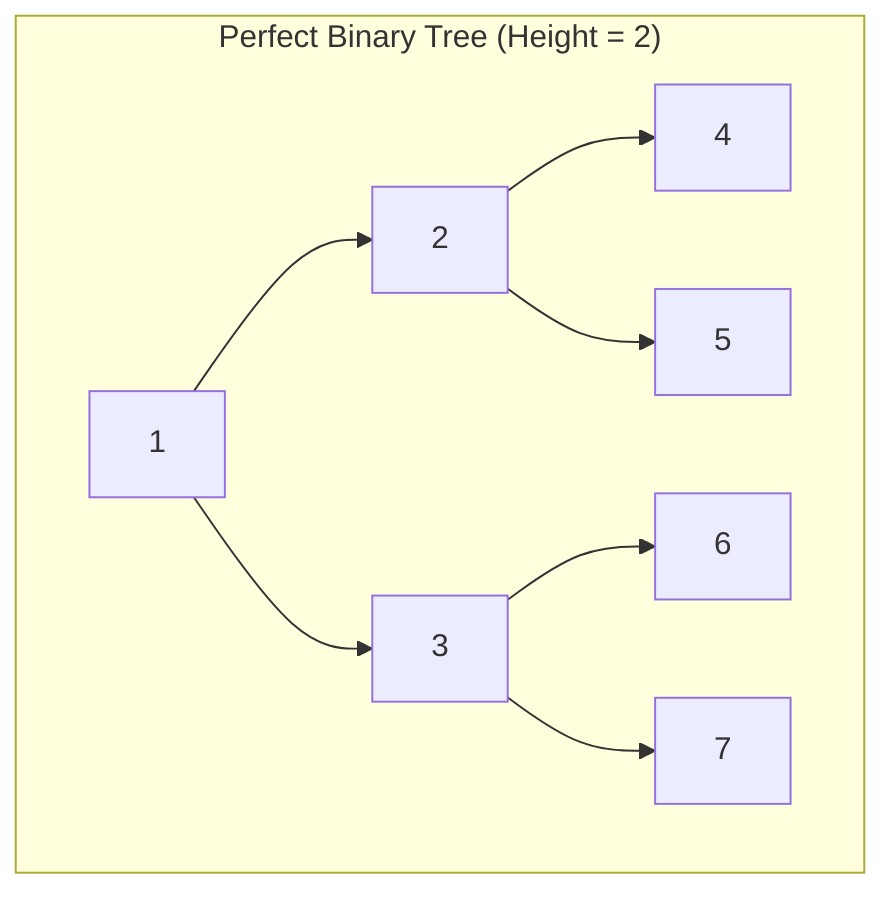
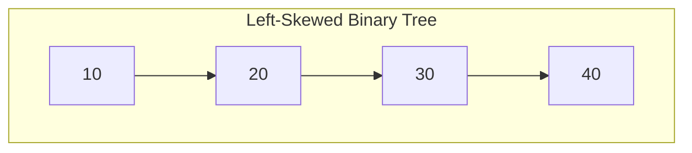
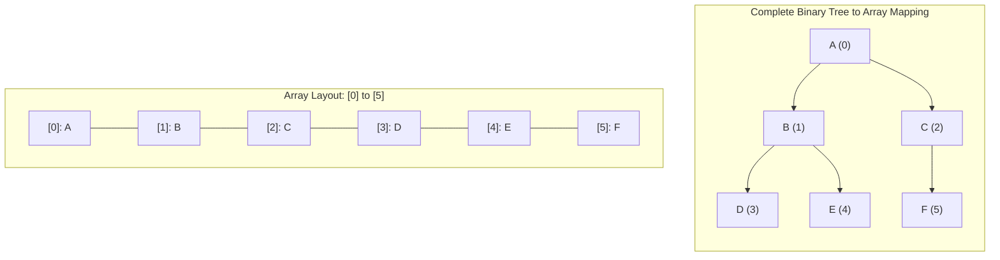
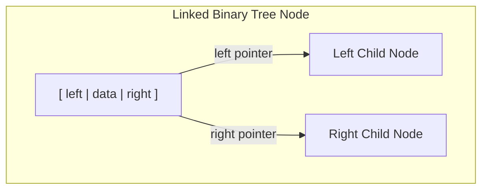

[DSA Index](../README.md) / [Unit 2: Circular Lists, Queues, and Trees](Introduction.md)

---

# Binary Trees - Properties and Representations

In the previous lecture, we laid down the foundational terminology of general trees. But in a general tree, a node can have an arbitrary number of children — one node might have two children, another five, and another none at all. This structural unpredictability makes general trees cumbersome to manipulate in memory.

What happens if we impose a simple, powerful constraint? 

What if we declare that **every node can have at most two children**?

The moment we introduce this constraint, we create the most extensively studied, versatile, and elegant data structure in computer science: the **Binary Tree**.

---

## What is a Binary Tree?

A **Binary Tree** is a hierarchical data structure defined recursively:
> A binary tree is a finite set of nodes that is either:
> 1. **Empty** (a null tree with zero nodes), or
> 2. Consists of a **root node** and two disjoint binary trees called the **left subtree** and the **right subtree**.



### The Critical Distinction: Ordered Subtrees
In a general tree, children are simply members of an unordered or ordered set. In a binary tree, **position matters fundamentally**:
- A node's two subtrees are explicitly designated as the **left child** and the **right child**.
- A tree with a root and only a left child is **topologically distinct** from a tree with a root and only a right child, even though both have identical degree!

---

## Classifications of Binary Trees

Not all binary trees have the same structural properties. Depending on how nodes are populated across levels, binary trees fall into five standard classifications:



### 1. Full (Strict / Proper) Binary Tree
A binary tree in which **every node has either 0 or 2 children**. No node has exactly 1 child.



### 2. Complete Binary Tree
A binary tree in which:
- Every level is completely filled, except possibly the last level.
- In the last level, all nodes are positioned **as far left as possible** without gaps.



Complete binary trees are essential because they map into contiguous arrays with zero wasted space, forming the foundation of **Binary Heaps**.

### 3. Perfect Binary Tree
A binary tree in which:
- All internal nodes have exactly two children.
- All leaf nodes are located at the **exact same level**.



A perfect binary tree of height $h$ is completely saturated with nodes: every available slot is occupied.

### 4. Balanced Binary Tree
A binary tree in which the height difference between the left and right subtrees of every node is **at most 1**:
$$|\text{Height}(\text{left}) - \text{Height}(\text{right})| \le 1$$

Balanced trees (such as AVL trees and Red-Black trees) guarantee $O(\log N)$ search, insertion, and deletion times.

### 5. Degenerate (Skewed) Binary Tree
A tree where every internal node has only one child. 
- If all children branch to the left, it is a **Left-Skewed Binary Tree**.
- If all children branch to the right, it is a **Right-Skewed Binary Tree**.



Notice something critical: a skewed binary tree is topologically identical to a **singly linked list**. It completely loses the hierarchical advantage of trees, and its operation complexities degrade from $O(\log N)$ down to $O(N)$.

---

## Mathematical Properties of Binary Trees

Binary trees possess exact mathematical invariants that dictate their capacity, height, and node distributions.

### Property 1: Maximum Nodes at Level $i$
> The maximum number of nodes at level $i$ (with root at level 0) is:
> $$\text{Max Nodes at Level } i = 2^i$$

- Level 0 (Root): $2^0 = 1$ node
- Level 1: $2^1 = 2$ nodes
- Level 2: $2^2 = 4$ nodes
- Level $i$: $2^i$ nodes

### Property 2: Maximum Total Nodes in Tree of Height $h$
> The maximum number of nodes in a binary tree of height $h$ is:
> $$N_{\text{max}} = 2^{h+1} - 1$$

**Proof:**
The maximum nodes occur in a Perfect Binary Tree, which is the sum of a geometric series across all levels from $0$ to $h$:
$$N_{\text{max}} = \sum_{i=0}^{h} 2^i = 2^0 + 2^1 + 2^2 + \dots + 2^h = \frac{2^{h+1} - 1}{2 - 1} = 2^{h+1} - 1$$

For example, a tree of height $h = 3$ can hold at most $2^{3+1} - 1 = 16 - 1 = 15$ nodes.

### Property 3: Minimum Height for $N$ Nodes
> The minimum possible height of a binary tree with $N$ nodes is:
> $$h_{\text{min}} = \lceil \log_2(N + 1) \rceil - 1 = \lfloor \log_2 N \rfloor$$

This minimum height is achieved when the tree is completely packed (a complete binary tree). This logarithmic height is why binary search trees achieve such blistering search performance.

Conversely, the **maximum possible height** of a binary tree with $N$ nodes occurs in a skewed tree:
$$h_{\text{max}} = N - 1$$

### Property 4: The Leaf vs. Degree-2 Invariant
> In any non-empty binary tree, if $n_0$ is the number of leaf nodes and $n_2$ is the number of nodes with degree 2, then:
> $$n_0 = n_2 + 1$$

This theorem states that **the number of leaf nodes is always exactly one greater than the number of nodes with two children**, regardless of how unbalanced the tree is!

**Proof:**
Let $N$ be the total number of nodes, and $E$ be the total number of edges.
1. Every node in a binary tree has degree 0, 1, or 2. Therefore:
   $$N = n_0 + n_1 + n_2$$
2. Recall from L07 that every tree with $N$ nodes has exactly $E = N - 1$ edges:
   $$E = N - 1 \implies N = E + 1$$
3. Each edge stems from a parent node. A node with degree 1 contributes 1 downward edge; a node with degree 2 contributes 2 downward edges; leaf nodes contribute 0. Therefore:
   $$E = 0 \cdot n_0 + 1 \cdot n_1 + 2 \cdot n_2 = n_1 + 2n_2$$
4. Substitute this expression for $E$ into equation (2):
   $$N = (n_1 + 2n_2) + 1$$
5. Now equate equation (1) and equation (4):
   $$n_0 + n_1 + n_2 = n_1 + 2n_2 + 1$$
6. Subtract $n_1$ and $n_2$ from both sides:
   $$n_0 = n_2 + 1$$

This proof is a favorite in university examinations and holds for every single binary tree in existence.

---

## Memory Representations of Binary Trees

There are two primary ways to represent a binary tree in computer memory:
1. **Contiguous Array (Sequential) Representation**
2. **Linked (Pointer-based) Representation**

---

## 1. Contiguous Array Representation

In an array representation, nodes are stored sequentially in a 1D array indexed from $0$ to $N - 1$. 

The parent-child relationships are calculated using mathematical index formulas:

For a node stored at index $i$:
- **Left Child Index:** $2i + 1$
- **Right Child Index:** $2i + 2$
- **Parent Index:** $\lfloor \frac{i - 1}{2} \rfloor$

*(Note: If using a 1-indexed array, the formulas simplify to: Left $= 2i$, Right $= 2i + 1$, Parent $= \lfloor i / 2 \rfloor$).*



Let's verify:
- Node B is at index $1$.
  - Its left child: $2(1) + 1 = 3 \implies$ Node D.
  - Its right child: $2(1) + 2 = 4 \implies$ Node E.
  - Its parent: $(1 - 1) / 2 = 0 \implies$ Node A.

### The Fatal Flaw of Array Representation for Skewed Trees
Array representation is exceptionally cache-friendly and space-efficient for **Complete Binary Trees**.

Now look at what happens if the tree is **Right-Skewed** of height $h = 4$:
- Root at index $0$
- Right child at index $2(0) + 2 = 2$
- Right child at index $2(2) + 2 = 6$
- Right child at index $2(6) + 2 = 14$
- Right child at index $2(14) + 2 = 30$

To store just 5 nodes, we must allocate an array of size 31! 
Slots $1, 3, 4, 5, 7, \dots, 29$ are completely empty. For an arbitrary tree of height $h$, the array requires $2^{h+1} - 1$ slots, leading to an **exponential waste of memory ($O(2^h)$)**.

---

## 2. Linked (Pointer-Based) Representation

To eliminate array fragmentation and dynamic size limits, binary trees are almost universally implemented in C using **doubly linked nodes**.

Each node contains three fields:
1. `data`: the stored payload.
2. `left`: pointer to the left child node (or `NULL`).
3. `right`: pointer to the right child node (or `NULL`).



### In C:
```c
#include <stdio.h>
#include <stdlib.h>

struct TreeNode {
    int data;
    struct TreeNode *left;
    struct TreeNode *right;
};

struct TreeNode* createNode(int value) {
    struct TreeNode *newNode = (struct TreeNode *)malloc(sizeof(struct TreeNode));
    if (newNode == NULL) {
        printf("Memory allocation failed!\n");
        return NULL;
    }
    newNode->data = value;
    newNode->left = NULL;
    newNode->right = NULL;
    return newNode;
}
```

### The $N + 1$ NULL Pointers Theorem
How many `NULL` pointers exist in a linked binary tree of $N$ nodes?

> In any binary tree with $N$ nodes, there are **exactly $N + 1$ NULL pointers**.

**Proof:**
- Each node has 2 pointers (`left` and `right`).
- For $N$ nodes, total pointers $= 2N$.
- Every non-root node has exactly 1 pointer pointing to it (the incoming edge from its parent).
- Since there are $N - 1$ edges, exactly $N - 1$ pointers are non-null.
- Therefore, the number of `NULL` pointers is:
  $$\text{NULL Pointers} = 2N - (N - 1) = N + 1$$

For example, a tree with 1,000 nodes contains exactly 1,001 `NULL` pointers. This insight is what inspired the invention of **Threaded Binary Trees**, where wasted `NULL` pointers are recycled to point to in-order predecessors and successors!

---

## Complete Working Program (Linked Binary Tree)

Here is a C program demonstrating node creation, manual tree construction, and basic recursive preorder printing:

```c
#include <stdio.h>
#include <stdlib.h>

struct TreeNode {
    int data;
    struct TreeNode *left;
    struct TreeNode *right;
};

struct TreeNode* createNode(int val) {
    struct TreeNode *newNode = (struct TreeNode *)malloc(sizeof(struct TreeNode));
    newNode->data = val;
    newNode->left = NULL;
    newNode->right = NULL;
    return newNode;
}

// Simple recursive traversal: Root -> Left -> Right
void printPreorder(struct TreeNode *root) {
    if (root == NULL) return;
    printf("%d ", root->data);
    printPreorder(root->left);
    printPreorder(root->right);
}

int main(void) {
    // Constructing a sample binary tree:
    //         1
    //       /   \
    //      2     3
    //     / \   /
    //    4   5 6

    struct TreeNode *root = createNode(1);
    root->left = createNode(2);
    root->right = createNode(3);

    root->left->left = createNode(4);
    root->left->right = createNode(5);

    root->right->left = createNode(6);

    printf("Preorder Traversal of constructed tree: ");
    printPreorder(root);
    printf("\n");

    return 0;
}
```

---

## Comparison: Array vs. Linked Representation

| Characteristic | Contiguous Array Representation | Linked Pointer Representation |
| :--- | :--- | :--- |
| **Direct Indexing** | $O(1)$ directly using arithmetic formulas | $O(N)$ traversal through pointers |
| **Space for Complete Trees** | Optimal (zero pointer overhead) | Extra memory for 2 pointers per node |
| **Space for Skewed Trees** | Catastrophic ($O(2^h)$ space, mostly empty) | Optimal ($O(N)$ space, exactly $N$ nodes) |
| **Dynamic Resizing** | Difficult (requires realloc and copying) | Effortless (dynamic malloc on demand) |
| **Cache Performance** | Outstanding (contiguous cache lines) | Moderate (pointer chasing in heap) |

---

## Key Takeaways

- A binary tree restricts every node to at most two ordered subtrees: left and right.
- In a full binary tree, every node has 0 or 2 children; in a complete binary tree, all levels are packed left-to-right; in a perfect binary tree, all leaves sit at the identical lowest level.
- Fundamental formulas: Max nodes at level $i = 2^i$; Max nodes in tree of height $h = 2^{h+1} - 1$; Leaf nodes $n_0 = n_2 + 1$.
- Array representation computes child indices as $2i + 1$ and $2i + 2$, excelling for complete trees but wasting exponential memory for skewed trees.
- A linked binary tree with $N$ nodes always has exactly $N + 1$ `NULL` pointers.

Now that we understand the structure and mathematical guarantees of binary trees, a profound architectural question arises: What if we are given an arbitrary general tree with nodes having 5, 8, or 20 children? Or what if we have a disconnected collection of multiple trees — a **Forest**? Can we convert any arbitrary forest into a standard binary tree without losing a single parent-child relationship? We answer this in [L09 - Forests and Conversion to Binary Trees](L09%20-%20Forests%20and%20Conversion%20to%20Binary%20Trees.md).
