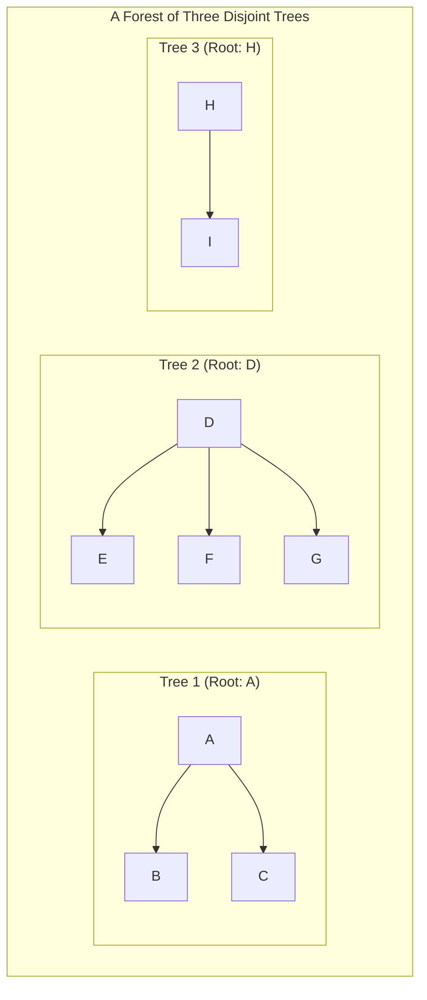
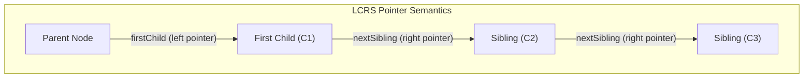
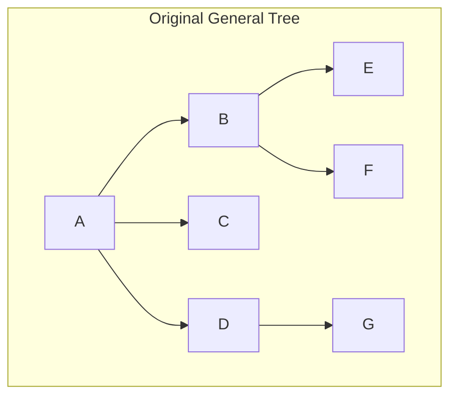
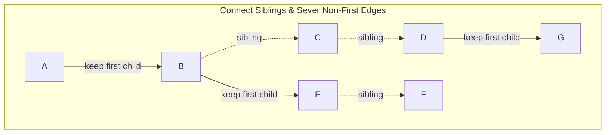
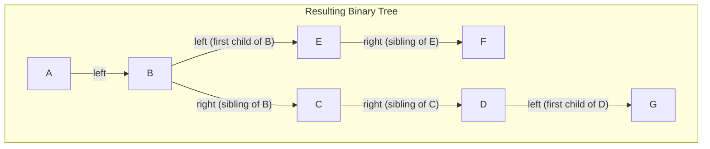
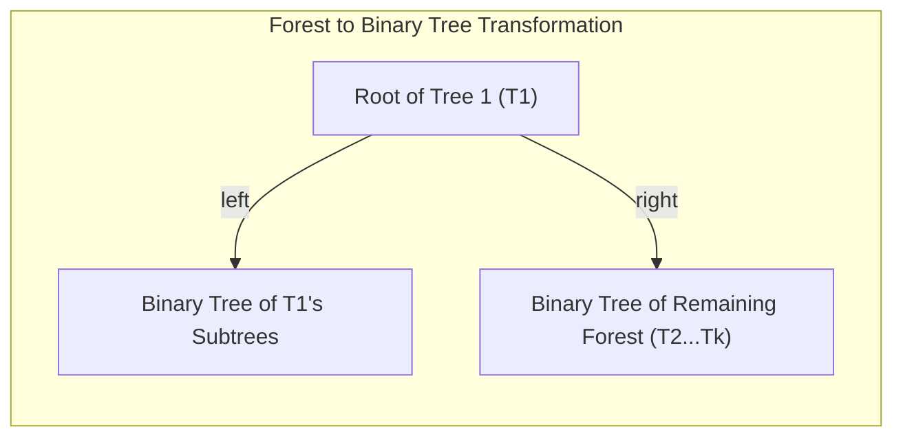
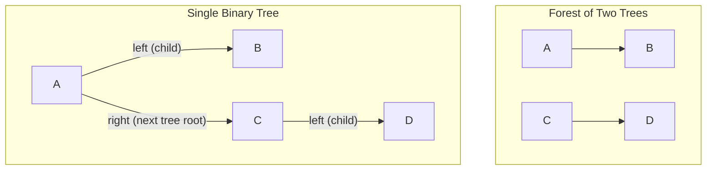

[DSA Index](../README.md) / [Unit 2: Circular Lists, Queues, and Trees](Introduction.md)

---

# Forests and Conversion to Binary Trees

In the previous lecture, we discovered the mathematical beauty and algorithmic efficiency of Binary Trees. Because every node has at most two children, we can write concise recursive algorithms and represent nodes using uniform structs.

Now think about real-world hierarchical data.

A company's organizational chart has a manager supervising ten team leads. An HTML document has a `<body>` containing twenty sibling tags. A file system directory has hundreds of files inside a single folder. These are **General Trees** (or **N-ary Trees**), where a node can branch into an arbitrary, unpredictable number of children.

If we attempt to represent general trees directly in C by allocating fixed arrays of child pointers, we waste massive amounts of memory. If we use dynamic pointer lists, our algorithms become convoluted.

Is there a way to convert **any arbitrary general tree** — or even a collection of multiple disconnected trees (a **Forest**) — into a standard **Binary Tree** without losing a single relationship?

Yes. The solution was formalized by Donald Knuth: the **Left-Child Right-Sibling (LCRS)** transformation.

---

## What is a Forest?

Before we examine the conversion algorithm, we must define the concept of a **Forest**:
> A **Forest** is an ordered set of zero or more disjoint trees.



Notice the intimate relationship between a Tree and a Forest:
- If you take any general tree and delete its root node, what remains is a **forest** composed of the subtrees of that root.
- Conversely, if you have a forest and create a new dummy root node that connects to the roots of each tree in the forest, the collection becomes a single **general tree**.

---

## The Left-Child Right-Sibling (LCRS) Representation

The genius of Knuth's transformation lies in reinterpreting what two pointers mean:

In a traditional binary tree:
- Pointer 1 = `left` (Left Child)
- Pointer 2 = `right` (Right Child)

In the **Left-Child Right-Sibling (LCRS)** representation:
- Pointer 1 = `firstChild` (points to the node's **leftmost child**)
- Pointer 2 = `nextSibling` (points to the node's **immediate right sibling** sharing the same parent)



Look at what this accomplishes:
- Even if a parent has 50 children, it only needs **one pointer** to reach them: a link to child #1.
- Child #1 points to Child #2 via its sibling pointer, Child #2 points to Child #3, and so on.
- Every node in the entire general tree requires **exactly two pointers**, regardless of how many children it has!

In C, the struct definition is identical to a binary tree node:
```c
struct LCRSNode {
    int data;
    struct LCRSNode *firstChild;  // Acts as binary tree's 'left'
    struct LCRSNode *nextSibling; // Acts as binary tree's 'right'
};
```

---

## Converting a General Tree to a Binary Tree

Let's convert a general tree into a binary tree step-by-step.

### The Transformation Algorithm
1. **Link Siblings:** For every node in the tree, draw a horizontal edge connecting all of its immediate children from left to right.
2. **Sever Redundant Child Links:** For every parent node, keep only the edge to its **first (leftmost) child**. Erase all downward edges to its other children.
3. **Rotate 45 Degrees Clockwise:** Tilt the entire diagram 45 degrees clockwise:
   - All remaining downward edges (first child) tilt to become **left children**.
   - All horizontal edges (siblings) tilt downward to become **right children**.

---

### Step-by-Step Visual Walkthrough

Consider this sample general tree:
- Root **A** has children **B**, **C**, and **D**.
- Node **B** has children **E** and **F**.
- Node **D** has child **G**.

#### Step 1: The Original General Tree



#### Step 2: Connect Siblings and Remove Non-First Child Edges



#### Step 3: The Resulting Binary Tree (Rotated)

Now, treat `firstChild` as `left` and `nextSibling` as `right`:



Let's verify the relationships in the binary tree:
- What is the left child of **A**? **B** (its first child).
- What is the right child of **A**? `NULL` (the root of a tree has no siblings).
- What is the right child of **B**? **C** (its sibling).
- What is the right child of **C**? **D** (its sibling).
- What is the left child of **B**? **E** (its first child).
- What is the right child of **E**? **F** (its sibling).
- What is the left child of **D**? **G** (its first child).

Every single hierarchical relationship has been preserved, yet the entire structure is now a valid binary tree!

---

## Converting a Forest to a Binary Tree

What if we have not just one tree, but a **Forest** $F = (T_1, T_2, \dots, T_k)$ of multiple trees?

The conversion algorithm generalizes recursively:
> Let $F = (T_1, T_2, \dots, T_k)$ be a forest of trees:
> 1. If $F$ is empty, the resulting binary tree is empty (`NULL`).
> 2. The root of the first tree $T_1$ becomes the **root of the binary tree**.
> 3. The **left subtree** of this root is the binary tree obtained by converting the subtrees of $T_1$.
> 4. The **right subtree** of this root is the binary tree obtained by converting the remaining forest $(T_2, T_3, \dots, T_k)$!



### Visual Example: Forest of Two Trees

Suppose we have two trees:
- Tree 1: Root **A** with child **B**.
- Tree 2: Root **C** with child **D**.



Notice the crucial difference:
- In the binary tree representation of a **single general tree**, the root **never has a right child** (because the root has no siblings).
- In the binary tree representation of a **forest**, the root **has a right child** if the forest contains more than one tree! The right child chain of the root enumerates the roots of all subsequent trees in the forest.

---

## Inverse Conversion: Binary Tree Back to General Tree / Forest

Can we reconstruct the original forest or general tree from a binary tree? 

Yes, the transformation is completely bijective (one-to-one and invertible):
1. For any node $v$, its `left` child is interpreted as its first child.
2. Traverse the `right` pointer chain starting from that `left` child: every node visited along this right chain is another child of $v$.
3. Repeat recursively for all nodes.

---

## C Implementation: LCRS Construction and Traversal

Here is a C program demonstrating how a multi-way general tree is constructed and traversed using LCRS binary pointers:

```c
#include <stdio.h>
#include <stdlib.h>

struct Node {
    char data;
    struct Node *firstChild;  // Equivalent to binary tree 'left'
    struct Node *nextSibling; // Equivalent to binary tree 'right'
};

struct Node* createNode(char data) {
    struct Node *newNode = (struct Node *)malloc(sizeof(struct Node));
    newNode->data = data;
    newNode->firstChild = NULL;
    newNode->nextSibling = NULL;
    return newNode;
}

// Appends a sibling to an existing child node
struct Node* addSibling(struct Node *node, char data) {
    if (node == NULL) return NULL;
    while (node->nextSibling != NULL) {
        node = node->nextSibling;
    }
    node->nextSibling = createNode(data);
    return node->nextSibling;
}

// Adds a child to a parent node
struct Node* addChild(struct Node *parent, char data) {
    if (parent == NULL) return NULL;
    if (parent->firstChild != NULL) {
        return addSibling(parent->firstChild, data);
    } else {
        parent->firstChild = createNode(data);
        return parent->firstChild;
    }
}

// Prints the general tree in indented hierarchical format
void printGeneralTree(struct Node *root, int depth) {
    if (root == NULL) return;

    for (int i = 0; i < depth; i++) printf("  ");
    printf("- %c\n", root->data);

    // Recurse on children (firstChild)
    printGeneralTree(root->firstChild, depth + 1);

    // Recurse on siblings (nextSibling) at same depth
    printGeneralTree(root->nextSibling, depth);
}

int main(void) {
    // Construct general tree:
    //       A
    //     / | \
    //    B  C  D
    //   / \    |
    //  E   F   G

    struct Node *root = createNode('A');
    struct Node *b = addChild(root, 'B');
    addChild(root, 'C');
    struct Node *d = addChild(root, 'D');

    addChild(b, 'E');
    addChild(b, 'F');

    addChild(d, 'G');

    printf("Hierarchical Representation of General Tree (stored via LCRS):\n");
    printGeneralTree(root, 0);

    return 0;
}
```

---

## Comparison: General Tree vs. LCRS Representation

| Feature | Direct General Tree (Fixed Child Array) | Left-Child Right-Sibling (Binary Representation) |
| :--- | :--- | :--- |
| **Pointers Per Node** | Fixed $K$ child pointers (e.g., $10$) | Strictly **2 pointers** (`firstChild`, `nextSibling`) |
| **Memory Utilization** | Catastrophic ($>80\%$ NULL pointers) | Optimal (each node uses exactly 2 pointers) |
| **Arbitrary Arity** | Restricted to maximum degree $K$ | Unbounded: any node can have unlimited children |
| **Algorithmic Uniformity** | Complex branching logic | Handled by standard binary tree traversals |

---

## Key Takeaways

- A Forest is an ordered set of zero or more disjoint trees; removing the root of any tree produces a forest of its subtrees.
- The Left-Child Right-Sibling (LCRS) representation encodes general multi-way trees using exactly two pointers per node: `firstChild` (left) and `nextSibling` (right).
- Converting a general tree to a binary tree involves linking siblings horizontally, severing non-first child links, and rotating 45 degrees clockwise.
- In the binary tree representation of a single tree, the root's right child is always `NULL`; in the binary tree of a forest, the root's right child chain links the roots of subsequent trees.
- The transformation is lossless and fully reversible.

---

## Unit 2 Summary and the Road Ahead

Across Unit 2, we broke out of rigid 1D sequences:
- We closed the ends of linked lists into continuous loops with **Circular Linked Lists**.
- We opened bidirectional navigation channels with **Doubly Linked Lists**.
- We built FIFO engines with **Linear Queues** and solved array drift with **Circular Queues**.
- We generalized queue operations with **Deques** and prioritized critical data with **Priority Queues**.
- We put queues to work in **Round Robin Scheduling** and the **Josephus Problem**.
- We stepped into the hierarchical realm with **Trees**, derived the mathematical invariants of **Binary Trees**, and converted general multi-way trees and **Forests** into binary forms.

Now that we possess the structures to represent trees in memory, how do we systematically visit every single node in a tree? How do we search, insert, and delete items with logarithmic efficiency? We step into advanced tree algorithms, depth-first traversals, AVL self-balancing trees, and priority heaps in [Unit 3: Advanced Trees and Heaps](../Unit%203/Introduction.md) and begin our study of tree algorithms in [L01 - Binary Tree Traversals](../Unit%203/L01%20-%20Binary%20Tree%20Traversals.md).
