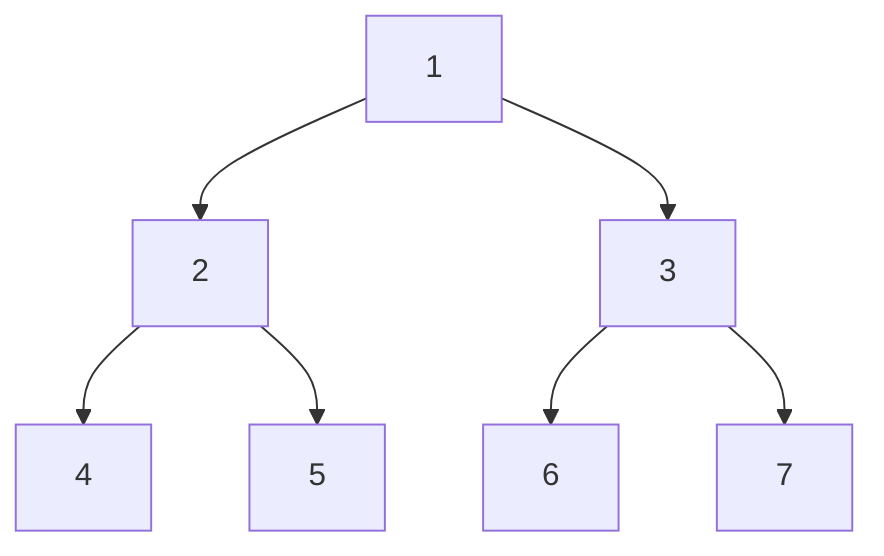
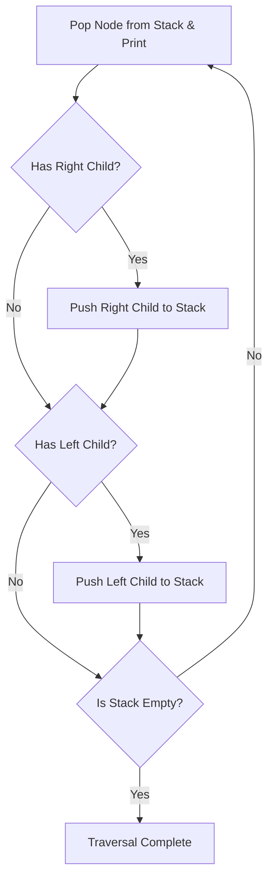
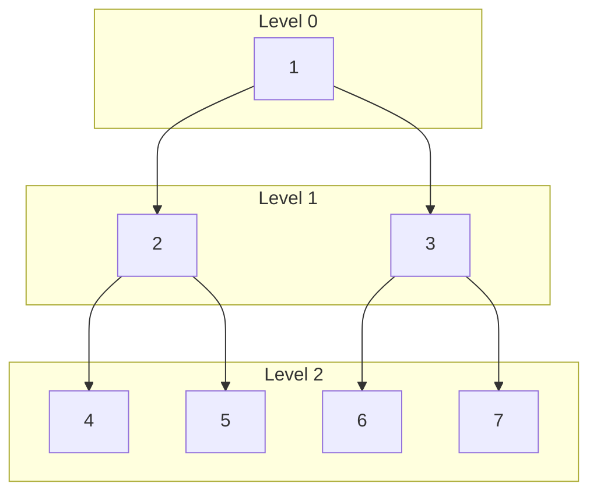

[DSA Index](../README.md) / [Unit 3: Advanced Trees and Heaps](Introduction.md)

# L01: Binary Tree Traversals

When we work with linear data structures like arrays or linked lists, visiting every single element is straightforward. We start at index zero or the head pointer and march forward until we hit the end. There is exactly one obvious successor for every node.

Trees shatter that linear simplicity. The moment a node branches into left and right subtrees, we have a problem: which direction do we explore first? And once we traverse down one branch, how do we find our way back to explore the other?

A traversal is nothing more than an algorithm that visits every node in a tree topology exactly once in a systematic, deterministic order. Because trees are non-linear, different traversal orders yield completely different sequences of values, each tailored to solve specific computational problems.

---

## The Tree Node and the Two Traversal Philosophies

In C, a binary tree node is represented as a self-referential structure holding data and two pointer fields:

```c
typedef struct TreeNode {
    int data;
    struct TreeNode *left;
    struct TreeNode *right;
} TreeNode;
```

All tree traversals fall into two broad computational philosophies:

1. **Depth-First Search (DFS)**: We plunge as deep as possible down one branch before backtracking to explore alternate branches. The DFS family comprises **Preorder**, **Inorder**, and **Postorder** traversals.
2. **Breadth-First Search (BFS)**: We explore the tree level by level, visiting all nodes at depth $d$ before touching any node at depth $d + 1$. This is known as **Level-Order** traversal.

Let's examine how each order behaves on a representative binary tree:



---

## Preorder Traversal: Visit, Dive Left, Dive Right

Preorder traversal follows the sequence: **Node (Root) $\to$ Left Subtree $\to$ Right Subtree**.

Think of Preorder as an executive briefing: the root introduces itself first before delegating attention to its subordinates. This order is ideal when copying or cloning a tree, or serializing a tree topology to disk, because encountering the parent before the children allows us to reconstruct the exact tree shape later.

For our example tree, the traversal order is: `1, 2, 4, 5, 3, 6, 7`.

### Recursive Implementation

The recursive implementation matches the mathematical definition directly. The call stack handles backtracking automatically:

```c
void preorderRecursive(TreeNode *root) {
    if (root == NULL) {
        return;
    }
    printf("%d ", root->data);          // Process Root
    preorderRecursive(root->left);     // Traverse Left Subtree
    preorderRecursive(root->right);    // Traverse Right Subtree
}
```

### Iterative Implementation Using an Explicit Stack

Now here's the thing: recursion is not magic. It relies on the operating system call stack. If our tree degenerates into a skewed chain of 100,000 nodes, recursive calls can blow past the stack memory limit and crash the process with a segmentation fault.

To make this production-safe, we simulate the call stack using our own heap-allocated LIFO stack. But notice something critical about stack ordering: because a stack is Last-In, First-Out, if we want to process the left child before the right child, we must push the right child onto the stack first!



```c
#include <stdio.h>
#include <stdlib.h>

#define MAX_STACK 100

typedef struct Stack {
    TreeNode *items[MAX_STACK];
    int top;
} Stack;

void initStack(Stack *s) {
    s->top = -1;
}

int isEmpty(Stack *s) {
    return s->top == -1;
}

void push(Stack *s, TreeNode *node) {
    if (s->top < MAX_STACK - 1) {
        s->items[++(s->top)] = node;
    }
}

TreeNode *pop(Stack *s) {
    if (!isEmpty(s)) {
        return s->items[(s->top)--];
    }
    return NULL;
}

void preorderIterative(TreeNode *root) {
    if (root == NULL) {
        return;
    }

    Stack s;
    initStack(&s);
    push(&s, root);

    while (!isEmpty(&s)) {
        TreeNode *curr = pop(&s);
        printf("%d ", curr->data);

        // Push right child first so left child is popped and processed first
        if (curr->right != NULL) {
            push(&s, curr->right);
        }
        if (curr->left != NULL) {
            push(&s, curr->left);
        }
    }
}
```

---

## Inorder Traversal: Left, Visit, Right

Inorder traversal follows the sequence: **Left Subtree $\to$ Node (Root) $\to$ Right Subtree**.

Notice what happens here: we refuse to process a node until everything to its left has been completely exhausted. If you project the nodes of a binary tree down onto a horizontal line, Inorder reads them from left to right. As we will discover in later lectures, executing an Inorder traversal on a Binary Search Tree (BST) prints the keys in strictly sorted ascending order.

For our example tree, the traversal order is: `4, 2, 5, 1, 6, 3, 7`.

### Recursive Implementation

```c
void inorderRecursive(TreeNode *root) {
    if (root == NULL) {
        return;
    }
    inorderRecursive(root->left);      // Traverse Left Subtree
    printf("%d ", root->data);          // Process Root
    inorderRecursive(root->right);     // Traverse Right Subtree
}
```

### Iterative Implementation Using an Explicit Stack

How do we simulate Inorder iteratively? We cannot simply push and pop nodes uniformly because a node must be visited after its left subtree returns, but before its right subtree begins.

The strategy is:
1. Start at the root and drill down left as far as possible, pushing every node along the path onto the stack.
2. When we hit `NULL`, we have reached the leftmost unprocessed node. We pop the stack, visit and print it.
3. Then, we shift our pointer to that node's right child and repeat the leftward drill.

```c
void inorderIterative(TreeNode *root) {
    Stack s;
    initStack(&s);
    TreeNode *curr = root;

    while (curr != NULL || !isEmpty(&s)) {
        // Drill left until we hit a NULL link
        while (curr != NULL) {
            push(&s, curr);
            curr = curr->left;
        }

        // curr is now NULL, pop the deepest left ancestor
        curr = pop(&s);
        printf("%d ", curr->data);

        // Transition to the right subtree
        curr = curr->right;
    }
}
```

Trace this carefully in your mind: when `curr` moves to `curr->right`, if that right child exists, the inner loop pushes it and immediately drills down its entire left chain. If `curr->right` is `NULL`, the inner loop is skipped, and the next outer iteration immediately pops the parent waiting on the stack. The stack frames handle our backtracking seamlessly.

---

## Postorder Traversal: Left, Right, Visit

Postorder traversal follows the sequence: **Left Subtree $\to$ Right Subtree $\to$ Node (Root)**.

Postorder represents pure bottom-up computation. A node is never visited until all its descendants have been fully evaluated. 

This makes Postorder mandatory for two essential operations:
1. **Deallocating / Freeing a Dynamic Tree**: If you free a parent node before freeing its children, you lose the pointers to those children and cause massive heap memory leaks. In Postorder, children are freed first, and the parent is freed last.
2. **Computing Bottom-Up Metrics**: Calculating the height or total node count of a tree requires knowing the height or count of both subtrees before combining them at the root.

For our example tree, the traversal order is: `4, 5, 2, 6, 7, 3, 1`.

### Recursive Implementation

```c
void postorderRecursive(TreeNode *root) {
    if (root == NULL) {
        return;
    }
    postorderRecursive(root->left);     // Traverse Left Subtree
    postorderRecursive(root->right);    // Traverse Right Subtree
    printf("%d ", root->data);          // Process Root
}
```

### Iterative Implementation: The Single-Stack Challenge

Iterative Postorder is notoriously tricky. When we pop a node from the stack, how do we know whether we are returning from its left child (in which case we must explore its right child before visiting the node) or returning from its right child (in which case both subtrees are done and we can safely visit it)?

One approach uses two stacks, but that wastes memory. A much cleaner single-stack approach maintains a `lastVisited` tracking pointer:

```c
TreeNode *peek(Stack *s) {
    if (!isEmpty(s)) {
        return s->items[s->top];
    }
    return NULL;
}

void postorderIterative(TreeNode *root) {
    Stack s;
    initStack(&s);
    TreeNode *curr = root;
    TreeNode *lastVisited = NULL;

    while (curr != NULL || !isEmpty(&s)) {
        if (curr != NULL) {
            push(&s, curr);
            curr = curr->left;
        } else {
            TreeNode *peekNode = peek(&s);
            // If right child exists and hasn't been visited yet, move right
            if (peekNode->right != NULL && lastVisited != peekNode->right) {
                curr = peekNode->right;
            } else {
                // Both subtrees have been processed; visit peekNode
                printf("%d ", peekNode->data);
                lastVisited = pop(&s);
            }
        }
    }
}
```

Notice the conditional check `lastVisited != peekNode->right`. When returning from the right branch, `lastVisited` matches `peekNode->right`, signaling that the right subtree has concluded. We immediately pop and print `peekNode` without falling into an infinite loop.

---

## Breadth-First Search: Level-Order Traversal

Now let's step away from depth-first paths and look across the tree horizontally.

Level-order traversal visits nodes level by level, starting from the root at Level 0, then all nodes at Level 1 from left to right, then Level 2, and so forth.

For our example tree, the level-order traversal is: `1, 2, 3, 4, 5, 6, 7`.

Can we use a stack for this? Absolutely not. Stacks reverse arrival orders (LIFO). To process nodes in the exact order they appear from left to right across levels, we must use a **Queue (FIFO: First-In, First-Out)**.



### Queue Mechanics for Level-Order

The algorithm unfolds systematically:
1. Enqueue the root pointer.
2. While the queue is not empty:
   - Dequeue the front node and print its value.
   - If its left child exists, enqueue it.
   - If its right child exists, enqueue it.

```c
#define MAX_QUEUE 100

typedef struct Queue {
    TreeNode *items[MAX_QUEUE];
    int front;
    int rear;
} Queue;

void initQueue(Queue *q) {
    q->front = 0;
    q->rear = 0;
}

int isQueueEmpty(Queue *q) {
    return q->front == q->rear;
}

void enqueue(Queue *q, TreeNode *node) {
    if ((q->rear + 1) % MAX_QUEUE != q->front) {
        q->items[q->rear] = node;
        q->rear = (q->rear + 1) % MAX_QUEUE;
    }
}

TreeNode *dequeue(Queue *q) {
    if (!isQueueEmpty(q)) {
        TreeNode *node = q->items[q->front];
        q->front = (q->front + 1) % MAX_QUEUE;
        return node;
    }
    return NULL;
}

void levelOrder(TreeNode *root) {
    if (root == NULL) {
        return;
    }

    Queue q;
    initQueue(&q);
    enqueue(&q, root);

    while (!isQueueEmpty(&q)) {
        TreeNode *curr = dequeue(&q);
        printf("%d ", curr->data);

        if (curr->left != NULL) {
            enqueue(&q, curr->left);
        }
        if (curr->right != NULL) {
            enqueue(&q, curr->right);
        }
    }
}
```

Every parent puts its children at the back of the line. Because parents were already sorted left to right, their children enter the queue in exact left-to-right order for the subsequent level.

---

## Complexity Analysis of Tree Traversals

Let $n$ denote the total number of nodes in the binary tree, and $h$ denote the height of the tree.

| Traversal Algorithm | Time Complexity | Auxiliary Space (Balanced Tree) | Auxiliary Space (Skewed Tree) | Primary Memory Driver |
| :--- | :--- | :--- | :--- | :--- |
| **Recursive Preorder** | $O(n)$ | $O(\log n)$ | $O(n)$ | Call stack frames ($h$) |
| **Iterative Preorder** | $O(n)$ | $O(\log n)$ | $O(n)$ | Explicit LIFO stack ($h$) |
| **Recursive Inorder** | $O(n)$ | $O(\log n)$ | $O(n)$ | Call stack frames ($h$) |
| **Iterative Inorder** | $O(n)$ | $O(\log n)$ | $O(n)$ | Explicit LIFO stack ($h$) |
| **Recursive Postorder** | $O(n)$ | $O(\log n)$ | $O(n)$ | Call stack frames ($h$) |
| **Iterative Postorder** | $O(n)$ | $O(\log n)$ | $O(n)$ | Explicit LIFO stack ($h$) |
| **Level-Order (BFS)** | $O(n)$ | $O(n)$ | $O(1)$ | FIFO Queue (max width $w \approx \lceil n/2 \rceil$) |

Notice an intriguing tradeoff: for depth-first traversals, a balanced tree is the best case for memory ($O(\log n)$ space), while a skewed tree is the worst case ($O(n)$ space). 

For level-order traversal, the situation flips! In a completely skewed tree, every level has only one node, so the queue never holds more than one element ($O(1)$ space). But in a balanced tree, the bottom level holds $\lceil n/2 \rceil$ leaves, meaning the queue expands to hold roughly half the entire tree at once ($O(n)$ space).

---

## Key Takeaways

- Binary tree traversals impose a deterministic linear sequence over non-linear hierarchical data.
- The three Depth-First traversals differ strictly in where the root is visited relative to its children: Preorder (`Root-L-R`), Inorder (`L-Root-R`), and Postorder (`L-R-Root`).
- Preorder is used for serialization and tree cloning; Inorder produces sorted order in BSTs; Postorder is essential for bottom-up node deletion and tree destruction.
- Iterative DFS requires an explicit LIFO stack to eliminate call-stack overflow vulnerabilities on deep trees.
- Level-Order traversal explores nodes horizontally across levels using a FIFO queue.
- Time complexity across all standard traversals is strictly $O(n)$ because every node must be visited at least once.

Now that we understand how systematic traversals can navigate arbitrary tree topologies, let's look at a concrete computational application of tree structures in compiler design. Move on to [L02 - Expression Trees](L02%20-%20Expression%20Trees.md) to explore how arithmetic expressions are represented, transformed, and evaluated as binary trees.
