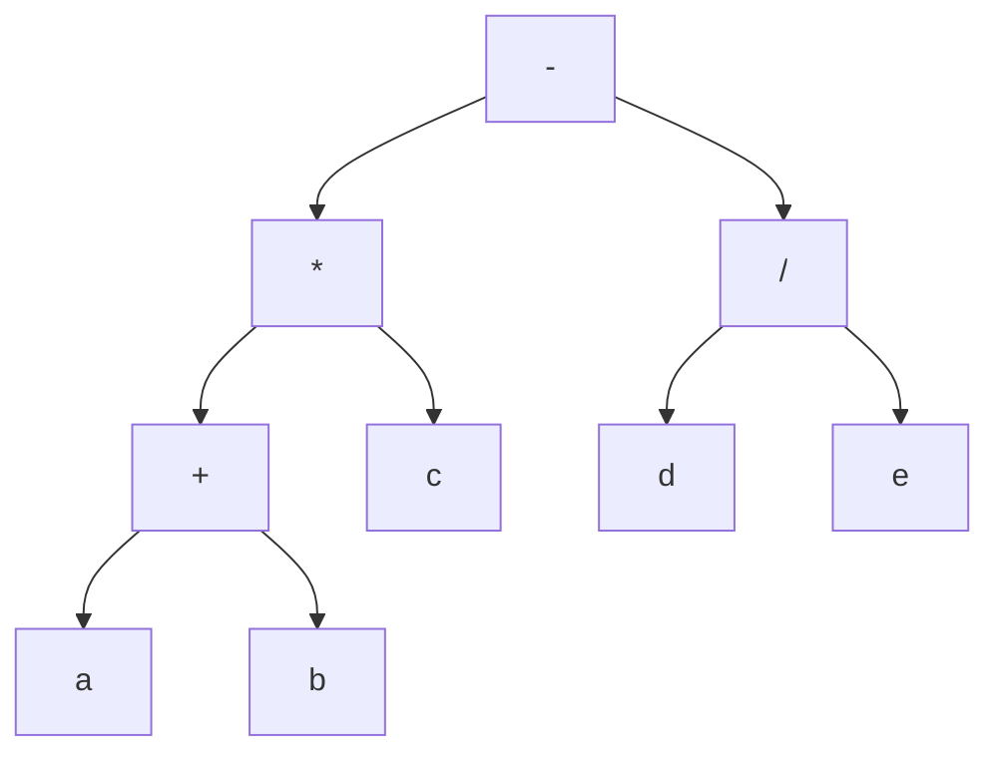
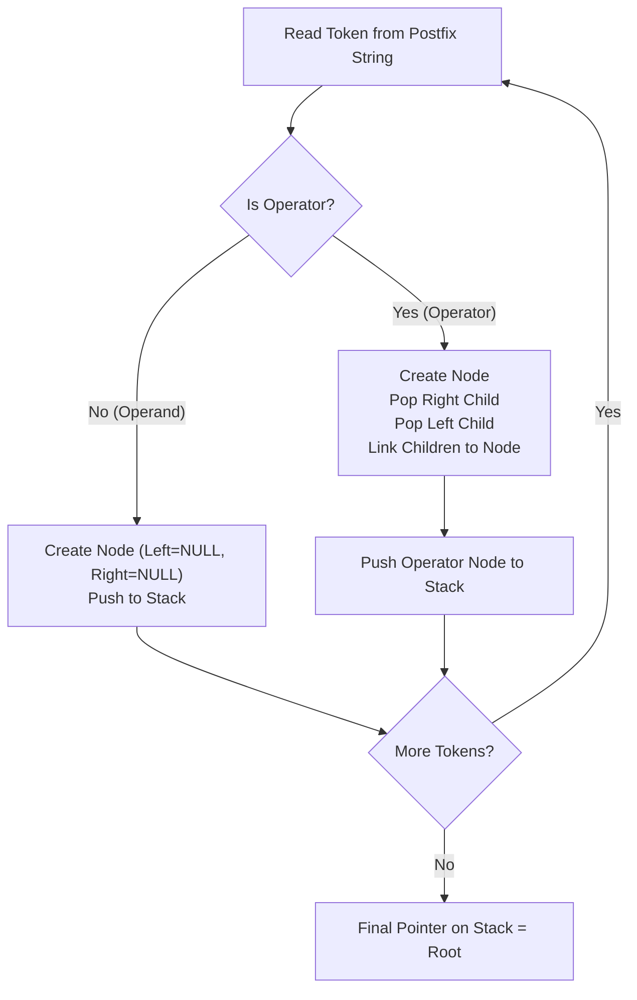
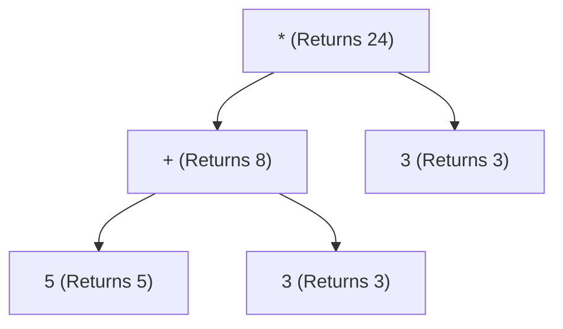

[DSA Index](../README.md) / [Unit 3: Advanced Trees and Heaps](Introduction.md)

# L02: Expression Trees

When we type a mathematical expression like `3 + 5 * 2`, our brain instantly resolves operator precedence: we know multiplication happens before addition, giving `13`, not `16`. But how does a compiler or an interpreter understand that?

To a computer, code begins as a flat sequence of characters. It has no innate concept of precedence, associativity, or parentheses. 

To evaluate or compile an expression, the language parser converts that flat string into a hierarchical syntax tree known as an **Expression Tree**. Once an expression is structured as a tree, all ambiguities vanish: tree topology itself dictates execution order without needing explicit parentheses.

---

## Architecture of an Expression Tree

An expression tree is a specific form of binary tree used to represent arithmetic, logical, or algebraic expressions.

It obeys two fundamental structural rules:
1. **Leaves are Operands**: Every leaf node (degree 0) holds a constant, a literal value, or a variable name (such as `a`, `b`, `5`, or `12`).
2. **Internal Nodes are Operators**: Every non-leaf node (internal node) holds an operator (such as `+`, `-`, `*`, `/`, or `^`).

Because standard arithmetic operators are binary (taking exactly two arguments: a left operand and a right operand), an expression tree for binary operations is a **strictly binary (full binary) tree**. Every internal node has exactly two children, and every leaf has zero children.



Take a look at the tree above. Notice how parentheses are completely unnecessary in the tree representation:
- The addition `a + b` is nested deep in the left subtree.
- Its result is multiplied by `c`.
- Independently, `d` is divided by `e` in the right subtree.
- Finally, the root operator `-` subtracts the right subtree's result from the left subtree's result.

The physical depth in the tree enforces execution timing: deeper operations must be computed first so their values can flow up as inputs to the operators above them.

---

## Traversal Equivalence: Infix, Prefix, and Postfix

The three depth-first traversals we explored in the previous lecture map directly to the three standard mathematical notations:

1. **Inorder Traversal $\to$ Infix Notation**:
   Visiting `Left -> Root -> Right` reconstructs the standard human-readable expression. However, an unparenthesized inorder traversal loses precedence information. For our tree, a naive inorder traversal yields `a + b * c - d / e`. To preserve mathematical meaning, we must output parentheses around each subexpression: `(((a + b) * c) - (d / e))`.

2. **Preorder Traversal $\to$ Prefix Notation (Polish Notation)**:
   Visiting `Root -> Left -> Right` outputs the operator before its operands: `- * + a b c / d e`. Prefix notation requires no parentheses whatsoever and can be evaluated unambiguously from right to left.

3. **Postorder Traversal $\to$ Postfix Notation (Reverse Polish Notation - RPN)**:
   Visiting `Left -> Right -> Root` outputs operands first, followed by their operator: `a b + c * d e / -`. Postfix notation is the computational gold standard for stack-based virtual machines (like the Java Virtual Machine bytecode engine) and pocket calculators because it can be evaluated sequentially in a single pass without backtracking.

---

## Constructing an Expression Tree from Postfix Notation

Compilers frequently convert human infix code into postfix notation (using Dijkstra's Shunting-Yard algorithm) and then build an expression tree from that postfix stream.

How do we build an expression tree from a postfix expression like `a b + c * d e / -`?

We use an auxiliary **Stack of Tree Node Pointers**. 

### The Construction Algorithm

We scan the postfix expression from left to right, one token at a time:

1. If the token is an **operand**:
   - Allocate a new tree node containing the operand.
   - Set both `left` and `right` pointers to `NULL`.
   - Push the node's pointer onto the stack.

2. If the token is an **operator**:
   - Allocate a new tree node containing the operator.
   - Pop the top pointer from the stack and assign it to the operator's **right child**.
   - Pop the next pointer from the stack and assign it to the operator's **left child**.
   - Push the new operator node's pointer back onto the stack.

3. When the postfix string is fully consumed, exactly one pointer remains on the stack: the **root** of the newly constructed expression tree.

Notice the order of popping: the **first** node popped becomes the **right** child, and the **second** node popped becomes the **left** child. Reversing this order corrupts non-commutative operations like subtraction and division!



### Complete C Implementation of Expression Tree Construction

```c
#include <stdio.h>
#include <stdlib.h>
#include <ctype.h>
#include <string.h>

typedef struct ExprNode {
    char data;
    struct ExprNode *left;
    struct ExprNode *right;
} ExprNode;

// Stack of Expression Node pointers
#define MAX_STACK 100

typedef struct Stack {
    ExprNode *items[MAX_STACK];
    int top;
} Stack;

void initStack(Stack *s) {
    s->top = -1;
}

int isStackEmpty(Stack *s) {
    return s->top == -1;
}

void push(Stack *s, ExprNode *node) {
    if (s->top < MAX_STACK - 1) {
        s->items[++(s->top)] = node;
    }
}

ExprNode *pop(Stack *s) {
    if (!isStackEmpty(s)) {
        return s->items[(s->top)--];
    }
    return NULL;
}

ExprNode *createNode(char val) {
    ExprNode *node = (ExprNode *)malloc(sizeof(ExprNode));
    if (!node) {
        fprintf(stderr, "Memory allocation error\n");
        exit(EXIT_FAILURE);
    }
    node->data = val;
    node->left = NULL;
    node->right = NULL;
    return node;
}

int isOperator(char ch) {
    return (ch == '+' || ch == '-' || ch == '*' || ch == '/' || ch == '^');
}

ExprNode *buildExpressionTree(const char *postfix) {
    Stack s;
    initStack(&s);

    for (int i = 0; postfix[i] != '\0'; i++) {
        char ch = postfix[i];

        // Skip whitespace
        if (ch == ' ' || ch == '\t') {
            continue;
        }

        if (!isOperator(ch)) {
            // Token is an operand: create leaf and push
            ExprNode *leaf = createNode(ch);
            push(&s, leaf);
        } else {
            // Token is an operator: pop two operands, link, and push
            ExprNode *opNode = createNode(ch);
            
            ExprNode *rightChild = pop(&s);
            ExprNode *leftChild = pop(&s);

            if (rightChild == NULL || leftChild == NULL) {
                fprintf(stderr, "Malformed postfix expression\n");
                return NULL;
            }

            opNode->right = rightChild;
            opNode->left = leftChild;

            push(&s, opNode);
        }
    }

    // The remaining node on the stack is the tree root
    return pop(&s);
}
```

---

## Reconstructing Fully Parenthesized Infix

If we take an expression tree and print an unadorned Inorder traversal, we risk generating ambiguous expressions. For example, $(a + b) \times c$ becomes $a + b \times c$, which alters the meaning entirely.

To reconstruct valid infix notation, we output an opening parenthesis `(` when entering an operator's left subtree and a closing parenthesis `)` after returning from its right subtree:

```c
void printParenthesizedInfix(ExprNode *root) {
    if (root == NULL) {
        return;
    }

    // If it's an operator, wrap its subtrees in parentheses
    int isOp = isOperator(root->data);
    if (isOp) {
        printf("(");
    }

    printParenthesizedInfix(root->left);
    printf(" %c ", root->data);
    printParenthesizedInfix(root->right);

    if (isOp) {
        printf(")");
    }
}
```

For our tree, this produces:
`(((a + b) * c) - (d / e))`

Every sub-operation is grouped without any ambiguity.

---

## Recursive Evaluation of an Expression Tree

Once the tree is built, evaluating it is elegant because evaluation is an inherently bottom-up process. 

Before we can compute an operator, we must know the numerical values of both its left and right subtrees. This is the exact definition of a **Postorder Traversal**:
1. Recursively evaluate the left child.
2. Recursively evaluate the right child.
3. Apply the operator at the current node to the two evaluated results.



Let's look at the evaluation function in C, assuming integer operands for demonstration:

```c
int evaluate(ExprNode *root) {
    // Base Case: Leaf node represents an operand
    if (root->left == NULL && root->right == NULL) {
        // If operand is stored as character digit '0'-'9', convert to integer
        if (isdigit(root->data)) {
            return root->data - '0';
        }
        return 0; // Default for non-digit variables
    }

    // Recursive step: Evaluate both subtrees
    int leftVal = evaluate(root->left);
    int rightVal = evaluate(root->right);

    // Apply the node's operator
    switch (root->data) {
        case '+': return leftVal + rightVal;
        case '-': return leftVal - rightVal;
        case '*': return leftVal * rightVal;
        case '/':
            if (rightVal == 0) {
                fprintf(stderr, "Division by zero error\n");
                exit(EXIT_FAILURE);
            }
            return leftVal / rightVal;
        default:
            fprintf(stderr, "Unsupported operator: %c\n", root->data);
            exit(EXIT_FAILURE);
    }
}
```

Notice how clean the code is: there are zero checks for operator precedence, zero stack manipulations, and zero parenthesis counters. All precedence and grouping logic is permanently frozen into the tree topology itself.

---

## Freeing the Expression Tree

Just as with any dynamically allocated binary tree, when we are finished with an expression tree, we must deallocate its memory using a postorder traversal:

```c
void freeTree(ExprNode *root) {
    if (root == NULL) {
        return;
    }
    freeTree(root->left);
    freeTree(root->right);
    free(root);
}
```

If we attempted to free `root` before `root->left` or `root->right`, dereferencing those child pointers would invoke undefined behavior, causing dangling pointer corruptions or memory leaks.

---

## Complexity Analysis of Expression Tree Operations

Let $N$ denote the number of characters/tokens in the expression string, which corresponds directly to $n$ nodes in the expression tree.

| Operation | Time Complexity | Auxiliary Space Complexity | Explanation |
| :--- | :--- | :--- | :--- |
| **Tree Construction from Postfix** | $O(N)$ | $O(N)$ | Single pass scan; stack holds at most $N$ node pointers. |
| **Tree Evaluation** | $O(n)$ | $O(h)$ | Visits every node once; call stack depth equals tree height $h$. |
| **Parenthesized Infix Generation** | $O(n)$ | $O(h)$ | Inorder recursion visiting each node once. |
| **Prefix / Postfix Generation** | $O(n)$ | $O(h)$ | Preorder / Postorder traversal visiting each node once. |
| **Tree Deallocation (`freeTree`)** | $O(n)$ | $O(h)$ | Postorder traversal visiting and freeing every heap block. |

In the worst case (a highly asymmetric expression like `a + b + c + d + e`), tree height $h = O(n)$, making recursion stack space $O(n)$. In a balanced expression tree, $h = O(\log n)$.

---

## Key Takeaways

- An expression tree translates linear character syntax into an unambiguous hierarchical model where depth dictates precedence.
- Leaves are always operands, and internal nodes are operators; for standard binary operators, the result is a strictly binary tree.
- Inorder traversal produces infix notation, preorder yields prefix (Polish notation), and postorder yields postfix (Reverse Polish notation).
- Constructing an expression tree from postfix notation requires a stack of node pointers, popping the right child first, then the left child.
- Evaluation is naturally postorder: subtrees evaluate bottom-up before the parent operator executes.

While expression trees illustrate the expressive power of pointer-linked branching, standard binary trees come with an underlying inefficiency: more than half of all pointer fields in any binary tree are completely unused and set to `NULL`. Let's move to [L03 - Threaded Binary Trees](L03%20-%20Threaded%20Binary%20Trees.md) to discover how these wasted `NULL` pointers can be repurposed into active traversal threads that eliminate stacks and recursion entirely.
