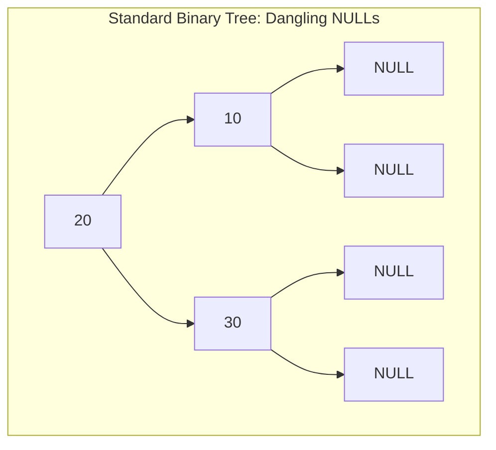
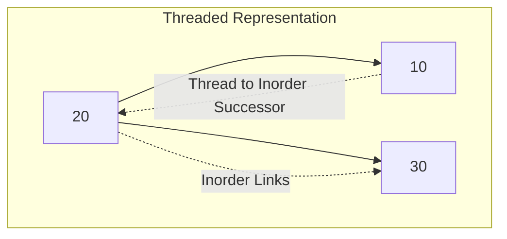
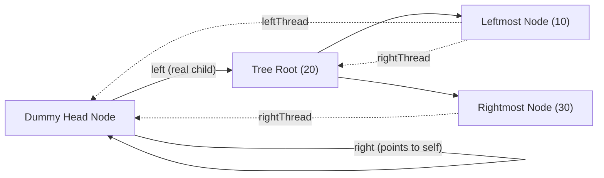
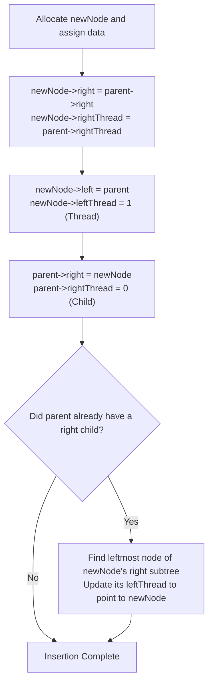

[DSA Index](../README.md) / [Unit 3: Advanced Trees and Heaps](Introduction.md)

# L03: Threaded Binary Trees

Take a moment to calculate the memory overhead of a standard binary tree.

Suppose we have a binary tree containing $n$ nodes. Every node contains two pointer fields: `left` and `right`. That means our tree contains exactly $2n$ pointer fields in memory.

Now, how many of those pointers actually point to valid child nodes?

Every node in a tree—except for the single root node—has exactly one incoming edge from its parent. That means there are exactly $n - 1$ edges in total, which occupy $n - 1$ pointers.

So how many pointers are left over, sitting completely empty as `NULL`?

$$\text{NULL Pointers} = 2n - (n - 1) = n + 1$$

In any binary tree of size $n$, more than half the pointers ($n + 1$ out of $2n$) are wasted storing `NULL`! If a tree has 10,000 nodes, 10,001 pointers do nothing except consume 80 kilobytes of 64-bit address space.

Even worse, when we traverse that tree using recursive or iterative algorithms, we are forced to allocate an external stack of size $O(h)$ just to remember how to backtrack to ancestor nodes.

In 1960, A. J. Perlis and C. Thornton asked a brilliant question: **What if we replace those wasted `NULL` pointers with active links that point directly to the node's traversal predecessor and successor?**

This is the foundational idea of the **Threaded Binary Tree**.

---

## The Concept of Threading

In a standard binary tree, leaf nodes and half-leaf nodes terminate with `NULL`. In a Threaded Binary Tree, we repurpose these dead-end pointers into "threads":
- If `left` is `NULL`, we turn it into a **thread** pointing to the node's **Inorder Predecessor** (the node that comes immediately before it in an inorder traversal).
- If `right` is `NULL`, we turn it into a **thread** pointing to the node's **Inorder Successor** (the node that comes immediately after it in an inorder traversal).





Notice the problem that immediately arises: if a pointer can be either a regular child pointer or a thread, how does our code tell them apart? Dereferencing a thread thinking it is a real child would send our traversal looping infinitely.

To resolve this ambiguity, we add two single-bit boolean flags (tags) to every node:

```c
typedef struct ThreadedNode {
    int data;
    struct ThreadedNode *left;
    struct ThreadedNode *right;
    int leftThread;   // 1 if left points to inorder predecessor, 0 if normal child
    int rightThread;  // 1 if right points to inorder successor, 0 if normal child
} ThreadedNode;
```

---

## Varieties of Threaded Trees

Threaded binary trees come in two primary variations depending on how many `NULL` pointers are reclaimed:

1. **Single-Threaded (Right-Threaded)**: Only the `NULL` right pointers are replaced with threads pointing to the inorder successor. This is the most common variant because it facilitates forward inorder traversal without needing stack memory.
2. **Double-Threaded (Fully Threaded)**: Both `NULL` left pointers and `NULL` right pointers are replaced with threads. Left threads point to inorder predecessors, and right threads point to inorder successors, enabling stack-free traversal both forward and backward.

---

## The Dummy Head Node Architecture

Think about this from the boundaries:
- The very first node in an inorder traversal (the leftmost node of the tree) has no inorder predecessor.
- The very last node in an inorder traversal (the rightmost node of the tree) has no inorder successor.

Where should their threads point? Leaving them as `NULL` breaks the elegance of our traversal loops by introducing special-case boundary checks.

The standard computer science solution is to introduce a **Dummy Head Node**:



The dummy head node operates under strict architectural rules:
- `head->left` is a normal child pointer (`leftThread == 0`) pointing to the actual root of the binary tree.
- `head->right` points directly to the dummy head node itself (`rightThread == 0`).
- The leftmost node's `leftThread` points back to `head`.
- The rightmost node's `rightThread` points back to `head`.
- If the tree is completely empty, `head->left = head` and `head->leftThread = 1`.

Because of this circular structure, our traversal starts from `head` and cleanly finishes when it loops back to `head`.

---

## Finding the Inorder Successor in $O(1)$ Time

The primary advantage of a right-threaded tree is that finding the inorder successor of any node requires zero recursion and zero stack memory.

Let's trace the logic for finding the successor of node `curr`:

1. **Case 1: `curr->rightThread == 1`**
   The right pointer is an explicit thread. We simply follow it:
   $$\text{Successor} = \text{curr}\to\text{right}$$
   This is an instantaneous $O(1)$ pointer jump!

2. **Case 2: `curr->rightThread == 0`**
   The right pointer is a normal child link pointing to a real right subtree. By definition, the inorder successor is the **leftmost node in that right subtree**.
   So, we step right once: `curr = curr->right`.
   Then, as long as `curr->leftThread == 0`, we keep stepping left: `curr = curr->left`.
   The node where `leftThread == 1` is our inorder successor!

```c
ThreadedNode *inorderSuccessor(ThreadedNode *curr) {
    // If it's a thread, jump directly
    if (curr->rightThread == 1) {
        return curr->right;
    }

    // Otherwise, find the leftmost child in the right subtree
    curr = curr->right;
    while (curr->leftThread == 0) {
        curr = curr->left;
    }
    return curr;
}
```

Notice something profound: no matter where we are in the tree, we never have to inspect parent pointers or pop an ancestor from a stack. The threads and left child pointers guide us directly to the successor.

---

## Stack-Free Inorder Traversal

With `inorderSuccessor` in place, traversing the entire tree in inorder requires nothing more than a simple `while` loop that runs in strictly $O(1)$ auxiliary space:

```c
void threadedInorder(ThreadedNode *head) {
    ThreadedNode *curr = head->left; // Start at root

    // If tree is empty
    if (curr == head) {
        return;
    }

    // 1. Navigate to the first inorder node (the leftmost node of the tree)
    while (curr->leftThread == 0) {
        curr = curr->left;
    }

    // 2. Continually find and visit the inorder successor until returning to head
    while (curr != head) {
        printf("%d ", curr->data);
        curr = inorderSuccessor(curr);
    }
    printf("\n");
}
```

Look at that loop: there is no recursion stack. There is no dynamically allocated stack array. The memory footprint of the traversal algorithm itself is absolute zero auxiliary space ($O(1)$).

---

## Inserting a Node into a Threaded Binary Tree

Now, what is the cost of this stack-free traversal? The cost comes during insertion and deletion.

In an ordinary binary tree, inserting a leaf is trivial: find the parent and assign `parent->left = new_node`. But in a threaded tree, when a new node is inserted, we must carefully wire its threads to preserve the inorder chain.

Let's examine inserting `newNode` as the **right child** of an existing node `parent`:



### Complete C Code for Right-Child Insertion

```c
#include <stdio.h>
#include <stdlib.h>

ThreadedNode *createThreadedNode(int key) {
    ThreadedNode *node = (ThreadedNode *)malloc(sizeof(ThreadedNode));
    node->data = key;
    node->left = NULL;
    node->right = NULL;
    node->leftThread = 1;
    node->rightThread = 1;
    return node;
}

void insertRight(ThreadedNode *parent, int key) {
    ThreadedNode *newNode = createThreadedNode(key);

    // 1. Inherit the parent's right pointer and thread status
    newNode->right = parent->right;
    newNode->rightThread = parent->rightThread;

    // 2. The new node's left predecessor is the parent
    newNode->left = parent;
    newNode->leftThread = 1;

    // 3. Parent's right now points to the new child
    parent->right = newNode;
    parent->rightThread = 0;

    // 4. If newNode now has a right subtree (meaning parent originally had a child),
    // the leftmost node of that right subtree must now point its leftThread to newNode
    if (newNode->rightThread == 0) {
        ThreadedNode *temp = newNode->right;
        while (temp->leftThread == 0) {
            temp = temp->left;
        }
        temp->left = newNode;
    }
}

void insertLeft(ThreadedNode *parent, int key) {
    ThreadedNode *newNode = createThreadedNode(key);

    // 1. Inherit parent's left pointer and thread status
    newNode->left = parent->left;
    newNode->leftThread = parent->leftThread;

    // 2. The new node's right successor is the parent
    newNode->right = parent;
    newNode->rightThread = 1;

    // 3. Parent's left now points to the new child
    parent->left = newNode;
    parent->leftThread = 0;

    // 4. If newNode now has a left subtree,
    // the rightmost node of that left subtree must point its rightThread to newNode
    if (newNode->leftThread == 0) {
        ThreadedNode *temp = newNode->left;
        while (temp->rightThread == 0) {
            temp = temp->right;
        }
        temp->right = newNode;
    }
}
```

The pointer updates require surgical precision: if you assign `parent->right = newNode` before capturing `parent->right` into `newNode->right`, the chain is severed and the tree's threads become corrupted.

---

## Complexity and Engineering Trade-Offs

| Operation | Standard Binary Tree | Threaded Binary Tree | Advantage of Threading |
| :--- | :--- | :--- | :--- |
| **Inorder Traversal Time** | $O(n)$ | $O(n)$ | Equal asymptotic time, but threaded has lower constant factors. |
| **Traversal Auxiliary Space** | $O(h)$ (Stack memory) | $O(1)$ (Strictly constant) | **Major win**: Zero stack overflow risk. |
| **Find Inorder Successor** | $O(h)$ worst-case | $O(1)$ if threaded, $O(h)$ otherwise | Immediate jump when `rightThread == 1`. |
| **Node Insertion Time** | $O(1)$ (given parent) | $O(1)$ or $O(h)$ (to rewire threads) | Standard tree is simpler. |
| **Structural Complexity** | Simple pointer links | Requires 2 tag flags and re-threading logic | Standard tree is easier to maintain. |
| **Memory per Node** | $2 \text{ pointers} + \text{data}$ | $2 \text{ pointers} + \text{data} + 2 \text{ bits}$ | Tag bits can often be packed into unused pointer alignment bits. |

### Where Are Threaded Trees Actually Used?

Threaded trees shine in environments where stack space is strictly constrained or completely forbidden:
- **Embedded Systems & Microcontrollers**: Automotive ECUs and medical devices where recursion can cause catastrophic stack crashes.
- **Garbage Collection Routines**: Low-level memory managers that must traverse heap object trees during low-memory conditions when allocating stack frames is impossible.

---

## Key Takeaways

- In any binary tree of $n$ nodes, exactly $n + 1$ pointer fields hold `NULL`.
- Threaded binary trees reclaim these wasted pointers: left `NULL` pointers point to inorder predecessors, and right `NULL` pointers point to inorder successors.
- Two boolean tag flags (`leftThread`, `rightThread`) distinguish real child links from threads.
- A dummy head node eliminates edge-case boundary checks for the leftmost and rightmost nodes.
- Inorder traversal on a threaded tree runs in $O(n)$ time with strictly $O(1)$ auxiliary space—eliminating all recursive call stacks and explicit stacks.
- The tradeoff is increased insertion and deletion overhead to maintain thread pointers.

While threaded trees optimize memory efficiency and traversal mechanics, they do not solve the fundamental problem of fast searching. In an arbitrary binary tree, finding a specific value still requires checking every node ($O(n)$). Let's move to [L04 - Binary Search Trees - Insertion and Search](L04%20-%20Binary%20Search%20Trees%20-%20Insertion%20and%20Search.md) to explore how establishing a strict spatial ordering enables logarithmic-time searches.
