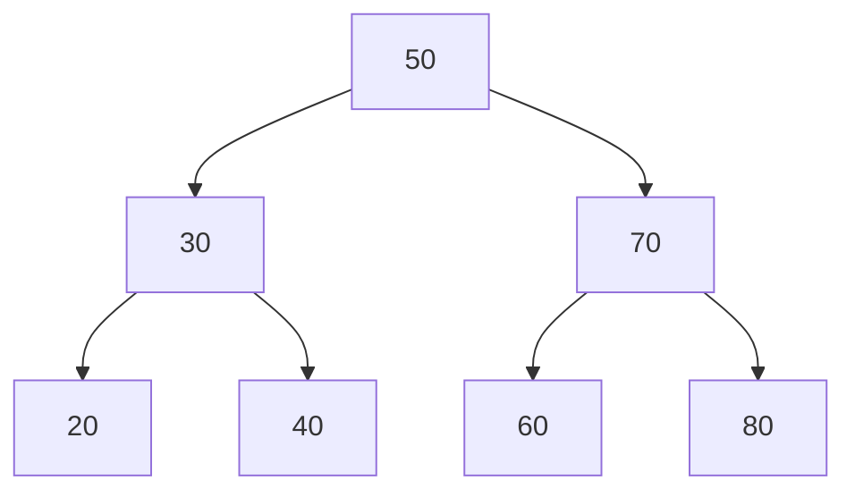
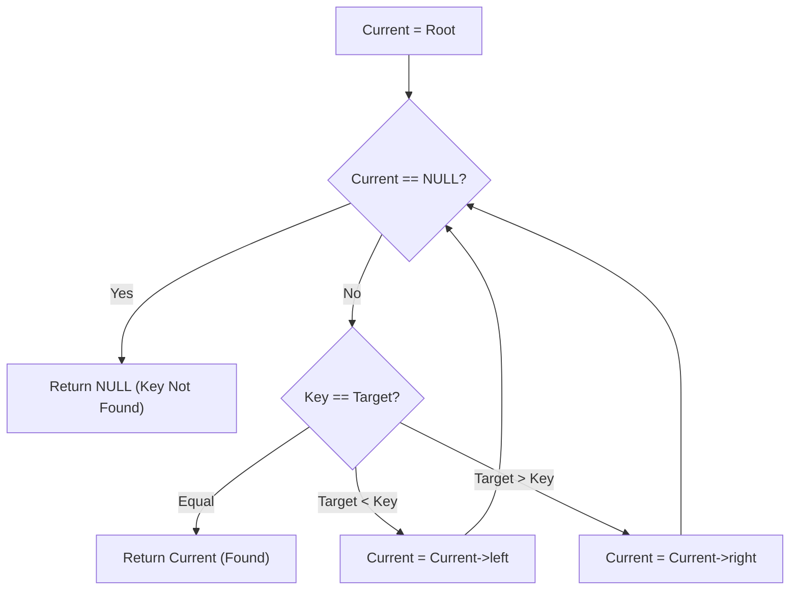
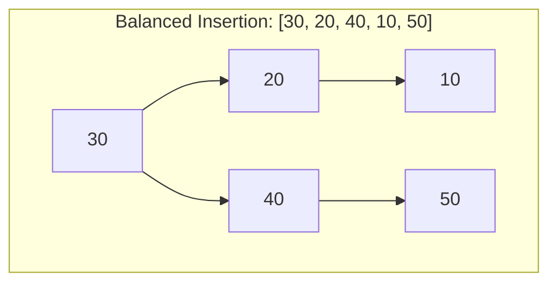
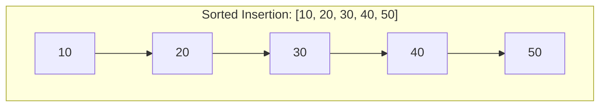

[DSA Index](../README.md) / [Unit 3: Advanced Trees and Heaps](Introduction.md)

# L04: Binary Search Trees - Insertion and Search

Consider the fundamental tradeoff in computer science between search speed and insertion flexibility.

If we store data in an unsorted linked list, inserting a new element is instantaneous ($O(1)$ by pushing to the head), but finding an element forces a sequential scan through every single node ($O(n)$).

If we store data in a sorted array, we can use binary search to locate any element in lightning-fast $O(\log n)$ time. But the moment we want to insert a new value into that sorted array, we hit a wall: we must shift every subsequent element to the right, incurring an expensive $O(n)$ data movement penalty.

Can we get the best of both worlds? Can we maintain a dynamic structure that enables $O(\log n)$ search without paying $O(n)$ shifting costs during insertions?

This is precisely what the **Binary Search Tree (BST)** achieves.

---

## The Binary Search Tree Invariant

A Binary Search Tree is a binary tree that enforces a strict spatial ordering invariant across all its nodes.

For any given node $X$ in the tree:
1. Every key in the **left subtree** of $X$ must be strictly less than the key of $X$:
   $$\forall Y \in \text{LeftSubtree}(X), \quad \text{key}(Y) < \text{key}(X)$$
2. Every key in the **right subtree** of $X$ must be strictly greater than the key of $X$:
   $$\forall Z \in \text{RightSubtree}(X), \quad \text{key}(Z) > \text{key}(X)$$
3. Both the left and right subtrees must themselves be binary search trees.



Look at node `50`. It does not simply require that its immediate left child `30` is smaller. Every single node in that entire left branch (`20, 30, 40`) must be smaller than `50`. Similarly, every single node in the right branch (`60, 70, 80`) must be larger than `50`.

### The Inorder Invariant Property

Notice an immediate mathematical consequence: if you perform an **Inorder Traversal** (`Left -> Root -> Right`) on a Binary Search Tree, you visit elements in strictly ascending sorted order:

$$20 \to 30 \to 40 \to 50 \to 60 \to 70 \to 80$$

If an inorder traversal ever produces an out-of-order element, the tree has violated the BST invariant and is structurally corrupt.

---

## Searching in a BST

Searching in a BST is the tree equivalent of binary search. At each node, a single comparison eliminates an entire subtree from consideration.

To search for a target key `val`:
1. If the current node is `NULL`, the target does not exist in the tree (search miss).
2. If `val == curr->key`, the target is found (search hit).
3. If `val < curr->key`, the target—if it exists—must reside in the left subtree. We branch left.
4. If `val > curr->key`, the target must reside in the right subtree. We branch right.



### Recursive vs. Iterative Search Implementation

While recursive search is conceptually clean, an iterative search is far superior in production C code. Iterative search uses strictly $O(1)$ auxiliary space, eliminates function call overhead, and avoids stack overflow on deep trees:

```c
#include <stdio.h>
#include <stdlib.h>

typedef struct BSTNode {
    int key;
    struct BSTNode *left;
    struct BSTNode *right;
} BSTNode;

// Recursive Search: O(h) auxiliary stack space
BSTNode *searchRecursive(BSTNode *root, int target) {
    if (root == NULL || root->key == target) {
        return root;
    }
    if (target < root->key) {
        return searchRecursive(root->left, target);
    }
    return searchRecursive(root->right, target);
}

// Iterative Search: O(1) auxiliary space
BSTNode *searchIterative(BSTNode *root, int target) {
    BSTNode *curr = root;
    while (curr != NULL) {
        if (target == curr->key) {
            return curr; // Found
        } else if (target < curr->key) {
            curr = curr->left;
        } else {
            curr = curr->right;
        }
    }
    return NULL; // Not found
}
```

---

## Finding Minimum and Maximum Elements

Because of the BST ordering invariant, finding the absolute minimum and maximum values requires zero searching across arbitrary branches:

- **Minimum Key**: Start at the root and continuously follow `left` pointers until `curr->left == NULL`. The leftmost node is guaranteed to hold the smallest value.
- **Maximum Key**: Start at the root and continuously follow `right` pointers until `curr->right == NULL`. The rightmost node is guaranteed to hold the largest value.

```c
BSTNode *findMin(BSTNode *root) {
    if (root == NULL) {
        return NULL;
    }
    BSTNode *curr = root;
    while (curr->left != NULL) {
        curr = curr->left;
    }
    return curr;
}

BSTNode *findMax(BSTNode *root) {
    if (root == NULL) {
        return NULL;
    }
    BSTNode *curr = root;
    while (curr->right != NULL) {
        curr = curr->right;
    }
    return curr;
}
```

Both operations take $O(h)$ time, where $h$ is the height of the tree.

---

## Insertion into a BST

In an ordinary binary tree, you can place a new node anywhere. In a BST, the destination of a new key is uniquely predetermined by the ordering invariant.

A fundamental property of BST insertion is that **new nodes are always inserted as leaf nodes**.

### The Insertion Algorithm

1. If the tree is empty (`root == NULL`), allocate a new node and return it as the new root.
2. If `newKey < curr->key`, recursively or iteratively descend into the left subtree.
3. If `newKey > curr->key`, descend into the right subtree.
4. If `newKey == curr->key`, the key already exists (duplicate). In standard BSTs, duplicates are ignored or handled via a node counter.
5. When a `NULL` pointer is encountered, attach the new node at that position.

```c
BSTNode *createBSTNode(int key) {
    BSTNode *node = (BSTNode *)malloc(sizeof(BSTNode));
    node->key = key;
    node->left = NULL;
    node->right = NULL;
    return node;
}

// Recursive Insertion
BSTNode *insertRecursive(BSTNode *root, int key) {
    if (root == NULL) {
        return createBSTNode(key);
    }

    if (key < root->key) {
        root->left = insertRecursive(root->left, key);
    } else if (key > root->key) {
        root->right = insertRecursive(root->right, key);
    }
    // If key == root->key, duplicate is ignored

    return root;
}

// Iterative Insertion
BSTNode *insertIterative(BSTNode *root, int key) {
    BSTNode *newNode = createBSTNode(key);
    if (root == NULL) {
        return newNode;
    }

    BSTNode *curr = root;
    BSTNode *parent = NULL;

    while (curr != NULL) {
        parent = curr;
        if (key < curr->key) {
            curr = curr->left;
        } else if (key > curr->key) {
            curr = curr->right;
        } else {
            // Duplicate key: free allocated node and return unchanged root
            free(newNode);
            return root;
        }
    }

    // Attach newNode to the appropriate pointer of parent
    if (key < parent->key) {
        parent->left = newNode;
    } else {
        parent->right = newNode;
    }

    return root;
}
```

Notice the pointer assignment in the recursive version: `root->left = insertRecursive(...)`. This pattern updates the link when reaching the leaf level while leaving existing ancestor links untouched as the recursion unwinds.

---

## Finding Inorder Successor and Predecessor

Finding the predecessor (the value immediately before) or successor (the value immediately after) of a given node is critical for range queries and BST node deletion.

### Finding the Inorder Successor

To find the inorder successor of a node $P$:

1. **Case 1: $P$ has a right subtree**
   If $P$ has a right subtree, its successor is simply the **minimum node in that right subtree**:
   $$\text{Successor} = \text{findMin}(P\to\text{right})$$

2. **Case 2: $P$ has no right subtree**
   If $P$ has no right subtree, its successor lies higher up in the tree. We start from the root and walk down toward $P$:
   - Whenever we branch left, the current ancestor could be the successor (it is greater than $P$). We record this ancestor.
   - Whenever we branch right, the current ancestor is smaller than $P$, so it cannot be the successor.
   - When we arrive at $P$, the last recorded ancestor that caused us to branch left is the inorder successor!

```c
BSTNode *getInorderSuccessor(BSTNode *root, BSTNode *target) {
    if (target == NULL) {
        return NULL;
    }

    // Case 1: Target has right subtree
    if (target->right != NULL) {
        return findMin(target->right);
    }

    // Case 2: Target has no right subtree
    BSTNode *successor = NULL;
    BSTNode *curr = root;

    while (curr != NULL) {
        if (target->key < curr->key) {
            successor = curr;   // Possible successor; take note and go left
            curr = curr->left;
        } else if (target->key > curr->key) {
            curr = curr->right; // Target is in right subtree, continue searching
        } else {
            break; // Reached target node
        }
    }

    return successor;
}
```

---

## The Degeneration Problem: Skewed BSTs

Now we come to the Achilles' heel of the standard Binary Search Tree.

What is the time complexity of searching or inserting in a BST? We often say $O(\log n)$, but that is only true if the tree remains reasonably balanced!

Suppose we insert the keys `[10, 20, 30, 40, 50]` in ascending order into an initially empty BST:





Look at what happened. Because every new key is strictly greater than the previous one, every single node is attached as a right child. The tree degenerates into a linear singly linked list!

- In the balanced tree, height $h = \lfloor \log_2 n \rfloor = 2$. Searching takes at most 3 comparisons.
- In the skewed tree, height $h = n = 5$. Searching for `50` requires 5 comparisons.

In general, for $n$ sorted keys:
$$\text{Height } h = n \implies \text{Search Time} = O(n)$$

The brilliant $O(\log n)$ performance of binary search collapses back into the sluggish $O(n)$ performance of a linked list. The performance of a basic BST is entirely at the mercy of the input data order.

---

## Complexity Analysis of BST Operations

| Operation | Best Case ($h = \log n$) | Average Case ($h \approx 1.39 \log n$) | Worst Case (Skewed: $h = n$) | Auxiliary Space (Iterative) |
| :--- | :--- | :--- | :--- | :--- |
| **Search** | $O(\log n)$ | $O(\log n)$ | $O(n)$ | $O(1)$ |
| **Insert** | $O(\log n)$ | $O(\log n)$ | $O(n)$ | $O(1)$ |
| **Find Min / Max** | $O(\log n)$ | $O(\log n)$ | $O(n)$ | $O(1)$ |
| **Inorder Successor** | $O(\log n)$ | $O(\log n)$ | $O(n)$ | $O(1)$ |
| **Inorder Traversal** | $O(n)$ | $O(n)$ | $O(n)$ | $O(h)$ |

Every primary operation in a Binary Search Tree is bounded by the height of the tree: $O(h)$.

---

## Key Takeaways

- A Binary Search Tree enforces the spatial invariant: $\text{Left Subtree} < \text{Root} < \text{Right Subtree}$.
- An Inorder traversal of a BST visits keys in strictly ascending sorted order.
- Searching and insertion both eliminate half the remaining search space at each step in a balanced tree.
- New keys are always inserted as leaf nodes.
- Finding the inorder successor requires checking the minimum of the right subtree, or tracking the lowest ancestor where a left turn occurred.
- The fundamental flaw of a standard BST is height degeneration: sorted or nearly-sorted inputs produce a skewed tree of height $h = n$, degrading performance to $O(n)$.

Now that we have mastered searching and inserting into a BST, what happens when we need to remove a key? While insertion is relatively simple, deletion introduces multiple structural edge cases depending on the number of children the target node possesses. Let's explore the three distinct cases in [L05 - Binary Search Trees - Deletion](L05%20-%20Binary%20Search%20Trees%20-%20Deletion.md).
