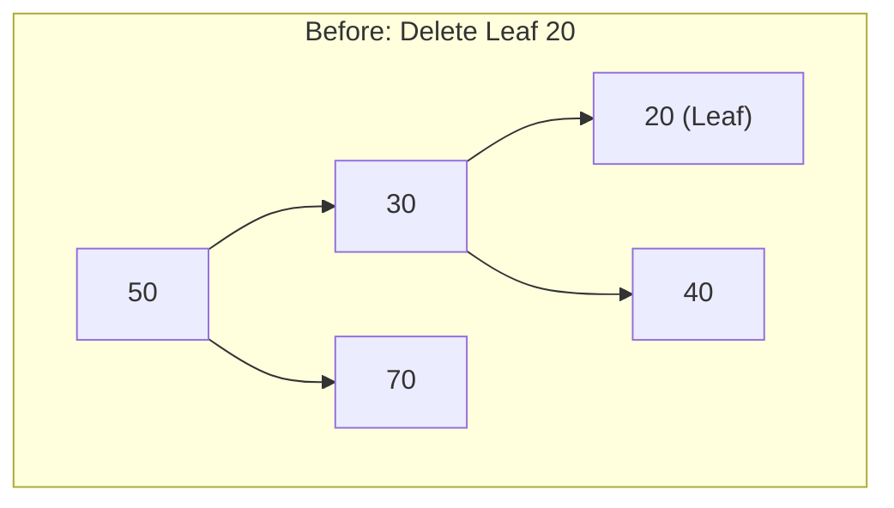
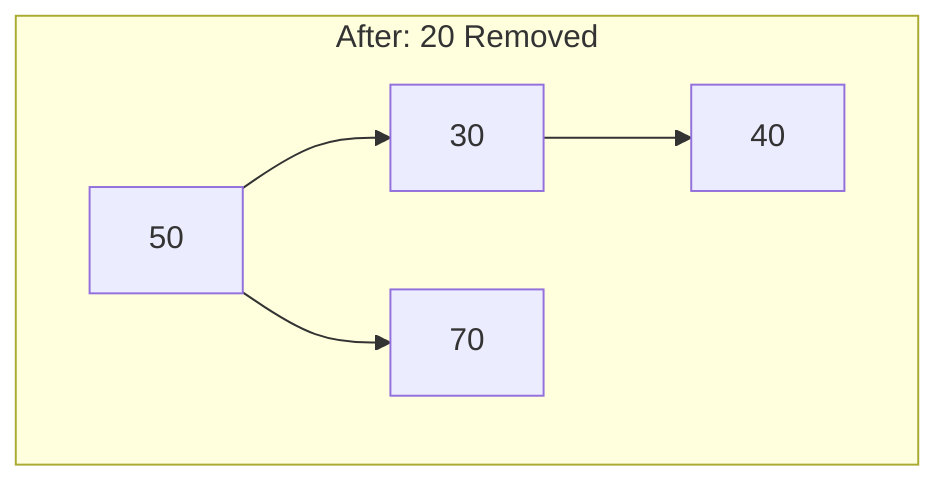
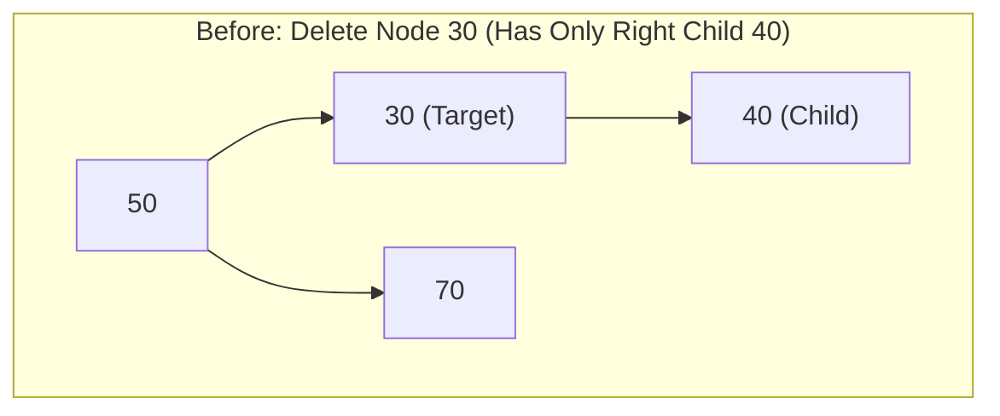
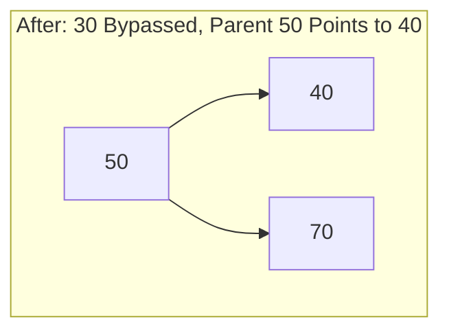
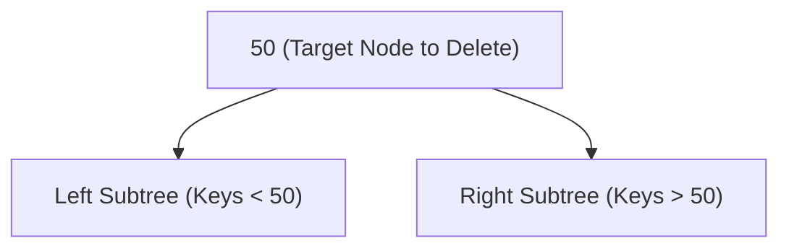
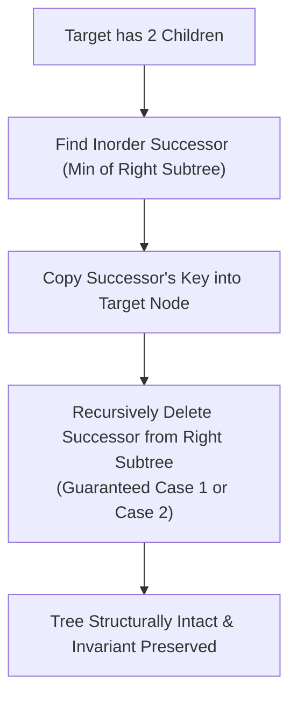
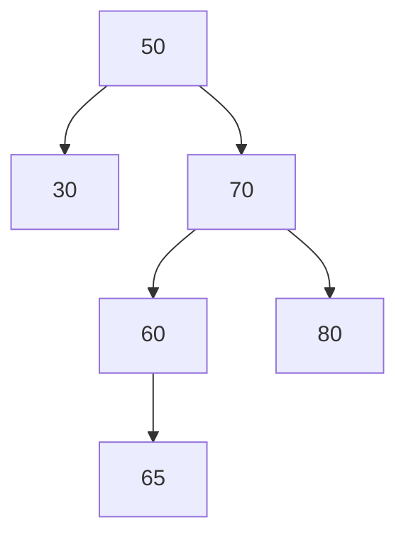

[DSA Index](../README.md) / [Unit 3: Advanced Trees and Heaps](Introduction.md)

# L05: Binary Search Trees - Deletion

Inserting a node into a Binary Search Tree is straightforward because new keys always become leaves at the outer fringe of the tree. We simply search until we hit `NULL` and attach the node.

Deleting a node is a completely different engineering challenge.

When we delete a node, that node could be located anywhere: at the perimeter as a leaf, midway down an active branch, or sitting at the very root of the entire hierarchy. If that node has children, simply freeing its memory would orphan those subtrees, cutting them off from the rest of the data structure.

We must remove the target node, free its memory, and reconnect the surrounding pointer links in a way that preserves the BST invariant ($\text{Left} < \text{Root} < \text{Right}$) across every single remaining node.

To solve this systematically, BST deletion is divided into three distinct structural cases.

---

## Case 1: Deleting a Leaf Node (Degree 0)

A leaf node has no children (`node->left == NULL` and `node->right == NULL`).

This is the simplest possible case:
1. Locate the leaf node.
2. Set the corresponding child pointer of its parent to `NULL`.
3. Free the leaf node's memory.





Because the leaf has no descendants, severing its parent's link orphans nothing.

---

## Case 2: Deleting a Node with Exactly One Child (Degree 1)

In this case, the target node has either a left child or a right child, but not both.

Think about how node deletion works in a singly linked list: to delete a middle node, you bypass it by pointing the previous node directly to the subsequent node.

We do the exact same thing in a BST:
1. Locate the target node.
2. Identify its single surviving child (either `left` or `right`).
3. Connect the target node's parent directly to that child.
4. Free the target node's memory.





Why does this preserve the BST property? 
Because every descendant of `30` was already verified to be smaller than `50` (since they were in `50`'s left subtree). Promoting `40` to take `30`'s place maintains every relative inequality across the tree.

---

## Case 3: Deleting a Node with Two Children (Degree 2)

Now we reach the truly difficult case. The target node has both a left child and a right child.

Why can't we simply bypass the node like in Case 2? 

Because the target's parent has only **one** pointer slot available (`left` or `right`), but the target node leaves behind **two** orphaned subtrees! A single pointer cannot hold two separate memory addresses.



To resolve this without tearing down the tree structure, we use a replacement strategy:
Instead of physically deleting the target node and trying to splice its subtrees, **we replace the target node's key with a carefully chosen surrogate key from inside one of its subtrees, and then delete that surrogate node instead!**

### Choosing the Surrogate Key

Which key can safely take the target's place at the root of both subtrees?

To maintain the BST invariant, the replacement key must be:
- Strictly greater than every node in the left subtree.
- Strictly less than every node in the right subtree.

There are exactly two nodes in the entire tree that satisfy this condition:
1. **The Inorder Predecessor**: The maximum key in the target's left subtree (`findMax(target->left)`).
2. **The Inorder Successor**: The minimum key in the target's right subtree (`findMin(target->right)`).

Standard implementations typically choose the **Inorder Successor**.

### Why the Inorder Successor Simplifies Everything

Notice something crucial about the Inorder Successor in the right subtree:

By definition, the successor is the **minimum** node in that right subtree. To find it, we step right once, and then follow `left` pointers until we can go no further.

Because we went left until we hit `NULL`, **the inorder successor CANNOT have a left child!** 

If it had a left child, that left child would be smaller, which violates our premise that the successor was the minimum node.

Therefore, the inorder successor has at most ONE child (a right child). It is either a leaf (Case 1) or a single-child node (Case 2). 

This is an enormous computational breakthrough: deleting the successor from the right subtree is mathematically guaranteed to fall into Case 1 or Case 2, both of which are trivial!



---

## Complete Recursive BST Deletion in C

Let's inspect the complete recursive implementation. Notice how the function returns the updated pointer to the root of the current subtree:

```c
#include <stdio.h>
#include <stdlib.h>

typedef struct BSTNode {
    int key;
    struct BSTNode *left;
    struct BSTNode *right;
} BSTNode;

BSTNode *findMin(BSTNode *node) {
    BSTNode *curr = node;
    while (curr && curr->left != NULL) {
        curr = curr->left;
    }
    return curr;
}

BSTNode *deleteNode(BSTNode *root, int key) {
    // Base Case: Key does not exist in the tree
    if (root == NULL) {
        return NULL;
    }

    // Step 1: Search for the node to delete
    if (key < root->key) {
        root->left = deleteNode(root->left, key);
    } else if (key > root->key) {
        root->right = deleteNode(root->right, key);
    } else {
        // We found the node! Now handle the 3 cases:

        // Case 1: Node has NO children (Leaf)
        if (root->left == NULL && root->right == NULL) {
            free(root);
            return NULL;
        }

        // Case 2A: Node has ONLY a right child
        else if (root->left == NULL) {
            BSTNode *temp = root->right;
            free(root);
            return temp; // Return right child to be linked by parent
        }

        // Case 2B: Node has ONLY a left child
        else if (root->right == NULL) {
            BSTNode *temp = root->left;
            free(root);
            return temp; // Return left child to be linked by parent
        }

        // Case 3: Node has TWO children
        else {
            // Find the inorder successor (smallest in right subtree)
            BSTNode *successor = findMin(root->right);

            // Copy successor's key into current node
            root->key = successor->key;

            // Recursively delete the successor node from the right subtree
            root->right = deleteNode(root->right, successor->key);
        }
    }

    return root;
}
```

### Tracing Case 3 Execution

Let's trace `deleteNode(root, 50)` on this tree:



1. The function matches `key == 50` at the root.
2. `root->left` (`30`) and `root->right` (`70`) both exist $\to$ Case 3 triggers.
3. `findMin(root->right)` starts at `70`, follows `left` to `60`. Node `60` has no left child, so `60` is the successor.
4. We copy `60` into the root's key slot: `root->key = 60`.
5. We invoke `deleteNode(70, 60)` to delete the original successor from the right subtree.
6. In that recursive call, node `60` has only a right child (`65`) $\to$ Case 2 triggers. Node `60` is freed, and `65` is spliced directly to `70->left`.
7. The tree is completely rebalanced, holding valid BST ordering everywhere.

---

## The Hibbard Deletion Problem: Asymmetric Tree Degradation

Notice a subtle flaw in our strategy.

Whenever we encounter a two-child deletion, we systematically chose the **Inorder Successor** from the right subtree. 

In 1962, Thomas N. Hibbard proved that this consistent bias causes a mathematical phenomenon known as **Hibbard Deletion Degradation**.

When you repeatedly delete nodes using only the right successor in a long-running system (such as an in-memory database index undergoing thousands of insertions and deletions):
- Nodes are continuously carved out of the right subtrees and moved up.
- Left subtrees are left untouched and grow deeper.
- Over time, the tree loses its symmetric balance. The average depth of the tree degenerates from the ideal $O(\log n)$ down toward $O(\sqrt{n})$.

To mitigate this bias, production implementations alternate between replacing with the Inorder Successor and the Inorder Predecessor (either randomly or using a parity flip toggle).

---

## Complexity Analysis of BST Deletion

Let $n$ be the number of nodes in the tree, and $h$ be the height of the tree.

| Deletion Case | Time Complexity | Auxiliary Space (Call Stack) | Reason |
| :--- | :--- | :--- | :--- |
| **Case 1 (Leaf Node)** | $O(h)$ | $O(h)$ | Search takes $O(h)$; deallocation takes $O(1)$. |
| **Case 2 (Single Child)** | $O(h)$ | $O(h)$ | Search takes $O(h)$; pointer bypass takes $O(1)$. |
| **Case 3 (Two Children)** | $O(h)$ | $O(h)$ | Search takes $O(h)$; finding successor takes $O(h)$; recursive deletion takes $O(h)$. |
| **Best-Case Tree ($h \approx \log n$)** | $O(\log n)$ | $O(\log n)$ | Tree remains balanced. |
| **Worst-Case Tree ($h = n$)** | $O(n)$ | $O(n)$ | Skewed tree forces linear traversal. |

---

## Key Takeaways

- Deleting from a BST requires handling three structural scenarios: leaf nodes (Degree 0), single-child nodes (Degree 1), and two-child nodes (Degree 2).
- Leaf nodes are simply unlinked and freed.
- Single-child nodes are bypassed by linking their parent directly to their child.
- Two-child nodes cannot be directly unlinked; their value is replaced with the Inorder Successor (or Predecessor), and the surrogate node is recursively deleted.
- The Inorder Successor in a right subtree is guaranteed to have at most one child (a right child), ensuring its recursive deletion always falls into Case 1 or Case 2.
- Always returning the updated root pointer from recursive calls simplifies pointer rewiring across parent and child frames.
- Systematically favoring the successor causes Hibbard degradation over time, pulling the tree out of balance.

No matter how carefully we implement search, insertion, and deletion, the standard Binary Search Tree suffers from an unavoidable vulnerability: its performance is hostage to the order of operations. A sequence of sorted inputs degenerates the tree into an $O(n)$ linear chain. Let's move to [L06 - AVL Trees - Balanced Search Trees](L06%20-%20AVL%20Trees%20-%20Balanced%20Search%20Trees.md) to discover the first self-balancing tree in computer science history, which mathematically guarantees logarithmic performance under all conditions.
