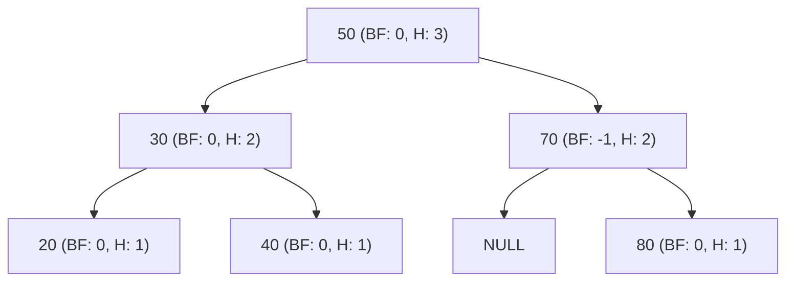
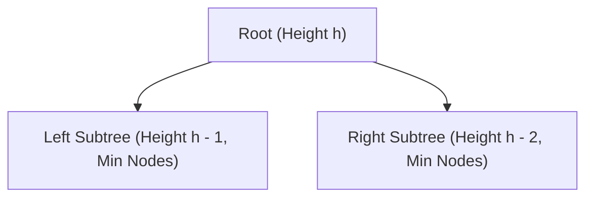
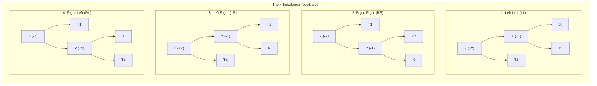

[DSA Index](../README.md) / [Unit 3: Advanced Trees and Heaps](Introduction.md)

# L06: AVL Trees - Balanced Search Trees

In our exploration of Binary Search Trees, we uncovered a dangerous vulnerability: the shape of a BST depends entirely on the order in which data is inserted.

If keys arrive in random order, a BST performs admirably, maintaining an average height of approximately $1.39 \log_2 n$. But if keys arrive in sorted or nearly-sorted order—a scenario that happens constantly in real-world systems, such as auto-incrementing database primary keys or chronological timestamp logs—the BST degenerates into a linear chain. 

Its height balloons to $h = n$, its $O(\log n)$ search speed collapses to $O(n)$, and our sophisticated hierarchical tree becomes an expensive singly linked list.

In 1962, two Soviet mathematicians, **Georgy Adelson-Velsky** and **Evgenii Landis**, solved this problem by introducing the first self-balancing binary search tree in computer science history: the **AVL Tree**.

---

## The Height-Balance Property and the Balance Factor

An AVL Tree is a Binary Search Tree with one crucial added constraint: **the heights of the left and right subtrees of every single node can differ by at most 1**.

To quantify this, we define the height of a node and its **Balance Factor (BF)**.

### Defining Node Height

We define height mathematically as follows:
- The height of an empty tree (`NULL`) is $0$.
- The height of a single leaf node is $1$.
- The height of any internal node is one plus the maximum height of its two children:
  $$\text{height}(\text{node}) = 1 + \max(\text{height}(\text{node}\to\text{left}), \text{height}(\text{node}\to\text{right}))$$

### Defining the Balance Factor

The Balance Factor of a node $X$ is defined as the height of its left subtree minus the height of its right subtree:

$$\text{BF}(X) = \text{height}(X\to\text{left}) - \text{height}(X\to\text{right})$$

### The AVL Invariant

A binary search tree is an AVL tree if and only if, for **every node $X$** in the tree:

$$\text{BF}(X) \in \{-1, 0, +1\}$$



Look at the nodes in the tree above:
- Node `20`, `40`, and `80` are leaves; their left and right subtrees are `NULL` (height 0), so $\text{BF} = 0 - 0 = 0$.
- Node `30` has left and right subtrees of height 1, so $\text{BF} = 1 - 1 = 0$.
- Node `70` has a left subtree of height 0 and right subtree of height 1, so $\text{BF} = 0 - 1 = -1$.
- Node `50` has left height 2 and right height 2, so $\text{BF} = 2 - 2 = 0$.

Because every node's balance factor is within $\{-1, 0, +1\}$, this tree is a valid AVL tree.

The moment an insertion or deletion pushes any node's balance factor to $+2$ or $-2$, the tree is formally unbalanced and must be restructured immediately.

---

## Why AVL Trees Guarantee $O(\log n)$ Height: The Mathematical Proof

Why is the AVL condition so powerful? Why does capping the height difference at 1 guarantee logarithmic height?

To prove this, let's determine the **absolute worst-case AVL tree**: a tree that has the maximum possible height $h$ with the minimum possible number of nodes $N(h)$.

### The Recurrence Relation

To construct an AVL tree of height $h$ using the minimum possible number of nodes:
- The root must have one child with height $h - 1$.
- To keep the balance factor valid (difference $\le 1$) while minimizing nodes, the other child must have height $h - 2$.
- Both of those child subtrees must themselves be minimal AVL trees.



This yields the recurrence relation:

$$N(h) = 1 + N(h - 1) + N(h - 2)$$

Let's compute the first few base values:
- $N(0) = 0$ (empty tree)
- $N(1) = 1$ (single node)
- $N(2) = 1 + N(1) + N(0) = 1 + 1 + 0 = 2$
- $N(3) = 1 + N(2) + N(1) = 1 + 2 + 1 = 4$
- $N(4) = 1 + N(3) + N(2) = 1 + 4 + 2 = 7$
- $N(5) = 1 + N(4) + N(3) = 1 + 7 + 4 = 12$

### The Fibonacci Connection

Notice the pattern: $N(h) + 1$ forms the Fibonacci sequence!
- $N(1) + 1 = 2 = F_3$
- $N(2) + 1 = 3 = F_4$
- $N(3) + 1 = 5 = F_5$
- $N(4) + 1 = 8 = F_6$
- $N(5) + 1 = 13 = F_7$

In general:
$$N(h) = F_{h + 2} - 1$$

From mathematics, the $k$-th Fibonacci number grows exponentially according to the Golden Ratio $\phi = \frac{1 + \sqrt{5}}{2} \approx 1.618$:

$$F_k \approx \frac{\phi^k}{\sqrt{5}}$$

Therefore:
$$n = N(h) \approx \frac{\phi^{h + 2}}{\sqrt{5}} - 1$$

Adding 1 and taking base-2 logarithms on both sides:

$$\log_2(n + 1) \approx (h + 2)\log_2(\phi) - \log_2(\sqrt{5})$$

Since $\log_2(\phi) = \log_2(1.618) \approx 0.6942$:

$$h + 2 \approx \frac{\log_2(n + 1)}{0.6942} \approx 1.44 \log_2(n + 1)$$

$$h \le 1.44 \log_2 n$$

This is a monumental mathematical result: even in the absolute most lopsided, sparsely-populated AVL tree imaginable, the height can never exceed $1.44 \log_2 n$.

For a tree containing $1,000,000$ nodes:
- A skewed BST could have height $1,000,000$.
- An AVL tree has a maximum theoretical height of only $1.44 \times 20 \approx 28$ levels!

Searching through a million elements is guaranteed to take at most 29 pointer hops.

---

## Storing Node Metadata in C

If we calculate the height of a subtree from scratch every time we evaluate a balance factor, computing $\text{height}(\text{node})$ would take $O(n)$ time. Doing that at every step of an insertion would degrade the entire tree to $O(n^2)$ time!

To keep insertions and searches fast, every AVL node explicitly caches its current height inside its struct:

```c
#include <stdio.h>
#include <stdlib.h>

typedef struct AVLNode {
    int key;
    struct AVLNode *left;
    struct AVLNode *right;
    int height;
} AVLNode;

// Helper to safely get node height (handles NULL pointers)
int getHeight(AVLNode *node) {
    if (node == NULL) {
        return 0;
    }
    return node->height;
}

// Compute maximum of two integers
int max(int a, int b) {
    return (a > b) ? a : b;
}

// Calculate the Balance Factor of a node
int getBalanceFactor(AVLNode *node) {
    if (node == NULL) {
        return 0;
    }
    return getHeight(node->left) - getHeight(node->right);
}

// Update cached height based on children
void updateHeight(AVLNode *node) {
    if (node != NULL) {
        node->height = 1 + max(getHeight(node->left), getHeight(node->right));
    }
}

// Create a new AVL node
AVLNode *createAVLNode(int key) {
    AVLNode *node = (AVLNode *)malloc(sizeof(AVLNode));
    node->key = key;
    node->left = NULL;
    node->right = NULL;
    node->height = 1; // New leaf has height 1
    return node;
}
```

By storing `height`, calculating `getBalanceFactor(node)` is an instantaneous $O(1)$ arithmetic operation.

---

## The Four Imbalance Configurations

When we insert a new key into an AVL tree, we place it as a leaf just like in a standard BST. 

As the recursive call stack unwinds back up toward the root, we update each ancestor's height and inspect its balance factor.

Let $Z$ be the **first unbalanced node** (where $|\text{BF}| = 2$) that we encounter on our way up from the newly inserted leaf.

Depending on the spatial relationship between $Z$, its child, and where the new key was inserted, the imbalance falls into one of four distinct configurations:



### 1. Left-Left (LL) Imbalance
- $\text{BF}(Z) = +2$ and $\text{BF}(Z\to\text{left}) \ge 0$.
- The new key was inserted into the **left subtree of the left child**.
- The nodes form a straight left-leaning line ($Z \to \text{Left} \to \text{Left}$).

### 2. Right-Right (RR) Imbalance
- $\text{BF}(Z) = -2$ and $\text{BF}(Z\to\text{right}) \le 0$.
- The new key was inserted into the **right subtree of the right child**.
- The nodes form a straight right-leaning line ($Z \to \text{Right} \to \text{Right}$).

### 3. Left-Right (LR) Imbalance
- $\text{BF}(Z) = +2$ and $\text{BF}(Z\to\text{left}) < 0$.
- The new key was inserted into the **right subtree of the left child**.
- The nodes form a zigzag "kink" ($Z \to \text{Left} \to \text{Right}$).

### 4. Right-Left (RL) Imbalance
- $\text{BF}(Z) = -2$ and $\text{BF}(Z\to\text{right}) > 0$.
- The new key was inserted into the **left subtree of the right child**.
- The nodes form an opposite zigzag "kink" ($Z \to \text{Right} \to \text{Left}$).

Understanding these four configurations is the key to balancing the tree. Straight-line imbalances (LL and RR) are resolved using **single rotations**, while zigzag imbalances (LR and RL) require **double rotations**.

---

## Comparison: AVL Tree vs. Standard Data Structures

| Structure | Search (Worst) | Insert (Worst) | Delete (Worst) | Memory Overhead per Node | Guaranteed Balanced? |
| :--- | :--- | :--- | :--- | :--- | :--- |
| **Unsorted Linked List** | $O(n)$ | $O(1)$ | $O(n)$ | 1 Pointer | No |
| **Sorted Array** | $O(\log n)$ | $O(n)$ | $O(n)$ | Zero | N/A (Contiguous) |
| **Standard BST** | $O(n)$ | $O(n)$ | $O(n)$ | 2 Pointers | No (Degenerates on sorted data) |
| **AVL Tree** | $O(\log n)$ | $O(\log n)$ | $O(\log n)$ | 2 Pointers + Height integer | **Yes** (Strict $h \le 1.44 \log n$) |

---

## Key Takeaways

- Standard BSTs risk degenerating to $O(n)$ linear chains on sorted or partially sorted input.
- An AVL tree enforces the height-balance condition: the balance factor ($\text{BF} = \text{height}(\text{left}) - \text{height}(\text{right})$) of every node must be $\in \{-1, 0, +1\}$.
- In the worst case, an AVL tree of height $h$ has a minimal node count that follows the Fibonacci sequence: $N(h) = F_{h+2} - 1$.
- The mathematical upper bound on AVL tree height is $h \le 1.44 \log_2 n$, guaranteeing $O(\log n)$ search time under all conditions.
- By caching each node's `height` field inside its struct, balance factors can be calculated in $O(1)$ time.
- Any imbalance caused by an insertion manifests as one of four topological configurations: Left-Left (LL), Right-Right (RR), Left-Right (LR), or Right-Left (RL).

Now that we know how to identify the four imbalance configurations, how do we physically restore balance without violating the BST ordering invariant? We use pointer rotations. Turn to [L07 - AVL Rotations](L07%20-%20AVL%20Rotations.md) to master the exact pointer mechanics of single and double AVL rotations.
