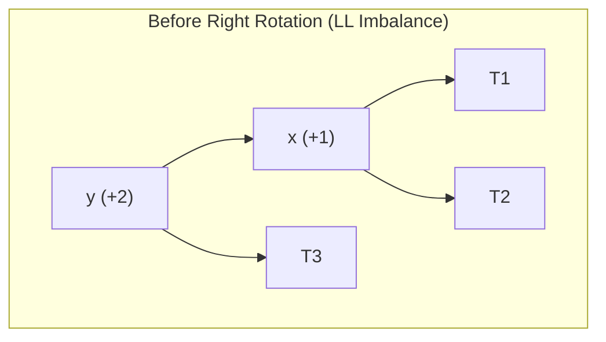
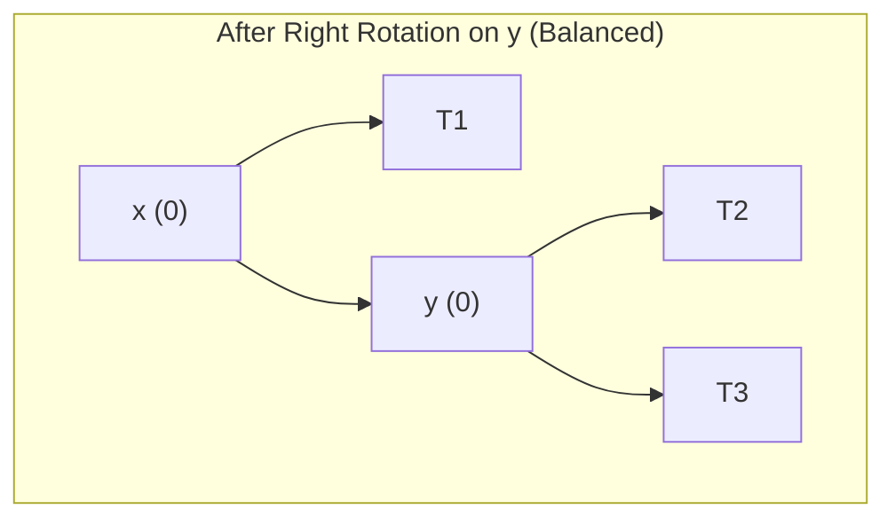
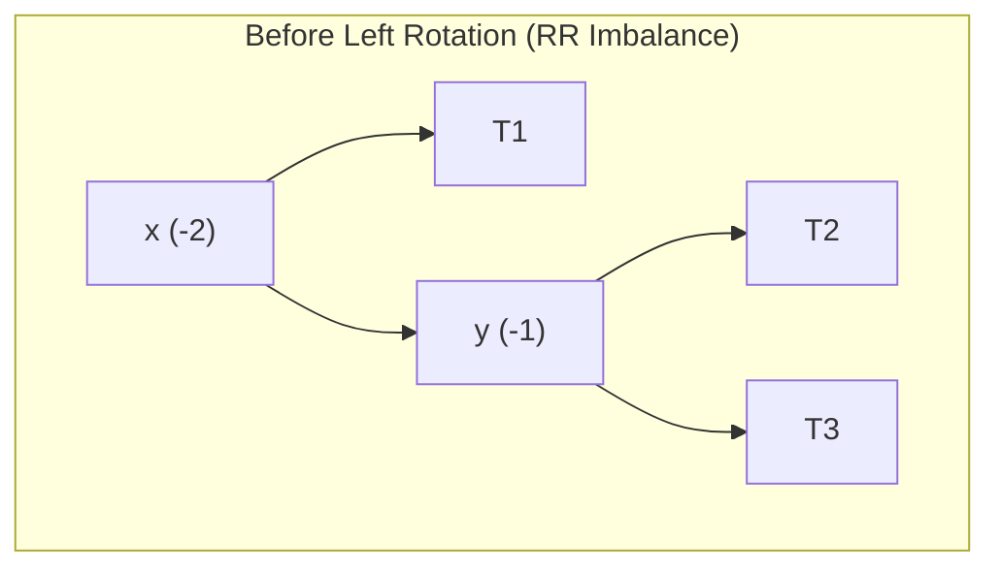
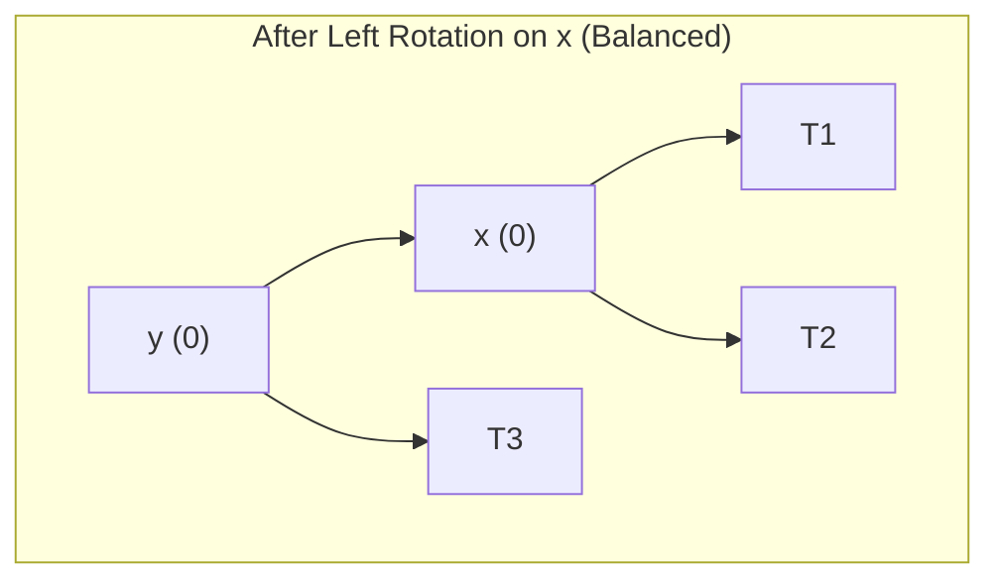
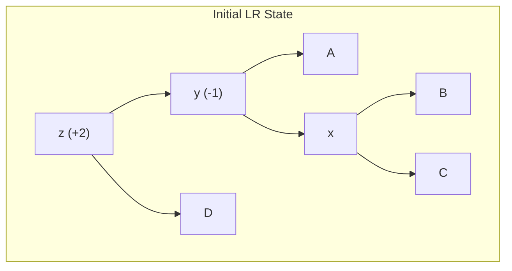
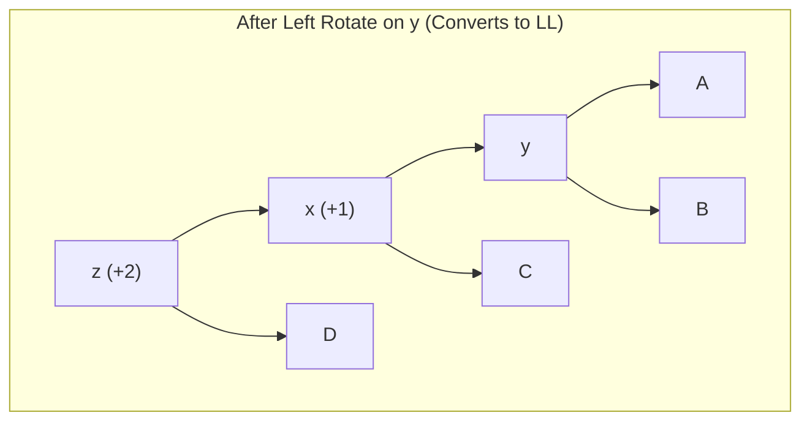
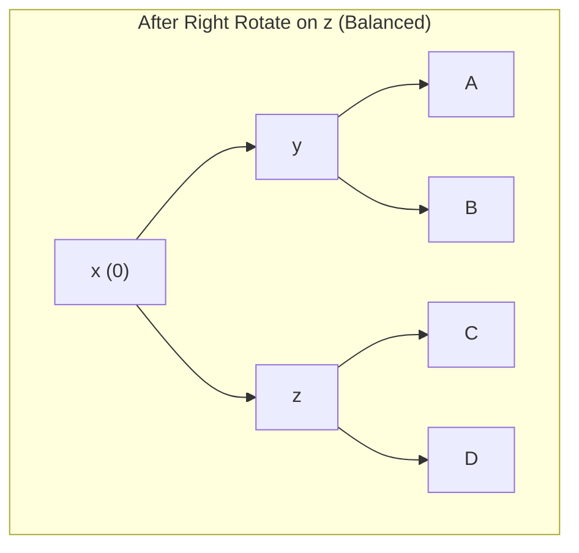

[DSA Index](../README.md) / [Unit 3: Advanced Trees and Heaps](Introduction.md)

# L07: AVL Rotations

In the previous lecture, we established the AVL height-balance invariant: every node must maintain a balance factor $\text{BF} \in \{-1, 0, +1\}$. We also identified that an insertion or deletion can push a node's balance factor to $+2$ or $-2$, triggering one of four imbalance topologies: Left-Left (LL), Right-Right (RR), Left-Right (LR), or Right-Left (RL).

Now, the fundamental question is: how do we physically fix an imbalance?

We cannot simply re-sort the nodes or rebuild the entire tree from scratch; that would take $O(n)$ time and destroy our logarithmic performance. 

Instead, we use a local restructuring operation called a **Tree Rotation**.

A tree rotation is a pointer manipulation that changes the heights of local subtrees while preserving the Binary Search Tree ordering invariant ($\text{Left} < \text{Root} < \text{Right}$) with 100% mathematical fidelity. All rotations execute in strictly $O(1)$ constant time with zero copying of node data.

---

## The Single Right Rotation (LL Rotation)

A Right Rotation (clockwise rotation) is used to resolve a **Left-Left (LL)** imbalance. This occurs when a node $y$ has a balance factor of $+2$ and its left child $x$ has a balance factor of $+1$ (or $0$ during deletions).

Let's inspect the subtrees before rotation:
- $y$ is the root of the unbalanced subtree.
- $x$ is $y$'s left child.
- $T_1$ is the left subtree of $x$.
- $T_2$ is the right subtree of $x$.
- $T_3$ is the right subtree of $y$.





### Why the BST Invariant Is Strictly Preserved

Let's verify the key ordering across all subtrees before the rotation:

$$T_1 < x < T_2 < y < T_3$$

Now examine what the right rotation does:
1. $x$ is elevated to become the new root of this subtree.
2. $y$ moves down to become the **right child** of $x$. (Valid, because $y > x$).
3. What happens to $T_2$ (the right subtree of $x$)? It is temporarily displaced. But notice where $T_2$ belongs: $T_2 > x$ and $T_2 < y$. Therefore, $T_2$ safely reattaches as the **left child of $y$**!
4. $T_1$ remains the left child of $x$, and $T_3$ remains the right child of $y$.

The resulting ordering is:
$$T_1 < x < (T_2 < y < T_3)$$

The BST invariant is preserved down to every single node. Furthermore, the height of the restructured subtree decreases by 1, restoring the AVL condition.

### C Implementation of Right Rotation

```c
AVLNode *rightRotate(AVLNode *y) {
    AVLNode *x = y->left;
    AVLNode *T2 = x->right;

    // Perform rotation: swap pointer links
    x->right = y;
    y->left = T2;

    // Update heights: bottom node (y) first, then top node (x)
    updateHeight(y);
    updateHeight(x);

    // Return new root of the rotated subtree
    return x;
}
```

Notice the order of height updates: we must update `y` first because `y` is now a child of `x`. Updating `x` first would calculate `x`'s height using the outdated height of `y`.

---

## The Single Left Rotation (RR Rotation)

A Left Rotation (counter-clockwise rotation) is the exact mirror image of the Right Rotation. It resolves a **Right-Right (RR)** imbalance, where node $x$ has $\text{BF} = -2$ and its right child $y$ has $\text{BF} = -1$ (or $0$).





### Pointer Mechanics of Left Rotation

1. $y$ is elevated to become the new root.
2. $x$ moves down to become the **left child** of $y$.
3. $T_2$ (the left child of $y$) reattaches as the **right child of $x$** (valid, because $x < T_2 < y$).

```c
AVLNode *leftRotate(AVLNode *x) {
    AVLNode *y = x->right;
    AVLNode *T2 = y->left;

    // Perform rotation
    y->left = x;
    x->right = T2;

    // Update heights: bottom node (x) first, then top node (y)
    updateHeight(x);
    updateHeight(y);

    // Return new root of the rotated subtree
    return y;
}
```

---

## The Double Rotations: Handling Zigzag Imbalances

Now, what happens if we attempt a single Right Rotation on a **Left-Right (LR)** imbalance?

Let's test it: in an LR imbalance, the left child has its extra weight in its *right* subtree. If you perform a single Right Rotation on the parent, that heavy inner subtree ($T_2$) simply gets transferred over to the right child, creating a Right-Left (RL) imbalance! The height doesn't decrease at all.

A zigzag imbalance cannot be fixed with a single rotation. It requires a **Double Rotation**.

---

### The Left-Right (LR) Double Rotation

An LR imbalance occurs when node $z$ has $\text{BF} = +2$ and its left child $y$ has $\text{BF} = -1$. The path from $z$ to the newly inserted node goes **Left, then Right**.

The solution is a two-phase operation:
1. **Phase 1: Left Rotate the child ($y$)**: This straightens the zigzag, transforming the LR configuration into a pure LL configuration.
2. **Phase 2: Right Rotate the root ($z$)**: This resolves the LL configuration, restoring height balance.







Notice what node ends up as the new root: node $x$, which was originally the grandchild, is promoted all the way to the top!

```c
AVLNode *leftRightRotate(AVLNode *z) {
    // Phase 1: Left rotate on left child
    z->left = leftRotate(z->left);
    // Phase 2: Right rotate on root
    return rightRotate(z);
}
```

---

### The Right-Left (RL) Double Rotation

An RL imbalance is the exact symmetric counterpart: node $z$ has $\text{BF} = -2$ and its right child $y$ has $\text{BF} = +1$. The path goes **Right, then Left**.

The two-phase solution:
1. **Phase 1: Right Rotate the child ($y$)**: Straightens the RL zigzag into a pure RR configuration.
2. **Phase 2: Left Rotate the root ($z$)**: Resolves the RR configuration, restoring balance.

```c
AVLNode *rightLeftRotate(AVLNode *z) {
    // Phase 1: Right rotate on right child
    z->right = rightRotate(z->right);
    // Phase 2: Left rotate on root
    return leftRotate(z);
}
```

---

## Complete Recursive AVL Insertion

Let's assemble all the pieces into the complete AVL insertion algorithm:

1. Perform standard BST recursive insertion to place the new key as a leaf.
2. As the recursion unwinds, update the `height` of each ancestor node.
3. Compute the `balanceFactor` of the current node.
4. If $|\text{BF}| > 1$, trigger the appropriate rotation depending on the four cases:

```c
AVLNode *insertAVL(AVLNode *node, int key) {
    // 1. Standard BST insertion
    if (node == NULL) {
        return createAVLNode(key);
    }

    if (key < node->key) {
        node->left = insertAVL(node->left, key);
    } else if (key > node->key) {
        node->right = insertAVL(node->right, key);
    } else {
        // Duplicate keys not permitted in standard AVL
        return node;
    }

    // 2. Update height of current node
    updateHeight(node);

    // 3. Obtain Balance Factor
    int balance = getBalanceFactor(node);

    // 4. Rebalance if unbalanced

    // Case 1: Left-Left (LL)
    if (balance > 1 && key < node->left->key) {
        return rightRotate(node);
    }

    // Case 2: Right-Right (RR)
    if (balance < -1 && key > node->right->key) {
        return leftRotate(node);
    }

    // Case 3: Left-Right (LR)
    if (balance > 1 && key > node->left->key) {
        return leftRightRotate(node);
    }

    // Case 4: Right-Left (RL)
    if (balance < -1 && key < node->right->key) {
        return rightLeftRotate(node);
    }

    // No balance violation, return unchanged node pointer
    return node;
}
```

### The Insertion Invariant: At Most One Rotation

Notice a remarkable mathematical property of AVL insertion:

When an insertion causes an imbalance, performing **a single rotation (single or double) on the lowest unbalanced ancestor completely restores the height of that entire subtree to what it was before the insertion!**

Because the height of that subtree does not increase, none of its higher ancestors can become unbalanced. 

Therefore, **an AVL insertion requires at most ONE rotation (single or double) to rebalance the entire tree**, no matter how large $n$ is.

---

## AVL Deletion: The Multi-Rotation Propagation

Now consider deletion. Deleting a key follows standard BST deletion:
- Leaf: free and return `NULL`.
- One child: bypass node and return child.
- Two children: replace with Inorder Successor (`findMin(node->right)`), then recursively delete the successor.

After the node is deleted, we unwind the recursive stack, updating heights and checking balance factors.

The rebalancing logic during deletion differs slightly from insertion:

```c
AVLNode *deleteAVL(AVLNode *root, int key) {
    if (root == NULL) {
        return NULL;
    }

    // 1. Standard BST search and delete
    if (key < root->key) {
        root->left = deleteAVL(root->left, key);
    } else if (key > root->key) {
        root->right = deleteAVL(root->right, key);
    } else {
        // Node found
        if (root->left == NULL || root->right == NULL) {
            AVLNode *temp = root->left ? root->left : root->right;
            if (temp == NULL) {
                // Leaf case
                temp = root;
                root = NULL;
            } else {
                // One child case: copy contents of child
                *root = *temp;
            }
            free(temp);
        } else {
            // Two children: find inorder successor
            AVLNode *temp = root->right;
            while (temp->left != NULL) {
                temp = temp->left;
            }
            root->key = temp->key;
            root->right = deleteAVL(root->right, temp->key);
        }
    }

    if (root == NULL) {
        return NULL;
    }

    // 2. Update height
    updateHeight(root);

    // 3. Check balance factor
    int balance = getBalanceFactor(root);

    // 4. Rebalance

    // Left-Heavy
    if (balance > 1) {
        if (getBalanceFactor(root->left) >= 0) {
            return rightRotate(root); // LL
        } else {
            return leftRightRotate(root); // LR
        }
    }

    // Right-Heavy
    if (balance < -1) {
        if (getBalanceFactor(root->right) <= 0) {
            return leftRotate(root); // RR
        } else {
            return rightLeftRotate(root); // RL
        }
    }

    return root;
}
```

### Why Deletion Can Trigger Multiple Rotations

Here is the critical distinction between insertion and deletion:

When you delete a node, rebalancing an ancestor via a rotation **decreases the height of that subtree**. 

If that subtree was the tall branch of its own parent, decreasing its height may now make the parent unbalanced! 

Therefore, unlike insertion (which stops after 1 rotation), **AVL deletion can trigger up to $O(\log n)$ rotations**, propagating rebalancing all the way up the tree to the root.

---

## Complexity Analysis of AVL Tree Operations

| Operation | Best Case | Average Case | Worst Case | Rotations Required |
| :--- | :--- | :--- | :--- | :--- |
| **Search** | $O(1)$ | $O(\log n)$ | $O(\log n)$ | 0 |
| **Insert** | $O(\log n)$ | $O(\log n)$ | $O(\log n)$ | At most 1 (single or double) |
| **Delete** | $O(\log n)$ | $O(\log n)$ | $O(\log n)$ | Up to $O(\log n)$ rotations |
| **Auxiliary Space** | $O(\log n)$ | $O(\log n)$ | $O(\log n)$ | Recursive call stack ($h \le 1.44 \log n$) |

---

## Key Takeaways

- A tree rotation is an $O(1)$ local pointer transformation that alters height while strictly preserving the BST ordering invariant.
- A single Right Rotation resolves a Left-Left (LL) imbalance; a single Left Rotation resolves a Right-Right (RR) imbalance.
- Zigzag imbalances cannot be fixed by a single rotation; a Left-Right (LR) imbalance requires a Left Rotation on the left child followed by a Right Rotation on the root; Right-Left (RL) is its exact mirror.
- Height updates must update the lower child first, followed by the newly promoted root.
- An AVL insertion requires at most one rotation (single or double) to rebalance the entire tree.
- An AVL deletion can trigger up to $O(\log n)$ rotations propagating to the root because rotations decrease subtree height.

AVL trees offer rigid, guaranteed $O(\log n)$ worst-case bounds, but that rigidity comes at a cost: every node must store height metadata, and frequent insertions/deletions spend CPU cycles performing rotations. What if we could achieve the same logarithmic performance without storing any balance metadata at all, while automatically optimizing for frequently accessed data? Turn to [L08 - Splay Trees](L08%20-%20Splay%20Trees.md) to explore self-adjusting search trees.
