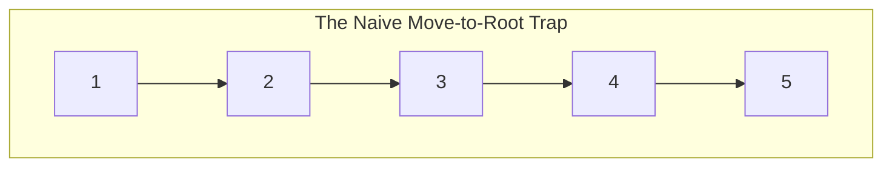
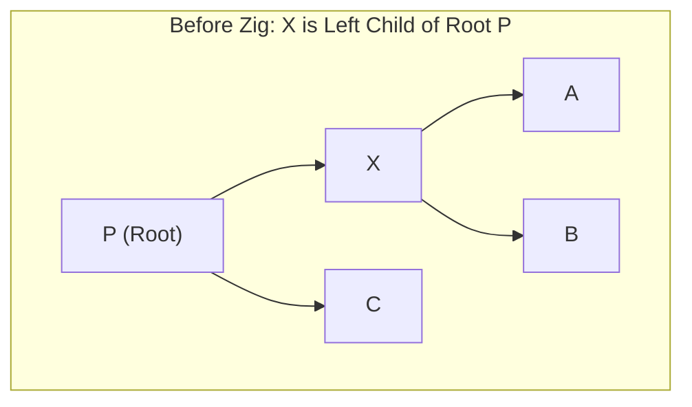
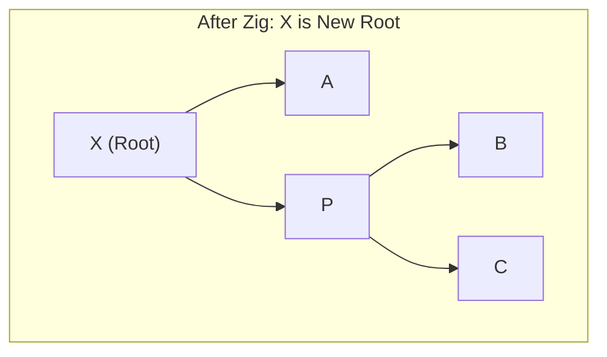
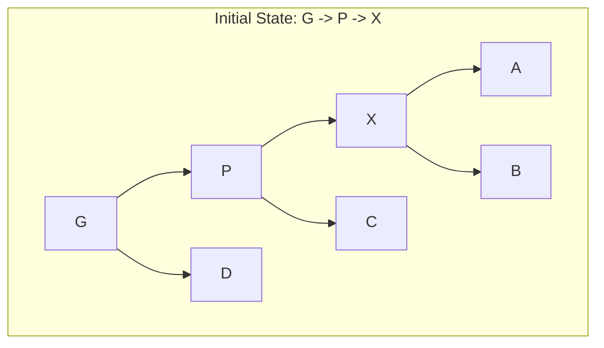
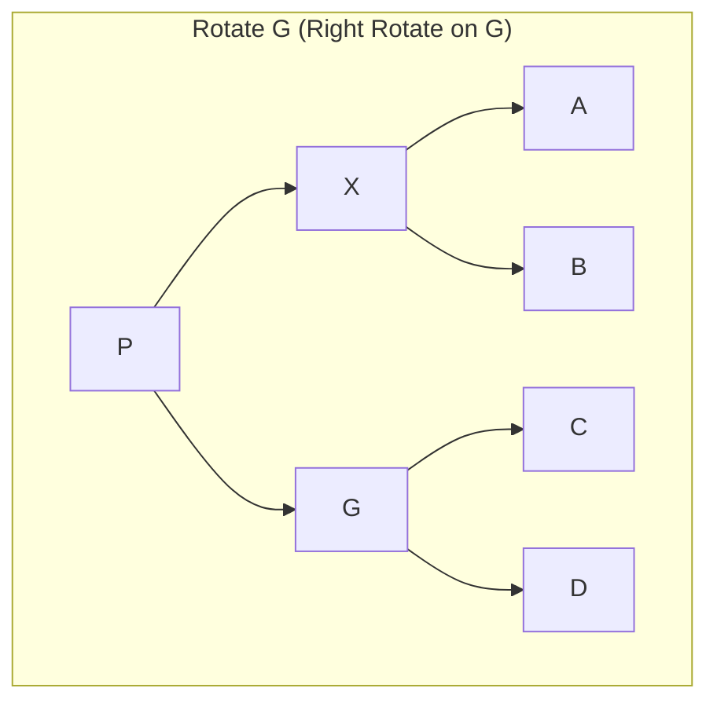
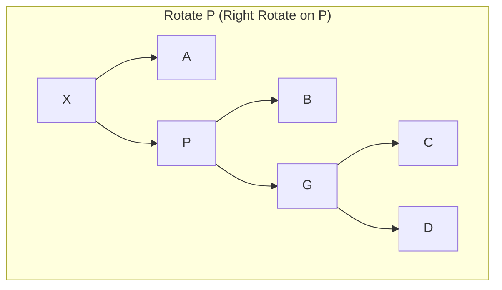
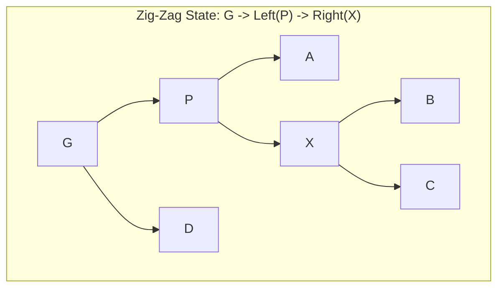
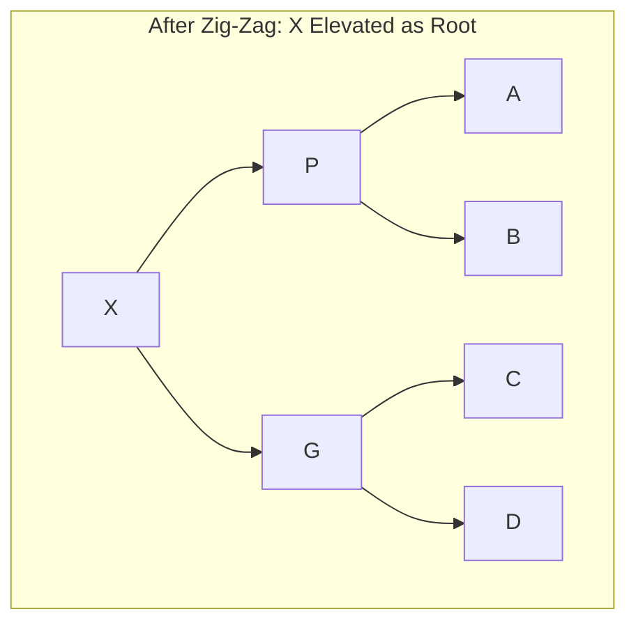

[DSA Index](../README.md) / [Unit 3: Advanced Trees and Heaps](Introduction.md)

# L08: Splay Trees

AVL trees provide guaranteed $O(\log n)$ performance by maintaining a strict balance invariant: no two sibling subtrees may differ in height by more than 1.

But think about what that guarantee costs us in practice:
1. **Memory Overhead**: Every single node must carry an integer or bit-field storing height or balance factor metadata.
2. **Maintenance Overhead**: Every single insertion and deletion must backtrack up the tree, calculating balance factors and executing rotations.
3. **Worst-Case vs. Real-World Workloads**: In reality, memory and disk access patterns are rarely uniform. The **Pareto Principle (80/20 Rule)** and **Temporal Locality** dominate computing: a tiny subset of keys (e.g., recently queried database rows, popular network routes, local compiler symbols) accounts for the vast majority of all operations.

In 1985, **Daniel Sleator** and **Robert Tarjan** proposed an alternative design: **The Splay Tree**.

A Splay Tree is a self-adjusting binary search tree that stores **zero balance metadata** (no heights, no colors, no balance factors) and yet achieves an **amortized time complexity of $O(\log n)$** per operation.

---

## The Splaying Philosophy and Temporal Locality

The defining premise of a splay tree is simple: **whenever a node is accessed (via search, insert, or delete), it is immediately migrated to the root of the tree using a sequence of rotations.**

This operation is called **Splaying**.

Notice the immediate benefits of splaying:
- If a key is queried repeatedly, the first query splays it to the root in $O(h)$ time, and every subsequent query retrieves it in **$O(1)$ instantaneous time**!
- Less frequently accessed keys naturally sink down toward the bottom of the tree.
- The tree self-optimizes dynamically based entirely on actual application workload.

### Why Naive "Move-to-Root" Fails

Now here's the thing: moving an accessed node to the root is not a new idea. Why can't we simply use repeated single rotations to bubble a node up to the root, like bubbles rising in water?

Consider what happens if we insert keys in sorted order `[1, 2, 3, 4, 5]`, creating a degenerate right-skewed tree of height 5. If we access leaf `5` and bubble it to the root using naive single rotations:



If you apply naive single rotations to node `5`, node `5` becomes the root, but the rest of the tree simply inverts into a left-skewed chain! The overall height remains $O(n)$, and accessing node `1` next will cost another $O(n)$ operations. Naive move-to-root does not balance the tree; it merely flips its tilt.

Tarjan's breakthrough was discovering that **how** we rotate matters: by evaluating two levels at a time (grandparent, parent, child), splaying roughly **halves the depth of every single node along the access path**, actively transforming tall, skewed branches into bushy, balanced subtrees.

---

## The Three Splaying Steps

Let $X$ be the target node being accessed, $P$ be its parent, and $G$ be its grandparent.

At each step of splaying, we inspect the positions of $X, P,$ and $G$, applying one of three structural transformations:

### 1. The Zig Step (Terminal Case)

The Zig step occurs when $P$ is the root of the entire tree (meaning $X$ has no grandparent $G$).

Because $X$ is only one hop away from the root, we perform a **single rotation**:
- If $X$ is the left child of $P$, perform a **Right Rotation** on $P$.
- If $X$ is the right child of $P$, perform a **Left Rotation** on $P$.





The Zig step only executes once, at the very end of a splay sequence, if the initial depth of $X$ was odd.

---

### 2. The Zig-Zig Step (Homogeneous Double Rotation)

The Zig-Zig step occurs when $X$ and $P$ are both left children, or both right children. They form a straight line: $G \to P \to X$.

Here is Tarjan's critical design rule: **we must rotate the parent-grandparent link ($G$) FIRST, and then rotate the node-parent link ($P$) SECOND.**







Look at the structural transformation from Step 0 to Step 2:
- In Step 0, the path $G \to P \to X$ had depth 3.
- In Step 2, $X$ is at depth 0, and both $P$ and $G$ are packed closely beneath it.
- If this path had 10 nodes, a Zig-Zig splay cuts the total height of that branch roughly in half!

If we had rotated $P$ before $G$ (the naive mistake), node $X$ would reach the top, but the remaining ancestors would stay in a long linear chain. Rotating $G$ first is the secret sauce that guarantees amortized balance.

---

### 3. The Zig-Zag Step (Heterogeneous Double Rotation)

The Zig-Zag step occurs when $X$ is a right child and $P$ is a left child, or $X$ is a left child and $P$ is a right child. They form a kink/zigzag: $G \to P \to X$.

The mechanics are identical to an AVL double rotation:
1. Rotate $P$ (Left Rotate if $X$ is right child).
2. Rotate $G$ (Right Rotate).





Node $X$ becomes the parent of both $P$ and $G$, flattening the branch.

---

## Complete C Implementation of Splay Tree Operations

Let's implement a clean, top-down splay tree in C. Notice that the node structure contains **zero balance metadata**—only `key`, `left`, and `right`:

```c
#include <stdio.h>
#include <stdlib.h>

typedef struct SplayNode {
    int key;
    struct SplayNode *left;
    struct SplayNode *right;
} SplayNode;

SplayNode *createSplayNode(int key) {
    SplayNode *node = (SplayNode *)malloc(sizeof(SplayNode));
    node->key = key;
    node->left = NULL;
    node->right = NULL;
    return node;
}

// Single Right Rotation
SplayNode *rightRotate(SplayNode *y) {
    SplayNode *x = y->left;
    y->left = x->right;
    x->right = y;
    return x;
}

// Single Left Rotation
SplayNode *leftRotate(SplayNode *x) {
    SplayNode *y = x->right;
    x->right = y->left;
    y->left = x;
    return y;
}

// Splay function: brings key to the root if present,
// or brings the last accessed node to root if key is absent.
SplayNode *splay(SplayNode *root, int key) {
    if (root == NULL || root->key == key) {
        return root;
    }

    // Key lies in Left Subtree
    if (key < root->key) {
        if (root->left == NULL) {
            return root; // Key not present; root remains
        }

        // Case 1: Zig-Zig (Left-Left)
        if (key < root->left->key) {
            root->left->left = splay(root->left->left, key);
            root = rightRotate(root); // Rotate G first!
        }
        // Case 2: Zig-Zag (Left-Right)
        else if (key > root->left->key) {
            root->left->right = splay(root->left->right, key);
            if (root->left->right != NULL) {
                root->left = leftRotate(root->left);
            }
        }

        // Do second rotation for Zig-Zig or terminal Zig
        return (root->left == NULL) ? root : rightRotate(root);
    }
    // Key lies in Right Subtree
    else {
        if (root->right == NULL) {
            return root; // Key not present
        }

        // Case 3: Zig-Zag (Right-Left)
        if (key < root->right->key) {
            root->right->left = splay(root->right->left, key);
            if (root->right->left != NULL) {
                root->right = rightRotate(root->right);
            }
        }
        // Case 4: Zig-Zig (Right-Right)
        else if (key > root->right->key) {
            root->right->right = splay(root->right->right, key);
            root = leftRotate(root); // Rotate G first!
        }

        // Do second rotation for Zig-Zig or terminal Zig
        return (root->right == NULL) ? root : leftRotate(root);
    }
}
```

---

## Search, Insert, and Delete Mechanics

Once the `splay` function is written, every other operation becomes surprisingly simple.

### 1. Search Operation

To search for a key: call `splay(root, key)`. 
If `root->key == key`, the key was found and now sits right at the root! If `root->key != key`, the key does not exist, but the last accessed boundary node is now at the root.

```c
SplayNode *search(SplayNode *root, int key) {
    return splay(root, key);
}
```

### 2. Insertion Operation

To insert `key`:
1. Splay the tree around `key`. The node closest to `key` is now at the root.
2. If `root->key == key`, it's a duplicate; return `root`.
3. Otherwise, allocate `newNode`. Split the existing tree into two based on `root->key`:
   - If `key < root->key`: `newNode->right = root`, `newNode->left = root->left`, `root->left = NULL`.
   - If `key > root->key`: `newNode->left = root`, `newNode->right = root->right`, `root->right = NULL`.
4. Return `newNode` as the new root.

```c
SplayNode *insert(SplayNode *root, int key) {
    if (root == NULL) {
        return createSplayNode(key);
    }

    // Bring closest node to root
    root = splay(root, key);

    if (root->key == key) {
        return root; // Duplicate key
    }

    SplayNode *newNode = createSplayNode(key);

    if (key < root->key) {
        newNode->right = root;
        newNode->left = root->left;
        root->left = NULL;
    } else {
        newNode->left = root;
        newNode->right = root->right;
        root->right = NULL;
    }

    return newNode; // New node is now root
}
```

### 3. Deletion Operation

To delete `key`:
1. Splay `key` to the root. If `root->key != key`, the element is absent.
2. If `root->key == key`, remove the root. We are left with two disconnected trees: `root->left` ($L$) and `root->right` ($R$).
3. Splay the maximum element of $L$ to $L$'s root.
4. Because that element is the maximum in $L$, **it has no right child!**
5. Simply attach $R$ as the right child of $L$'s root.

```c
SplayNode *delete(SplayNode *root, int key) {
    if (root == NULL) {
        return NULL;
    }

    root = splay(root, key);

    if (root->key != key) {
        return root; // Key not in tree
    }

    SplayNode *temp = root;

    if (root->left == NULL) {
        root = root->right;
    } else {
        // Splay the maximum element in left subtree to its root
        SplayNode *leftSubtree = splay(root->left, key);
        leftSubtree->right = root->right;
        root = leftSubtree;
    }

    free(temp);
    return root;
}
```

Notice the beauty of this logic: there are no complex cases, no successor swapping, and no manual pointer rewiring across multiple ancestors. The `splay` routine does all the heavy structural lifting.

---

## Amortized Complexity Analysis: The Potential Method

What is the time complexity of a splay tree?

If an attacker constructs a degenerate tree and searches for the deepest leaf, that single operation will take **$O(n)$ worst-case time**. Splay trees do NOT guarantee $O(\log n)$ for every individual operation!

However, Sleator and Tarjan proved that **any sequence of $m$ arbitrary operations on an $n$-node splay tree takes at most $O(m \log n)$ total time**.

This means that while a single operation might cost $O(n)$, it pays for itself by halving the depths of all visited nodes. Subsequent operations along that branch will run significantly faster. Over any long sequence, the average cost per operation is strictly **$O(\log n)$ amortized**.

### Comparison: Splay Trees vs. AVL Trees vs. Red-Black Trees

| Feature | Splay Tree | AVL Tree | Red-Black Tree |
| :--- | :--- | :--- | :--- |
| **Worst-Case Search** | $O(n)$ | $O(\log n)$ | $O(\log n)$ |
| **Amortized Search** | $O(\log n)$ | $O(\log n)$ | $O(\log n)$ |
| **Worst-Case Insertion** | $O(n)$ | $O(\log n)$ | $O(\log n)$ |
| **Amortized Insertion** | $O(\log n)$ | $O(\log n)$ | $O(\log n)$ |
| **Node Metadata Overhead** | **0 bits** (None!) | 1 Integer (Height) | 1 Bit (Color) |
| **Non-Uniform Access Speed** | **$O(1)$ for frequent keys** | $O(\log n)$ | $O(\log n)$ |
| **Read Operations Mutate Tree?** | **Yes** (Searches splay!) | No | No |

That final row is critical: in a splay tree, **even a read-only search modifies the tree structure**. Because of this, splay trees require synchronization locks in multi-threaded environments, whereas AVL trees allow concurrent read access without mutation.

---

## Key Takeaways

- Splay trees are self-adjusting binary search trees that store zero balance metadata.
- Every operation (search, insert, delete) splays the accessed node to the root.
- The splay operation consists of Zig, Zig-Zig, and Zig-Zag steps.
- In the Zig-Zig step, rotating the grandparent-parent link first is the algorithmic breakthrough that roughly halves the depth of the entire access path.
- An individual operation can take $O(n)$ worst-case time, but any sequence of $m$ operations executes in $O(m \log n)$ time, guaranteeing $O(\log n)$ amortized complexity.
- Splay trees naturally exploit temporal locality, making them ideal for caching, memory allocators, and network routers.

We have spent several lectures studying trees that maintain a complete ordering across all elements. But in many critical systems—like operating system process scheduling, event simulation, and network packet routing—we do not need to sort every single item. We only care about instantly accessing the single highest-priority or lowest-priority item. Let's move to [L09 - Binary Heaps and Heap Sort](L09%20-%20Binary%20Heaps%20and%20Heap%20Sort.md) to explore how priority queues are implemented using pointerless complete binary trees mapped directly into contiguous arrays.
