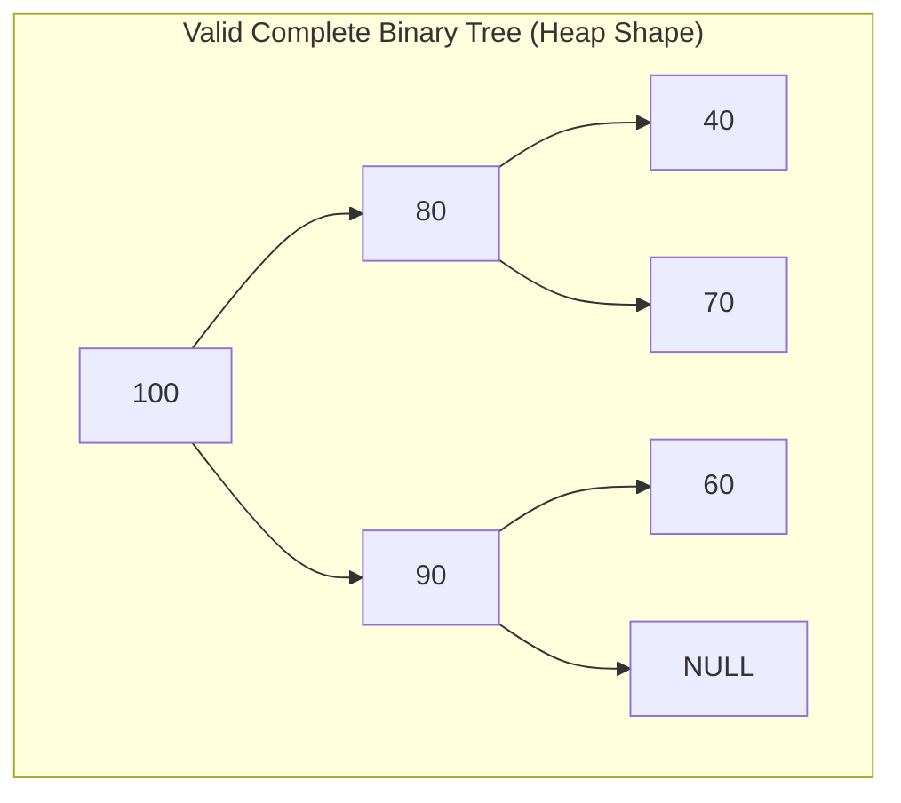
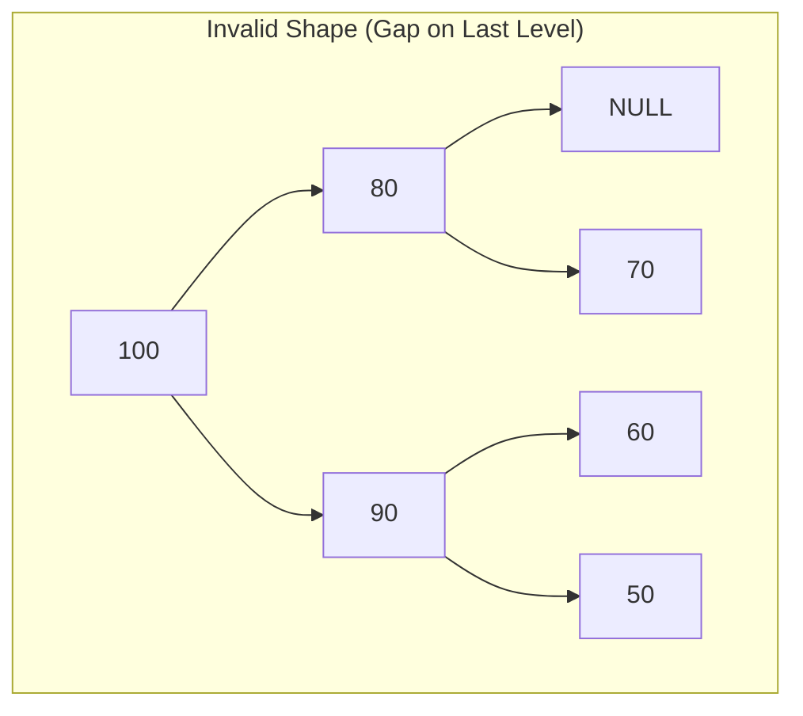
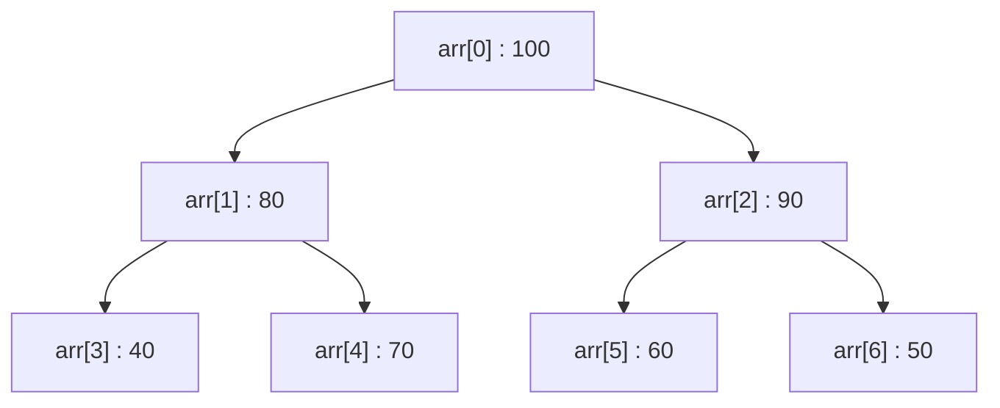
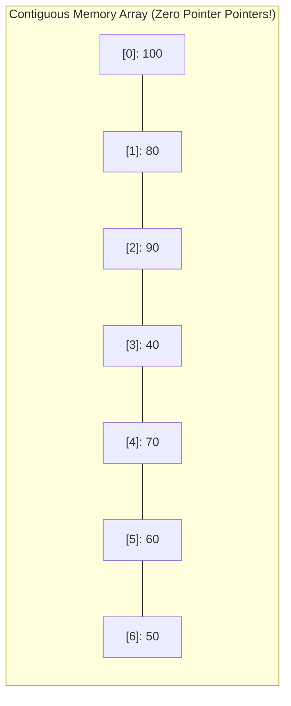
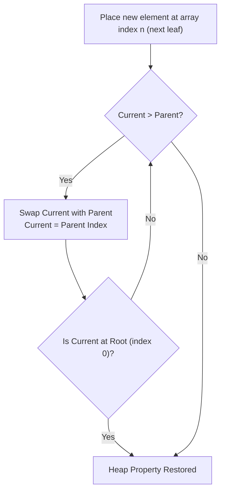
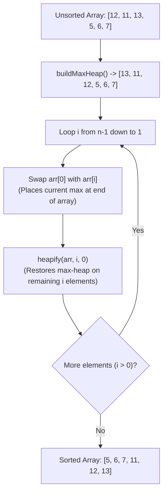

[DSA Index](../README.md) / [Unit 3: Advanced Trees and Heaps](Introduction.md)

# L09: Binary Heaps and Heap Sort

Across our study of Binary Search Trees, AVL Trees, and Splay Trees, our goal has been total ordering: we wanted every element sorted relative to every other element ($\text{Left} < \text{Root} < \text{Right}$) so we could find any arbitrary key in logarithmic time.

Now, consider a different computational problem.

In an operating system CPU scheduler, hundreds of threads are waiting for processor time. The scheduler does not need to know the relative priority between the 45th and 46th threads; it only needs to know **which single thread has the highest priority right now**. 

Similarly, in Dijkstra's shortest path algorithm or Prim's minimum spanning tree algorithm, the system only needs repeated, immediate access to the **minimum-weight edge**.

Maintaining a fully sorted BST or AVL tree just to extract the minimum element is computational overkill. We pay tree balancing overhead that we do not need.

What we need is a data structure specifically tailored for priority retrieval: **The Binary Heap**.

---

## The Dual Properties of a Binary Heap

A Binary Heap is a specialized binary tree that satisfies two strict invariants:

### 1. The Shape Property (Complete Binary Tree)

A binary heap is always a **Complete Binary Tree**:
- Every level of the tree is completely filled with nodes, with the possible exception of the bottom-most level.
- At the bottom-most level, all nodes are packed strictly from **left to right** without any intermediate gaps.





Because of this rigid shape, a heap never skews, never tilts, and its height is mathematically guaranteed to be strictly:

$$h = \lfloor \log_2 n \rfloor$$

### 2. The Heap-Order Property (Partial Ordering)

Unlike a BST where left is smaller and right is larger, a binary heap enforces a vertical parent-child relationship:

- **Max-Heap Property**: For every node $i$ other than the root:
  $$\text{key}(\text{parent}(i)) \ge \text{key}(i)$$
  Every parent is greater than or equal to its children. The absolute maximum element of the entire tree is guaranteed to reside at the **root**.

- **Min-Heap Property**: For every node $i$ other than the root:
  $$\text{key}(\text{parent}(i)) \le \text{key}(i)$$
  Every parent is less than or equal to its children. The absolute minimum element of the entire tree is guaranteed to reside at the **root**.

Notice something subtle here: **there is zero horizontal ordering between siblings**. In a Max-Heap, the left child could be larger than the right child, or the right child could be larger than the left child. All that matters is that both are smaller than their parent.

---

## Contiguous Array Representation: Zero Pointer Overhead

Now here is the architectural miracle of the binary heap: **we do not use a single pointer to build it!**

Because a complete binary tree has no gaps, we can map its nodes directly into a contiguous 1D array in level-order sequence:





### The 0-Based Index Arithmetic

Using simple integer arithmetic, we can navigate anywhere in the tree in $O(1)$ time without dereferencing a single pointer:

For any node sitting at index $i$:
- **Parent Index**:
  $$\text{parent}(i) = \left\lfloor \frac{i - 1}{2} \right\rfloor$$
- **Left Child Index**:
  $$\text{leftChild}(i) = 2i + 1$$
- **Right Child Index**:
  $$\text{rightChild}(i) = 2i + 2$$

Let's test it:
- Node at index $2$ (`90`):
  - Left child is at $2(2) + 1 = 5$ (`60`). Correct!
  - Right child is at $2(2) + 2 = 6$ (`50`). Correct!
  - Parent is at $\lfloor (2 - 1)/2 \rfloor = 0$ (`100`). Correct!

This eliminates all node pointer allocations, eliminates dynamic memory fragmentation, and delivers maximum CPU cache-line locality.

---

## Core Heap Operations: Insertion and Extraction

Let's examine how we maintain the heap property when data arrives or leaves.

### 1. Insertion (`push`) and `siftUp` (Bubble-Up)

When inserting a new value into a Max-Heap:
1. Place the new element at the very end of the array (at index $n$). This preserves the **Complete Binary Tree Shape** property.
2. But the new element might be larger than its parent, violating the **Heap-Order Property**.
3. To restore order, we perform `siftUp`: compare the node with its parent. If the node is larger than its parent, swap them. Repeat this upward comparison until the node is $\le$ its parent or it reaches the root.



Since the maximum height of a complete binary tree is $\lfloor \log_2 n \rfloor$, `siftUp` performs at most $\lfloor \log_2 n \rfloor$ swaps. Insertion takes **$O(\log n)$ time**.

---

### 2. Extract-Max (`pop`) and `siftDown` (Heapify / Bubble-Down)

Extracting the maximum element is what the heap was built for:
1. The maximum value is sitting right at `arr[0]`. We extract it to return to the caller.
2. Now index `0` is empty. How do we fill it? If we pull an element up from the middle, we create a gap and destroy the complete binary tree shape.
3. Instead, **we move the very last element of the array (`arr[n - 1]`) into the root slot (`arr[0]`)**, and decrement the heap size by 1.
4. Now the shape property is intact, but the root element is almost certainly smaller than its children, violating the heap order.
5. To restore order, we perform `siftDown` (also called `heapify`): compare the root with its two children. Find the **largest** of the children. If the child is larger than the parent, swap them. Repeat downward until the element is larger than both its children or hits a leaf.

```c
#include <stdio.h>
#include <stdlib.h>

void swap(int *a, int *b) {
    int temp = *a;
    *a = *b;
    *b = temp;
}

// siftDown / heapify: fixes the heap property for the subtree rooted at index i
void heapify(int arr[], int n, int i) {
    int largest = i;          // Initialize largest as root
    int left = 2 * i + 1;     // Left child
    int right = 2 * i + 2;    // Right child

    // If left child exists and is greater than root
    if (left < n && arr[left] > arr[largest]) {
        largest = left;
    }

    // If right child exists and is greater than the largest so far
    if (right < n && arr[right] > arr[largest]) {
        largest = right;
    }

    // If largest is not root, swap and continue sifting down recursively
    if (largest != i) {
        swap(&arr[i], &arr[largest]);
        heapify(arr, n, largest);
    }
}
```

Because `siftDown` traverses downward along a single branch of height $h$, it executes in strictly **$O(\log n)$ time**.

---

## Building a Heap in $O(n)$ Time: The Bottom-Up Algorithm

Suppose someone hands you an arbitrary unsorted array of $n$ elements: `[4, 10, 3, 5, 1]`. How do you convert that array into a valid Max-Heap?

### The Naive Approach: $O(n \log n)$
The obvious method is to start with an empty heap and call `insert()` for each of the $n$ elements.
Since inserting the $i$-th element takes $O(\log i)$, the total time is:

$$\sum_{i=1}^n \log i = \log(n!) = O(n \log n)$$

### Robert W. Floyd's Bottom-Up Algorithm: $O(n)$
In 1964, Robert W. Floyd published a brilliant insight: **we can build a heap in linear $O(n)$ time by working backwards from the bottom up!**

Notice something about the leaves of any complete binary tree:
In an array of $n$ elements, all elements from index $\lfloor n/2 \rfloor$ to $n - 1$ are **leaf nodes**. 

A leaf node has zero children. Therefore, **every leaf node already satisfies the heap property trivially!**

So, we don't need to do anything to the leaves. We simply locate the **very last non-leaf node** at index:

$$\text{Last Non-Leaf Index} = \left\lfloor \frac{n}{2} \right\rfloor - 1$$

And we iterate backwards from that index down to $0$, calling `heapify()` on each node:

```c
void buildMaxHeap(int arr[], int n) {
    // Start from the last internal node and sift down to root
    for (int i = (n / 2) - 1; i >= 0; i--) {
        heapify(arr, n, i);
    }
}
```

### The Mathematical Proof of $O(n)$ Build-Heap

Why does this loop run in $O(n)$ time instead of $O(n \log n)$?

Let's analyze how much work each node actually does:
- Nodes near the bottom (leaves) do 0 work.
- Nodes one level above the leaves can sift down at most 1 level.
- Nodes two levels above the leaves can sift down at most 2 levels.
- Only the single root node can sift down all the way through height $h$.

In a complete binary tree of height $H \approx \log_2 n$:
- At level $h$ (measured from the bottom, where leaves are $h = 0$), there are at most $\left\lceil \frac{n}{2^{h+1}} \right\rceil$ nodes.
- Each node at height $h$ takes at most $O(h)$ operations to sift down.

The total work $S$ across the entire tree is:

$$S = \sum_{h=0}^{\lfloor \log_2 n \rfloor} \left\lceil \frac{n}{2^{h+1}} \right\rceil O(h) \le \frac{n}{2} \sum_{h=0}^\infty \frac{h}{2^h}$$

Let's evaluate the infinite summation:

$$\Sigma = \sum_{h=0}^\infty \frac{h}{2^h} = \frac{0}{1} + \frac{1}{2} + \frac{2}{4} + \frac{3}{8} + \frac{4}{16} + \dots$$

Multiply both sides by $\frac{1}{2}$:

$$\frac{1}{2}\Sigma = \frac{1}{4} + \frac{2}{8} + \frac{3}{16} + \dots$$

Subtract the second equation from the first:

$$\Sigma - \frac{1}{2}\Sigma = \frac{1}{2} + \left(\frac{2}{4} - \frac{1}{4}\right) + \left(\frac{3}{8} - \frac{2}{8}\right) + \left(\frac{4}{16} - \frac{3}{16}\right) + \dots$$

$$\frac{1}{2}\Sigma = \frac{1}{2} + \frac{1}{4} + \frac{1}{8} + \frac{1}{16} + \dots$$

The right side is an infinite geometric series with first term $a = 1/2$ and ratio $r = 1/2$:

$$\frac{1}{2}\Sigma = \frac{1/2}{1 - 1/2} = 1 \implies \Sigma = 2$$

Now substitute $\Sigma = 2$ back into our work formula:

$$S \le \frac{n}{2} \times 2 = n$$

$$S = O(n)$$

The vast majority of nodes sit at the bottom levels where height $h$ is tiny, so the total work sums to strictly linear time. Building a heap from an arbitrary array is an $O(n)$ operation.

---

## In-Place Heap Sort

Now that we have an $O(n)$ heap construction and an $O(\log n)$ extraction algorithm, sorting an array becomes a natural two-phase process: **Heap Sort**.

### The Heap Sort Algorithm

To sort an array in ascending order:
1. **Phase 1 (Build Heap)**: Convert the unsorted array of size $n$ into a **Max-Heap** using bottom-up `buildMaxHeap()` ($O(n)$ time).
2. **Phase 2 (Extract and Sort In-Place)**:
   - The maximum element sits at `arr[0]`.
   - Swap `arr[0]` with the last element of the heap (`arr[i]`, where $i$ starts at $n - 1$). The largest element is now in its permanently sorted position at the end of the array!
   - Reduce the effective heap size by 1 (ignoring the sorted element at the end).
   - Call `heapify(arr, i, 0)` on the root to restore the heap property.
   - Repeat until the entire array is sorted.

```c
void heapSort(int arr[], int n) {
    // Phase 1: Build max heap (in-place)
    buildMaxHeap(arr, n);

    // Phase 2: One by one extract elements from heap
    for (int i = n - 1; i > 0; i--) {
        // Move current root (maximum) to the end
        swap(&arr[0], &arr[i]);

        // Call heapify on the reduced heap
        heapify(arr, i, 0);
    }
}
```



Look at what makes Heap Sort so compelling:
- It requires **zero extra memory**: the sorting happens directly inside the input array ($O(1)$ auxiliary space).
- Unlike Quick Sort, which degrades to $O(n^2)$ when given pathological inputs, Heap Sort is mathematically guaranteed to run in **$O(n \log n)$ in the absolute worst case**.

---

## Comparison of Comparison-Based Sorting Algorithms

| Sorting Algorithm | Best Case Time | Average Case Time | Worst Case Time | Auxiliary Space | Stability | In-Place? |
| :--- | :--- | :--- | :--- | :--- | :--- | :--- |
| **Selection Sort** | $O(n^2)$ | $O(n^2)$ | $O(n^2)$ | $O(1)$ | No | Yes |
| **Insertion Sort** | $O(n)$ | $O(n^2)$ | $O(n^2)$ | $O(1)$ | Yes | Yes |
| **Merge Sort** | $O(n \log n)$ | $O(n \log n)$ | $O(n \log n)$ | $O(n)$ | **Yes** | No |
| **Quick Sort** | $O(n \log n)$ | $O(n \log n)$ | $O(n^2)$ | $O(\log n)$ | No | Yes |
| **Heap Sort** | $O(n \log n)$ | $O(n \log n)$ | $O(n \log n)$ | **$O(1)$** | No | **Yes** |

Notice why Heap Sort is unique: it is the only comparison sort that simultaneously achieves **guaranteed $O(n \log n)$ worst-case time** AND **$O(1)$ strict auxiliary space**.

Why isn't it always preferred over Quick Sort in practice? Because Heap Sort bounces across array indices ($2i + 1, 2i + 2$), which causes more CPU cache misses than Quick Sort's sequential array scans.

---

## Key Takeaways

- A Binary Heap enforces two properties: the Complete Binary Tree Shape property and the partial Heap-Order property.
- Complete binary trees map into 1D contiguous arrays with zero pointer overhead using index formulas: $\text{parent} = \lfloor (i - 1)/2 \rfloor$, $\text{left} = 2i + 1$, and $\text{right} = 2i + 2$.
- Insertion pushes the element to the end of the array and uses `siftUp` in $O(\log n)$ time.
- Extraction replaces the root with the last leaf and uses `siftDown` (`heapify`) in $O(\log n)$ time.
- Floyd's bottom-up `buildMaxHeap` algorithm runs in strictly linear $O(n)$ time by exploiting the fact that most nodes are leaves or near the bottom.
- Heap Sort sorts an array in-place in $O(n \log n)$ time with strictly $O(1)$ auxiliary space.

We have now concluded our deep dive into non-linear hierarchical data structures—from tree traversals and expression evaluation to self-balancing AVL trees, splaying heuristics, and binary heaps. But trees are only a special case of a far more expressive relational model: one where cycles are permitted, edges can carry directions and weights, and any node can connect to any other node. Turn to [Unit 4: Graphs and Hashing](../Unit%204/Introduction.md) and begin with [L01 - Graph Fundamentals and Representations](../Unit%204/L01%20-%20Graph%20Fundamentals%20and%20Representations.md) to explore the mathematics, pointer representations, and traversal algorithms of graphs.
