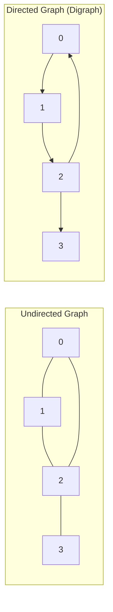
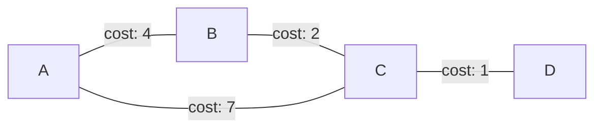
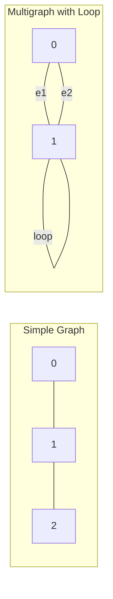
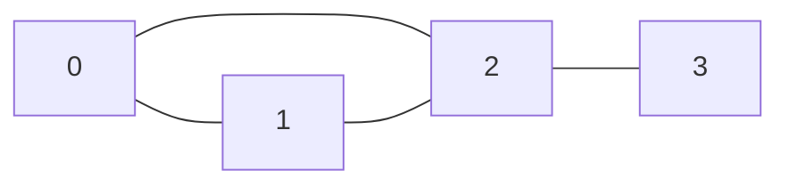
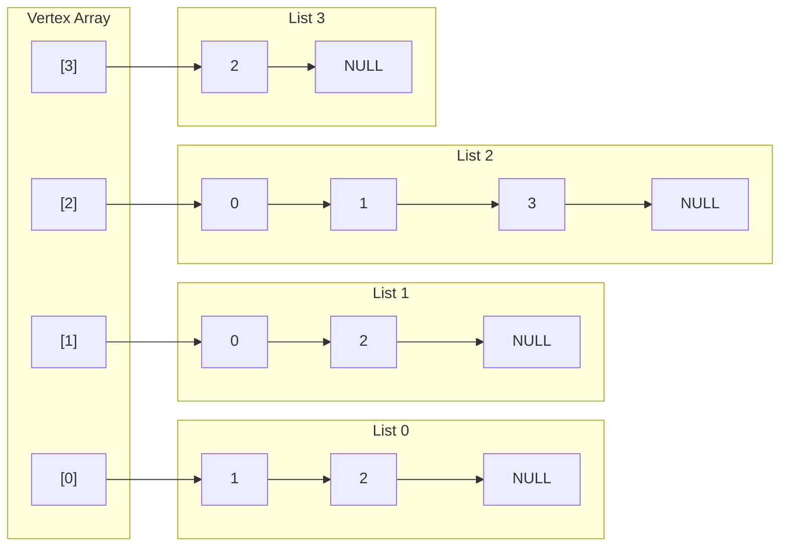

[DSA Index](../README.md) / [Unit 4: Graphs and Hashing](Introduction.md)

# L01: Graph Fundamentals and Representations

Up until this point, every data structure we have explored has imposed a rigid, predetermined shape on our data. Arrays and linked lists force elements into a strictly linear sequence where every item has at most one predecessor and one successor. Trees relax this slightly by allowing multiple children, but they enforce a strict parent-child hierarchy where cycles are forbidden and every node has exactly one parent.

Real-world relationships rarely conform to trees or linear lists. Computer networks, road maps, social networks, electrical circuits, and software build dependencies do not have a root node, nor do they follow a one-way hierarchical flow. Connections are arbitrary, can branch out in multiple directions, and can loop back onto themselves.

To model arbitrary relationships between entities, we need a mathematical and programmatic structure capable of handling unconstrained interconnectedness: the **Graph**.

---

## Formal Definition and Terminology

Mathematically, a graph $G$ is defined as an ordered pair:

$$G = (V, E)$$

Where:
- $V$ is a non-empty set of **vertices** (also called nodes), representing the entities: $V = \{v_0, v_1, v_2, \dots, v_{n-1}\}$.
- $E$ is a set of **edges** (also called arcs or links), representing connections between pairs of vertices: $E \subseteq V \times V$.

Notice the notation: $|V|$ (often denoted simply as $V$) represents the number of vertices, and $|E|$ (often denoted as $E$) represents the number of edges.



### Directed vs. Undirected Graphs

In an **undirected graph**, edges are bidirectional unordered pairs of vertices:

$$e = (u, v) \iff e = (v, u)$$

If an edge connects vertex $u$ and vertex $v$, you can traverse from $u$ to $v$ and from $v$ to $u$ with equal validity. Think of a two-way street or a friendship connection on a social network.

In a **directed graph** (or **digraph**), edges are ordered pairs with an intrinsic orientation:

$$e = \langle u, v \rangle \neq \langle v, u \rangle$$

Here, edge $\langle u, v \rangle$ originates at $u$ (the source or tail) and terminates at $v$ (the destination or head). You can move from $u$ to $v$, but not from $v$ to $u$ unless an explicit reverse edge $\langle v, u \rangle$ exists. Think of a one-way street, a hyperlink between web pages, or a Twitter follow.

### Edge Weights

Edges can either be **unweighted** (where every connection represents an identical binary relationship of existence) or **weighted** (where an edge carries a numerical cost, distance, latency, or capacity):

$$e = (u, v, w), \quad w \in \mathbb{R}$$



Weighted graphs allow us to solve optimization problems, such as finding the shortest driving distance between cities or the highest-bandwidth route across an optical network.

---

## Graph Anatomy and Structural Classifications

Before writing code, we need precise vocabulary to describe the features and constraints of any given graph topology.

### Self-Loops and Parallel Edges

A **self-loop** is an edge that connects a vertex to itself: $e = (u, u)$.

**Parallel edges** (or multiple edges) occur when two or more edges connect the exact same pair of vertices in the same direction.



A graph containing no self-loops and no parallel edges is called a **simple graph**. Unless explicitly stated otherwise, standard graph algorithms assume simple graphs. If parallel edges or loops are permitted, the structure is termed a **multigraph**.

### Vertex Degrees and the Handshaking Lemma

The **degree** of a vertex $v$, denoted as $\deg(v)$, is the total number of edges incident to $v$.

In directed graphs, degree splits into two distinct metrics:
- **In-degree** ($\deg^-(v)$): The number of incoming edges pointing into $v$.
- **Out-degree** ($\deg^+(v)$): The number of outgoing edges leaving $v$.
- Total degree: $\deg(v) = \deg^-(v) + \deg^+(v)$.

A vertex with $\deg(v) = 0$ is termed an **isolated vertex**. A vertex with $\deg(v) = 1$ is termed a **pendant vertex** (or leaf).

Now, notice a fundamental relationship that holds for every undirected graph. Every edge connects exactly two endpoints. If you sum the degrees of every vertex in the graph, each edge is counted twice—once at each of its two ends.

This leads directly to Euler's **Handshaking Lemma**:

$$\sum_{v \in V} \deg(v) = 2|E|$$

An immediate corollary of the Handshaking Lemma: in any undirected graph, the number of vertices with an odd degree must always be even. You can never have an odd number of odd-degree vertices.

For directed graphs, every directed edge leaves one vertex and enters another. Therefore:

$$\sum_{v \in V} \deg^+(v) = \sum_{v \in V} \deg^-(v) = |E|$$

### Paths, Reachability, and Cycles

A **walk** is an alternating sequence of vertices and edges: $v_0, e_1, v_1, e_2, \dots, e_k, v_k$.

A **path** is a walk where all vertices (and consequently all edges) are distinct.

A **cycle** is a closed walk of length at least 3 (in undirected graphs) where the first and last vertices are identical ($v_0 = v_k$), and all intermediate vertices are distinct.

A graph with no cycles is **acyclic**. A directed acyclic graph is universally known by its acronym: **DAG**.

### Dense vs. Sparse Graphs

How many edges can a simple graph with $|V|$ vertices hold?
- In an undirected simple graph, every pair of vertices can have at most one edge:

$$|E|_{\max} = \frac{|V|(|V| - 1)}{2} = \Theta(|V|^2)$$

- In a directed simple graph, each pair can have two directed edges ($\langle u, v \rangle$ and $\langle v, u \rangle$):

$$|E|_{\max} = |V|(|V| - 1) = \Theta(|V|^2)$$

A graph where $|E| \approx |V|^2$ is called **dense**. Most possible connections exist.
A graph where $|E| \approx O(|V|)$ is called **sparse**. Vertices are connected to only a small fraction of the total network.

This distinction between dense and sparse is not just academic trivia. It is the single most critical factor in choosing how to represent a graph in silicon memory.

---

## Silicon Representations: Matrix vs. List

Computers do not store abstract mathematical sets directly. They store bits, arrays, and memory pointers. How do we translate $G = (V, E)$ into concrete data structures?

There are two primary paradigms:
1. **Adjacency Matrix**: A 2D array representing edge existence between all pairs.
2. **Adjacency List**: An array of linked lists (or dynamic arrays) representing the outgoing neighbors of each vertex.

Let's dissect both down to their memory layouts and operational mechanics.

---

## Representation 1: Adjacency Matrix

An **Adjacency Matrix** is a 2D array $A$ of dimensions $|V| \times |V|$:

$$A[u][v] = \begin{cases} 1 & \text{if edge } (u, v) \in E \\ 0 & \text{otherwise} \end{cases}$$

For a weighted graph, instead of storing 1, we store the actual numerical weight $w(u, v)$, and use a special sentinel value (such as $\infty$ or $0$) to denote the absence of an edge.

Let's look at an undirected graph with 4 vertices $\{0, 1, 2, 3\}$:



The corresponding adjacency matrix is:

$$
A = \begin{bmatrix}
0 & 1 & 1 & 0 \\
1 & 0 & 1 & 0 \\
1 & 1 & 0 & 1 \\
0 & 0 & 1 & 0
\end{bmatrix}
$$

Notice something important about this matrix:
1. **Symmetry**: Because the graph is undirected, $(u, v) \in E \iff (v, u) \in E$. Therefore, $A[u][v] = A[v][u]$. The matrix is symmetric along its main diagonal ($A = A^T$).
2. **Main Diagonal**: For simple graphs without self-loops, $A[i][i] = 0$ for all $i$.
3. **Directed Asymmetry**: For a directed graph, $A[u][v] = 1$ indicates an edge leaving $u$ and entering $v$. The row represents outgoing edges, and the column represents incoming edges. The matrix is generally asymmetric.

### Memory Overhead of Adjacency Matrix

The matrix requires storing $|V| \times |V| = |V|^2$ entries. If we store each entry as a standard 4-byte `int`, a graph with 100,000 vertices requires:

$$100{,}000 \times 100{,}000 \times 4 \text{ bytes} = 40{,}000{,}000{,}000 \text{ bytes} \approx 40 \text{ GB}$$

Even if the graph is sparse and only has 200,000 edges, you still allocate 40 GB of RAM. Most of that memory will be filled with zeros.

However, if edge lookup speed is your absolute priority—"Does edge $(u, v)$ exist?"—the matrix gives you an instant $O(1)$ answer: read $A[u][v]$.

### Complete C Implementation: Adjacency Matrix

```c
#include <stdio.h>
#include <stdlib.h>
#include <stdbool.h>

typedef struct {
    int num_vertices;
    bool is_directed;
    int **matrix;
} AdjMatrixGraph;

AdjMatrixGraph *adj_matrix_create(int vertices, bool directed) {
    AdjMatrixGraph *graph = (AdjMatrixGraph *)malloc(sizeof(AdjMatrixGraph));
    if (!graph) return NULL;

    graph->num_vertices = vertices;
    graph->is_directed = directed;

    // Allocate array of row pointers
    graph->matrix = (int **)malloc(vertices * sizeof(int *));
    if (!graph->matrix) {
        free(graph);
        return NULL;
    }

    // Allocate contiguous rows initialized to zero
    for (int i = 0; i < vertices; i++) {
        graph->matrix[i] = (int *)calloc(vertices, sizeof(int));
        if (!graph->matrix[i]) {
            for (int j = 0; j < i; j++) free(graph->matrix[j]);
            free(graph->matrix);
            free(graph);
            return NULL;
        }
    }
    return graph;
}

void adj_matrix_add_edge(AdjMatrixGraph *graph, int u, int v, int weight) {
    if (u < 0 || u >= graph->num_vertices || v < 0 || v >= graph->num_vertices) {
        return;
    }
    graph->matrix[u][v] = weight;
    if (!graph->is_directed) {
        graph->matrix[v][u] = weight;
    }
}

bool adj_matrix_has_edge(AdjMatrixGraph *graph, int u, int v) {
    if (u < 0 || u >= graph->num_vertices || v < 0 || v >= graph->num_vertices) {
        return false;
    }
    return graph->matrix[u][v] != 0;
}

void adj_matrix_print(AdjMatrixGraph *graph) {
    printf("Adjacency Matrix (%d vertices):\n    ", graph->num_vertices);
    for (int j = 0; j < graph->num_vertices; j++) {
        printf("%3d ", j);
    }
    printf("\n");

    for (int i = 0; i < graph->num_vertices; i++) {
        printf("%3d:", i);
        for (int j = 0; j < graph->num_vertices; j++) {
            printf("%3d ", graph->matrix[i][j]);
        }
        printf("\n");
    }
}

void adj_matrix_destroy(AdjMatrixGraph *graph) {
    if (!graph) return;
    for (int i = 0; i < graph->num_vertices; i++) {
        free(graph->matrix[i]);
    }
    free(graph->matrix);
    free(graph);
}
```

---

## Representation 2: Adjacency List

The moment we realize that most real-world graphs are sparse, the adjacency matrix becomes unacceptable. Why allocate memory for non-existent edges?

An **Adjacency List** maintains an array of $|V|$ lists. The $i$-th list contains all vertices adjacent to vertex $i$.

For the same 4-vertex graph:


Notice the memory efficiency:
- In a directed graph, the total number of list nodes across all lists is exactly $|E|$.
- In an undirected graph, every edge $(u, v)$ appears twice (once in list $u$ and once in list $v$), so the total number of list nodes is $2|E|$.

The total memory footprint is:

$$\Theta(|V| + |E|)$$

For our 100,000-vertex graph with 200,000 edges, instead of 40 GB, the adjacency list requires an array of 100,000 pointers plus 400,000 small nodes. That takes under 15 MB of RAM—a 2,700-fold reduction.

### The Trade-off

Nothing comes for free in engineering.

In an adjacency matrix, checking if $(u, v)$ exists takes $O(1)$ time: inspect `matrix[u][v]`.
In an adjacency list, checking if $(u, v)$ exists requires traversing the linked list at `adj[u]`. In the worst case, this takes $O(\deg(u))$ time.

However, iterating over all outgoing neighbors of a vertex $u$ in an adjacency list takes $O(\deg(u))$ time. In an adjacency matrix, you must iterate over all $|V|$ columns in row $u$, which takes $O(|V|)$ time even if vertex $u$ has only one neighbor.

Since graph search algorithms spend most of their time iterating over neighbors, the adjacency list is overwhelmingly faster on sparse graphs.

### Complete C Implementation: Adjacency List

```c
#include <stdio.h>
#include <stdlib.h>
#include <stdbool.h>

// Node representing a destination vertex and optional weight
typedef struct AdjListNode {
    int dest;
    int weight;
    struct AdjListNode *next;
} AdjListNode;

// Head pointer for each vertex's linked list
typedef struct {
    AdjListNode *head;
} AdjList;

// The Graph structure
typedef struct {
    int num_vertices;
    bool is_directed;
    AdjList *array;
} AdjListGraph;

AdjListNode *adj_list_node_create(int dest, int weight) {
    AdjListNode *node = (AdjListNode *)malloc(sizeof(AdjListNode));
    if (!node) return NULL;
    node->dest = dest;
    node->weight = weight;
    node->next = NULL;
    return node;
}

AdjListGraph *adj_list_create(int vertices, bool directed) {
    AdjListGraph *graph = (AdjListGraph *)malloc(sizeof(AdjListGraph));
    if (!graph) return NULL;

    graph->num_vertices = vertices;
    graph->is_directed = directed;
    graph->array = (AdjList *)malloc(vertices * sizeof(AdjList));
    if (!graph->array) {
        free(graph);
        return NULL;
    }

    for (int i = 0; i < vertices; i++) {
        graph->array[i].head = NULL;
    }
    return graph;
}

void adj_list_add_edge(AdjListGraph *graph, int u, int v, int weight) {
    if (u < 0 || u >= graph->num_vertices || v < 0 || v >= graph->num_vertices) {
        return;
    }

    // Add edge u -> v at the head of list u (O(1) insertion)
    AdjListNode *node = adj_list_node_create(v, weight);
    node->next = graph->array[u].head;
    graph->array[u].head = node;

    // If undirected, add edge v -> u at the head of list v
    if (!graph->is_directed) {
        AdjListNode *rev_node = adj_list_node_create(u, weight);
        rev_node->next = graph->array[v].head;
        graph->array[v].head = rev_node;
    }
}

bool adj_list_has_edge(AdjListGraph *graph, int u, int v) {
    if (u < 0 || u >= graph->num_vertices || v < 0 || v >= graph->num_vertices) {
        return false;
    }

    AdjListNode *curr = graph->array[u].head;
    while (curr) {
        if (curr->dest == v) return true;
        curr = curr->next;
    }
    return false;
}

void adj_list_print(AdjListGraph *graph) {
    printf("Adjacency List (%d vertices):\n", graph->num_vertices);
    for (int v = 0; v < graph->num_vertices; v++) {
        printf("  [%d]", v);
        AdjListNode *curr = graph->array[v].head;
        while (curr) {
            printf(" -> (dest: %d, wt: %d)", curr->dest, curr->weight);
            curr = curr->next;
        }
        printf(" -> NULL\n");
    }
}

void adj_list_destroy(AdjListGraph *graph) {
    if (!graph) return;
    for (int i = 0; i < graph->num_vertices; i++) {
        AdjListNode *curr = graph->array[i].head;
        while (curr) {
            AdjListNode *temp = curr;
            curr = curr->next;
            free(temp);
        }
    }
    free(graph->array);
    free(graph);
}
```

---

## Alternative Representations: Edge Lists and Dynamic Arrays

While Adjacency Matrices and Adjacency Lists dominate, two other representations appear in specialized algorithms:

### Edge List
An **Edge List** is an array of all $|E|$ edges, where each entry is a triplet: `(u, v, weight)`.
- Space: $\Theta(|E|)$.
- Iterating through all edges takes $O(|E|)$ sequential memory access.
- Checking if $(u, v)$ exists takes $O(|E|)$ scan.
- Finding neighbors takes $O(|E|)$.

Edge lists are simple and cache-friendly. They are used in Kruskal's Minimum Spanning Tree algorithm, where sorting all edges by weight is the primary operation.

### Adjacency Array (Compressed Sparse Row - CSR)
Instead of linked lists with pointer overhead and cache misses, store all neighbors in a single flat array, accompanied by an offset array indicating where each vertex's neighbors begin and end.
- Space: $\Theta(|V| + |E|)$ contiguous memory with zero pointer overhead.
- Excellent cache locality, heavily favored in high-performance graph processing engines.

---

## Rigorous Complexity Comparison

Let's summarize the computational tradeoffs across all core operations:

| Operation | Adjacency Matrix | Adjacency List | Edge List |
| :--- | :--- | :--- | :--- |
| **Space Complexity** | $\Theta(V^2)$ | $\Theta(V + E)$ | $\Theta(E)$ |
| **Add Edge** | $O(1)$ | $O(1)$ (insert at head) | $O(1)$ (append) |
| **Remove Edge $(u, v)$** | $O(1)$ | $O(\deg(u))$ | $O(E)$ |
| **Check Edge $(u, v)$** | $O(1)$ | $O(\deg(u))$ | $O(E)$ |
| **Iterate Neighbors of $u$** | $\Theta(V)$ | $\Theta(\deg(u))$ | $\Theta(E)$ |
| **Iterate All Edges** | $\Theta(V^2)$ | $\Theta(V + E)$ | $\Theta(E)$ |
| **Add Vertex** | $O(V^2)$ (realloc 2D) | $O(1)$ (amortized) | $O(1)$ |
| **Memory Cache Locality** | Good for row scans | Poor (pointer chasing) | Excellent (flat array) |

---

## Key Takeaways

- A graph $G = (V, E)$ models arbitrary non-hierarchical relationships between entities.
- Undirected graphs satisfy the Handshaking Lemma: $\sum \deg(v) = 2|E|$, proving that the number of vertices with odd degrees is always even.
- Dense graphs ($|E| \approx |V|^2$) favor an Adjacency Matrix because edge lookup is $O(1)$ and space is already $\Theta(V^2)$.
- Sparse graphs ($|E| \ll |V|^2$) favor an Adjacency List, reducing memory from $\Theta(V^2)$ to $\Theta(V + E)$ and speeding up neighbor iteration from $\Theta(V)$ to $\Theta(\deg(u))$.
- Linked-list adjacency structures trade cache locality for cheap dynamic insertions; Compressed Sparse Row (CSR) eliminates this overhead in high-throughput engines.

Now that we have established how graphs are structured mathematically and stored in memory, the next question is how to explore them systematically. When we stand at a starting vertex, how do we visit every reachable node in expanding ripples of shortest distance? To answer this, let's turn to [L02 - Breadth-First Search](L02%20-%20Breadth-First%20Search.md).
